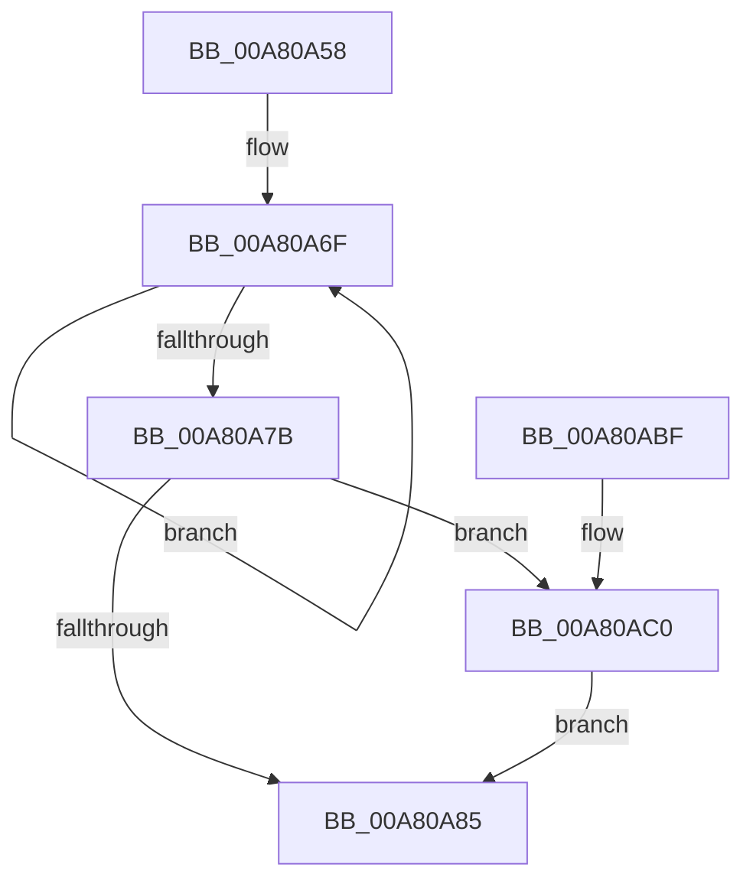

# PopDirectedDripsSendSessionData

- RVA: `0x00A80A58`–`0x00A80AC5` (길이 `109` bytes)
- VA: `0x0000000140A80A58`
- 실행 섹션: `PAGE`
- PDB 이름 있음: `예`; PDB Function 태그: `아니요`
- unwind 정보 RVA: `0x0009FDFC`
- 디코드: `31`개 명령, `109/109` bytes 표시
- 미해석 바이트: `0` (있으면 어셈블리에 `.byte`로 보존)

> 이 문서는 커널 이미지의 기계어와 PDB 기호를 분석해 생성했습니다. 4번과 5번은 함수 원형과 자료형을 바이너리 사용 방식에서 추정한 C 해석이며 원본 소스 복구 결과는 아닙니다.

## 1. Dependencies

- 직접 호출 지점: **1**; 고유 호출 대상: **1**
- 직접 호출자로 확인된 함수: **1**
- RIP 상대 이미지 참조: **2**

### Outgoing calls
- `0x00A80AB5` → [PopDirectedDripsDiagNotifySessionStop](PopDirectedDripsDiagNotifySessionStop_function_00A80ACC.md) (function, `0x00A80ACC`)

### Direct callers
- [PopDirectedDripsNotify](PopDirectedDripsNotify_function_00A80850.md) at `0x00A809C8`

### Static image references
- `0x00A80A5C` → RVA `0x00F0EAF0` (`.data`; read)
- `0x00A80A62` → RVA `0x00F0EAC0` (`.data`; read)

## 2. Other-region calls and transfers

- 다른 실행 섹션으로 향하는 call: **0**
- 별도 외부 분기/꼬리 이동을 확인하지 못했습니다.

## 3. Assembly (complete function range)

```asm
00A80A58  48 83 EC 28                     sub rsp, 0x28
00A80A5C  8B 15 8E E0 48 00               mov edx, dword ptr [rip + 0x48e08e]
00A80A62  0F 0D 0D 57 E0 48 00            prefetchw byte ptr [rip + 0x48e057]
00A80A69  8B 05 51 E0 48 00               mov eax, dword ptr [rip + 0x48e051]
00A80A6F  8B C8                           mov ecx, eax
00A80A71  F0 0F B1 0D 47 E0 48 00         lock cmpxchg dword ptr [rip + 0x48e047], ecx
00A80A79  75 F4                           jne 0x140a80a6f
00A80A7B  8B CA                           mov ecx, edx
00A80A7D  83 E1 01                        and ecx, 1
00A80A80  F6 C2 02                        test dl, 2
00A80A83  75 3B                           jne 0x140a80ac0
00A80A85  8B D0                           mov edx, eax
00A80A87  44 8B C8                        mov r9d, eax
00A80A8A  C1 EA 0A                        shr edx, 0xa
00A80A8D  83 E2 01                        and edx, 1
00A80A90  41 C1 E9 0C                     shr r9d, 0xc
00A80A94  44 8B C2                        mov r8d, edx
00A80A97  41 83 E1 01                     and r9d, 1
00A80A9B  41 83 C8 02                     or r8d, 2
00A80A9F  0F BA E0 0B                     bt eax, 0xb
00A80AA3  44 0F 43 C2                     cmovae r8d, edx
00A80AA7  41 8B D1                        mov edx, r9d
00A80AAA  83 CA 02                        or edx, 2
00A80AAD  0F BA E0 0D                     bt eax, 0xd
00A80AB1  41 0F 43 D1                     cmovae edx, r9d
00A80AB5  E8 12 00 00 00                  call 0x140a80acc
00A80ABA  48 83 C4 28                     add rsp, 0x28
00A80ABE  C3                              ret
00A80ABF  CC                              int3
00A80AC0  83 C9 02                        or ecx, 2
00A80AC3  EB C0                           jmp 0x140a80a85
```

## 4. C-style interpretation (structured pseudocode)

```c
__int64 __fastcall PopDirectedDripsSendSessionData(void)
{
    __int64 result;
    __int64 v_rsp;

    v_rsp = (v_rsp) - (40);
loc_00A80A6F:
    if (condition_is_not_equal) goto loc_00A80A6F;
    a1 = (unsigned int)(((unsigned int)((unsigned int)((unsigned int)(*(unsigned int *)(v_rip + 4776078))))) & (1));
    if ((((unsigned __int8)((unsigned int)(*(unsigned int *)(v_rip + 4776078)))) & (2)) != 0) goto loc_00A80AC0;
loc_00A80A85:
    a2 = (unsigned int)(((unsigned int)((unsigned int)((unsigned int)(*(unsigned int *)(v_rip + 4776017))))) >> (10));
    a2 = (unsigned int)((a2) & (1));
    a4 = (unsigned int)(((unsigned int)((unsigned int)((unsigned int)(*(unsigned int *)(v_rip + 4776017))))) >> (12));
    a4 = (unsigned int)((a4) & (1));
    a3 = (unsigned int)(((unsigned int)((unsigned int)(a2))) | (2));
    if (condition_is_above_or_equal) { a3 = (unsigned int)(a2); }
    a2 = (unsigned int)(((unsigned int)((unsigned int)(a4))) | (2));
    if (condition_is_above_or_equal) { a2 = (unsigned int)(a4); }
    result = PopDirectedDripsDiagNotifySessionStop(a1, a2, a3, a4);
    v_rsp = (v_rsp) + (40);
    return result;
loc_00A80AC0:
    a1 = (unsigned int)((a1) | (2));
    goto loc_00A80A85;
}
```

## 5. (Beta) C Style

```c
void PopDirectedDripsSendSessionData(void)
{
    int64_t result;
    int64_t local_rsp;

    local_rsp = (local_rsp) - (40);
loc_00A80A6F:
    if (condition_is_not_equal) goto loc_00A80A6F;
    a1 = (uint32_t)(((uint32_t)((uint32_t)((uint32_t)(*(uint32_t *)(v_rip + 0x48E08E))))) & (1));
    if ((((uint8_t)((uint32_t)(*(uint32_t *)(v_rip + 0x48E08E)))) & (2)) != 0) goto loc_00A80AC0;
loc_00A80A85:
    a2 = (uint32_t)(((uint32_t)((uint32_t)((uint32_t)(*(uint32_t *)(v_rip + 0x48E051))))) >> (10));
    a2 = (uint32_t)((a2) & (1));
    a4 = (uint32_t)(((uint32_t)((uint32_t)((uint32_t)(*(uint32_t *)(v_rip + 0x48E051))))) >> (12));
    a4 = (uint32_t)((a4) & (1));
    a3 = (uint32_t)(((uint32_t)((uint32_t)(a2))) | (2));
    if (condition_is_above_or_equal) { a3 = (uint32_t)(a2); }
    a2 = (uint32_t)(((uint32_t)((uint32_t)(a4))) | (2));
    if (condition_is_above_or_equal) { a2 = (uint32_t)(a4); }
    result = PopDirectedDripsDiagNotifySessionStop(a1, a2, a3, a4);
    local_rsp = (local_rsp) + (40);
    return result;
loc_00A80AC0:
    a1 = (uint32_t)((a1) | (2));
    goto loc_00A80A85;
}
```

## 6. Execution-region graph

[열기: 2D/3D 그래프와 함수 탐색 컨트롤 패널](../../../control-panel.html?section=page&rva=0x00A80A58&view=graph)

- 2D 그래프는 위에서 아래로 흐르고, 3D 그래프는 빈 공간을 드래그해 회전합니다. Shift+드래그는 이동, 휠은 확대·축소, 함수 노드 선택은 대상 보고서 이동입니다.

### Static fallback


