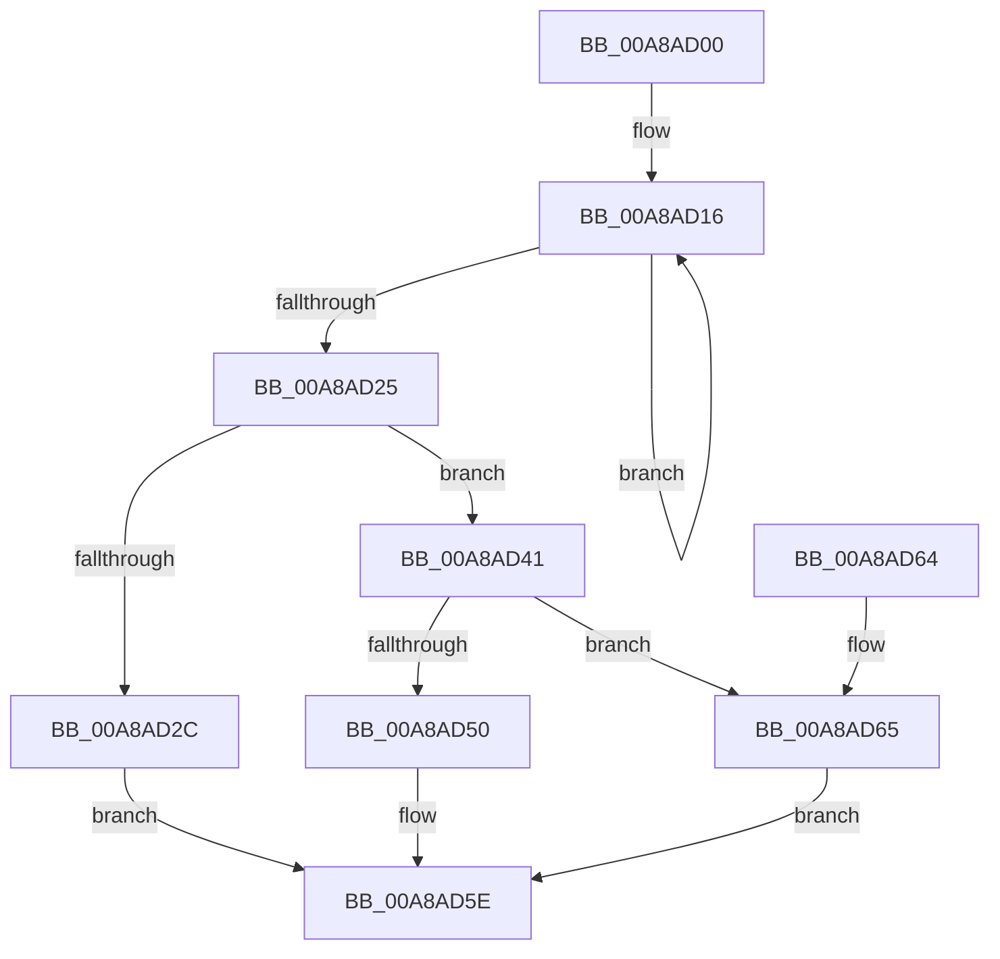

# PopFxUnregisterDeviceOrWait

- RVA: `0x00A8AD00`–`0x00A8AD6F` (길이 `111` bytes)
- VA: `0x0000000140A8AD00`
- 실행 섹션: `PAGE`
- PDB 이름 있음: `예`; PDB Function 태그: `아니요`
- unwind 정보 RVA: `0x00085AEC`
- 디코드: `33`개 명령, `111/111` bytes 표시
- 미해석 바이트: `0` (있으면 어셈블리에 `.byte`로 보존)

> 이 문서는 커널 이미지의 기계어와 PDB 기호를 분석해 생성했습니다. 4번과 5번은 함수 원형과 자료형을 바이너리 사용 방식에서 추정한 C 해석이며 원본 소스 복구 결과는 아닙니다.

## 1. Dependencies

- 직접 호출 지점: **4**; 고유 호출 대상: **4**
- 직접 호출자로 확인된 함수: **2**
- RIP 상대 이미지 참조: **0**

### Outgoing calls
- `0x00A8AD3A` → [KeWaitForSingleObject](../../text/20/KeWaitForSingleObject_function_0020E6B0.md) (function, `0x0020E6B0`)
- `0x00A8AD46` → [PopFxLockDevice](../../text/26/PopFxLockDevice_function_0026F950.md) (function, `0x0026F950`)
- `0x00A8AD59` → [KeSetEvent](../../text/33/KeSetEvent_function_0033F310.md) (function, `0x0033F310`)
- `0x00A8AD68` → [PopFxUnregisterDevice](PopFxUnregisterDevice_function_00A8AE84.md) (function, `0x00A8AE84`)

### Direct callers
- [PoFxUnregisterDevice](PoFxUnregisterDevice_function_00A8AB20.md) at `0x00A8AB39`
- [PoFxAbandonDevice](PoFxAbandonDevice_function_00A8AB64.md) at `0x00A8AB96`

### Static image references
- 디코드된 RIP-relative 메모리 참조가 없습니다.

## 2. Other-region calls and transfers

- 다른 실행 섹션으로 향하는 call: **3**
  - `0x00A8AD3A` → [KeWaitForSingleObject](../../text/20/KeWaitForSingleObject_function_0020E6B0.md) (`PAGE` → `.text`)
  - `0x00A8AD46` → [PopFxLockDevice](../../text/26/PopFxLockDevice_function_0026F950.md) (`PAGE` → `.text`)
  - `0x00A8AD59` → [KeSetEvent](../../text/33/KeSetEvent_function_0033F310.md) (`PAGE` → `.text`)
- 별도 외부 분기/꼬리 이동을 확인하지 못했습니다.

## 3. Assembly (complete function range)

```asm
00A8AD00  40 53                           push rbx
00A8AD02  48 83 EC 30                     sub rsp, 0x30
00A8AD06  48 8B D9                        mov rbx, rcx
00A8AD09  0F 0D 89 28 01 00 00            prefetchw byte ptr [rcx + 0x128]
00A8AD10  8B 81 28 01 00 00               mov eax, dword ptr [rcx + 0x128]
00A8AD16  8B D0                           mov edx, eax
00A8AD18  83 CA 08                        or edx, 8
00A8AD1B  F0 0F B1 91 28 01 00 00         lock cmpxchg dword ptr [rcx + 0x128], edx
00A8AD23  75 F1                           jne 0x140a8ad16
00A8AD25  45 33 C0                        xor r8d, r8d
00A8AD28  A8 08                           test al, 8
00A8AD2A  74 15                           je 0x140a8ad41
00A8AD2C  4C 21 44 24 20                  and qword ptr [rsp + 0x20], r8
00A8AD31  48 83 C1 60                     add rcx, 0x60
00A8AD35  45 33 C9                        xor r9d, r9d
00A8AD38  33 D2                           xor edx, edx
00A8AD3A  E8 71 39 78 FF                  call 0x14020e6b0
00A8AD3F  EB 1D                           jmp 0x140a8ad5e
00A8AD41  BA 09 00 00 00                  mov edx, 9
00A8AD46  E8 05 4C 7E FF                  call 0x14026f950
00A8AD4B  48 85 C0                        test rax, rax
00A8AD4E  75 15                           jne 0x140a8ad65
00A8AD50  48 8D 4B 60                     lea rcx, [rbx + 0x60]
00A8AD54  45 33 C0                        xor r8d, r8d
00A8AD57  33 D2                           xor edx, edx
00A8AD59  E8 B2 45 8B FF                  call 0x14033f310
00A8AD5E  48 83 C4 30                     add rsp, 0x30
00A8AD62  5B                              pop rbx
00A8AD63  C3                              ret
00A8AD64  CC                              int3
00A8AD65  48 8B C8                        mov rcx, rax
00A8AD68  E8 17 01 00 00                  call 0x140a8ae84
00A8AD6D  EB EF                           jmp 0x140a8ad5e
```

## 4. C-style interpretation (structured pseudocode)

```c
__int64 __fastcall PopFxUnregisterDeviceOrWait(__int64 a1, __int64 a2, int a3, int a4)
{
    __int64 result;
    __int64 v_rsp;
    unsigned __int64 v_stack_m18;

    v_rsp = (v_rsp) - (48);
loc_00A8AD16:
    a2 = (unsigned int)(((unsigned int)((unsigned int)((unsigned int)(*(unsigned int *)(a1 + 296))))) | (8));
    if (condition_is_not_equal) goto loc_00A8AD16;
    a3 = 0;
    if ((((unsigned __int8)((unsigned int)(*(unsigned int *)(a1 + 296)))) & (8)) == 0) goto loc_00A8AD41;
    a1 = (a1) + (96);
    a4 = 0;
    a2 = 0;
    result = KeWaitForSingleObject(a1, a2, a3, a4);
    goto loc_00A8AD5E;
loc_00A8AD41:
    result = PopFxLockDevice(a1, 9, a3, a4);
    if (result != 0) goto loc_00A8AD65;
    a3 = 0;
    a2 = 0;
    result = KeSetEvent(a1 + 96, a2, a3, a4);
loc_00A8AD5E:
    v_rsp = (v_rsp) + (48);
    return result;
loc_00A8AD65:
    result = PopFxUnregisterDevice(result, a2, a3, a4);
    goto loc_00A8AD5E;
}
```

## 5. (Beta) C Style

```c
int64_t PopFxUnregisterDeviceOrWait(void *Arg1, int64_t Arg2, int32_t Arg3, int32_t Arg4)
{
    uint8_t *arg1 = (uint8_t *)Arg1;

    int64_t result;
    int64_t local_rsp;
    uint64_t v_stack_m18;

    local_rsp = (local_rsp) - (48);
loc_00A8AD16:
    Arg2 = (uint32_t)(((uint32_t)((uint32_t)((uint32_t)(*(uint32_t *)(arg1 + 0x128))))) | (8));
    if (condition_is_not_equal) goto loc_00A8AD16;
    Arg3 = 0;
    if ((((uint8_t)((uint32_t)(*(uint32_t *)(arg1 + 0x128)))) & (8)) == 0) goto loc_00A8AD41;
    Arg1 = (Arg1) + (96);
    Arg4 = 0;
    Arg2 = 0;
    result = KeWaitForSingleObject(Arg1, Arg2, Arg3, Arg4);
    goto loc_00A8AD5E;
loc_00A8AD41:
    result = PopFxLockDevice(Arg1, 9, Arg3, Arg4);
    if (result != 0) goto loc_00A8AD65;
    Arg3 = 0;
    Arg2 = 0;
    result = KeSetEvent(Arg1 + 96, Arg2, Arg3, Arg4);
loc_00A8AD5E:
    local_rsp = (local_rsp) + (48);
    return result;
loc_00A8AD65:
    result = PopFxUnregisterDevice(result, Arg2, Arg3, Arg4);
    goto loc_00A8AD5E;
}
```

### 관측된 메모리 오프셋

구조체 형식이 확인되지 않은 접근은 인자 기준의 오프셋으로만 기록했습니다.

| 기준 인자 | 오프셋 표현 | 폭 (bit) | 접근 |
|---|---:|---:|---|
| `Arg1` | `+ 0x60` | `64` | `R` |
| `Arg1` | `+ 0x128` | `8` | `R` |
| `Arg1` | `+ 0x128` | `32` | `R` |

## 6. Execution-region graph

[열기: 2D/3D 그래프와 함수 탐색 컨트롤 패널](../../../control-panel.html?section=page&rva=0x00A8AD00&view=graph)

- 2D 그래프는 위에서 아래로 흐르고, 3D 그래프는 빈 공간을 드래그해 회전합니다. Shift+드래그는 이동, 휠은 확대·축소, 함수 노드 선택은 대상 보고서 이동입니다.

### Static fallback


