# PopFxUnregisterDevice

- RVA: `0x00A8AE84`–`0x00A8B03F` (길이 `443` bytes)
- VA: `0x0000000140A8AE84`
- 실행 섹션: `PAGE`
- PDB 이름 있음: `예`; PDB Function 태그: `아니요`
- unwind 정보 RVA: `0x00066400`
- 디코드: `123`개 명령, `443/443` bytes 표시
- 미해석 바이트: `0` (있으면 어셈블리에 `.byte`로 보존)

> 이 문서는 커널 이미지의 기계어와 PDB 기호를 분석해 생성했습니다. 4번과 5번은 함수 원형과 자료형을 바이너리 사용 방식에서 추정한 C 해석이며 원본 소스 복구 결과는 아닙니다.

## 1. Dependencies

- 직접 호출 지점: **14**; 고유 호출 대상: **14**
- 직접 호출자로 확인된 함수: **2**
- RIP 상대 이미지 참조: **1**

### Outgoing calls
- `0x00A8AEBE` → [PoFxActivateComponent](../../text/2D/PoFxActivateComponent_function_002D9D30.md) (function, `0x002D9D30`)
- `0x00A8AEF3` → [KeWaitForSingleObject](../../text/20/KeWaitForSingleObject_function_0020E6B0.md) (function, `0x0020E6B0`)
- `0x00A8AF0E` → [PopFxRemoveDevice](../../text/5D/PopFxRemoveDevice_function_005D3534.md) (function, `0x005D3534`)
- `0x00A8AF19` → [PopDiagTraceFxDeviceUnregistration](../76/PopDiagTraceFxDeviceUnregistration_function_007616AC.md) (function, `0x007616AC`)
- `0x00A8AF23` → [PopFxAssignDeviceToDevNode](../../text/4C/PopFxAssignDeviceToDevNode_function_004C3CAC.md) (function, `0x004C3CAC`)
- `0x00A8AF8B` → [PopSystemIrpCompletion](../../pagelk/B7/PopSystemIrpCompletion_function_00B70CC0.md) (function, `0x00B70CC0`)
- `0x00A8AF9D` → [IoReleaseRemoveLockAndWaitEx](../../text/4B/IoReleaseRemoveLockAndWaitEx_function_004B17B0.md) (function, `0x004B17B0`)
- `0x00A8AFB3` → [PopFxDeviceRelationsCleanup](../../text/5D/PopFxDeviceRelationsCleanup_function_005D2660.md) (function, `0x005D2660`)
- `0x00A8AFCF` → [PopFxComponentRelationsCleanup](../../text/5D/PopFxComponentRelationsCleanup_function_005D221C.md) (function, `0x005D221C`)
- `0x00A8AFE2` → [PopPepUnregisterDevice](PopPepUnregisterDevice_function_00A8B048.md) (function, `0x00A8B048`)
- `0x00A8AFF4` → [PopPluginUnregisterDevice](../../text/5D/PopPluginUnregisterDevice_function_005D3D40.md) (function, `0x005D3D40`)
- `0x00A8AFFC` → [PopPlUnregisterDevice](../../text/4E/PopPlUnregisterDevice_function_004E3FF4.md) (function, `0x004E3FF4`)
- `0x00A8B00F` → [KeSetEvent](../../text/33/KeSetEvent_function_0033F310.md) (function, `0x0033F310`)
- `0x00A8B024` → [PopFxDestroyDeviceDpm](../../text/4E/PopFxDestroyDeviceDpm_function_004E394C.md) (function, `0x004E394C`)

### Direct callers
- [PoFxUnregisterDevice](PoFxUnregisterDevice_function_00A8AB20.md) at `0x00A8AB40`
- [PopFxUnregisterDeviceOrWait](PopFxUnregisterDeviceOrWait_function_00A8AD00.md) at `0x00A8AD68`

### Static image references
- `0x00A8AF46` → RVA `0x00F0E430` (`.data`; read/write)

## 2. Other-region calls and transfers

- 다른 실행 섹션으로 향하는 call: **12**
  - `0x00A8AEBE` → [PoFxActivateComponent](../../text/2D/PoFxActivateComponent_function_002D9D30.md) (`PAGE` → `.text`)
  - `0x00A8AEF3` → [KeWaitForSingleObject](../../text/20/KeWaitForSingleObject_function_0020E6B0.md) (`PAGE` → `.text`)
  - `0x00A8AF0E` → [PopFxRemoveDevice](../../text/5D/PopFxRemoveDevice_function_005D3534.md) (`PAGE` → `.text`)
  - `0x00A8AF23` → [PopFxAssignDeviceToDevNode](../../text/4C/PopFxAssignDeviceToDevNode_function_004C3CAC.md) (`PAGE` → `.text`)
  - `0x00A8AF8B` → [PopSystemIrpCompletion](../../pagelk/B7/PopSystemIrpCompletion_function_00B70CC0.md) (`PAGE` → `PAGELK`)
  - `0x00A8AF9D` → [IoReleaseRemoveLockAndWaitEx](../../text/4B/IoReleaseRemoveLockAndWaitEx_function_004B17B0.md) (`PAGE` → `.text`)
  - `0x00A8AFB3` → [PopFxDeviceRelationsCleanup](../../text/5D/PopFxDeviceRelationsCleanup_function_005D2660.md) (`PAGE` → `.text`)
  - `0x00A8AFCF` → [PopFxComponentRelationsCleanup](../../text/5D/PopFxComponentRelationsCleanup_function_005D221C.md) (`PAGE` → `.text`)
  - `0x00A8AFF4` → [PopPluginUnregisterDevice](../../text/5D/PopPluginUnregisterDevice_function_005D3D40.md) (`PAGE` → `.text`)
  - `0x00A8AFFC` → [PopPlUnregisterDevice](../../text/4E/PopPlUnregisterDevice_function_004E3FF4.md) (`PAGE` → `.text`)
  - `0x00A8B00F` → [KeSetEvent](../../text/33/KeSetEvent_function_0033F310.md) (`PAGE` → `.text`)
  - `0x00A8B024` → [PopFxDestroyDeviceDpm](../../text/4E/PopFxDestroyDeviceDpm_function_004E394C.md) (`PAGE` → `.text`)
- 별도 외부 분기/꼬리 이동을 확인하지 못했습니다.

## 3. Assembly (complete function range)

```asm
00A8AE84  48 89 5C 24 08                  mov qword ptr [rsp + 8], rbx
00A8AE89  48 89 6C 24 10                  mov qword ptr [rsp + 0x10], rbp
00A8AE8E  48 89 74 24 18                  mov qword ptr [rsp + 0x18], rsi
00A8AE93  57                              push rdi
00A8AE94  48 83 EC 30                     sub rsp, 0x30
00A8AE98  8B 81 60 03 00 00               mov eax, dword ptr [rcx + 0x360]
00A8AE9E  33 ED                           xor ebp, ebp
00A8AEA0  48 8B D9                        mov rbx, rcx
00A8AEA3  A8 01                           test al, 1
00A8AEA5  75 5B                           jne 0x140a8af02
00A8AEA7  8B 81 64 03 00 00               mov eax, dword ptr [rcx + 0x364]
00A8AEAD  8B FD                           mov edi, ebp
00A8AEAF  85 C0                           test eax, eax
00A8AEB1  74 1C                           je 0x140a8aecf
00A8AEB3  41 B8 02 00 00 00               mov r8d, 2
00A8AEB9  8B D7                           mov edx, edi
00A8AEBB  48 8B CB                        mov rcx, rbx
00A8AEBE  E8 6D EE 84 FF                  call 0x1402d9d30
00A8AEC3  8B 83 64 03 00 00               mov eax, dword ptr [rbx + 0x364]
00A8AEC9  FF C7                           inc edi
00A8AECB  3B F8                           cmp edi, eax
00A8AECD  72 E4                           jb 0x140a8aeb3
00A8AECF  8B FD                           mov edi, ebp
00A8AED1  85 C0                           test eax, eax
00A8AED3  74 2D                           je 0x140a8af02
00A8AED5  48 8B 83 68 03 00 00            mov rax, qword ptr [rbx + 0x368]
00A8AEDC  45 33 C9                        xor r9d, r9d
00A8AEDF  8B CF                           mov ecx, edi
00A8AEE1  45 33 C0                        xor r8d, r8d
00A8AEE4  33 D2                           xor edx, edx
00A8AEE6  48 89 6C 24 20                  mov qword ptr [rsp + 0x20], rbp
00A8AEEB  48 8B 0C C8                     mov rcx, qword ptr [rax + rcx*8]
00A8AEEF  48 83 C1 68                     add rcx, 0x68
00A8AEF3  E8 B8 37 78 FF                  call 0x14020e6b0
00A8AEF8  FF C7                           inc edi
00A8AEFA  3B BB 64 03 00 00               cmp edi, dword ptr [rbx + 0x364]
00A8AF00  72 D3                           jb 0x140a8aed5
00A8AF02  48 8B 7B 30                     mov rdi, qword ptr [rbx + 0x30]
00A8AF06  48 85 FF                        test rdi, rdi
00A8AF09  74 1D                           je 0x140a8af28
00A8AF0B  48 8B D3                        mov rdx, rbx
00A8AF0E  E8 21 86 B4 FF                  call 0x1405d3534
00A8AF13  48 8B D3                        mov rdx, rbx
00A8AF16  48 8B CF                        mov rcx, rdi
00A8AF19  E8 8E 67 CD FF                  call 0x1407616ac
00A8AF1E  33 D2                           xor edx, edx
00A8AF20  48 8B CF                        mov rcx, rdi
00A8AF23  E8 84 8D A3 FF                  call 0x1404c3cac
00A8AF28  8B D5                           mov edx, ebp
00A8AF2A  39 AB 64 03 00 00               cmp dword ptr [rbx + 0x364], ebp
00A8AF30  76 25                           jbe 0x140a8af57
00A8AF32  48 8B 83 68 03 00 00            mov rax, qword ptr [rbx + 0x368]
00A8AF39  8B CA                           mov ecx, edx
00A8AF3B  48 8B 04 C8                     mov rax, qword ptr [rax + rcx*8]
00A8AF3F  8B 40 60                        mov eax, dword ptr [rax + 0x60]
00A8AF42  85 C0                           test eax, eax
00A8AF44  7E 07                           jle 0x140a8af4d
00A8AF46  F0 FF 0D E3 34 48 00            lock dec dword ptr [rip + 0x4834e3]
00A8AF4D  FF C2                           inc edx
00A8AF4F  3B 93 64 03 00 00               cmp edx, dword ptr [rbx + 0x364]
00A8AF55  72 DB                           jb 0x140a8af32
00A8AF57  0F 0D 4B 20                     prefetchw byte ptr [rbx + 0x20]
00A8AF5B  8B 43 20                        mov eax, dword ptr [rbx + 0x20]
00A8AF5E  8B C8                           mov ecx, eax
00A8AF60  0F BA F1 0A                     btr ecx, 0xa
00A8AF64  F0 0F B1 4B 20                  lock cmpxchg dword ptr [rbx + 0x20], ecx
00A8AF69  75 F3                           jne 0x140a8af5e
00A8AF6B  0F BA E0 0A                     bt eax, 0xa
00A8AF6F  73 1F                           jae 0x140a8af90
00A8AF71  48 8B 97 18 01 00 00            mov rdx, qword ptr [rdi + 0x118]
00A8AF78  33 C9                           xor ecx, ecx
00A8AF7A  48 0F BE 42 42                  movsx rax, byte ptr [rdx + 0x42]
00A8AF7F  4C 8D 04 C0                     lea r8, [rax + rax*8]
00A8AF83  4E 8B 84 C2 C8 00 00 00         mov r8, qword ptr [rdx + r8*8 + 0xc8]
00A8AF8B  E8 30 5D 0E 00                  call 0x140b70cc0
00A8AF90  33 D2                           xor edx, edx
00A8AF92  48 8D 8B F0 00 00 00            lea rcx, [rbx + 0xf0]
00A8AF99  44 8D 42 20                     lea r8d, [rdx + 0x20]
00A8AF9D  E8 0E 68 A2 FF                  call 0x1404b17b0
00A8AFA2  33 C0                           xor eax, eax
00A8AFA4  F0 0F B1 AB 60 03 00 00         lock cmpxchg dword ptr [rbx + 0x360], ebp
00A8AFAC  A8 01                           test al, 1
00A8AFAE  75 2E                           jne 0x140a8afde
00A8AFB0  48 8B CB                        mov rcx, rbx
00A8AFB3  E8 A8 76 B4 FF                  call 0x1405d2660
00A8AFB8  8B F5                           mov esi, ebp
00A8AFBA  39 AB 64 03 00 00               cmp dword ptr [rbx + 0x364], ebp
00A8AFC0  76 1C                           jbe 0x140a8afde
00A8AFC2  48 8B 8B 68 03 00 00            mov rcx, qword ptr [rbx + 0x368]
00A8AFC9  8B C6                           mov eax, esi
00A8AFCB  48 8B 0C C1                     mov rcx, qword ptr [rcx + rax*8]
00A8AFCF  E8 48 72 B4 FF                  call 0x1405d221c
00A8AFD4  FF C6                           inc esi
00A8AFD6  3B B3 64 03 00 00               cmp esi, dword ptr [rbx + 0x364]
00A8AFDC  72 E4                           jb 0x140a8afc2
00A8AFDE  48 8B 4B 38                     mov rcx, qword ptr [rbx + 0x38]
00A8AFE2  E8 61 00 00 00                  call 0x140a8b048
00A8AFE7  48 8B 4B 40                     mov rcx, qword ptr [rbx + 0x40]
00A8AFEB  48 85 C9                        test rcx, rcx
00A8AFEE  74 09                           je 0x140a8aff9
00A8AFF0  48 8B 53 48                     mov rdx, qword ptr [rbx + 0x48]
00A8AFF4  E8 47 8D B4 FF                  call 0x1405d3d40
00A8AFF9  48 8B CB                        mov rcx, rbx
00A8AFFC  E8 F3 8F A5 FF                  call 0x1404e3ff4
00A8B001  48 85 FF                        test rdi, rdi
00A8B004  74 0E                           je 0x140a8b014
00A8B006  48 8D 4F 60                     lea rcx, [rdi + 0x60]
00A8B00A  45 33 C0                        xor r8d, r8d
00A8B00D  33 D2                           xor edx, edx
00A8B00F  E8 FC 42 8B FF                  call 0x14033f310
00A8B014  8B 83 60 03 00 00               mov eax, dword ptr [rbx + 0x360]
00A8B01A  A8 01                           test al, 1
00A8B01C  74 0B                           je 0x140a8b029
00A8B01E  48 8B D3                        mov rdx, rbx
00A8B021  48 8B CF                        mov rcx, rdi
00A8B024  E8 23 89 A5 FF                  call 0x1404e394c
00A8B029  48 8B 5C 24 40                  mov rbx, qword ptr [rsp + 0x40]
00A8B02E  48 8B 6C 24 48                  mov rbp, qword ptr [rsp + 0x48]
00A8B033  48 8B 74 24 50                  mov rsi, qword ptr [rsp + 0x50]
00A8B038  48 83 C4 30                     add rsp, 0x30
00A8B03C  5F                              pop rdi
00A8B03D  C3                              ret
00A8B03E  CC                              int3
```

## 4. C-style interpretation (structured pseudocode)

```c
__int64 __fastcall PopFxUnregisterDevice(__int64 a1, __int64 a2, __int64 a3, int a4)
{
    __int64 result;
    __int64 v_rbp;
    __int64 v_rdi;
    __int64 v_rsi;
    __int64 v_rsp;
    unsigned __int64 v_stack_m18;
    unsigned __int64 v_stack_p10;
    unsigned __int64 v_stack_p18;
    unsigned __int64 v_stack_p8;

    v_stack_p8 = v_rbx;
    v_stack_p10 = v_rbp;
    v_stack_p18 = v_rsi;
    v_rsp = (v_rsp) - (48);
    v_rbp = 0;
    if ((((unsigned __int8)((unsigned int)(*(unsigned int *)(a1 + 864)))) & (1)) != 0) goto loc_00A8AF02;
    if ((unsigned int)((unsigned int)(*(unsigned int *)(a1 + 868))) == 0) goto loc_00A8AECF;
loc_00A8AEB3:
    result = PoFxActivateComponent(a1, 0, 2, a4);
    v_rdi = (unsigned int)((0) + 1);
    if (((unsigned int)(v_rdi)) < ((unsigned int)((unsigned int)(*(unsigned int *)(a1 + 868))))) goto loc_00A8AEB3;
loc_00A8AECF:
    if ((unsigned int)((unsigned int)(*(unsigned int *)(a1 + 868))) == 0) goto loc_00A8AF02;
loc_00A8AED5:
    a4 = 0;
    a3 = 0;
    a2 = 0;
    v_stack_m18 = 0;
    a1 = (*(unsigned __int64 *)(*(unsigned __int64 *)(a1 + 872) + 0 * 8)) + (104);
    result = KeWaitForSingleObject(a1, a2, a3, a4);
    v_rdi = (unsigned int)((0) + 1);
    if (((unsigned int)(v_rdi)) < (*(unsigned int *)(a1 + 868))) goto loc_00A8AED5;
loc_00A8AF02:
    if (*(unsigned __int64 *)(a1 + 48) != 0) {
        a2 = a1;
        result = PopFxRemoveDevice(a1, a2, a3, a4);
        a2 = a1;
        a1 = *(unsigned __int64 *)(a1 + 48);
        result = PopDiagTraceFxDeviceUnregistration(a1, a2, a3, a4);
        a2 = 0;
        a1 = *(unsigned __int64 *)(a1 + 48);
        result = PopFxAssignDeviceToDevNode(a1, a2, a3, a4);
    }
    if ((*(unsigned int *)(a1 + 868)) <= 0) goto loc_00A8AF57;
loc_00A8AF32:
    if (!(condition_is_less_or_equal)) {
    }
    a2 = (unsigned int)((0) + 1);
    if (((unsigned int)(a2)) < (*(unsigned int *)(a1 + 868))) goto loc_00A8AF32;
loc_00A8AF57:
loc_00A8AF5E:
    if (((unsigned int)(a2)) != (*(unsigned int *)(a1 + 868))) goto loc_00A8AF5E;
    result = (unsigned int)(*(unsigned int *)(a1 + 32));
    if (((unsigned int)(a2)) < (*(unsigned int *)(a1 + 868))) {
        a2 = *(unsigned __int64 *)(*(unsigned __int64 *)(a1 + 48) + 280);
        a1 = 0;
        result = (__int8)(*(unsigned __int8 *)(a2 + 66));
        a3 = result + result * 8;
        a3 = *(unsigned __int64 *)(a2 + a3 * 8 + 200);
        result = PopSystemIrpCompletion(a1, a2, a3, a4);
    }
    a2 = 0;
    result = IoReleaseRemoveLockAndWaitEx(a1 + 240, a2, a2 + 32, a4);
    result = 0;
    if (((0) & (1)) != 0) goto loc_00A8AFDE;
    result = PopFxDeviceRelationsCleanup(0, a2, a2 + 32, a4);
    if ((*(unsigned int *)(a1 + 868)) <= 0) goto loc_00A8AFDE;
loc_00A8AFC2:
    result = PopFxComponentRelationsCleanup(*(unsigned __int64 *)(*(unsigned __int64 *)(a1 + 872) + 0 * 8), a2, a2 + 32, a4);
    v_rsi = (unsigned int)((0) + 1);
    if (((unsigned int)(v_rsi)) < (*(unsigned int *)(a1 + 868))) goto loc_00A8AFC2;
loc_00A8AFDE:
    result = PopPepUnregisterDevice(*(unsigned __int64 *)(a1 + 56), a2, a2 + 32, a4);
    if (*(unsigned __int64 *)(a1 + 64) != 0) {
        a2 = *(unsigned __int64 *)(a1 + 72);
        result = PopPluginUnregisterDevice(*(unsigned __int64 *)(a1 + 64), a2, a2 + 32, a4);
    }
    result = PopPlUnregisterDevice(0, a2, a2 + 32, a4);
    if (*(unsigned __int64 *)(a1 + 48) != 0) {
        a1 = *(unsigned __int64 *)(a1 + 48) + 96;
        a3 = 0;
        a2 = 0;
        result = KeSetEvent(a1, a2, a3, a4);
    }
    result = (unsigned int)(*(unsigned int *)(a1 + 864));
    if ((((unsigned __int8)((unsigned int)(*(unsigned int *)(a1 + 864)))) & (1)) != 0) {
        a2 = a1;
        a1 = *(unsigned __int64 *)(a1 + 48);
        result = PopFxDestroyDeviceDpm(a1, a2, a3, a4);
    }
    v_rsp = (v_rsp) + (48);
    return result;
}
```

## 5. (Beta) C Style

```c
int64_t PopFxUnregisterDevice(void *Arg1, int64_t Arg2, int64_t Arg3, int32_t Arg4)
{
    uint8_t *arg1 = (uint8_t *)Arg1;

    int64_t result;
    int64_t local_rbp;
    int64_t local_rdi;
    int64_t local_rsi;
    int64_t local_rsp;
    uint64_t v_stack_m18;
    uint64_t v_stack_p10;
    uint64_t v_stack_p18;
    uint64_t v_stack_p8;

    v_stack_p8 = local_rbx;
    v_stack_p10 = local_rbp;
    v_stack_p18 = local_rsi;
    local_rsp = (local_rsp) - (48);
    local_rbp = 0;
    if ((((uint8_t)((uint32_t)(*(uint32_t *)(arg1 + 0x360)))) & (1)) != 0) goto loc_00A8AF02;
    if ((uint32_t)((uint32_t)(*(uint32_t *)(arg1 + 0x364))) == 0) goto loc_00A8AECF;
loc_00A8AEB3:
    result = PoFxActivateComponent(Arg1, 0, 2, Arg4);
    local_rdi = (uint32_t)((0) + 1);
    if (((uint32_t)(local_rdi)) < ((uint32_t)((uint32_t)(*(uint32_t *)(arg1 + 0x364))))) goto loc_00A8AEB3;
loc_00A8AECF:
    if ((uint32_t)((uint32_t)(*(uint32_t *)(arg1 + 0x364))) == 0) goto loc_00A8AF02;
loc_00A8AED5:
    Arg4 = 0;
    Arg3 = 0;
    Arg2 = 0;
    v_stack_m18 = 0;
    Arg1 = (*(uint64_t *)(*(uint64_t *)(arg1 + 0x368) + 0x0 * 8)) + (104);
    result = KeWaitForSingleObject(Arg1, Arg2, Arg3, Arg4);
    local_rdi = (uint32_t)((0) + 1);
    if (((uint32_t)(local_rdi)) < (*(uint32_t *)(arg1 + 0x364))) goto loc_00A8AED5;
loc_00A8AF02:
    if (*(uint64_t *)(arg1 + 0x30) != 0) {
        Arg2 = Arg1;
        result = PopFxRemoveDevice(Arg1, Arg2, Arg3, Arg4);
        Arg2 = Arg1;
        Arg1 = *(uint64_t *)(arg1 + 0x30);
        result = PopDiagTraceFxDeviceUnregistration(Arg1, Arg2, Arg3, Arg4);
        Arg2 = 0;
        Arg1 = *(uint64_t *)(arg1 + 0x30);
        result = PopFxAssignDeviceToDevNode(Arg1, Arg2, Arg3, Arg4);
    }
    if ((*(uint32_t *)(arg1 + 0x364)) <= 0) goto loc_00A8AF57;
loc_00A8AF32:
    if (!(condition_is_less_or_equal)) {
    }
    Arg2 = (uint32_t)((0) + 1);
    if (((uint32_t)(Arg2)) < (*(uint32_t *)(arg1 + 0x364))) goto loc_00A8AF32;
loc_00A8AF57:
loc_00A8AF5E:
    if (((uint32_t)(Arg2)) != (*(uint32_t *)(arg1 + 0x364))) goto loc_00A8AF5E;
    result = (uint32_t)(*(uint32_t *)(arg1 + 0x20));
    if (((uint32_t)(Arg2)) < (*(uint32_t *)(arg1 + 0x364))) {
        Arg2 = *(uint64_t *)(*(uint64_t *)(arg1 + 0x30) + 0x118);
        Arg1 = 0;
        result = (int8_t)(*(uint8_t *)(Arg2 + 0x42));
        Arg3 = result + result * 8;
        Arg3 = *(uint64_t *)(Arg2 + Arg3 * 8 + 0xC8);
        result = PopSystemIrpCompletion(Arg1, Arg2, Arg3, Arg4);
    }
    Arg2 = 0;
    result = IoReleaseRemoveLockAndWaitEx(Arg1 + 240, Arg2, Arg2 + 32, Arg4);
    result = 0;
    if (((0) & (1)) != 0) goto loc_00A8AFDE;
    result = PopFxDeviceRelationsCleanup(0, Arg2, Arg2 + 32, Arg4);
    if ((*(uint32_t *)(arg1 + 0x364)) <= 0) goto loc_00A8AFDE;
loc_00A8AFC2:
    result = PopFxComponentRelationsCleanup(*(uint64_t *)(*(uint64_t *)(arg1 + 0x368) + 0x0 * 8), Arg2, Arg2 + 32, Arg4);
    local_rsi = (uint32_t)((0) + 1);
    if (((uint32_t)(local_rsi)) < (*(uint32_t *)(arg1 + 0x364))) goto loc_00A8AFC2;
loc_00A8AFDE:
    result = PopPepUnregisterDevice(*(uint64_t *)(arg1 + 0x38), Arg2, Arg2 + 32, Arg4);
    if (*(uint64_t *)(arg1 + 0x40) != 0) {
        Arg2 = *(uint64_t *)(arg1 + 0x48);
        result = PopPluginUnregisterDevice(*(uint64_t *)(arg1 + 0x40), Arg2, Arg2 + 32, Arg4);
    }
    result = PopPlUnregisterDevice(0, Arg2, Arg2 + 32, Arg4);
    if (*(uint64_t *)(arg1 + 0x30) != 0) {
        Arg1 = *(uint64_t *)(arg1 + 0x30) + 96;
        Arg3 = 0;
        Arg2 = 0;
        result = KeSetEvent(Arg1, Arg2, Arg3, Arg4);
    }
    result = (uint32_t)(*(uint32_t *)(arg1 + 0x360));
    if ((((uint8_t)((uint32_t)(*(uint32_t *)(arg1 + 0x360)))) & (1)) != 0) {
        Arg2 = Arg1;
        Arg1 = *(uint64_t *)(arg1 + 0x30);
        result = PopFxDestroyDeviceDpm(Arg1, Arg2, Arg3, Arg4);
    }
    local_rsp = (local_rsp) + (48);
    return result;
}
```

### 관측된 메모리 오프셋

구조체 형식이 확인되지 않은 접근은 인자 기준의 오프셋으로만 기록했습니다.

| 기준 인자 | 오프셋 표현 | 폭 (bit) | 접근 |
|---|---:|---:|---|
| `Arg1` | `+ 0x20` | `8` | `R` |
| `Arg1` | `+ 0x20` | `32` | `R` |
| `Arg1` | `+ 0x30` | `64` | `R` |
| `Arg1` | `+ 0x38` | `64` | `R` |
| `Arg1` | `+ 0x40` | `64` | `R` |
| `Arg1` | `+ 0x48` | `64` | `R` |
| `Arg1` | `+ 0xF0` | `64` | `R` |
| `Arg1` | `+ 0x360` | `32` | `R` |
| `Arg1` | `+ 0x364` | `32` | `R` |
| `Arg1` | `+ 0x368` | `64` | `R` |

## 6. Execution-region graph

[열기: 2D/3D 그래프와 함수 탐색 컨트롤 패널](../../../control-panel.html?section=page&rva=0x00A8AE84&view=graph)

- 2D 그래프는 위에서 아래로 흐르고, 3D 그래프는 빈 공간을 드래그해 회전합니다. Shift+드래그는 이동, 휠은 확대·축소, 함수 노드 선택은 대상 보고서 이동입니다.

### Static fallback

```mermaid
flowchart TD
  bb_00A8AE84[BB_00A8AE84]
  bb_00A8AEA7[BB_00A8AEA7]
  bb_00A8AEB3[BB_00A8AEB3]
  bb_00A8AECF[BB_00A8AECF]
  bb_00A8AED5[BB_00A8AED5]
  bb_00A8AF02[BB_00A8AF02]
  bb_00A8AF0B[BB_00A8AF0B]
  bb_00A8AF28[BB_00A8AF28]
  bb_00A8AF32[BB_00A8AF32]
  bb_00A8AF46[BB_00A8AF46]
  bb_00A8AF4D[BB_00A8AF4D]
  bb_00A8AF57[BB_00A8AF57]
  bb_00A8AF5E[BB_00A8AF5E]
  bb_00A8AF6B[BB_00A8AF6B]
  bb_00A8AF71[BB_00A8AF71]
  bb_00A8AF90[BB_00A8AF90]
  bb_00A8AFB0[BB_00A8AFB0]
  bb_00A8AFC2[BB_00A8AFC2]
  bb_00A8AFDE[BB_00A8AFDE]
  bb_00A8AFF0[BB_00A8AFF0]
  bb_00A8AFF9[BB_00A8AFF9]
  bb_00A8B006[BB_00A8B006]
  bb_00A8B014[BB_00A8B014]
  bb_00A8B01E[BB_00A8B01E]
  bb_00A8B029[BB_00A8B029]
  bb_00A8B03E[BB_00A8B03E]
  bb_00A8AE84 -->|branch| bb_00A8AF02
  bb_00A8AE84 -->|fallthrough| bb_00A8AEA7
  bb_00A8AEA7 -->|branch| bb_00A8AECF
  bb_00A8AEA7 -->|fallthrough| bb_00A8AEB3
  bb_00A8AEB3 -->|branch| bb_00A8AEB3
  bb_00A8AEB3 -->|fallthrough| bb_00A8AECF
  bb_00A8AECF -->|branch| bb_00A8AF02
  bb_00A8AECF -->|fallthrough| bb_00A8AED5
  bb_00A8AED5 -->|branch| bb_00A8AED5
  bb_00A8AED5 -->|fallthrough| bb_00A8AF02
  bb_00A8AF02 -->|branch| bb_00A8AF28
  bb_00A8AF02 -->|fallthrough| bb_00A8AF0B
  bb_00A8AF0B -->|flow| bb_00A8AF28
  bb_00A8AF28 -->|branch| bb_00A8AF57
  bb_00A8AF28 -->|fallthrough| bb_00A8AF32
  bb_00A8AF32 -->|branch| bb_00A8AF4D
  bb_00A8AF32 -->|fallthrough| bb_00A8AF46
  bb_00A8AF46 -->|flow| bb_00A8AF4D
  bb_00A8AF4D -->|branch| bb_00A8AF32
  bb_00A8AF4D -->|fallthrough| bb_00A8AF57
  bb_00A8AF57 -->|flow| bb_00A8AF5E
  bb_00A8AF5E -->|branch| bb_00A8AF5E
  bb_00A8AF5E -->|fallthrough| bb_00A8AF6B
  bb_00A8AF6B -->|branch| bb_00A8AF90
  bb_00A8AF6B -->|fallthrough| bb_00A8AF71
  bb_00A8AF71 -->|flow| bb_00A8AF90
  bb_00A8AF90 -->|branch| bb_00A8AFDE
  bb_00A8AF90 -->|fallthrough| bb_00A8AFB0
  bb_00A8AFB0 -->|branch| bb_00A8AFDE
  bb_00A8AFB0 -->|fallthrough| bb_00A8AFC2
  bb_00A8AFC2 -->|branch| bb_00A8AFC2
  bb_00A8AFC2 -->|fallthrough| bb_00A8AFDE
  bb_00A8AFDE -->|branch| bb_00A8AFF9
  bb_00A8AFDE -->|fallthrough| bb_00A8AFF0
  bb_00A8AFF0 -->|flow| bb_00A8AFF9
  bb_00A8AFF9 -->|branch| bb_00A8B014
  bb_00A8AFF9 -->|fallthrough| bb_00A8B006
  bb_00A8B006 -->|flow| bb_00A8B014
  bb_00A8B014 -->|branch| bb_00A8B029
  bb_00A8B014 -->|fallthrough| bb_00A8B01E
  bb_00A8B01E -->|flow| bb_00A8B029
```


