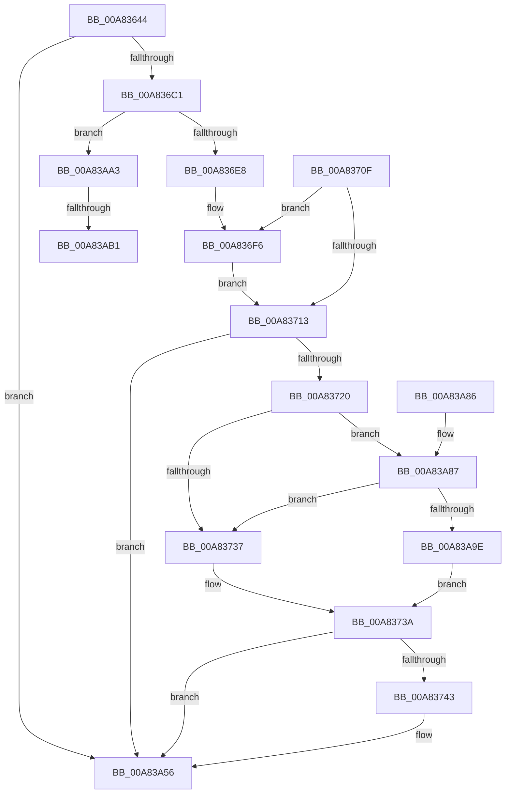

# PopIdleWakeSendDripsWakeSourceTelemetry

- RVA: `0x00A83644`–`0x00A83AB8` (길이 `1,140` bytes)
- VA: `0x0000000140A83644`
- 실행 섹션: `PAGE`
- PDB 이름 있음: `예`; PDB Function 태그: `예`
- unwind 정보 RVA: `0x000B74C4`
- 디코드: `220`개 명령, `1,140/1,140` bytes 표시
- 미해석 바이트: `0` (있으면 어셈블리에 `.byte`로 보존)

> 이 문서는 커널 이미지의 기계어와 PDB 기호를 분석해 생성했습니다. 4번과 5번은 함수 원형과 자료형을 바이너리 사용 방식에서 추정한 C 해석이며 원본 소스 복구 결과는 아닙니다.

## 1. Dependencies

- 직접 호출 지점: **3**; 고유 호출 대상: **3**
- 직접 호출자로 확인된 함수: **1**
- RIP 상대 이미지 참조: **8**

### Outgoing calls
- `0x00A836CC` → [RtlInitUnicodeString](../../text/42/RtlInitUnicodeString_function_0042A780.md) (function, `0x0042A780`)
- `0x00A83A51` → [tlgWriteTransfer_EtwWriteTransfer](../../text/42/tlgWriteTransfer_EtwWriteTransfer_function_004260E0.md) (function, `0x004260E0`)
- `0x00A83A60` → [_security_check_cookie](../../text/6A/_security_check_cookie_function_006AC640.md) (function, `0x006AC640`)

### Direct callers
- [PopIdleWakeTraceWakeSourceDiagnostic](PopIdleWakeTraceWakeSourceDiagnostic_function_00A8357C.md) at `0x00A835D6`
- [PopIdleWakeTraceWakeSourceDiagnostic](PopIdleWakeTraceWakeSourceDiagnostic_function_00A8357C.md) at `0x00A835E4`

### Static image references
- `0x00A8366A` → RVA `0x00E0A740` (`.data`; read)
- `0x00A836C1` → RVA `0x00AFCAD0` (` ?? ::NNGAKEGL::`string'`; read)
- `0x00A83713` → RVA `0x00E07748` (`.data`; read)
- `0x00A8372A` → RVA `0x00E07758` (`.data`; read)
- `0x00A83843` → RVA `0x00E0C220` (`.data`; read)
- `0x00A8386A` → RVA `0x00E0C270` (`.data`; read)
- `0x00A838F7` → RVA `0x0004E954` (`.rdata`; read)
- `0x00A83A87` → RVA `0x00E07760` (`.data`; read)

## 2. Other-region calls and transfers

- 다른 실행 섹션으로 향하는 call: **3**
  - `0x00A836CC` → [RtlInitUnicodeString](../../text/42/RtlInitUnicodeString_function_0042A780.md) (`PAGE` → `.text`)
  - `0x00A83A51` → [tlgWriteTransfer_EtwWriteTransfer](../../text/42/tlgWriteTransfer_EtwWriteTransfer_function_004260E0.md) (`PAGE` → `.text`)
  - `0x00A83A60` → [_security_check_cookie](../../text/6A/_security_check_cookie_function_006AC640.md) (`PAGE` → `.text`)
- call이 아닌 외부 분기/꼬리 이동: **2**
  - `0x00A83AAB` → [sub_00B43FFA](../B4/Unknown_function_00B43FFA.md) (`tail-transfer`)
  - `0x00A83AB3` → [sub_00B43FFA + 0x8](../B4/Unknown_function_00B43FFA.md) (`tail-transfer`)

## 3. Assembly (complete function range)

```asm
00A83644  48 8B C4                        mov rax, rsp
00A83647  48 89 58 08                     mov qword ptr [rax + 8], rbx
00A8364B  48 89 70 18                     mov qword ptr [rax + 0x18], rsi
00A8364F  48 89 78 20                     mov qword ptr [rax + 0x20], rdi
00A83653  55                              push rbp
00A83654  41 54                           push r12
00A83656  41 55                           push r13
00A83658  41 56                           push r14
00A8365A  41 57                           push r15
00A8365C  48 8D A8 08 FE FF FF            lea rbp, [rax - 0x1f8]
00A83663  48 81 EC D0 02 00 00            sub rsp, 0x2d0
00A8366A  48 8B 05 CF 70 38 00            mov rax, qword ptr [rip + 0x3870cf]
00A83671  48 33 C4                        xor rax, rsp
00A83674  48 89 85 C0 01 00 00            mov qword ptr [rbp + 0x1c0], rax
00A8367B  33 FF                           xor edi, edi
00A8367D  45 33 E4                        xor r12d, r12d
00A83680  45 84 C0                        test r8b, r8b
00A83683  48 89 7D A0                     mov qword ptr [rbp - 0x60], rdi
00A83687  45 8B F4                        mov r14d, r12d
00A8368A  0F 57 C0                        xorps xmm0, xmm0
00A8368D  41 0F 95 C6                     setne r14b
00A83691  0F 57 C9                        xorps xmm1, xmm1
00A83694  41 F6 D8                        neg r8b
00A83697  44 8D 6F 08                     lea r13d, [rdi + 8]
00A8369B  48 8B F2                        mov rsi, rdx
00A8369E  4C 8B F9                        mov r15, rcx
00A836A1  48 1B DB                        sbb rbx, rbx
00A836A4  81 E3 78 01 00 00               and ebx, 0x178
00A836AA  49 03 DD                        add rbx, r13
00A836AD  48 03 DA                        add rbx, rdx
00A836B0  0F 11 45 80                     movups xmmword ptr [rbp - 0x80], xmm0
00A836B4  0F 11 4D 90                     movups xmmword ptr [rbp - 0x70], xmm1
00A836B8  44 39 23                        cmp dword ptr [rbx], r12d
00A836BB  0F 84 95 03 00 00               je 0x140a83a56
00A836C1  48 8D 15 08 94 07 00            lea rdx, [rip + 0x79408]
00A836C8  48 8D 4D 80                     lea rcx, [rbp - 0x80]
00A836CC  E8 AF 70 9A FF                  call 0x14042a780
00A836D1  44 8B 16                        mov r10d, dword ptr [rsi]
00A836D4  8D 4F 03                        lea ecx, [rdi + 3]
00A836D7  44 8D 47 01                     lea r8d, [rdi + 1]
00A836DB  41 81 FA 80 00 00 00            cmp r10d, 0x80
00A836E2  0F 84 BB 03 00 00               je 0x140a83aa3
00A836E8  48 8D 86 00 03 00 00            lea rax, [rsi + 0x300]
00A836EF  41 8B D0                        mov edx, r8d
00A836F2  48 89 45 90                     mov qword ptr [rbp - 0x70], rax
00A836F6  8B C2                           mov eax, edx
00A836F8  48 8D 7D 90                     lea rdi, [rbp - 0x70]
00A836FC  2B CA                           sub ecx, edx
00A836FE  48 8D 3C C7                     lea rdi, [rdi + rax*8]
00A83702  48 8D 45 80                     lea rax, [rbp - 0x80]
00A83706  F3 48 AB                        rep stosq qword ptr [rdi], rax
00A83709  48 8B 7D A0                     mov rdi, qword ptr [rbp - 0x60]
00A8370D  EB 04                           jmp 0x140a83713
00A8370F  3B D1                           cmp edx, ecx
00A83711  72 E3                           jb 0x140a836f6
00A83713  83 3D 2E 40 38 00 05            cmp dword ptr [rip + 0x38402e], 5
00A8371A  0F 86 36 03 00 00               jbe 0x140a83a56
00A83720  48 BA 00 00 00 00 00 40 00 00   movabs rdx, 0x400000000000
00A8372A  48 85 15 27 40 38 00            test qword ptr [rip + 0x384027], rdx
00A83731  0F 85 50 03 00 00               jne 0x140a83a87
00A83737  45 8A C4                        mov r8b, r12b
00A8373A  45 84 C0                        test r8b, r8b
00A8373D  0F 84 13 03 00 00               je 0x140a83a56
00A83743  4C 89 7C 24 40                  mov qword ptr [rsp + 0x40], r15
00A83748  48 8D 44 24 40                  lea rax, [rsp + 0x40]
00A8374D  48 89 45 D0                     mov qword ptr [rbp - 0x30], rax
00A83751  48 8D 44 24 34                  lea rax, [rsp + 0x34]
00A83756  48 89 45 E0                     mov qword ptr [rbp - 0x20], rax
00A8375A  48 8B 45 90                     mov rax, qword ptr [rbp - 0x70]
00A8375E  4C 89 6D D8                     mov qword ptr [rbp - 0x28], r13
00A83762  44 89 54 24 34                  mov dword ptr [rsp + 0x34], r10d
00A83767  48 C7 45 E8 04 00 00 00         mov qword ptr [rbp - 0x18], 4
00A8376F  0F B7 10                        movzx edx, word ptr [rax]
00A83772  48 8B 48 08                     mov rcx, qword ptr [rax + 8]
00A83776  48 8D 45 08                     lea rax, [rbp + 8]
00A8377A  48 89 45 F0                     mov qword ptr [rbp - 0x10], rax
00A8377E  48 8B 45 98                     mov rax, qword ptr [rbp - 0x68]
00A83782  48 89 4D 00                     mov qword ptr [rbp], rcx
00A83786  89 55 08                        mov dword ptr [rbp + 8], edx
00A83789  48 C7 45 F8 02 00 00 00         mov qword ptr [rbp - 8], 2
00A83791  44 89 65 0C                     mov dword ptr [rbp + 0xc], r12d
00A83795  48 8B 48 08                     mov rcx, qword ptr [rax + 8]
00A83799  0F B7 10                        movzx edx, word ptr [rax]
00A8379C  48 8D 45 28                     lea rax, [rbp + 0x28]
00A837A0  48 89 45 10                     mov qword ptr [rbp + 0x10], rax
00A837A4  48 89 4D 20                     mov qword ptr [rbp + 0x20], rcx
00A837A8  89 55 28                        mov dword ptr [rbp + 0x28], edx
00A837AB  48 8D 55 48                     lea rdx, [rbp + 0x48]
00A837AF  48 C7 45 18 02 00 00 00         mov qword ptr [rbp + 0x18], 2
00A837B7  44 89 65 2C                     mov dword ptr [rbp + 0x2c], r12d
00A837BB  48 8B 47 08                     mov rax, qword ptr [rdi + 8]
00A837BF  0F B7 0F                        movzx ecx, word ptr [rdi]
00A837C2  48 89 45 40                     mov qword ptr [rbp + 0x40], rax
00A837C6  8B 03                           mov eax, dword ptr [rbx]
00A837C8  89 44 24 38                     mov dword ptr [rsp + 0x38], eax
00A837CC  48 8D 44 24 38                  lea rax, [rsp + 0x38]
00A837D1  48 89 45 50                     mov qword ptr [rbp + 0x50], rax
00A837D5  48 8B 43 08                     mov rax, qword ptr [rbx + 8]
00A837D9  48 89 44 24 48                  mov qword ptr [rsp + 0x48], rax
00A837DE  48 8D 44 24 48                  lea rax, [rsp + 0x48]
00A837E3  48 89 45 60                     mov qword ptr [rbp + 0x60], rax
00A837E7  48 8B 43 10                     mov rax, qword ptr [rbx + 0x10]
00A837EB  48 89 44 24 50                  mov qword ptr [rsp + 0x50], rax
00A837F0  48 8D 44 24 50                  lea rax, [rsp + 0x50]
00A837F5  48 89 45 70                     mov qword ptr [rbp + 0x70], rax
00A837F9  48 8B 43 18                     mov rax, qword ptr [rbx + 0x18]
00A837FD  48 89 44 24 58                  mov qword ptr [rsp + 0x58], rax
00A83802  48 8D 44 24 58                  lea rax, [rsp + 0x58]
00A83807  48 89 85 80 00 00 00            mov qword ptr [rbp + 0x80], rax
00A8380E  48 8D 86 52 03 00 00            lea rax, [rsi + 0x352]
00A83815  48 89 85 A0 00 00 00            mov qword ptr [rbp + 0xa0], rax
00A8381C  89 4D 48                        mov dword ptr [rbp + 0x48], ecx
00A8381F  48 8D 8E 50 03 00 00            lea rcx, [rsi + 0x350]
00A83826  0F B7 01                        movzx eax, word ptr [rcx]
00A83829  48 89 8D 90 00 00 00            mov qword ptr [rbp + 0x90], rcx
00A83830  48 89 55 30                     mov qword ptr [rbp + 0x30], rdx
00A83834  48 C7 45 38 02 00 00 00         mov qword ptr [rbp + 0x38], 2
00A8383C  8D 0C 80                        lea ecx, [rax + rax*4]
00A8383F  44 89 65 4C                     mov dword ptr [rbp + 0x4c], r12d
00A83843  48 8D 05 D6 89 38 00            lea rax, [rip + 0x3889d6]
00A8384A  48 C7 45 58 04 00 00 00         mov qword ptr [rbp + 0x58], 4
00A83852  48 89 85 B0 00 00 00            mov qword ptr [rbp + 0xb0], rax
00A83859  03 C9                           add ecx, ecx
00A8385B  48 8D 43 20                     lea rax, [rbx + 0x20]
00A8385F  4C 89 6D 68                     mov qword ptr [rbp + 0x68], r13
00A83863  48 89 85 C0 00 00 00            mov qword ptr [rbp + 0xc0], rax
00A8386A  48 8D 05 FF 89 38 00            lea rax, [rip + 0x3889ff]
00A83871  48 89 85 D0 00 00 00            mov qword ptr [rbp + 0xd0], rax
00A83878  48 8D 43 44                     lea rax, [rbx + 0x44]
00A8387C  48 89 85 E0 00 00 00            mov qword ptr [rbp + 0xe0], rax
00A83883  48 8D 44 24 30                  lea rax, [rsp + 0x30]
00A83888  48 89 85 F0 00 00 00            mov qword ptr [rbp + 0xf0], rax
00A8388F  48 8B 43 70                     mov rax, qword ptr [rbx + 0x70]
00A83893  4C 89 6D 78                     mov qword ptr [rbp + 0x78], r13
00A83897  4C 89 AD 88 00 00 00            mov qword ptr [rbp + 0x88], r13
00A8389E  48 C7 85 98 00 00 00 02 00 00 00  mov qword ptr [rbp + 0x98], 2
00A838A9  89 8D A8 00 00 00               mov dword ptr [rbp + 0xa8], ecx
00A838AF  44 89 A5 AC 00 00 00            mov dword ptr [rbp + 0xac], r12d
00A838B6  48 C7 85 B8 00 00 00 50 00 00 00  mov qword ptr [rbp + 0xb8], 0x50
00A838C1  48 C7 85 C8 00 00 00 24 00 00 00  mov qword ptr [rbp + 0xc8], 0x24
00A838CC  48 C7 85 D8 00 00 00 60 00 00 00  mov qword ptr [rbp + 0xd8], 0x60
00A838D7  48 C7 85 E8 00 00 00 2C 00 00 00  mov qword ptr [rbp + 0xe8], 0x2c
00A838E2  44 89 74 24 30                  mov dword ptr [rsp + 0x30], r14d
00A838E7  48 C7 85 F8 00 00 00 04 00 00 00  mov qword ptr [rbp + 0xf8], 4
00A838F2  48 89 44 24 60                  mov qword ptr [rsp + 0x60], rax
00A838F7  48 8D 15 56 B0 5C FF            lea rdx, [rip - 0xa34faa]
00A838FE  48 8D 44 24 60                  lea rax, [rsp + 0x60]
00A83903  4C 89 AD 08 01 00 00            mov qword ptr [rbp + 0x108], r13
00A8390A  48 89 85 00 01 00 00            mov qword ptr [rbp + 0x100], rax
00A83911  48 8D 0D 30 3E 38 00            lea rcx, [rip + 0x383e30]
00A83918  48 8D 43 78                     lea rax, [rbx + 0x78]
00A8391C  48 C7 85 18 01 00 00 14 00 00 00  mov qword ptr [rbp + 0x118], 0x14
00A83927  48 89 85 10 01 00 00            mov qword ptr [rbp + 0x110], rax
00A8392E  45 33 C9                        xor r9d, r9d
00A83931  48 8D 83 90 00 00 00            lea rax, [rbx + 0x90]
00A83938  48 C7 85 28 01 00 00 28 00 00 00  mov qword ptr [rbp + 0x128], 0x28
00A83943  48 89 85 20 01 00 00            mov qword ptr [rbp + 0x120], rax
00A8394A  45 33 C0                        xor r8d, r8d
00A8394D  48 8B 83 B8 00 00 00            mov rax, qword ptr [rbx + 0xb8]
00A83954  48 89 44 24 68                  mov qword ptr [rsp + 0x68], rax
00A83959  48 8D 44 24 68                  lea rax, [rsp + 0x68]
00A8395E  48 89 85 30 01 00 00            mov qword ptr [rbp + 0x130], rax
00A83965  48 8D 83 C0 00 00 00            lea rax, [rbx + 0xc0]
00A8396C  48 89 85 40 01 00 00            mov qword ptr [rbp + 0x140], rax
00A83973  48 8D 83 D8 00 00 00            lea rax, [rbx + 0xd8]
00A8397A  48 89 85 50 01 00 00            mov qword ptr [rbp + 0x150], rax
00A83981  48 8B 83 00 01 00 00            mov rax, qword ptr [rbx + 0x100]
00A83988  48 89 44 24 70                  mov qword ptr [rsp + 0x70], rax
00A8398D  48 8D 44 24 70                  lea rax, [rsp + 0x70]
00A83992  48 89 85 60 01 00 00            mov qword ptr [rbp + 0x160], rax
00A83999  48 8D 83 08 01 00 00            lea rax, [rbx + 0x108]
00A839A0  48 89 85 70 01 00 00            mov qword ptr [rbp + 0x170], rax
00A839A7  48 8D 83 20 01 00 00            lea rax, [rbx + 0x120]
00A839AE  48 89 85 80 01 00 00            mov qword ptr [rbp + 0x180], rax
00A839B5  48 8B 83 48 01 00 00            mov rax, qword ptr [rbx + 0x148]
00A839BC  48 89 44 24 78                  mov qword ptr [rsp + 0x78], rax
00A839C1  48 8D 44 24 78                  lea rax, [rsp + 0x78]
00A839C6  48 89 85 90 01 00 00            mov qword ptr [rbp + 0x190], rax
00A839CD  48 8D 83 50 01 00 00            lea rax, [rbx + 0x150]
00A839D4  48 89 85 A0 01 00 00            mov qword ptr [rbp + 0x1a0], rax
00A839DB  48 8D 83 60 01 00 00            lea rax, [rbx + 0x160]
00A839E2  48 89 85 B0 01 00 00            mov qword ptr [rbp + 0x1b0], rax
00A839E9  48 8D 45 B0                     lea rax, [rbp - 0x50]
00A839ED  48 89 44 24 28                  mov qword ptr [rsp + 0x28], rax
00A839F2  C7 44 24 20 21 00 00 00         mov dword ptr [rsp + 0x20], 0x21
00A839FA  4C 89 AD 38 01 00 00            mov qword ptr [rbp + 0x138], r13
00A83A01  48 C7 85 48 01 00 00 14 00 00 00  mov qword ptr [rbp + 0x148], 0x14
00A83A0C  48 C7 85 58 01 00 00 28 00 00 00  mov qword ptr [rbp + 0x158], 0x28
00A83A17  4C 89 AD 68 01 00 00            mov qword ptr [rbp + 0x168], r13
00A83A1E  48 C7 85 78 01 00 00 14 00 00 00  mov qword ptr [rbp + 0x178], 0x14
00A83A29  48 C7 85 88 01 00 00 28 00 00 00  mov qword ptr [rbp + 0x188], 0x28
00A83A34  4C 89 AD 98 01 00 00            mov qword ptr [rbp + 0x198], r13
00A83A3B  48 C7 85 A8 01 00 00 0C 00 00 00  mov qword ptr [rbp + 0x1a8], 0xc
00A83A46  48 C7 85 B8 01 00 00 18 00 00 00  mov qword ptr [rbp + 0x1b8], 0x18
00A83A51  E8 8A 26 9A FF                  call 0x1404260e0
00A83A56  48 8B 8D C0 01 00 00            mov rcx, qword ptr [rbp + 0x1c0]
00A83A5D  48 33 CC                        xor rcx, rsp
00A83A60  E8 DB 8B C2 FF                  call 0x1406ac640
00A83A65  4C 8D 9C 24 D0 02 00 00         lea r11, [rsp + 0x2d0]
00A83A6D  49 8B 5B 30                     mov rbx, qword ptr [r11 + 0x30]
00A83A71  49 8B 73 40                     mov rsi, qword ptr [r11 + 0x40]
00A83A75  49 8B 7B 48                     mov rdi, qword ptr [r11 + 0x48]
00A83A79  49 8B E3                        mov rsp, r11
00A83A7C  41 5F                           pop r15
00A83A7E  41 5E                           pop r14
00A83A80  41 5D                           pop r13
00A83A82  41 5C                           pop r12
00A83A84  5D                              pop rbp
00A83A85  C3                              ret
00A83A86  CC                              int3
00A83A87  48 8B 05 D2 3C 38 00            mov rax, qword ptr [rip + 0x383cd2]
00A83A8E  48 23 C2                        and rax, rdx
00A83A91  48 3B 05 C8 3C 38 00            cmp rax, qword ptr [rip + 0x383cc8]
00A83A98  0F 85 99 FC FF FF               jne 0x140a83737
00A83A9E  E9 97 FC FF FF                  jmp 0x140a8373a
00A83AA3  8B 96 10 03 00 00               mov edx, dword ptr [rsi + 0x310]
00A83AA9  3B D1                           cmp edx, ecx
00A83AAB  0F 86 49 05 0C 00               jbe 0x140b43ffa
00A83AB1  8B D1                           mov edx, ecx
00A83AB3  E9 4A 05 0C 00                  jmp 0x140b44002
```

## 4. C-style interpretation (structured pseudocode)

```c
__int64 __fastcall PopIdleWakeSendDripsWakeSourceTelemetry(__int64 a1, __int64 a2, unsigned __int8 a3, int a4)
{
    __int64 result;
    __int64 v_r12;
    __int64 v_r14;
    __int64 v_rbx;
    __int64 v_rdi;
    __int64 v_rsp;
    unsigned __int64 v_stack_m28;
    unsigned __int64 v_stack_m280;
    unsigned __int64 v_stack_m288;
    unsigned __int64 v_stack_m290;
    unsigned __int64 v_stack_m298;
    unsigned __int64 v_stack_m2A0;
    unsigned __int64 v_stack_m2A8;
    unsigned __int64 v_stack_m2B0;
    unsigned __int64 v_stack_m2B8;
    unsigned int v_stack_m2C0;
    unsigned __int64 v_stack_m2C4;
    unsigned __int64 v_stack_m2C8;
    unsigned __int64 v_stack_m2D0;
    unsigned int v_stack_m2D8;

    *(unsigned __int64 *)(v_rsp + 8) = v_rbx;
    *(unsigned __int64 *)(v_rsp + 24) = v_rsi;
    *(unsigned __int64 *)(v_rsp + 32) = v_rdi;
    v_rsp = (v_rsp) - (720);
    result = (*(unsigned __int64 *)(v_rip + 3698895)) ^ (v_rsp);
    *(unsigned __int64 *)(v_rsp - 504 + 448) = result;
    v_rdi = 0;
    v_r12 = 0;
    *(unsigned __int64 *)(v_rsp - 504 - 96) = 0;
    v_r14 = (a3 != 0) ? 1 : 0;
    a3 = (unsigned __int8)(-(a3));
    v_rbx = (unsigned int)((v_rbx) & (376));
    v_rbx = (v_rbx) + (v_rdi + 8);
    v_rbx = (v_rbx) + (a2);
    *(unsigned __int64 *)(v_rsp - 504 - 128) = v_xmm0;
    *(unsigned __int64 *)(v_rsp - 504 - 112) = v_xmm1;
    if ((*(unsigned int *)(v_rbx)) == 0) goto loc_00A83A56;
    result = RtlInitUnicodeString(v_rsp - 504 - 128, v_rip + 496648, a3, a4);
    if (((unsigned int)((unsigned int)(*(unsigned int *)(a2)))) == 128) goto loc_00A83AA3;
    *(unsigned __int64 *)(v_rsp - 504 - 112) = a2 + 768;
loc_00A836F6:
    a1 = (unsigned int)((v_rdi + 3) - ((unsigned int)((unsigned int)((unsigned int)(v_rdi + 1)))));
    goto loc_00A83713;
loc_00A83713:
    if ((*(unsigned int *)(v_rip + 3686446)) <= 5) goto loc_00A83A56;
    if (((*(unsigned __int64 *)(v_rip + 3686439)) & ((unsigned int)((unsigned int)(v_rdi + 1)))) != 0) goto loc_00A83A87;
loc_00A83737:
loc_00A8373A:
    result = v_rsp - 504 - 128;
    if (0 != 0) {
        v_stack_m2B8 = a1;
        result = v_stack_m2B8;
        *(unsigned __int64 *)(v_rsp - 504 - 48) = result;
        result = v_stack_m2C4;
        *(unsigned __int64 *)(v_rsp - 504 - 32) = result;
        result = *(unsigned __int64 *)(v_rsp - 504 - 112);
        *(unsigned __int64 *)(v_rsp - 504 - 40) = v_rdi + 8;
        v_stack_m2C4 = (unsigned int)((unsigned int)(*(unsigned int *)(a2)));
        *(unsigned __int64 *)(v_rsp - 504 - 24) = 4;
        a2 = *(unsigned __int16 *)(result);
        a1 = *(unsigned __int64 *)(result + 8);
        result = v_rsp - 504 + 8;
        *(unsigned __int64 *)(v_rsp - 504 - 16) = result;
        result = *(unsigned __int64 *)(v_rsp - 504 - 104);
        *(unsigned __int64 *)(v_rsp - 504) = a1;
        *(unsigned int *)(v_rsp - 504 + 8) = (unsigned int)(a2);
        *(unsigned __int64 *)(v_rsp - 504 - 8) = 2;
        *(unsigned int *)(v_rsp - 504 + 12) = 0;
        a1 = *(unsigned __int64 *)(result + 8);
        a2 = *(unsigned __int16 *)(result);
        result = v_rsp - 504 + 40;
        *(unsigned __int64 *)(v_rsp - 504 + 16) = result;
        *(unsigned __int64 *)(v_rsp - 504 + 32) = a1;
        *(unsigned int *)(v_rsp - 504 + 40) = (unsigned int)(a2);
        a2 = v_rsp - 504 + 72;
        *(unsigned __int64 *)(v_rsp - 504 + 24) = 2;
        *(unsigned int *)(v_rsp - 504 + 44) = 0;
        result = *(unsigned __int64 *)(*(unsigned __int64 *)(v_rsp - 504 - 96) + 8);
        a1 = *(unsigned __int16 *)(*(unsigned __int64 *)(v_rsp - 504 - 96));
        *(unsigned __int64 *)(v_rsp - 504 + 64) = result;
        result = *(unsigned int *)(v_rbx);
        v_stack_m2C0 = (unsigned int)(result);
        result = v_stack_m2C0;
        *(unsigned __int64 *)(v_rsp - 504 + 80) = result;
        result = *(unsigned __int64 *)(v_rbx + 8);
        v_stack_m2B0 = result;
        result = v_stack_m2B0;
        *(unsigned __int64 *)(v_rsp - 504 + 96) = result;
        result = *(unsigned __int64 *)(v_rbx + 16);
        v_stack_m2A8 = result;
        result = v_stack_m2A8;
        *(unsigned __int64 *)(v_rsp - 504 + 112) = result;
        result = *(unsigned __int64 *)(v_rbx + 24);
        v_stack_m2A0 = result;
        result = v_stack_m2A0;
        *(unsigned __int64 *)(v_rsp - 504 + 128) = result;
        result = a2 + 850;
        *(unsigned __int64 *)(v_rsp - 504 + 160) = result;
        *(unsigned int *)(v_rsp - 504 + 72) = (unsigned int)(a1);
        a1 = a2 + 848;
        result = *(unsigned __int16 *)(a1);
        *(unsigned __int64 *)(v_rsp - 504 + 144) = a1;
        *(unsigned __int64 *)(v_rsp - 504 + 48) = a2;
        *(unsigned __int64 *)(v_rsp - 504 + 56) = 2;
        a1 = result + result * 4;
        *(unsigned int *)(v_rsp - 504 + 76) = 0;
        result = v_rip + 3705302;
        *(unsigned __int64 *)(v_rsp - 504 + 88) = 4;
        *(unsigned __int64 *)(v_rsp - 504 + 176) = result;
        a1 = (unsigned int)((a1) + ((unsigned int)(a1)));
        result = v_rbx + 32;
        *(unsigned __int64 *)(v_rsp - 504 + 104) = v_rdi + 8;
        *(unsigned __int64 *)(v_rsp - 504 + 192) = result;
        result = v_rip + 3705343;
        *(unsigned __int64 *)(v_rsp - 504 + 208) = result;
        result = v_rbx + 68;
        *(unsigned __int64 *)(v_rsp - 504 + 224) = result;
        result = v_stack_m2C8;
        *(unsigned __int64 *)(v_rsp - 504 + 240) = result;
        result = *(unsigned __int64 *)(v_rbx + 112);
        *(unsigned __int64 *)(v_rsp - 504 + 120) = v_rdi + 8;
        *(unsigned __int64 *)(v_rsp - 504 + 136) = v_rdi + 8;
        *(unsigned __int64 *)(v_rsp - 504 + 152) = 2;
        *(unsigned int *)(v_rsp - 504 + 168) = (unsigned int)(a1);
        *(unsigned int *)(v_rsp - 504 + 172) = 0;
        *(unsigned __int64 *)(v_rsp - 504 + 184) = 80;
        *(unsigned __int64 *)(v_rsp - 504 + 200) = 36;
        *(unsigned __int64 *)(v_rsp - 504 + 216) = 96;
        *(unsigned __int64 *)(v_rsp - 504 + 232) = 44;
        v_stack_m2C8 = (unsigned int)(v_r14);
        *(unsigned __int64 *)(v_rsp - 504 + 248) = 4;
        v_stack_m298 = result;
        a2 = v_rip - 10702762;
        result = v_stack_m298;
        *(unsigned __int64 *)(v_rsp - 504 + 264) = v_rdi + 8;
        *(unsigned __int64 *)(v_rsp - 504 + 256) = result;
        a1 = v_rip + 3685936;
        result = v_rbx + 120;
        *(unsigned __int64 *)(v_rsp - 504 + 280) = 20;
        *(unsigned __int64 *)(v_rsp - 504 + 272) = result;
        a4 = 0;
        result = v_rbx + 144;
        *(unsigned __int64 *)(v_rsp - 504 + 296) = 40;
        *(unsigned __int64 *)(v_rsp - 504 + 288) = result;
        a3 = 0;
        result = *(unsigned __int64 *)(v_rbx + 184);
        v_stack_m290 = result;
        result = v_stack_m290;
        *(unsigned __int64 *)(v_rsp - 504 + 304) = result;
        result = v_rbx + 192;
        *(unsigned __int64 *)(v_rsp - 504 + 320) = result;
        result = v_rbx + 216;
        *(unsigned __int64 *)(v_rsp - 504 + 336) = result;
        result = *(unsigned __int64 *)(v_rbx + 256);
        v_stack_m288 = result;
        result = v_stack_m288;
        *(unsigned __int64 *)(v_rsp - 504 + 352) = result;
        result = v_rbx + 264;
        *(unsigned __int64 *)(v_rsp - 504 + 368) = result;
        result = v_rbx + 288;
        *(unsigned __int64 *)(v_rsp - 504 + 384) = result;
        result = *(unsigned __int64 *)(v_rbx + 328);
        v_stack_m280 = result;
        result = v_stack_m280;
        *(unsigned __int64 *)(v_rsp - 504 + 400) = result;
        result = v_rbx + 336;
        *(unsigned __int64 *)(v_rsp - 504 + 416) = result;
        result = v_rbx + 352;
        *(unsigned __int64 *)(v_rsp - 504 + 432) = result;
        result = v_rsp - 504 - 80;
        v_stack_m2D0 = result;
        v_stack_m2D8 = 33;
        *(unsigned __int64 *)(v_rsp - 504 + 312) = v_rdi + 8;
        *(unsigned __int64 *)(v_rsp - 504 + 328) = 20;
        *(unsigned __int64 *)(v_rsp - 504 + 344) = 40;
        *(unsigned __int64 *)(v_rsp - 504 + 360) = v_rdi + 8;
        *(unsigned __int64 *)(v_rsp - 504 + 376) = 20;
        *(unsigned __int64 *)(v_rsp - 504 + 392) = 40;
        *(unsigned __int64 *)(v_rsp - 504 + 408) = v_rdi + 8;
        *(unsigned __int64 *)(v_rsp - 504 + 424) = 12;
        *(unsigned __int64 *)(v_rsp - 504 + 440) = 24;
        result = tlgWriteTransfer_EtwWriteTransfer(a1, a2, a3, a4);
    }
    a1 = (*(unsigned __int64 *)(v_rsp - 504 + 448)) ^ (v_rsp);
    result = _security_check_cookie(a1, a2, a3, a4);
    return result;
loc_00A83A87:
    result = (*(unsigned __int64 *)(v_rip + 3685586)) & (a2);
    if (result != (*(unsigned __int64 *)(v_rip + 3685576))) goto loc_00A83737;
    goto loc_00A8373A;
loc_00A83AA3:
}
```

## 5. (Beta) C Style

```c
int64_t PopIdleWakeSendDripsWakeSourceTelemetry(int64_t Arg1, void *Arg2, uint8_t Arg3, int32_t Arg4)
{
    uint8_t *arg2 = (uint8_t *)Arg2;

    int64_t result;
    int64_t local_r12;
    int64_t local_r14;
    int64_t local_rbx;
    int64_t local_rdi;
    int64_t local_rsp;
    uint64_t v_stack_m28;
    uint64_t v_stack_m280;
    uint64_t v_stack_m288;
    uint64_t v_stack_m290;
    uint64_t v_stack_m298;
    uint64_t v_stack_m2A0;
    uint64_t v_stack_m2A8;
    uint64_t v_stack_m2B0;
    uint64_t v_stack_m2B8;
    uint32_t v_stack_m2C0;
    uint64_t v_stack_m2C4;
    uint64_t v_stack_m2C8;
    uint64_t v_stack_m2D0;
    uint32_t v_stack_m2D8;

    *(uint64_t *)(local_rsp + 0x8) = local_rbx;
    *(uint64_t *)(local_rsp + 0x18) = local_rsi;
    *(uint64_t *)(local_rsp + 0x20) = local_rdi;
    local_rsp = (local_rsp) - (720);
    result = (*(uint64_t *)(v_rip + 0x3870CF)) ^ (local_rsp);
    *(uint64_t *)(local_rsp - 0x1F8 + 0x1C0) = result;
    local_rdi = 0;
    local_r12 = 0;
    *(uint64_t *)(local_rsp - 0x1F8 - 0x60) = 0;
    local_r14 = (Arg3 != 0) ? 1 : 0;
    Arg3 = (uint8_t)(-(Arg3));
    local_rbx = (uint32_t)((local_rbx) & (376));
    local_rbx = (local_rbx) + (local_rdi + 8);
    local_rbx = (local_rbx) + (Arg2);
    *(uint64_t *)(local_rsp - 0x1F8 - 0x80) = v_xmm0;
    *(uint64_t *)(local_rsp - 0x1F8 - 0x70) = v_xmm1;
    if ((*(uint32_t *)(local_rbx)) == 0) goto loc_00A83A56;
    result = RtlInitUnicodeString(local_rsp - 504 - 128, v_rip + 496648, Arg3, Arg4);
    if (((uint32_t)((uint32_t)(*(uint32_t *)(arg2)))) == 128) goto loc_00A83AA3;
    *(void **)(local_rsp - 0x1F8 - 0x70) = Arg2 + 768;
loc_00A836F6:
    Arg1 = (uint32_t)((local_rdi + 3) - ((uint32_t)((uint32_t)((uint32_t)(local_rdi + 1)))));
    goto loc_00A83713;
loc_00A83713:
    if ((*(uint32_t *)(v_rip + 0x38402E)) <= 5) goto loc_00A83A56;
    if (((*(uint64_t *)(v_rip + 0x384027)) & ((uint32_t)((uint32_t)(local_rdi + 1)))) != 0) goto loc_00A83A87;
loc_00A83737:
loc_00A8373A:
    result = local_rsp - 504 - 128;
    if (0 != 0) {
        v_stack_m2B8 = Arg1;
        result = v_stack_m2B8;
        *(uint64_t *)(local_rsp - 0x1F8 - 0x30) = result;
        result = v_stack_m2C4;
        *(uint64_t *)(local_rsp - 0x1F8 - 0x20) = result;
        result = *(uint64_t *)(local_rsp - 0x1F8 - 0x70);
        *(uint64_t *)(local_rsp - 0x1F8 - 0x28) = local_rdi + 8;
        v_stack_m2C4 = (uint32_t)((uint32_t)(*(uint32_t *)(arg2)));
        *(uint64_t *)(local_rsp - 0x1F8 - 0x18) = 4;
        Arg2 = *(uint16_t *)(result);
        Arg1 = *(uint64_t *)(result + 0x8);
        result = local_rsp - 504 + 8;
        *(uint64_t *)(local_rsp - 0x1F8 - 0x10) = result;
        result = *(uint64_t *)(local_rsp - 0x1F8 - 0x68);
        *(uint64_t *)(local_rsp - 0x1F8) = Arg1;
        *(uint32_t *)(local_rsp - 0x1F8 + 0x8) = (uint32_t)(Arg2);
        *(uint64_t *)(local_rsp - 0x1F8 - 0x8) = 2;
        *(uint32_t *)(local_rsp - 0x1F8 + 0xC) = 0;
        Arg1 = *(uint64_t *)(result + 0x8);
        Arg2 = *(uint16_t *)(result);
        result = local_rsp - 504 + 40;
        *(uint64_t *)(local_rsp - 0x1F8 + 0x10) = result;
        *(uint64_t *)(local_rsp - 0x1F8 + 0x20) = Arg1;
        *(uint32_t *)(local_rsp - 0x1F8 + 0x28) = (uint32_t)(Arg2);
        Arg2 = local_rsp - 504 + 72;
        *(uint64_t *)(local_rsp - 0x1F8 + 0x18) = 2;
        *(uint32_t *)(local_rsp - 0x1F8 + 0x2C) = 0;
        result = *(uint64_t *)(*(uint64_t *)(local_rsp - 0x1F8 - 0x60) + 0x8);
        Arg1 = *(uint16_t *)(*(uint64_t *)(local_rsp - 0x1F8 - 0x60));
        *(uint64_t *)(local_rsp - 0x1F8 + 0x40) = result;
        result = *(uint32_t *)(local_rbx);
        v_stack_m2C0 = (uint32_t)(result);
        result = v_stack_m2C0;
        *(uint64_t *)(local_rsp - 0x1F8 + 0x50) = result;
        result = *(uint64_t *)(local_rbx + 0x8);
        v_stack_m2B0 = result;
        result = v_stack_m2B0;
        *(uint64_t *)(local_rsp - 0x1F8 + 0x60) = result;
        result = *(uint64_t *)(local_rbx + 0x10);
        v_stack_m2A8 = result;
        result = v_stack_m2A8;
        *(uint64_t *)(local_rsp - 0x1F8 + 0x70) = result;
        result = *(uint64_t *)(local_rbx + 0x18);
        v_stack_m2A0 = result;
        result = v_stack_m2A0;
        *(uint64_t *)(local_rsp - 0x1F8 + 0x80) = result;
        result = Arg2 + 850;
        *(uint64_t *)(local_rsp - 0x1F8 + 0xA0) = result;
        *(uint32_t *)(local_rsp - 0x1F8 + 0x48) = (uint32_t)(Arg1);
        Arg1 = Arg2 + 848;
        result = *(uint16_t *)(Arg1);
        *(uint64_t *)(local_rsp - 0x1F8 + 0x90) = Arg1;
        *(void **)(local_rsp - 0x1F8 + 0x30) = Arg2;
        *(uint64_t *)(local_rsp - 0x1F8 + 0x38) = 2;
        Arg1 = result + result * 4;
        *(uint32_t *)(local_rsp - 0x1F8 + 0x4C) = 0;
        result = v_rip + 3705302;
        *(uint64_t *)(local_rsp - 0x1F8 + 0x58) = 4;
        *(uint64_t *)(local_rsp - 0x1F8 + 0xB0) = result;
        Arg1 = (uint32_t)((Arg1) + ((uint32_t)(Arg1)));
        result = local_rbx + 32;
        *(uint64_t *)(local_rsp - 0x1F8 + 0x68) = local_rdi + 8;
        *(uint64_t *)(local_rsp - 0x1F8 + 0xC0) = result;
        result = v_rip + 3705343;
        *(uint64_t *)(local_rsp - 0x1F8 + 0xD0) = result;
        result = local_rbx + 68;
        *(uint64_t *)(local_rsp - 0x1F8 + 0xE0) = result;
        result = v_stack_m2C8;
        *(uint64_t *)(local_rsp - 0x1F8 + 0xF0) = result;
        result = *(uint64_t *)(local_rbx + 0x70);
        *(uint64_t *)(local_rsp - 0x1F8 + 0x78) = local_rdi + 8;
        *(uint64_t *)(local_rsp - 0x1F8 + 0x88) = local_rdi + 8;
        *(uint64_t *)(local_rsp - 0x1F8 + 0x98) = 2;
        *(uint32_t *)(local_rsp - 0x1F8 + 0xA8) = (uint32_t)(Arg1);
        *(uint32_t *)(local_rsp - 0x1F8 + 0xAC) = 0;
        *(uint64_t *)(local_rsp - 0x1F8 + 0xB8) = 80;
        *(uint64_t *)(local_rsp - 0x1F8 + 0xC8) = 36;
        *(uint64_t *)(local_rsp - 0x1F8 + 0xD8) = 96;
        *(uint64_t *)(local_rsp - 0x1F8 + 0xE8) = 44;
        v_stack_m2C8 = (uint32_t)(local_r14);
        *(uint64_t *)(local_rsp - 0x1F8 + 0xF8) = 4;
        v_stack_m298 = result;
        Arg2 = v_rip - 10702762;
        result = v_stack_m298;
        *(uint64_t *)(local_rsp - 0x1F8 + 0x108) = local_rdi + 8;
        *(uint64_t *)(local_rsp - 0x1F8 + 0x100) = result;
        Arg1 = v_rip + 3685936;
        result = local_rbx + 120;
        *(uint64_t *)(local_rsp - 0x1F8 + 0x118) = 20;
        *(uint64_t *)(local_rsp - 0x1F8 + 0x110) = result;
        Arg4 = 0;
        result = local_rbx + 144;
        *(uint64_t *)(local_rsp - 0x1F8 + 0x128) = 40;
        *(uint64_t *)(local_rsp - 0x1F8 + 0x120) = result;
        Arg3 = 0;
        result = *(uint64_t *)(local_rbx + 0xB8);
        v_stack_m290 = result;
        result = v_stack_m290;
        *(uint64_t *)(local_rsp - 0x1F8 + 0x130) = result;
        result = local_rbx + 192;
        *(uint64_t *)(local_rsp - 0x1F8 + 0x140) = result;
        result = local_rbx + 216;
        *(uint64_t *)(local_rsp - 0x1F8 + 0x150) = result;
        result = *(uint64_t *)(local_rbx + 0x100);
        v_stack_m288 = result;
        result = v_stack_m288;
        *(uint64_t *)(local_rsp - 0x1F8 + 0x160) = result;
        result = local_rbx + 264;
        *(uint64_t *)(local_rsp - 0x1F8 + 0x170) = result;
        result = local_rbx + 288;
        *(uint64_t *)(local_rsp - 0x1F8 + 0x180) = result;
        result = *(uint64_t *)(local_rbx + 0x148);
        v_stack_m280 = result;
        result = v_stack_m280;
        *(uint64_t *)(local_rsp - 0x1F8 + 0x190) = result;
        result = local_rbx + 336;
        *(uint64_t *)(local_rsp - 0x1F8 + 0x1A0) = result;
        result = local_rbx + 352;
        *(uint64_t *)(local_rsp - 0x1F8 + 0x1B0) = result;
        result = local_rsp - 504 - 80;
        v_stack_m2D0 = result;
        v_stack_m2D8 = 33;
        *(uint64_t *)(local_rsp - 0x1F8 + 0x138) = local_rdi + 8;
        *(uint64_t *)(local_rsp - 0x1F8 + 0x148) = 20;
        *(uint64_t *)(local_rsp - 0x1F8 + 0x158) = 40;
        *(uint64_t *)(local_rsp - 0x1F8 + 0x168) = local_rdi + 8;
        *(uint64_t *)(local_rsp - 0x1F8 + 0x178) = 20;
        *(uint64_t *)(local_rsp - 0x1F8 + 0x188) = 40;
        *(uint64_t *)(local_rsp - 0x1F8 + 0x198) = local_rdi + 8;
        *(uint64_t *)(local_rsp - 0x1F8 + 0x1A8) = 12;
        *(uint64_t *)(local_rsp - 0x1F8 + 0x1B8) = 24;
        result = tlgWriteTransfer_EtwWriteTransfer(Arg1, Arg2, Arg3, Arg4);
    }
    Arg1 = (*(uint64_t *)(local_rsp - 0x1F8 + 0x1C0)) ^ (local_rsp);
    result = _security_check_cookie(Arg1, Arg2, Arg3, Arg4);
    return result;
loc_00A83A87:
    result = (*(uint64_t *)(v_rip + 0x383CD2)) & (Arg2);
    if (result != (*(uint64_t *)(v_rip + 0x383CC8))) goto loc_00A83737;
    goto loc_00A8373A;
loc_00A83AA3:
}
```

### 관측된 메모리 오프셋

구조체 형식이 확인되지 않은 접근은 인자 기준의 오프셋으로만 기록했습니다.

| 기준 인자 | 오프셋 표현 | 폭 (bit) | 접근 |
|---|---:|---:|---|
| `Arg2` | `+ 0x0` | `16` | `R` |
| `Arg2` | `+ 0x0` | `32` | `R` |
| `Arg2` | `+ 0x300` | `64` | `R` |
| `Arg2` | `+ 0x310` | `32` | `R` |
| `Arg2` | `+ 0x350` | `64` | `R` |
| `Arg2` | `+ 0x352` | `64` | `R` |

## 6. Execution-region graph

[열기: 2D/3D 그래프와 함수 탐색 컨트롤 패널](../../../control-panel.html?section=page&rva=0x00A83644&view=graph)

- 2D 그래프는 위에서 아래로 흐르고, 3D 그래프는 빈 공간을 드래그해 회전합니다. Shift+드래그는 이동, 휠은 확대·축소, 함수 노드 선택은 대상 보고서 이동입니다.

### Static fallback


