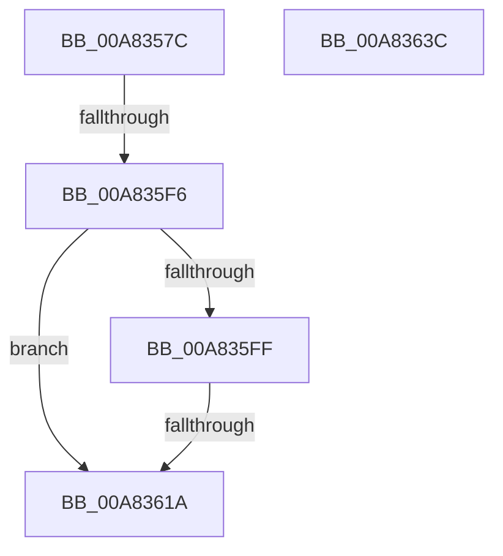

# PopIdleWakeTraceWakeSourceDiagnostic

- RVA: `0x00A8357C`–`0x00A8363D` (길이 `193` bytes)
- VA: `0x0000000140A8357C`
- 실행 섹션: `PAGE`
- PDB 이름 있음: `예`; PDB Function 태그: `예`
- unwind 정보 RVA: `0x000B7494`
- 디코드: `47`개 명령, `193/193` bytes 표시
- 미해석 바이트: `0` (있으면 어셈블리에 `.byte`로 보존)

> 이 문서는 커널 이미지의 기계어와 PDB 기호를 분석해 생성했습니다. 4번과 5번은 함수 원형과 자료형을 바이너리 사용 방식에서 추정한 C 해석이며 원본 소스 복구 결과는 아닙니다.

## 1. Dependencies

- 직접 호출 지점: **5**; 고유 호출 대상: **4**
- 직접 호출자로 확인된 함수: **1**
- RIP 상대 이미지 참조: **5**

### Outgoing calls
- `0x00A835C3` → [memset](../../text/6C/memset_function_006C6C40.md) (function, `0x006C6C40`)
- `0x00A835D6` → [PopIdleWakeSendDripsWakeSourceTelemetry](PopIdleWakeSendDripsWakeSourceTelemetry_function_00A83644.md) (function, `0x00A83644`)
- `0x00A835E4` → [PopIdleWakeSendDripsWakeSourceTelemetry](PopIdleWakeSendDripsWakeSourceTelemetry_function_00A83644.md) (function, `0x00A83644`)
- `0x00A8360D` → [EtwEventEnabled](../../text/39/EtwEventEnabled_function_00392450.md) (function, `0x00392450`)
- `0x00A83624` → [_security_check_cookie](../../text/6A/_security_check_cookie_function_006AC640.md) (function, `0x006AC640`)

### Direct callers
- [PopIdleWakeNotifyModernStandbyExitWorker](../AA/PopIdleWakeNotifyModernStandbyExitWorker_function_00AA55E0.md) at `0x00AA586D`

### Static image references
- `0x00A83593` → RVA `0x00E0A740` (`.data`; read)
- `0x00A835E9` → RVA `0x00E67859` (`.data`; read)
- `0x00A835F6` → RVA `0x00E67858` (`.data`; read)
- `0x00A835FF` → RVA `0x00F0B408` (`.data`; read)
- `0x00A83606` → RVA `0x0001BCF8` (`.rdata`; read)

## 2. Other-region calls and transfers

- 다른 실행 섹션으로 향하는 call: **3**
  - `0x00A835C3` → [memset](../../text/6C/memset_function_006C6C40.md) (`PAGE` → `.text`)
  - `0x00A8360D` → [EtwEventEnabled](../../text/39/EtwEventEnabled_function_00392450.md) (`PAGE` → `.text`)
  - `0x00A83624` → [_security_check_cookie](../../text/6A/_security_check_cookie_function_006AC640.md) (`PAGE` → `.text`)
- call이 아닌 외부 분기/꼬리 이동: **2**
  - `0x00A835F0` → [sub_00B43DE2](../B4/Unknown_function_00B43DE2.md) (`tail-transfer`)
  - `0x00A83614` → [sub_00B43DE2 + 0x193](../B4/Unknown_function_00B43DE2.md) (`tail-transfer`)

## 3. Assembly (complete function range)

```asm
00A8357C  48 89 5C 24 18                  mov qword ptr [rsp + 0x18], rbx
00A83581  55                              push rbp
00A83582  56                              push rsi
00A83583  57                              push rdi
00A83584  48 8D AC 24 A0 FA FF FF         lea rbp, [rsp - 0x560]
00A8358C  48 81 EC 60 06 00 00            sub rsp, 0x660
00A83593  48 8B 05 A6 71 38 00            mov rax, qword ptr [rip + 0x3871a6]
00A8359A  48 33 C4                        xor rax, rsp
00A8359D  48 89 85 50 05 00 00            mov qword ptr [rbp + 0x550], rax
00A835A4  48 8B FA                        mov rdi, rdx
00A835A7  48 8B D9                        mov rbx, rcx
00A835AA  33 C0                           xor eax, eax
00A835AC  48 8D 4C 24 40                  lea rcx, [rsp + 0x40]
00A835B1  33 F6                           xor esi, esi
00A835B3  89 44 24 44                     mov dword ptr [rsp + 0x44], eax
00A835B7  33 D2                           xor edx, edx
00A835B9  89 74 24 34                     mov dword ptr [rsp + 0x34], esi
00A835BD  41 B8 74 01 00 00               mov r8d, 0x174
00A835C3  E8 78 36 C4 FF                  call 0x1406c6c40
00A835C8  45 33 C0                        xor r8d, r8d
00A835CB  40 88 74 24 30                  mov byte ptr [rsp + 0x30], sil
00A835D0  48 8B D7                        mov rdx, rdi
00A835D3  48 8B CB                        mov rcx, rbx
00A835D6  E8 69 00 00 00                  call 0x140a83644
00A835DB  41 B0 01                        mov r8b, 1
00A835DE  48 8B D7                        mov rdx, rdi
00A835E1  48 8B CB                        mov rcx, rbx
00A835E4  E8 5B 00 00 00                  call 0x140a83644
00A835E9  40 38 35 69 42 3E 00            cmp byte ptr [rip + 0x3e4269], sil
00A835F0  0F 85 EC 07 0C 00               jne 0x140b43de2
00A835F6  40 38 35 5B 42 3E 00            cmp byte ptr [rip + 0x3e425b], sil
00A835FD  74 1B                           je 0x140a8361a
00A835FF  48 8B 0D 02 7E 48 00            mov rcx, qword ptr [rip + 0x487e02]
00A83606  48 8D 15 EB 86 59 FF            lea rdx, [rip - 0xa67915]
00A8360D  E8 3E EE 90 FF                  call 0x140392450
00A83612  84 C0                           test al, al
00A83614  0F 85 5B 09 0C 00               jne 0x140b43f75
00A8361A  48 8B 8D 50 05 00 00            mov rcx, qword ptr [rbp + 0x550]
00A83621  48 33 CC                        xor rcx, rsp
00A83624  E8 17 90 C2 FF                  call 0x1406ac640
00A83629  48 8B 9C 24 90 06 00 00         mov rbx, qword ptr [rsp + 0x690]
00A83631  48 81 C4 60 06 00 00            add rsp, 0x660
00A83638  5F                              pop rdi
00A83639  5E                              pop rsi
00A8363A  5D                              pop rbp
00A8363B  C3                              ret
00A8363C  CC                              int3
```

## 4. C-style interpretation (structured pseudocode)

```c
__int64 __fastcall PopIdleWakeTraceWakeSourceDiagnostic(__int64 a1, __int64 a2)
{
    __int64 result;
    __int64 v_rsi;
    __int64 v_rsp;
    unsigned __int64 v_stack_m28;
    unsigned __int64 v_stack_m578;
    unsigned int v_stack_m634;
    unsigned __int64 v_stack_m638;
    unsigned int v_stack_m644;
    unsigned __int8 v_stack_m648;
    unsigned __int64 v_stack_p18;

    v_stack_p18 = v_rbx;
    v_rsp = (v_rsp) - (0x660ULL);
    result = (*(unsigned __int64 *)(v_rip + 3699110)) ^ (v_rsp);
    v_stack_m28 = result;
    result = 0;
    v_rsi = 0;
    v_stack_m634 = 0;
    a2 = 0;
    v_stack_m644 = 0;
    result = memset(v_stack_m638, a2, 372, a4);
    a3 = 0;
    v_stack_m648 = 0;
    result = PopIdleWakeSendDripsWakeSourceTelemetry(a1, 0, a3, a4);
    result = PopIdleWakeSendDripsWakeSourceTelemetry(a1, 0, 1, a4);
    if ((*(unsigned __int8 *)(v_rip + 4080219)) == 0) goto loc_00A8361A;
    result = EtwEventEnabled(*(unsigned __int64 *)(v_rip + 4750850), v_rip - 10909973, 1, a4);
loc_00A8361A:
    a1 = (v_stack_m28) ^ (v_rsp);
    result = _security_check_cookie(a1, v_rip - 10909973, 1, a4);
    v_rsp = (v_rsp) + (0x660ULL);
    return result;
}
```

## 5. (Beta) C Style

```c
int64_t PopIdleWakeTraceWakeSourceDiagnostic(int64_t Arg1, int64_t Arg2)
{
    int64_t result;
    int64_t local_rsi;
    int64_t local_rsp;
    uint64_t v_stack_m28;
    uint64_t v_stack_m578;
    uint32_t v_stack_m634;
    uint64_t v_stack_m638;
    uint32_t v_stack_m644;
    uint8_t v_stack_m648;
    uint64_t v_stack_p18;

    v_stack_p18 = local_rbx;
    local_rsp = (local_rsp) - (0x660ULL);
    result = (*(uint64_t *)(v_rip + 0x3871A6)) ^ (local_rsp);
    v_stack_m28 = result;
    result = 0;
    local_rsi = 0;
    v_stack_m634 = 0;
    Arg2 = 0;
    v_stack_m644 = 0;
    result = memset(v_stack_m638, Arg2, 372, a4);
    a3 = 0;
    v_stack_m648 = 0;
    result = PopIdleWakeSendDripsWakeSourceTelemetry(Arg1, 0, a3, a4);
    result = PopIdleWakeSendDripsWakeSourceTelemetry(Arg1, 0, 1, a4);
    if ((*(uint8_t *)(v_rip + 0x3E425B)) == 0) goto loc_00A8361A;
    result = EtwEventEnabled(*(uint64_t *)(v_rip + 0x487E02), v_rip - 10909973, 1, a4);
loc_00A8361A:
    Arg1 = (v_stack_m28) ^ (local_rsp);
    result = _security_check_cookie(Arg1, v_rip - 10909973, 1, a4);
    local_rsp = (local_rsp) + (0x660ULL);
    return result;
}
```

## 6. Execution-region graph

[열기: 2D/3D 그래프와 함수 탐색 컨트롤 패널](../../../control-panel.html?section=page&rva=0x00A8357C&view=graph)

- 2D 그래프는 위에서 아래로 흐르고, 3D 그래프는 빈 공간을 드래그해 회전합니다. Shift+드래그는 이동, 휠은 확대·축소, 함수 노드 선택은 대상 보고서 이동입니다.

### Static fallback


