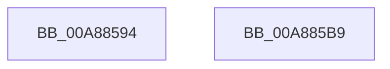

# PopIsRunningAsLocalSystem

- RVA: `0x00A88594`–`0x00A885BA` (길이 `38` bytes)
- VA: `0x0000000140A88594`
- 실행 섹션: `PAGE`
- PDB 이름 있음: `예`; PDB Function 태그: `아니요`
- unwind 정보 RVA: `0x0005C788`
- 디코드: `10`개 명령, `38/38` bytes 표시
- 미해석 바이트: `0` (있으면 어셈블리에 `.byte`로 보존)

> 이 문서는 커널 이미지의 기계어와 PDB 기호를 분석해 생성했습니다. 4번과 5번은 함수 원형과 자료형을 바이너리 사용 방식에서 추정한 C 해석이며 원본 소스 복구 결과는 아닙니다.

## 1. Dependencies

- 직접 호출 지점: **1**; 고유 호출 대상: **1**
- 직접 호출자로 확인된 함수: **2**
- RIP 상대 이미지 참조: **1**

### Outgoing calls
- `0x00A885AB` → [RtlCheckTokenMembership](../../text/3A/RtlCheckTokenMembership_function_003A5A10.md) (function, `0x003A5A10`)

### Direct callers
- [NtPowerInformation](../95/NtPowerInformation_function_00955D80.md) at `0x00955FCC`
- [PopPowerInformationInternal](PopPowerInformationInternal_function_00A8B7C0.md) at `0x00A8B8F2`
- [PopPowerInformationInternal](PopPowerInformationInternal_function_00A8B7C0.md) at `0x00A8B996`

### Static image references
- `0x00A88598` → RVA `0x00E67D58` (`.data`; read)

## 2. Other-region calls and transfers

- 다른 실행 섹션으로 향하는 call: **1**
  - `0x00A885AB` → [RtlCheckTokenMembership](../../text/3A/RtlCheckTokenMembership_function_003A5A10.md) (`PAGE` → `.text`)
- 별도 외부 분기/꼬리 이동을 확인하지 못했습니다.

## 3. Assembly (complete function range)

```asm
00A88594  48 83 EC 28                     sub rsp, 0x28
00A88598  48 8B 15 B9 F7 3D 00            mov rdx, qword ptr [rip + 0x3df7b9]
00A8859F  4C 8D 44 24 30                  lea r8, [rsp + 0x30]
00A885A4  33 C9                           xor ecx, ecx
00A885A6  C6 44 24 30 00                  mov byte ptr [rsp + 0x30], 0
00A885AB  E8 60 D4 91 FF                  call 0x1403a5a10
00A885B0  8A 44 24 30                     mov al, byte ptr [rsp + 0x30]
00A885B4  48 83 C4 28                     add rsp, 0x28
00A885B8  C3                              ret
00A885B9  CC                              int3
```

## 4. C-style interpretation (structured pseudocode)

```c
__int64 __fastcall PopIsRunningAsLocalSystem(int a1)
{
    __int64 result;
    __int64 v_rsp;
    unsigned __int64 v_stack_p8;

    v_rsp = (v_rsp) - (40);
    a1 = 0;
    v_stack_p8 = 0;
    result = RtlCheckTokenMembership(a1, *(unsigned __int64 *)(v_rip + 4061113), v_stack_p8, a4);
    v_rsp = (v_rsp) + (40);
    return v_stack_p8;
}
```

## 5. (Beta) C Style

```c
int64_t PopIsRunningAsLocalSystem(int32_t Arg1)
{
    int64_t result;
    int64_t local_rsp;
    uint64_t v_stack_p8;

    local_rsp = (local_rsp) - (40);
    Arg1 = 0;
    v_stack_p8 = 0;
    result = RtlCheckTokenMembership(Arg1, *(uint64_t *)(v_rip + 0x3DF7B9), v_stack_p8, a4);
    local_rsp = (local_rsp) + (40);
    return v_stack_p8;
}
```

## 6. Execution-region graph

[열기: 2D/3D 그래프와 함수 탐색 컨트롤 패널](../../../control-panel.html?section=page&rva=0x00A88594&view=graph)

- 2D 그래프는 위에서 아래로 흐르고, 3D 그래프는 빈 공간을 드래그해 회전합니다. Shift+드래그는 이동, 휠은 확대·축소, 함수 노드 선택은 대상 보고서 이동입니다.

### Static fallback


