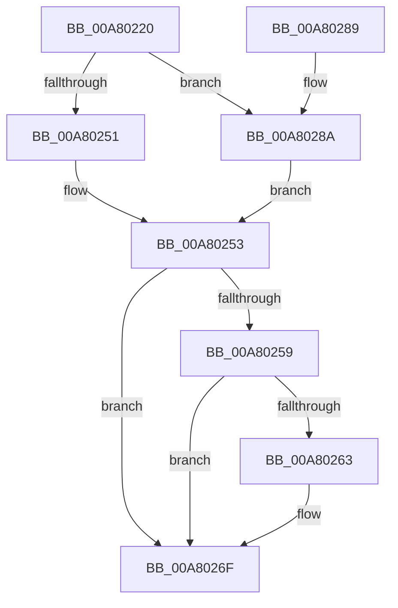

# PopNotifyWin32kRequestStatus

- RVA: `0x00A80220`–`0x00A80290` (길이 `112` bytes)
- VA: `0x0000000140A80220`
- 실행 섹션: `PAGE`
- PDB 이름 있음: `예`; PDB Function 태그: `아니요`
- unwind 정보 RVA: `0x00071254`
- 디코드: `32`개 명령, `112/112` bytes 표시
- 미해석 바이트: `0` (있으면 어셈블리에 `.byte`로 보존)

> 이 문서는 커널 이미지의 기계어와 PDB 기호를 분석해 생성했습니다. 4번과 5번은 함수 원형과 자료형을 바이너리 사용 방식에서 추정한 C 해석이며 원본 소스 복구 결과는 아닙니다.

## 1. Dependencies

- 직접 호출 지점: **3**; 고유 호출 대상: **3**
- 직접 호출자로 확인된 함수: **1**
- RIP 상대 이미지 참조: **3**

### Outgoing calls
- `0x00A8023E` → [PopAcquireRwLockExclusive](../../text/43/PopAcquireRwLockExclusive_function_00430B44.md) (function, `0x00430B44`)
- `0x00A8026A` → [PopQueueWorkItem](../../text/4A/PopQueueWorkItem_function_004A20F8.md) (function, `0x004A20F8`)
- `0x00A80272` → [PopReleaseRwLock](../../text/2D/PopReleaseRwLock_function_002DFBBC.md) (function, `0x002DFBBC`)

### Direct callers
- [PopPowerInformationInternal](PopPowerInformationInternal_function_00A8B7C0.md) at `0x00A8D43E`

### Static image references
- `0x00A80231` → RVA `0x00F0E840` (`.data`; read)
- `0x00A80259` → RVA `0x00F0E850` (`.data`; read)
- `0x00A80263` → RVA `0x00F0E9F8` (`.data`; read)

## 2. Other-region calls and transfers

- 다른 실행 섹션으로 향하는 call: **3**
  - `0x00A8023E` → [PopAcquireRwLockExclusive](../../text/43/PopAcquireRwLockExclusive_function_00430B44.md) (`PAGE` → `.text`)
  - `0x00A8026A` → [PopQueueWorkItem](../../text/4A/PopQueueWorkItem_function_004A20F8.md) (`PAGE` → `.text`)
  - `0x00A80272` → [PopReleaseRwLock](../../text/2D/PopReleaseRwLock_function_002DFBBC.md) (`PAGE` → `.text`)
- 별도 외부 분기/꼬리 이동을 확인하지 못했습니다.

## 3. Assembly (complete function range)

```asm
00A80220  48 89 5C 24 08                  mov qword ptr [rsp + 8], rbx
00A80225  48 89 74 24 10                  mov qword ptr [rsp + 0x10], rsi
00A8022A  57                              push rdi
00A8022B  48 83 EC 20                     sub rsp, 0x20
00A8022F  8B D9                           mov ebx, ecx
00A80231  48 8D 35 08 E6 48 00            lea rsi, [rip + 0x48e608]
00A80238  48 8B CE                        mov rcx, rsi
00A8023B  40 8A FA                        mov dil, dl
00A8023E  E8 01 09 9B FF                  call 0x140430b44
00A80243  8B 44 9E 18                     mov eax, dword ptr [rsi + rbx*4 + 0x18]
00A80247  BA 01 00 00 00                  mov edx, 1
00A8024C  40 84 FF                        test dil, dil
00A8024F  75 39                           jne 0x140a8028a
00A80251  2B C2                           sub eax, edx
00A80253  89 44 9E 18                     mov dword ptr [rsi + rbx*4 + 0x18], eax
00A80257  75 16                           jne 0x140a8026f
00A80259  48 83 3D EF E5 48 00 00         cmp qword ptr [rip + 0x48e5ef], 0
00A80261  74 0C                           je 0x140a8026f
00A80263  48 8D 0D 8E E7 48 00            lea rcx, [rip + 0x48e78e]
00A8026A  E8 89 1E A2 FF                  call 0x1404a20f8
00A8026F  48 8B CE                        mov rcx, rsi
00A80272  E8 45 F9 85 FF                  call 0x1402dfbbc
00A80277  48 8B 5C 24 30                  mov rbx, qword ptr [rsp + 0x30]
00A8027C  33 C0                           xor eax, eax
00A8027E  48 8B 74 24 38                  mov rsi, qword ptr [rsp + 0x38]
00A80283  48 83 C4 20                     add rsp, 0x20
00A80287  5F                              pop rdi
00A80288  C3                              ret
00A80289  CC                              int3
00A8028A  FF C0                           inc eax
00A8028C  3B C2                           cmp eax, edx
00A8028E  EB C3                           jmp 0x140a80253
```

## 4. C-style interpretation (structured pseudocode)

```c
__int64 __fastcall PopNotifyWin32kRequestStatus(int a1, unsigned __int8 a2)
{
    __int64 result;
    __int64 v_rsp;
    unsigned __int64 v_stack_p10;
    unsigned __int64 v_stack_p8;

    v_stack_p8 = v_rbx;
    v_stack_p10 = v_rsi;
    v_rsp = (v_rsp) - (32);
    result = PopAcquireRwLockExclusive(v_rip + 4777480, a2, a3, a4);
    if (a2 != 0) goto loc_00A8028A;
    result = (unsigned int)(((unsigned int)(*(unsigned int *)(v_rip + 4777480 + (unsigned int)(a1) * 4 + 24))) - (1));
loc_00A80253:
    *(unsigned int *)(v_rip + 4777480 + (unsigned int)(a1) * 4 + 24) = (unsigned int)(result);
    if (condition_is_not_equal) goto loc_00A8026F;
    if ((*(unsigned __int64 *)(v_rip + 4777455)) != 0) {
        a1 = v_rip + 4777870;
        result = PopQueueWorkItem(a1, 1, a3, a4);
    }
    result = PopReleaseRwLock(v_rip + 4777480, 1, a3, a4);
    result = 0;
    v_rsp = (v_rsp) + (32);
    return result;
loc_00A8028A:
    result = (unsigned int)((result) + 1);
    goto loc_00A80253;
}
```

## 5. (Beta) C Style

```c
int64_t PopNotifyWin32kRequestStatus(int32_t Arg1, uint8_t Arg2)
{
    int64_t result;
    int64_t local_rsp;
    uint64_t v_stack_p10;
    uint64_t v_stack_p8;

    v_stack_p8 = local_rbx;
    v_stack_p10 = local_rsi;
    local_rsp = (local_rsp) - (32);
    result = PopAcquireRwLockExclusive(v_rip + 4777480, Arg2, a3, a4);
    if (Arg2 != 0) goto loc_00A8028A;
    result = (uint32_t)(((uint32_t)(*(uint32_t *)(v_rip + 0x48E608 + (uint32_t)(Arg1) * 4 + 0x18))) - (1));
loc_00A80253:
    *(uint32_t *)(v_rip + 0x48E608 + (uint32_t)(Arg1) * 4 + 0x18) = (uint32_t)(result);
    if (condition_is_not_equal) goto loc_00A8026F;
    if ((*(uint64_t *)(v_rip + 0x48E5EF)) != 0) {
        Arg1 = v_rip + 4777870;
        result = PopQueueWorkItem(Arg1, 1, a3, a4);
    }
    result = PopReleaseRwLock(v_rip + 4777480, 1, a3, a4);
    result = 0;
    local_rsp = (local_rsp) + (32);
    return result;
loc_00A8028A:
    result = (uint32_t)((result) + 1);
    goto loc_00A80253;
}
```

## 6. Execution-region graph

[열기: 2D/3D 그래프와 함수 탐색 컨트롤 패널](../../../control-panel.html?section=page&rva=0x00A80220&view=graph)

- 2D 그래프는 위에서 아래로 흐르고, 3D 그래프는 빈 공간을 드래그해 회전합니다. Shift+드래그는 이동, 휠은 확대·축소, 함수 노드 선택은 대상 보고서 이동입니다.

### Static fallback


