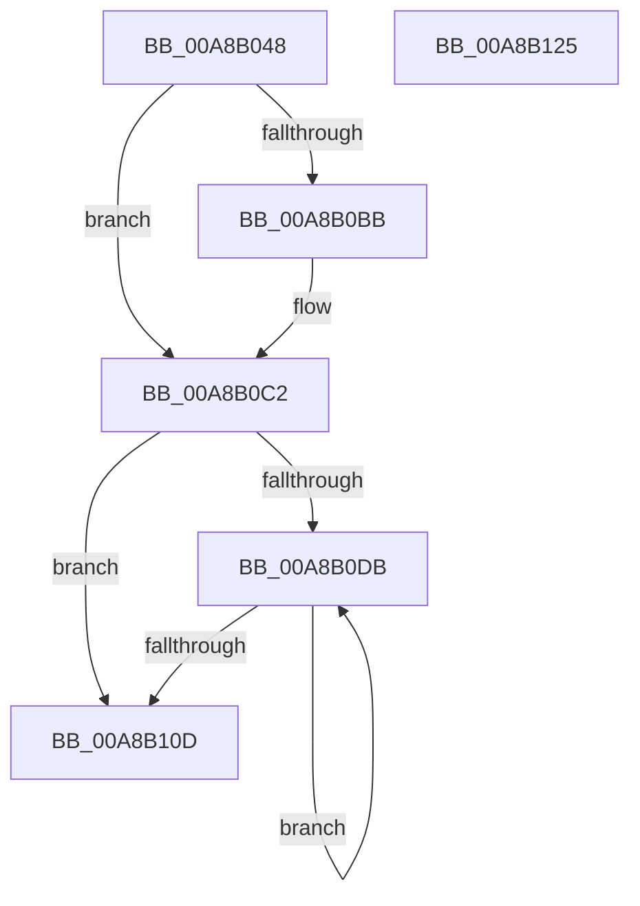

# PopPepUnregisterDevice

- RVA: `0x00A8B048`–`0x00A8B126` (길이 `222` bytes)
- VA: `0x0000000140A8B048`
- 실행 섹션: `PAGE`
- PDB 이름 있음: `예`; PDB Function 태그: `아니요`
- unwind 정보 RVA: `0x0006E5F8`
- 디코드: `57`개 명령, `222/222` bytes 표시
- 미해석 바이트: `0` (있으면 어셈블리에 `.byte`로 보존)

> 이 문서는 커널 이미지의 기계어와 PDB 기호를 분석해 생성했습니다. 4번과 5번은 함수 원형과 자료형을 바이너리 사용 방식에서 추정한 C 해석이며 원본 소스 복구 결과는 아닙니다.

## 1. Dependencies

- 직접 호출 지점: **8**; 고유 호출 대상: **7**
- 직접 호출자로 확인된 함수: **1**
- RIP 상대 이미지 참조: **1**

### Outgoing calls
- `0x00A8B069` → [DbgPrintEx](../../text/35/DbgPrintEx_function_00359290.md) (function, `0x00359290`)
- `0x00A8B082` → [PopPepProcessEvent](../../text/24/PopPepProcessEvent_function_0024B930.md) (function, `0x0024B930`)
- `0x00A8B098` → [KeWaitForSingleObject](../../text/20/KeWaitForSingleObject_function_0020E6B0.md) (function, `0x0020E6B0`)
- `0x00A8B0A0` → [PopPepWaitForDeviceRelease](../../text/4F/PopPepWaitForDeviceRelease_function_004FC920.md) (function, `0x004FC920`)
- `0x00A8B0A8` → [PopPepRemoveDevice](../../text/4C/PopPepRemoveDevice_function_004CBE38.md) (function, `0x004CBE38`)
- `0x00A8B0CE` → [PopPepUpdateIdleStateRefCount](../../text/2B/PopPepUpdateIdleStateRefCount_function_002BF930.md) (function, `0x002BF930`)
- `0x00A8B0FE` → [PopPepUpdateIdleStateRefCount](../../text/2B/PopPepUpdateIdleStateRefCount_function_002BF930.md) (function, `0x002BF930`)
- `0x00A8B115` → [ExFreePoolWithTag](../../poolcode/B8/ExFreePoolWithTag_function_00B82870.md) (function, `0x00B82870`)

### Direct callers
- [PopFxUnregisterDevice](PopFxUnregisterDevice_function_00A8AE84.md) at `0x00A8AFE2`

### Static image references
- `0x00A8B055` → RVA `0x00B03E20` (` ?? ::NNGAKEGL::`string'`; read)

## 2. Other-region calls and transfers

- 다른 실행 섹션으로 향하는 call: **8**
  - `0x00A8B069` → [DbgPrintEx](../../text/35/DbgPrintEx_function_00359290.md) (`PAGE` → `.text`)
  - `0x00A8B082` → [PopPepProcessEvent](../../text/24/PopPepProcessEvent_function_0024B930.md) (`PAGE` → `.text`)
  - `0x00A8B098` → [KeWaitForSingleObject](../../text/20/KeWaitForSingleObject_function_0020E6B0.md) (`PAGE` → `.text`)
  - `0x00A8B0A0` → [PopPepWaitForDeviceRelease](../../text/4F/PopPepWaitForDeviceRelease_function_004FC920.md) (`PAGE` → `.text`)
  - `0x00A8B0A8` → [PopPepRemoveDevice](../../text/4C/PopPepRemoveDevice_function_004CBE38.md) (`PAGE` → `.text`)
  - `0x00A8B0CE` → [PopPepUpdateIdleStateRefCount](../../text/2B/PopPepUpdateIdleStateRefCount_function_002BF930.md) (`PAGE` → `.text`)
  - `0x00A8B0FE` → [PopPepUpdateIdleStateRefCount](../../text/2B/PopPepUpdateIdleStateRefCount_function_002BF930.md) (`PAGE` → `.text`)
  - `0x00A8B115` → [ExFreePoolWithTag](../../poolcode/B8/ExFreePoolWithTag_function_00B82870.md) (`PAGE` → `POOLCODE`)
- 별도 외부 분기/꼬리 이동을 확인하지 못했습니다.

## 3. Assembly (complete function range)

```asm
00A8B048  48 89 5C 24 08                  mov qword ptr [rsp + 8], rbx
00A8B04D  57                              push rdi
00A8B04E  48 83 EC 30                     sub rsp, 0x30
00A8B052  48 8B D9                        mov rbx, rcx
00A8B055  4C 8D 05 C4 8D 07 00            lea r8, [rip + 0x78dc4]
00A8B05C  4C 8B C9                        mov r9, rcx
00A8B05F  BA 03 00 00 00                  mov edx, 3
00A8B064  B9 92 00 00 00                  mov ecx, 0x92
00A8B069  E8 22 E2 8C FF                  call 0x140359290
00A8B06E  33 FF                           xor edi, edi
00A8B070  33 D2                           xor edx, edx
00A8B072  48 8B CB                        mov rcx, rbx
00A8B075  48 89 7C 24 28                  mov qword ptr [rsp + 0x28], rdi
00A8B07A  44 8D 4F 05                     lea r9d, [rdi + 5]
00A8B07E  44 8D 47 06                     lea r8d, [rdi + 6]
00A8B082  E8 A9 08 7C FF                  call 0x14024b930
00A8B087  48 8D 4B 28                     lea rcx, [rbx + 0x28]
00A8B08B  48 89 7C 24 20                  mov qword ptr [rsp + 0x20], rdi
00A8B090  45 33 C9                        xor r9d, r9d
00A8B093  45 33 C0                        xor r8d, r8d
00A8B096  33 D2                           xor edx, edx
00A8B098  E8 13 36 78 FF                  call 0x14020e6b0
00A8B09D  48 8B CB                        mov rcx, rbx
00A8B0A0  E8 7B 18 A7 FF                  call 0x1404fc920
00A8B0A5  48 8B CB                        mov rcx, rbx
00A8B0A8  E8 8B 0D A4 FF                  call 0x1404cbe38
00A8B0AD  48 63 83 A8 00 00 00            movsxd rax, dword ptr [rbx + 0xa8]
00A8B0B4  8B CF                           mov ecx, edi
00A8B0B6  83 F8 04                        cmp eax, 4
00A8B0B9  74 07                           je 0x140a8b0c2
00A8B0BB  8B 8C 83 8C 00 00 00            mov ecx, dword ptr [rbx + rax*4 + 0x8c]
00A8B0C2  4C 8D 8B B8 00 00 00            lea r9, [rbx + 0xb8]
00A8B0C9  45 33 C0                        xor r8d, r8d
00A8B0CC  33 D2                           xor edx, edx
00A8B0CE  E8 5D 48 83 FF                  call 0x1402bf930
00A8B0D3  39 BB B4 00 00 00               cmp dword ptr [rbx + 0xb4], edi
00A8B0D9  76 32                           jbe 0x140a8b10d
00A8B0DB  8B C7                           mov eax, edi
00A8B0DD  4C 8D 8B 80 01 00 00            lea r9, [rbx + 0x180]
00A8B0E4  48 69 C8 D0 00 00 00            imul rcx, rax, 0xd0
00A8B0EB  45 33 C0                        xor r8d, r8d
00A8B0EE  33 D2                           xor edx, edx
00A8B0F0  4C 03 C9                        add r9, rcx
00A8B0F3  48 8B 8C 19 88 01 00 00         mov rcx, qword ptr [rcx + rbx + 0x188]
00A8B0FB  8B 49 10                        mov ecx, dword ptr [rcx + 0x10]
00A8B0FE  E8 2D 48 83 FF                  call 0x1402bf930
00A8B103  FF C7                           inc edi
00A8B105  3B BB B4 00 00 00               cmp edi, dword ptr [rbx + 0xb4]
00A8B10B  72 CE                           jb 0x140a8b0db
00A8B10D  BA 50 65 70 54                  mov edx, 0x54706550
00A8B112  48 8B CB                        mov rcx, rbx
00A8B115  E8 56 77 0F 00                  call 0x140b82870
00A8B11A  48 8B 5C 24 40                  mov rbx, qword ptr [rsp + 0x40]
00A8B11F  48 83 C4 30                     add rsp, 0x30
00A8B123  5F                              pop rdi
00A8B124  C3                              ret
00A8B125  CC                              int3
```

## 4. C-style interpretation (structured pseudocode)

```c
__int64 __fastcall PopPepUnregisterDevice(__int64 a1)
{
    __int64 result;
    __int64 v_rdi;
    __int64 v_rsp;
    unsigned __int64 v_stack_m10;
    unsigned __int64 v_stack_m18;
    unsigned __int64 v_stack_p8;

    v_stack_p8 = v_rbx;
    v_rsp = (v_rsp) - (48);
    result = DbgPrintEx(146, 3, v_rip + 495044, a1);
    v_rdi = 0;
    a2 = 0;
    v_stack_m10 = 0;
    result = PopPepProcessEvent(a1, a2, v_rdi + 6, v_rdi + 5);
    v_stack_m18 = 0;
    a4 = 0;
    a3 = 0;
    a2 = 0;
    result = KeWaitForSingleObject(a1 + 40, a2, a3, a4);
    result = PopPepWaitForDeviceRelease(a1, a2, a3, a4);
    result = PopPepRemoveDevice(a1, a2, a3, a4);
    if (((unsigned int)((int)(*(unsigned int *)(a1 + 168)))) != 4) {
        a1 = *(unsigned int *)(a1 + (int)(*(unsigned int *)(a1 + 168)) * 4 + 140);
    }
    a3 = 0;
    a2 = 0;
    result = PopPepUpdateIdleStateRefCount(a1, a2, a3, a1 + 184);
    if ((*(unsigned int *)(a1 + 180)) <= 0) goto loc_00A8B10D;
loc_00A8B0DB:
    a1 = (a1) * (0);
    a3 = 0;
    a2 = 0;
    a4 = (a1 + 384) + (a1);
    result = PopPepUpdateIdleStateRefCount((unsigned int)(*(unsigned int *)(*(unsigned __int64 *)(a1 + a1 * 1 + 392) + 16)), a2, a3, a4);
    v_rdi = (unsigned int)((v_rdi) + 1);
    if (((unsigned int)(v_rdi)) < (*(unsigned int *)(a1 + 180))) goto loc_00A8B0DB;
loc_00A8B10D:
    result = ExFreePoolWithTag(a1, (unsigned int)(0x54706550ULL), a3, a4);
    v_rsp = (v_rsp) + (48);
    return result;
}
```

## 5. (Beta) C Style

```c
int64_t PopPepUnregisterDevice(void *Arg1)
{
    uint8_t *arg1 = (uint8_t *)Arg1;

    int64_t result;
    int64_t local_rdi;
    int64_t local_rsp;
    uint64_t v_stack_m10;
    uint64_t v_stack_m18;
    uint64_t v_stack_p8;

    v_stack_p8 = local_rbx;
    local_rsp = (local_rsp) - (48);
    result = DbgPrintEx(146, 3, v_rip + 495044, Arg1);
    local_rdi = 0;
    a2 = 0;
    v_stack_m10 = 0;
    result = PopPepProcessEvent(Arg1, a2, local_rdi + 6, local_rdi + 5);
    v_stack_m18 = 0;
    a4 = 0;
    a3 = 0;
    a2 = 0;
    result = KeWaitForSingleObject(Arg1 + 40, a2, a3, a4);
    result = PopPepWaitForDeviceRelease(Arg1, a2, a3, a4);
    result = PopPepRemoveDevice(Arg1, a2, a3, a4);
    if (((uint32_t)((int32_t)(*(uint32_t *)(arg1 + 0xA8)))) != 4) {
        Arg1 = *(uint32_t *)(arg1 + (int32_t)(*(uint32_t *)(arg1 + 0xA8)) * 4 + 0x8C);
    }
    a3 = 0;
    a2 = 0;
    result = PopPepUpdateIdleStateRefCount(Arg1, a2, a3, Arg1 + 184);
    if ((*(uint32_t *)(arg1 + 0xB4)) <= 0) goto loc_00A8B10D;
loc_00A8B0DB:
    Arg1 = (Arg1) * (0);
    a3 = 0;
    a2 = 0;
    a4 = (Arg1 + 384) + (Arg1);
    result = PopPepUpdateIdleStateRefCount((uint32_t)(*(uint32_t *)(*(uint64_t *)(arg1 + arg1 * 1 + 0x188) + 0x10)), a2, a3, a4);
    local_rdi = (uint32_t)((local_rdi) + 1);
    if (((uint32_t)(local_rdi)) < (*(uint32_t *)(arg1 + 0xB4))) goto loc_00A8B0DB;
loc_00A8B10D:
    result = ExFreePoolWithTag(Arg1, (uint32_t)(0x54706550ULL), a3, a4);
    local_rsp = (local_rsp) + (48);
    return result;
}
```

### 관측된 메모리 오프셋

구조체 형식이 확인되지 않은 접근은 인자 기준의 오프셋으로만 기록했습니다.

| 기준 인자 | 오프셋 표현 | 폭 (bit) | 접근 |
|---|---:|---:|---|
| `Arg1` | `+ 0x28` | `64` | `R` |
| `Arg1` | `+ 0x8C + rax*4` | `32` | `R` |
| `Arg1` | `+ 0xA8` | `32` | `R` |
| `Arg1` | `+ 0xB4` | `32` | `R` |
| `Arg1` | `+ 0xB8` | `64` | `R` |
| `Arg1` | `+ 0x180` | `64` | `R` |

## 6. Execution-region graph

[열기: 2D/3D 그래프와 함수 탐색 컨트롤 패널](../../../control-panel.html?section=page&rva=0x00A8B048&view=graph)

- 2D 그래프는 위에서 아래로 흐르고, 3D 그래프는 빈 공간을 드래그해 회전합니다. Shift+드래그는 이동, 휠은 확대·축소, 함수 노드 선택은 대상 보고서 이동입니다.

### Static fallback


