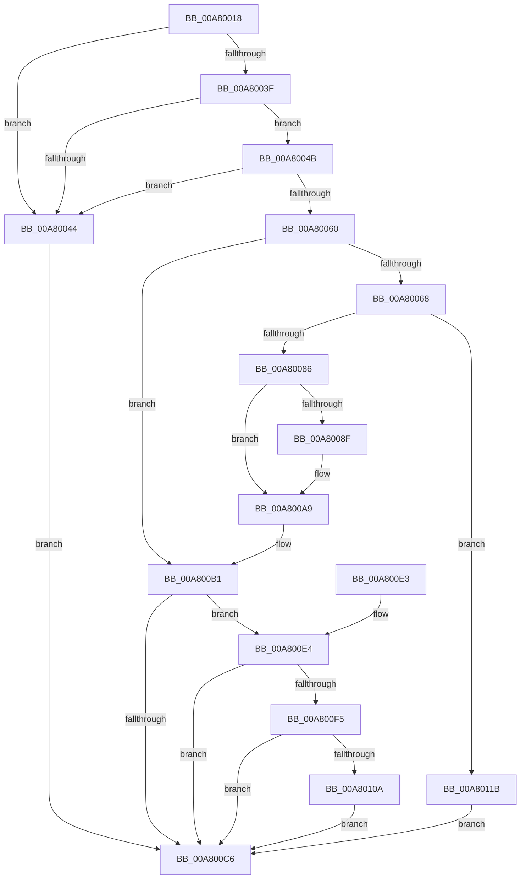

# PopPowerRequestStatsIdConcat

- RVA: `0x00A80018`–`0x00A80122` (길이 `266` bytes)
- VA: `0x0000000140A80018`
- 실행 섹션: `PAGE`
- PDB 이름 있음: `예`; PDB Function 태그: `아니요`
- unwind 정보 RVA: `0x0006F600`
- 디코드: `77`개 명령, `266/266` bytes 표시
- 미해석 바이트: `0` (있으면 어셈블리에 `.byte`로 보존)

> 이 문서는 커널 이미지의 기계어와 PDB 기호를 분석해 생성했습니다. 4번과 5번은 함수 원형과 자료형을 바이너리 사용 방식에서 추정한 C 해석이며 원본 소스 복구 결과는 아닙니다.

## 1. Dependencies

- 직접 호출 지점: **6**; 고유 호출 대상: **5**
- 직접 호출자로 확인된 함수: **1**
- RIP 상대 이미지 참조: **2**

### Outgoing calls
- `0x00A80075` → [ExAllocatePool2](../../poolcode/B8/ExAllocatePool2_function_00B820F0.md) (function, `0x00B820F0`)
- `0x00A80096` → [memcpy](../../text/6C/memcpy_function_006C6840.md) (function, `0x006C6840`)
- `0x00A800A4` → [ExFreePoolWithTag](../../poolcode/B8/ExFreePoolWithTag_function_00B82870.md) (function, `0x00B82870`)
- `0x00A800BB` → [RtlUnicodeStringCatString](../../text/41/RtlUnicodeStringCatString_function_0041CD30.md) (function, `0x0041CD30`)
- `0x00A800EA` → [RtlUnicodeStringCat](../../text/3E/RtlUnicodeStringCat_function_003E6030.md) (function, `0x003E6030`)
- `0x00A800FF` → [RtlUnicodeStringCatString](../../text/41/RtlUnicodeStringCatString_function_0041CD30.md) (function, `0x0041CD30`)

### Direct callers
- [PopPowerRequestStatsGetIdForRequest](../A2/PopPowerRequestStatsGetIdForRequest_function_00A2D784.md) at `0x00A2D911`

### Static image references
- `0x00A800B1` → RVA `0x00B01BC0` (` ?? ::NNGAKEGL::`string'`; read)
- `0x00A800F5` → RVA `0x00B01BB0` (` ?? ::NNGAKEGL::`string'`; read)

## 2. Other-region calls and transfers

- 다른 실행 섹션으로 향하는 call: **6**
  - `0x00A80075` → [ExAllocatePool2](../../poolcode/B8/ExAllocatePool2_function_00B820F0.md) (`PAGE` → `POOLCODE`)
  - `0x00A80096` → [memcpy](../../text/6C/memcpy_function_006C6840.md) (`PAGE` → `.text`)
  - `0x00A800A4` → [ExFreePoolWithTag](../../poolcode/B8/ExFreePoolWithTag_function_00B82870.md) (`PAGE` → `POOLCODE`)
  - `0x00A800BB` → [RtlUnicodeStringCatString](../../text/41/RtlUnicodeStringCatString_function_0041CD30.md) (`PAGE` → `.text`)
  - `0x00A800EA` → [RtlUnicodeStringCat](../../text/3E/RtlUnicodeStringCat_function_003E6030.md) (`PAGE` → `.text`)
  - `0x00A800FF` → [RtlUnicodeStringCatString](../../text/41/RtlUnicodeStringCatString_function_0041CD30.md) (`PAGE` → `.text`)
- 별도 외부 분기/꼬리 이동을 확인하지 못했습니다.

## 3. Assembly (complete function range)

```asm
00A80018  48 8B C4                        mov rax, rsp
00A8001B  48 89 58 08                     mov qword ptr [rax + 8], rbx
00A8001F  48 89 68 10                     mov qword ptr [rax + 0x10], rbp
00A80023  48 89 70 18                     mov qword ptr [rax + 0x18], rsi
00A80027  48 89 78 20                     mov qword ptr [rax + 0x20], rdi
00A8002B  41 56                           push r14
00A8002D  48 83 EC 20                     sub rsp, 0x20
00A80031  45 33 F6                        xor r14d, r14d
00A80034  48 8B F2                        mov rsi, rdx
00A80037  48 8B D9                        mov rbx, rcx
00A8003A  48 85 C9                        test rcx, rcx
00A8003D  74 05                           je 0x140a80044
00A8003F  48 85 D2                        test rdx, rdx
00A80042  75 07                           jne 0x140a8004b
00A80044  BA 0D 00 00 C0                  mov edx, 0xc000000d
00A80049  EB 7B                           jmp 0x140a800c6
00A8004B  0F B7 3A                        movzx edi, word ptr [rdx]
00A8004E  44 0F B7 01                     movzx r8d, word ptr [rcx]
00A80052  83 C7 08                        add edi, 8
00A80055  41 03 F8                        add edi, r8d
00A80058  81 FF FF FF 00 00               cmp edi, 0xffff
00A8005E  77 E4                           ja 0x140a80044
00A80060  0F B7 41 02                     movzx eax, word ptr [rcx + 2]
00A80064  3B C7                           cmp eax, edi
00A80066  73 49                           jae 0x140a800b1
00A80068  8B D7                           mov edx, edi
00A8006A  B9 00 01 00 00                  mov ecx, 0x100
00A8006F  41 B8 50 57 51 54               mov r8d, 0x54515750
00A80075  E8 76 20 10 00                  call 0x140b820f0
00A8007A  48 8B E8                        mov rbp, rax
00A8007D  48 85 C0                        test rax, rax
00A80080  0F 84 95 00 00 00               je 0x140a8011b
00A80086  48 8B 53 08                     mov rdx, qword ptr [rbx + 8]
00A8008A  48 85 D2                        test rdx, rdx
00A8008D  74 1A                           je 0x140a800a9
00A8008F  44 0F B7 03                     movzx r8d, word ptr [rbx]
00A80093  48 8B C8                        mov rcx, rax
00A80096  E8 A5 67 C4 FF                  call 0x1406c6840
00A8009B  48 8B 4B 08                     mov rcx, qword ptr [rbx + 8]
00A8009F  BA 50 57 51 54                  mov edx, 0x54515750
00A800A4  E8 C7 27 10 00                  call 0x140b82870
00A800A9  48 89 6B 08                     mov qword ptr [rbx + 8], rbp
00A800AD  66 89 7B 02                     mov word ptr [rbx + 2], di
00A800B1  48 8D 15 08 1B 08 00            lea rdx, [rip + 0x81b08]
00A800B8  48 8B CB                        mov rcx, rbx
00A800BB  E8 70 CC 99 FF                  call 0x14041cd30
00A800C0  8B D0                           mov edx, eax
00A800C2  85 C0                           test eax, eax
00A800C4  79 1E                           jns 0x140a800e4
00A800C6  48 8B 5C 24 30                  mov rbx, qword ptr [rsp + 0x30]
00A800CB  8B C2                           mov eax, edx
00A800CD  48 8B 6C 24 38                  mov rbp, qword ptr [rsp + 0x38]
00A800D2  48 8B 74 24 40                  mov rsi, qword ptr [rsp + 0x40]
00A800D7  48 8B 7C 24 48                  mov rdi, qword ptr [rsp + 0x48]
00A800DC  48 83 C4 20                     add rsp, 0x20
00A800E0  41 5E                           pop r14
00A800E2  C3                              ret
00A800E3  CC                              int3
00A800E4  48 8B D6                        mov rdx, rsi
00A800E7  48 8B CB                        mov rcx, rbx
00A800EA  E8 41 5F 96 FF                  call 0x1403e6030
00A800EF  8B D0                           mov edx, eax
00A800F1  85 C0                           test eax, eax
00A800F3  78 D1                           js 0x140a800c6
00A800F5  48 8D 15 B4 1A 08 00            lea rdx, [rip + 0x81ab4]
00A800FC  48 8B CB                        mov rcx, rbx
00A800FF  E8 2C CC 99 FF                  call 0x14041cd30
00A80104  8B D0                           mov edx, eax
00A80106  85 C0                           test eax, eax
00A80108  78 BC                           js 0x140a800c6
00A8010A  0F B7 0B                        movzx ecx, word ptr [rbx]
00A8010D  48 8B 43 08                     mov rax, qword ptr [rbx + 8]
00A80111  48 D1 E9                        shr rcx, 1
00A80114  66 44 89 34 48                  mov word ptr [rax + rcx*2], r14w
00A80119  EB AB                           jmp 0x140a800c6
00A8011B  BA 9A 00 00 C0                  mov edx, 0xc000009a
00A80120  EB A4                           jmp 0x140a800c6
```

## 4. C-style interpretation (structured pseudocode)

```c
__int64 __fastcall PopPowerRequestStatsIdConcat(__int64 a1, __int64 a2)
{
    __int64 result;
    __int64 v_r14;
    __int64 v_rdi;
    __int64 v_rsp;
    unsigned __int64 v_stack_p10;
    unsigned __int64 v_stack_p18;
    unsigned __int64 v_stack_p20;
    unsigned __int64 v_stack_p8;

    *(unsigned __int64 *)(v_rsp + 8) = v_rbx;
    *(unsigned __int64 *)(v_rsp + 16) = v_rbp;
    *(unsigned __int64 *)(v_rsp + 24) = v_rsi;
    *(unsigned __int64 *)(v_rsp + 32) = v_rdi;
    v_rsp = (v_rsp) - (32);
    v_r14 = 0;
    if (a1 == 0) goto loc_00A80044;
    if (a2 != 0) goto loc_00A8004B;
loc_00A80044:
    goto loc_00A800C6;
loc_00A8004B:
    v_rdi = (unsigned int)((*(unsigned __int16 *)((unsigned int)(0xC000000DULL))) + (8));
    v_rdi = (unsigned int)((v_rdi) + ((unsigned int)(*(unsigned __int16 *)(a1))));
    if (((unsigned int)(v_rdi)) > 0xFFFFULL) goto loc_00A80044;
    if (((unsigned int)(*(unsigned __int16 *)(a1 + 2))) >= ((unsigned int)(v_rdi))) goto loc_00A800B1;
    result = ExAllocatePool2(256, (unsigned int)((unsigned int)(v_rdi)), (unsigned int)(0x54515750ULL), a4);
    if (result == 0) goto loc_00A8011B;
    if (*(unsigned __int64 *)(a1 + 8) != 0) {
        a3 = *(unsigned __int16 *)(a1);
        a1 = result;
        result = memcpy(a1, *(unsigned __int64 *)(a1 + 8), a3, a4);
        a1 = *(unsigned __int64 *)(a1 + 8);
        a2 = 0x54515750ULL;
        result = ExFreePoolWithTag(a1, a2, a3, a4);
    }
    *(unsigned __int64 *)(a1 + 8) = result;
    *(unsigned __int16 *)(a1 + 2) = (unsigned __int16)(v_rdi);
loc_00A800B1:
    result = RtlUnicodeStringCatString(a1, v_rip + 531208, a3, a4);
    if (!sign_flag) goto loc_00A800E4;
loc_00A800C6:
    v_rsp = (v_rsp) + (32);
    return (unsigned int)((unsigned int)((unsigned int)((unsigned int)(result))));
loc_00A800E4:
    result = RtlUnicodeStringCat(v_stack_p8, v_stack_p18, a3, a4);
    if (sign_flag) goto loc_00A800C6;
    result = RtlUnicodeStringCatString(v_stack_p8, v_rip + 531124, a3, a4);
    if (sign_flag) goto loc_00A800C6;
    a1 = (*(unsigned __int16 *)(v_stack_p8)) >> (1);
    *(unsigned __int16 *)(*(unsigned __int64 *)(v_stack_p8 + 8) + a1 * 2) = 0;
    goto loc_00A800C6;
loc_00A8011B:
    goto loc_00A800C6;
}
```

## 5. (Beta) C Style

```c
int64_t PopPowerRequestStatsIdConcat(void *Arg1, int64_t Arg2)
{
    uint8_t *arg1 = (uint8_t *)Arg1;

    int64_t result;
    int64_t local_r14;
    int64_t local_rdi;
    int64_t local_rsp;
    uint64_t v_stack_p10;
    uint64_t v_stack_p18;
    uint64_t v_stack_p20;
    uint64_t v_stack_p8;

    *(uint64_t *)(local_rsp + 0x8) = local_rbx;
    *(uint64_t *)(local_rsp + 0x10) = local_rbp;
    *(uint64_t *)(local_rsp + 0x18) = local_rsi;
    *(uint64_t *)(local_rsp + 0x20) = local_rdi;
    local_rsp = (local_rsp) - (32);
    local_r14 = 0;
    if (Arg1 == NULL) goto loc_00A80044;
    if (Arg2 != 0) goto loc_00A8004B;
loc_00A80044:
    goto loc_00A800C6;
loc_00A8004B:
    local_rdi = (uint32_t)((*(uint16_t *)((uint32_t)(0xC000000DULL))) + (8));
    local_rdi = (uint32_t)((local_rdi) + ((uint32_t)(*(uint16_t *)(arg1))));
    if (((uint32_t)(local_rdi)) > 0xFFFFULL) goto loc_00A80044;
    if (((uint32_t)(*(uint16_t *)(arg1 + 0x2))) >= ((uint32_t)(local_rdi))) goto loc_00A800B1;
    result = ExAllocatePool2(256, (uint32_t)((uint32_t)(local_rdi)), (uint32_t)(0x54515750ULL), a4);
    if (result == 0) goto loc_00A8011B;
    if (*(uint64_t *)(arg1 + 0x8) != 0) {
        a3 = *(uint16_t *)(arg1);
        Arg1 = result;
        result = memcpy(Arg1, *(uint64_t *)(arg1 + 0x8), a3, a4);
        Arg1 = *(uint64_t *)(arg1 + 0x8);
        Arg2 = 0x54515750ULL;
        result = ExFreePoolWithTag(Arg1, Arg2, a3, a4);
    }
    *(uint64_t *)(arg1 + 0x8) = result;
    *(uint16_t *)(arg1 + 0x2) = (uint16_t)(local_rdi);
loc_00A800B1:
    result = RtlUnicodeStringCatString(Arg1, v_rip + 531208, a3, a4);
    if (!sign_flag) goto loc_00A800E4;
loc_00A800C6:
    local_rsp = (local_rsp) + (32);
    return (uint32_t)((uint32_t)((uint32_t)((uint32_t)(result))));
loc_00A800E4:
    result = RtlUnicodeStringCat(v_stack_p8, v_stack_p18, a3, a4);
    if (sign_flag) goto loc_00A800C6;
    result = RtlUnicodeStringCatString(v_stack_p8, v_rip + 531124, a3, a4);
    if (sign_flag) goto loc_00A800C6;
    Arg1 = (*(uint16_t *)(v_stack_p8)) >> (1);
    *(uint16_t *)(*(uint64_t *)(v_stack_p8 + 0x8) + arg1 * 2) = 0;
    goto loc_00A800C6;
loc_00A8011B:
    goto loc_00A800C6;
}
```

### 관측된 메모리 오프셋

구조체 형식이 확인되지 않은 접근은 인자 기준의 오프셋으로만 기록했습니다.

| 기준 인자 | 오프셋 표현 | 폭 (bit) | 접근 |
|---|---:|---:|---|
| `Arg1` | `+ 0x0` | `16` | `R` |
| `Arg1` | `+ 0x2` | `16` | `W` |
| `Arg1` | `+ 0x8` | `64` | `R` |
| `Arg1` | `+ 0x8` | `64` | `W` |

## 6. Execution-region graph

[열기: 2D/3D 그래프와 함수 탐색 컨트롤 패널](../../../control-panel.html?section=page&rva=0x00A80018&view=graph)

- 2D 그래프는 위에서 아래로 흐르고, 3D 그래프는 빈 공간을 드래그해 회전합니다. Shift+드래그는 이동, 휠은 확대·축소, 함수 노드 선택은 대상 보고서 이동입니다.

### Static fallback


