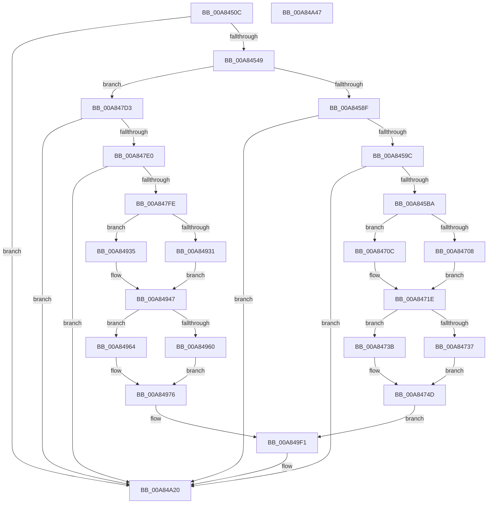

# PopSetBatteryDischargingState

- RVA: `0x00A8450C`–`0x00A84A48` (길이 `1,340` bytes)
- VA: `0x0000000140A8450C`
- 실행 섹션: `PAGE`
- PDB 이름 있음: `예`; PDB Function 태그: `아니요`
- unwind 정보 RVA: `0x000B7648`
- 디코드: `307`개 명령, `1,340/1,340` bytes 표시
- 미해석 바이트: `0` (있으면 어셈블리에 `.byte`로 보존)

> 이 문서는 커널 이미지의 기계어와 PDB 기호를 분석해 생성했습니다. 4번과 5번은 함수 원형과 자료형을 바이너리 사용 방식에서 추정한 C 해석이며 원본 소스 복구 결과는 아닙니다.

## 1. Dependencies

- 직접 호출 지점: **25**; 고유 호출 대상: **6**
- 직접 호출자로 확인된 함수: **1**
- RIP 상대 이미지 참조: **23**

### Outgoing calls
- `0x00A8457B` → [ZwUpdateWnfStateData](../../text/6B/ZwUpdateWnfStateData_function_006B0D10.md) (function, `0x006B0D10`)
- `0x00A84582` → [Feature_BatteryChargeLimitV2Support__private_IsEnabledDeviceUsageNoInline](../../text/5D/Feature_BatteryChargeLimitV2Support__private_IsEnabledDeviceUsageNoInline_function_005D9484.md) (function, `0x005D9484`)
- `0x00A845AD` → [tlgKeywordOn](../../text/42/tlgKeywordOn_function_0042EAA0.md) (function, `0x0042EAA0`)
- `0x00A84607` → [tlgCreate1Sz_char](../../text/42/tlgCreate1Sz_char_function_00427304.md) (function, `0x00427304`)
- `0x00A84627` → [tlgCreate1Sz_char](../../text/42/tlgCreate1Sz_char_function_00427304.md) (function, `0x00427304`)
- `0x00A84640` → [tlgCreate1Sz_char](../../text/42/tlgCreate1Sz_char_function_00427304.md) (function, `0x00427304`)
- `0x00A84659` → [tlgCreate1Sz_char](../../text/42/tlgCreate1Sz_char_function_00427304.md) (function, `0x00427304`)
- `0x00A84672` → [tlgCreate1Sz_char](../../text/42/tlgCreate1Sz_char_function_00427304.md) (function, `0x00427304`)
- `0x00A8468B` → [tlgCreate1Sz_char](../../text/42/tlgCreate1Sz_char_function_00427304.md) (function, `0x00427304`)
- `0x00A846A4` → [tlgCreate1Sz_char](../../text/42/tlgCreate1Sz_char_function_00427304.md) (function, `0x00427304`)
- `0x00A846BD` → [tlgCreate1Sz_char](../../text/42/tlgCreate1Sz_char_function_00427304.md) (function, `0x00427304`)
- `0x00A846D8` → [tlgCreate1Sz_char](../../text/42/tlgCreate1Sz_char_function_00427304.md) (function, `0x00427304`)
- `0x00A846F3` → [tlgCreate1Sz_char](../../text/42/tlgCreate1Sz_char_function_00427304.md) (function, `0x00427304`)
- `0x00A847F1` → [tlgKeywordOn](../../text/42/tlgKeywordOn_function_0042EAA0.md) (function, `0x0042EAA0`)
- `0x00A8484B` → [tlgCreate1Sz_char](../../text/42/tlgCreate1Sz_char_function_00427304.md) (function, `0x00427304`)
- `0x00A8486B` → [tlgCreate1Sz_char](../../text/42/tlgCreate1Sz_char_function_00427304.md) (function, `0x00427304`)
- `0x00A84884` → [tlgCreate1Sz_char](../../text/42/tlgCreate1Sz_char_function_00427304.md) (function, `0x00427304`)
- `0x00A8489D` → [tlgCreate1Sz_char](../../text/42/tlgCreate1Sz_char_function_00427304.md) (function, `0x00427304`)
- `0x00A848B6` → [tlgCreate1Sz_char](../../text/42/tlgCreate1Sz_char_function_00427304.md) (function, `0x00427304`)
- `0x00A848CF` → [tlgCreate1Sz_char](../../text/42/tlgCreate1Sz_char_function_00427304.md) (function, `0x00427304`)
- `0x00A848E8` → [tlgCreate1Sz_char](../../text/42/tlgCreate1Sz_char_function_00427304.md) (function, `0x00427304`)
- `0x00A84901` → [tlgCreate1Sz_char](../../text/42/tlgCreate1Sz_char_function_00427304.md) (function, `0x00427304`)
- `0x00A8491C` → [tlgCreate1Sz_char](../../text/42/tlgCreate1Sz_char_function_00427304.md) (function, `0x00427304`)
- `0x00A84A1B` → [tlgWriteTransfer_EtwWriteTransfer](../../text/42/tlgWriteTransfer_EtwWriteTransfer_function_004260E0.md) (function, `0x004260E0`)
- `0x00A84A2A` → [_security_check_cookie](../../text/6A/_security_check_cookie_function_006AC640.md) (function, `0x006AC640`)

### Direct callers
- [PopBatteryCheckCompositeCapacity](PopBatteryCheckCompositeCapacity_function_00A84358.md) at `0x00A84477`

### Static image references
- `0x00A84529` → RVA `0x00E0A740` (`.data`; read)
- `0x00A8453A` → RVA `0x00F0C208` (`.data`; read)
- `0x00A8454E` → RVA `0x00F0C208` (`.data`; write)
- `0x00A84554` → RVA `0x00020A68` (`.rdata`; read)
- `0x00A8458F` → RVA `0x00E07748` (`.data`; read)
- `0x00A845C1` → RVA `0x00B02A20` (` ?? ::NNGAKEGL::`string'`; read)
- `0x00A845E0` → RVA `0x00F0C034` (`.data`; read)
- `0x00A845F8` → RVA `0x00B02A60` (` ?? ::NNGAKEGL::`string'`; read)
- `0x00A8460E` → RVA `0x00B028B0` (` ?? ::NNGAKEGL::`string'`; read)
- `0x00A84618` → RVA `0x00B02A40` (` ?? ::NNGAKEGL::`string'`; read)
- `0x00A8462E` → RVA `0x00B02A90` (` ?? ::NNGAKEGL::`string'`; read)
- `0x00A84647` → RVA `0x00B02A70` (` ?? ::NNGAKEGL::`string'`; read)
- `0x00A84660` → RVA `0x00B02AE0` (` ?? ::NNGAKEGL::`string'`; read)
- `0x00A84679` → RVA `0x00B02AB0` (` ?? ::NNGAKEGL::`string'`; read)
- `0x00A84692` → RVA `0x00B02990` (` ?? ::NNGAKEGL::`string'`; read)
- `0x00A846AB` → RVA `0x00B02970` (` ?? ::NNGAKEGL::`string'`; read)
- `0x00A846C2` → RVA `0x00F0C2C0` (`.data`; reference)
- `0x00A846C9` → RVA `0x00B029D0` (` ?? ::NNGAKEGL::`string'`; read)
- `0x00A846DD` → RVA `0x00F0C2C1` (`.data`; reference)
- `0x00A846E4` → RVA `0x00B029B0` (` ?? ::NNGAKEGL::`string'`; read)
- `0x00A846F8` → RVA `0x00F0C0A0` (`.data`; read)
- `0x00A84751` → RVA `0x0004D90F` (`.rdata`; read)
- `0x00A8497A` → RVA `0x0004D056` (`.rdata`; read)

## 2. Other-region calls and transfers

- 다른 실행 섹션으로 향하는 call: **25**
  - `0x00A8457B` → [ZwUpdateWnfStateData](../../text/6B/ZwUpdateWnfStateData_function_006B0D10.md) (`PAGE` → `.text`)
  - `0x00A84582` → [Feature_BatteryChargeLimitV2Support__private_IsEnabledDeviceUsageNoInline](../../text/5D/Feature_BatteryChargeLimitV2Support__private_IsEnabledDeviceUsageNoInline_function_005D9484.md) (`PAGE` → `.text`)
  - `0x00A845AD` → [tlgKeywordOn](../../text/42/tlgKeywordOn_function_0042EAA0.md) (`PAGE` → `.text`)
  - `0x00A84607` → [tlgCreate1Sz_char](../../text/42/tlgCreate1Sz_char_function_00427304.md) (`PAGE` → `.text`)
  - `0x00A84627` → [tlgCreate1Sz_char](../../text/42/tlgCreate1Sz_char_function_00427304.md) (`PAGE` → `.text`)
  - `0x00A84640` → [tlgCreate1Sz_char](../../text/42/tlgCreate1Sz_char_function_00427304.md) (`PAGE` → `.text`)
  - `0x00A84659` → [tlgCreate1Sz_char](../../text/42/tlgCreate1Sz_char_function_00427304.md) (`PAGE` → `.text`)
  - `0x00A84672` → [tlgCreate1Sz_char](../../text/42/tlgCreate1Sz_char_function_00427304.md) (`PAGE` → `.text`)
  - `0x00A8468B` → [tlgCreate1Sz_char](../../text/42/tlgCreate1Sz_char_function_00427304.md) (`PAGE` → `.text`)
  - `0x00A846A4` → [tlgCreate1Sz_char](../../text/42/tlgCreate1Sz_char_function_00427304.md) (`PAGE` → `.text`)
  - `0x00A846BD` → [tlgCreate1Sz_char](../../text/42/tlgCreate1Sz_char_function_00427304.md) (`PAGE` → `.text`)
  - `0x00A846D8` → [tlgCreate1Sz_char](../../text/42/tlgCreate1Sz_char_function_00427304.md) (`PAGE` → `.text`)
  - `0x00A846F3` → [tlgCreate1Sz_char](../../text/42/tlgCreate1Sz_char_function_00427304.md) (`PAGE` → `.text`)
  - `0x00A847F1` → [tlgKeywordOn](../../text/42/tlgKeywordOn_function_0042EAA0.md) (`PAGE` → `.text`)
  - `0x00A8484B` → [tlgCreate1Sz_char](../../text/42/tlgCreate1Sz_char_function_00427304.md) (`PAGE` → `.text`)
  - `0x00A8486B` → [tlgCreate1Sz_char](../../text/42/tlgCreate1Sz_char_function_00427304.md) (`PAGE` → `.text`)
  - `0x00A84884` → [tlgCreate1Sz_char](../../text/42/tlgCreate1Sz_char_function_00427304.md) (`PAGE` → `.text`)
  - `0x00A8489D` → [tlgCreate1Sz_char](../../text/42/tlgCreate1Sz_char_function_00427304.md) (`PAGE` → `.text`)
  - `0x00A848B6` → [tlgCreate1Sz_char](../../text/42/tlgCreate1Sz_char_function_00427304.md) (`PAGE` → `.text`)
  - `0x00A848CF` → [tlgCreate1Sz_char](../../text/42/tlgCreate1Sz_char_function_00427304.md) (`PAGE` → `.text`)
  - `0x00A848E8` → [tlgCreate1Sz_char](../../text/42/tlgCreate1Sz_char_function_00427304.md) (`PAGE` → `.text`)
  - `0x00A84901` → [tlgCreate1Sz_char](../../text/42/tlgCreate1Sz_char_function_00427304.md) (`PAGE` → `.text`)
  - `0x00A8491C` → [tlgCreate1Sz_char](../../text/42/tlgCreate1Sz_char_function_00427304.md) (`PAGE` → `.text`)
  - `0x00A84A1B` → [tlgWriteTransfer_EtwWriteTransfer](../../text/42/tlgWriteTransfer_EtwWriteTransfer_function_004260E0.md) (`PAGE` → `.text`)
  - `0x00A84A2A` → [_security_check_cookie](../../text/6A/_security_check_cookie_function_006AC640.md) (`PAGE` → `.text`)
- 별도 외부 분기/꼬리 이동을 확인하지 못했습니다.

## 3. Assembly (complete function range)

```asm
00A8450C  48 89 5C 24 08                  mov qword ptr [rsp + 8], rbx
00A84511  48 89 74 24 18                  mov qword ptr [rsp + 0x18], rsi
00A84516  55                              push rbp
00A84517  57                              push rdi
00A84518  41 56                           push r14
00A8451A  48 8D AC 24 30 FF FF FF         lea rbp, [rsp - 0xd0]
00A84522  48 81 EC D0 01 00 00            sub rsp, 0x1d0
00A84529  48 8B 05 10 62 38 00            mov rax, qword ptr [rip + 0x386210]
00A84530  48 33 C4                        xor rax, rsp
00A84533  48 89 85 C0 00 00 00            mov qword ptr [rbp + 0xc0], rax
00A8453A  38 15 C8 7C 48 00               cmp byte ptr [rip + 0x487cc8], dl
00A84540  48 8B D9                        mov rbx, rcx
00A84543  0F 84 D7 04 00 00               je 0x140a84a20
00A84549  33 F6                           xor esi, esi
00A8454B  0F B6 C2                        movzx eax, dl
00A8454E  88 15 B4 7C 48 00               mov byte ptr [rip + 0x487cb4], dl
00A84554  48 8D 0D 0D C5 59 FF            lea rcx, [rip - 0xa63af3]
00A8455B  89 74 24 30                     mov dword ptr [rsp + 0x30], esi
00A8455F  48 8D 54 24 64                  lea rdx, [rsp + 0x64]
00A84564  89 74 24 28                     mov dword ptr [rsp + 0x28], esi
00A84568  45 33 C9                        xor r9d, r9d
00A8456B  44 8D 76 04                     lea r14d, [rsi + 4]
00A8456F  89 44 24 64                     mov dword ptr [rsp + 0x64], eax
00A84573  45 8B C6                        mov r8d, r14d
00A84576  48 89 74 24 20                  mov qword ptr [rsp + 0x20], rsi
00A8457B  E8 90 C7 C2 FF                  call 0x1406b0d10
00A84580  8B F8                           mov edi, eax
00A84582  E8 FD 4E B5 FF                  call 0x1405d9484
00A84587  85 C0                           test eax, eax
00A84589  0F 84 44 02 00 00               je 0x140a847d3
00A8458F  83 3D B2 31 38 00 05            cmp dword ptr [rip + 0x3831b2], 5
00A84596  0F 86 84 04 00 00               jbe 0x140a84a20
00A8459C  48 BA 00 00 00 00 00 40 00 00   movabs rdx, 0x400000000000
00A845A6  48 8D 0D 9B 31 38 00            lea rcx, [rip + 0x38319b]
00A845AD  E8 EE A4 9A FF                  call 0x14042eaa0
00A845B2  84 C0                           test al, al
00A845B4  0F 84 66 04 00 00               je 0x140a84a20
00A845BA  0F B6 05 47 7C 48 00            movzx eax, byte ptr [rip + 0x487c47]
00A845C1  48 8D 15 58 E4 07 00            lea rdx, [rip + 0x7e458]
00A845C8  89 44 24 40                     mov dword ptr [rsp + 0x40], eax
00A845CC  48 8D 4D B0                     lea rcx, [rbp - 0x50]
00A845D0  48 8D 44 24 40                  lea rax, [rsp + 0x40]
00A845D5  4C 89 75 98                     mov qword ptr [rbp - 0x68], r14
00A845D9  48 89 45 90                     mov qword ptr [rbp - 0x70], rax
00A845DD  41 B1 01                        mov r9b, 1
00A845E0  8B 05 4E 7A 48 00               mov eax, dword ptr [rip + 0x487a4e]
00A845E6  89 44 24 44                     mov dword ptr [rsp + 0x44], eax
00A845EA  48 8D 44 24 44                  lea rax, [rsp + 0x44]
00A845EF  48 89 45 A0                     mov qword ptr [rbp - 0x60], rax
00A845F3  8B 03                           mov eax, dword ptr [rbx]
00A845F5  41 84 C1                        test r9b, al
00A845F8  48 8D 05 61 E4 07 00            lea rax, [rip + 0x7e461]
00A845FF  4C 89 75 A8                     mov qword ptr [rbp - 0x58], r14
00A84603  48 0F 44 D0                     cmove rdx, rax
00A84607  E8 F8 2C 9A FF                  call 0x140427304
00A8460C  8B 0B                           mov ecx, dword ptr [rbx]
00A8460E  4C 8D 05 9B E2 07 00            lea r8, [rip + 0x7e29b]
00A84615  F6 C1 02                        test cl, 2
00A84618  48 8D 15 21 E4 07 00            lea rdx, [rip + 0x7e421]
00A8461F  48 8D 4D C0                     lea rcx, [rbp - 0x40]
00A84623  49 0F 44 D0                     cmove rdx, r8
00A84627  E8 D8 2C 9A FF                  call 0x140427304
00A8462C  8B 0B                           mov ecx, dword ptr [rbx]
00A8462E  48 8D 15 5B E4 07 00            lea rdx, [rip + 0x7e45b]
00A84635  41 84 CE                        test r14b, cl
00A84638  48 8D 4D D0                     lea rcx, [rbp - 0x30]
00A8463C  49 0F 44 D0                     cmove rdx, r8
00A84640  E8 BF 2C 9A FF                  call 0x140427304
00A84645  8B 0B                           mov ecx, dword ptr [rbx]
00A84647  48 8D 15 22 E4 07 00            lea rdx, [rip + 0x7e422]
00A8464E  F6 C1 08                        test cl, 8
00A84651  48 8D 4D E0                     lea rcx, [rbp - 0x20]
00A84655  49 0F 44 D0                     cmove rdx, r8
00A84659  E8 A6 2C 9A FF                  call 0x140427304
00A8465E  8B 0B                           mov ecx, dword ptr [rbx]
00A84660  48 8D 15 79 E4 07 00            lea rdx, [rip + 0x7e479]
00A84667  F6 C1 10                        test cl, 0x10
00A8466A  48 8D 4D F0                     lea rcx, [rbp - 0x10]
00A8466E  49 0F 44 D0                     cmove rdx, r8
00A84672  E8 8D 2C 9A FF                  call 0x140427304
00A84677  8B 0B                           mov ecx, dword ptr [rbx]
00A84679  48 8D 15 30 E4 07 00            lea rdx, [rip + 0x7e430]
00A84680  F6 C1 20                        test cl, 0x20
00A84683  48 8D 4D 00                     lea rcx, [rbp]
00A84687  49 0F 44 D0                     cmove rdx, r8
00A8468B  E8 74 2C 9A FF                  call 0x140427304
00A84690  8B 0B                           mov ecx, dword ptr [rbx]
00A84692  48 8D 15 F7 E2 07 00            lea rdx, [rip + 0x7e2f7]
00A84699  F6 C1 40                        test cl, 0x40
00A8469C  48 8D 4D 10                     lea rcx, [rbp + 0x10]
00A846A0  49 0F 44 D0                     cmove rdx, r8
00A846A4  E8 5B 2C 9A FF                  call 0x140427304
00A846A9  8B 0B                           mov ecx, dword ptr [rbx]
00A846AB  48 8D 15 BE E2 07 00            lea rdx, [rip + 0x7e2be]
00A846B2  F6 C1 80                        test cl, 0x80
00A846B5  48 8D 4D 20                     lea rcx, [rbp + 0x20]
00A846B9  49 0F 44 D0                     cmove rdx, r8
00A846BD  E8 42 2C 9A FF                  call 0x140427304
00A846C2  44 84 0D F7 7B 48 00            test byte ptr [rip + 0x487bf7], r9b
00A846C9  48 8D 15 00 E3 07 00            lea rdx, [rip + 0x7e300]
00A846D0  48 8D 4D 30                     lea rcx, [rbp + 0x30]
00A846D4  49 0F 44 D0                     cmove rdx, r8
00A846D8  E8 27 2C 9A FF                  call 0x140427304
00A846DD  44 84 0D DD 7B 48 00            test byte ptr [rip + 0x487bdd], r9b
00A846E4  48 8D 15 C5 E2 07 00            lea rdx, [rip + 0x7e2c5]
00A846EB  48 8D 4D 40                     lea rcx, [rbp + 0x40]
00A846EF  49 0F 44 D0                     cmove rdx, r8
00A846F3  E8 0C 2C 9A FF                  call 0x140427304
00A846F8  44 8B 0D A1 79 48 00            mov r9d, dword ptr [rip + 0x4879a1]
00A846FF  44 8B 43 04                     mov r8d, dword ptr [rbx + 4]
00A84703  45 85 C9                        test r9d, r9d
00A84706  75 04                           jne 0x140a8470c
00A84708  8B CE                           mov ecx, esi
00A8470A  EB 12                           jmp 0x140a8471e
00A8470C  41 6B C0 64                     imul eax, r8d, 0x64
00A84710  41 8B C9                        mov ecx, r9d
00A84713  D1 E9                           shr ecx, 1
00A84715  33 D2                           xor edx, edx
00A84717  03 C1                           add eax, ecx
00A84719  41 F7 F1                        div r9d
00A8471C  8B C8                           mov ecx, eax
00A8471E  89 4C 24 48                     mov dword ptr [rsp + 0x48], ecx
00A84722  48 8D 4C 24 48                  lea rcx, [rsp + 0x48]
00A84727  48 89 4D 50                     mov qword ptr [rbp + 0x50], rcx
00A8472B  41 8B C0                        mov eax, r8d
00A8472E  4C 89 75 58                     mov qword ptr [rbp + 0x58], r14
00A84732  45 85 C9                        test r9d, r9d
00A84735  75 04                           jne 0x140a8473b
00A84737  8B CE                           mov ecx, esi
00A84739  EB 12                           jmp 0x140a8474d
00A8473B  49 69 C0 A0 86 01 00            imul rax, r8, 0x186a0
00A84742  33 D2                           xor edx, edx
00A84744  49 F7 F1                        div r9
00A84747  48 8B C8                        mov rcx, rax
00A8474A  41 8B C0                        mov eax, r8d
00A8474D  89 44 24 50                     mov dword ptr [rsp + 0x50], eax
00A84751  48 8D 15 B7 91 5C FF            lea rdx, [rip - 0xa36e49]
00A84758  48 8D 44 24 50                  lea rax, [rsp + 0x50]
00A8475D  89 4C 24 4C                     mov dword ptr [rsp + 0x4c], ecx
00A84761  48 89 45 70                     mov qword ptr [rbp + 0x70], rax
00A84765  48 8D 4C 24 4C                  lea rcx, [rsp + 0x4c]
00A8476A  48 8D 44 24 54                  lea rax, [rsp + 0x54]
00A8476F  48 89 4D 60                     mov qword ptr [rbp + 0x60], rcx
00A84773  48 89 85 80 00 00 00            mov qword ptr [rbp + 0x80], rax
00A8477A  8B 43 08                        mov eax, dword ptr [rbx + 8]
00A8477D  89 44 24 58                     mov dword ptr [rsp + 0x58], eax
00A84781  48 8D 44 24 58                  lea rax, [rsp + 0x58]
00A84786  48 89 85 90 00 00 00            mov qword ptr [rbp + 0x90], rax
00A8478D  8B 43 0C                        mov eax, dword ptr [rbx + 0xc]
00A84790  89 44 24 5C                     mov dword ptr [rsp + 0x5c], eax
00A84794  48 8D 44 24 5C                  lea rax, [rsp + 0x5c]
00A84799  48 89 85 A0 00 00 00            mov qword ptr [rbp + 0xa0], rax
00A847A0  48 8D 44 24 60                  lea rax, [rsp + 0x60]
00A847A5  48 89 85 B0 00 00 00            mov qword ptr [rbp + 0xb0], rax
00A847AC  48 8D 44 24 70                  lea rax, [rsp + 0x70]
00A847B1  48 89 44 24 28                  mov qword ptr [rsp + 0x28], rax
00A847B6  C7 44 24 20 15 00 00 00         mov dword ptr [rsp + 0x20], 0x15
00A847BE  44 89 4C 24 54                  mov dword ptr [rsp + 0x54], r9d
00A847C3  89 7C 24 60                     mov dword ptr [rsp + 0x60], edi
00A847C7  4C 89 B5 B8 00 00 00            mov qword ptr [rbp + 0xb8], r14
00A847CE  E9 1E 02 00 00                  jmp 0x140a849f1
00A847D3  83 3D 6E 2F 38 00 05            cmp dword ptr [rip + 0x382f6e], 5
00A847DA  0F 86 40 02 00 00               jbe 0x140a84a20
00A847E0  48 BA 00 00 00 00 00 40 00 00   movabs rdx, 0x400000000000
00A847EA  48 8D 0D 57 2F 38 00            lea rcx, [rip + 0x382f57]
00A847F1  E8 AA A2 9A FF                  call 0x14042eaa0
00A847F6  84 C0                           test al, al
00A847F8  0F 84 22 02 00 00               je 0x140a84a20
00A847FE  0F B6 05 03 7A 48 00            movzx eax, byte ptr [rip + 0x487a03]
00A84805  48 8D 15 14 E2 07 00            lea rdx, [rip + 0x7e214]
00A8480C  89 44 24 60                     mov dword ptr [rsp + 0x60], eax
00A84810  48 8D 4D B0                     lea rcx, [rbp - 0x50]
00A84814  48 8D 44 24 60                  lea rax, [rsp + 0x60]
00A84819  4C 89 75 98                     mov qword ptr [rbp - 0x68], r14
00A8481D  48 89 45 90                     mov qword ptr [rbp - 0x70], rax
00A84821  41 B1 01                        mov r9b, 1
00A84824  8B 05 0A 78 48 00               mov eax, dword ptr [rip + 0x48780a]
00A8482A  89 44 24 5C                     mov dword ptr [rsp + 0x5c], eax
00A8482E  48 8D 44 24 5C                  lea rax, [rsp + 0x5c]
00A84833  48 89 45 A0                     mov qword ptr [rbp - 0x60], rax
00A84837  8B 03                           mov eax, dword ptr [rbx]
00A84839  41 84 C1                        test r9b, al
00A8483C  48 8D 05 1D E2 07 00            lea rax, [rip + 0x7e21d]
00A84843  4C 89 75 A8                     mov qword ptr [rbp - 0x58], r14
00A84847  48 0F 44 D0                     cmove rdx, rax
00A8484B  E8 B4 2A 9A FF                  call 0x140427304
00A84850  8B 0B                           mov ecx, dword ptr [rbx]
00A84852  4C 8D 05 57 E0 07 00            lea r8, [rip + 0x7e057]
00A84859  F6 C1 02                        test cl, 2
00A8485C  48 8D 15 DD E1 07 00            lea rdx, [rip + 0x7e1dd]
00A84863  48 8D 4D C0                     lea rcx, [rbp - 0x40]
00A84867  49 0F 44 D0                     cmove rdx, r8
00A8486B  E8 94 2A 9A FF                  call 0x140427304
00A84870  8B 0B                           mov ecx, dword ptr [rbx]
00A84872  48 8D 15 17 E2 07 00            lea rdx, [rip + 0x7e217]
00A84879  41 84 CE                        test r14b, cl
00A8487C  48 8D 4D D0                     lea rcx, [rbp - 0x30]
00A84880  49 0F 44 D0                     cmove rdx, r8
00A84884  E8 7B 2A 9A FF                  call 0x140427304
00A84889  8B 0B                           mov ecx, dword ptr [rbx]
00A8488B  48 8D 15 DE E1 07 00            lea rdx, [rip + 0x7e1de]
00A84892  F6 C1 08                        test cl, 8
00A84895  48 8D 4D E0                     lea rcx, [rbp - 0x20]
00A84899  49 0F 44 D0                     cmove rdx, r8
00A8489D  E8 62 2A 9A FF                  call 0x140427304
00A848A2  8B 0B                           mov ecx, dword ptr [rbx]
00A848A4  48 8D 15 35 E2 07 00            lea rdx, [rip + 0x7e235]
00A848AB  F6 C1 10                        test cl, 0x10
00A848AE  48 8D 4D F0                     lea rcx, [rbp - 0x10]
00A848B2  49 0F 44 D0                     cmove rdx, r8
00A848B6  E8 49 2A 9A FF                  call 0x140427304
00A848BB  8B 0B                           mov ecx, dword ptr [rbx]
00A848BD  48 8D 15 EC E1 07 00            lea rdx, [rip + 0x7e1ec]
00A848C4  F6 C1 20                        test cl, 0x20
00A848C7  48 8D 4D 00                     lea rcx, [rbp]
00A848CB  49 0F 44 D0                     cmove rdx, r8
00A848CF  E8 30 2A 9A FF                  call 0x140427304
00A848D4  8B 0B                           mov ecx, dword ptr [rbx]
00A848D6  48 8D 15 B3 E0 07 00            lea rdx, [rip + 0x7e0b3]
00A848DD  F6 C1 40                        test cl, 0x40
00A848E0  48 8D 4D 10                     lea rcx, [rbp + 0x10]
00A848E4  49 0F 44 D0                     cmove rdx, r8
00A848E8  E8 17 2A 9A FF                  call 0x140427304
00A848ED  8B 0B                           mov ecx, dword ptr [rbx]
00A848EF  48 8D 15 7A E0 07 00            lea rdx, [rip + 0x7e07a]
00A848F6  F6 C1 80                        test cl, 0x80
00A848F9  48 8D 4D 20                     lea rcx, [rbp + 0x20]
00A848FD  49 0F 44 D0                     cmove rdx, r8
00A84901  E8 FE 29 9A FF                  call 0x140427304
00A84906  44 84 0D B3 79 48 00            test byte ptr [rip + 0x4879b3], r9b
00A8490D  48 8D 15 BC E0 07 00            lea rdx, [rip + 0x7e0bc]
00A84914  48 8D 4D 30                     lea rcx, [rbp + 0x30]
00A84918  49 0F 44 D0                     cmove rdx, r8
00A8491C  E8 E3 29 9A FF                  call 0x140427304
00A84921  44 8B 0D 78 77 48 00            mov r9d, dword ptr [rip + 0x487778]
00A84928  44 8B 43 04                     mov r8d, dword ptr [rbx + 4]
00A8492C  45 85 C9                        test r9d, r9d
00A8492F  75 04                           jne 0x140a84935
00A84931  8B CE                           mov ecx, esi
00A84933  EB 12                           jmp 0x140a84947
00A84935  41 6B C0 64                     imul eax, r8d, 0x64
00A84939  41 8B C9                        mov ecx, r9d
00A8493C  D1 E9                           shr ecx, 1
00A8493E  33 D2                           xor edx, edx
00A84940  03 C1                           add eax, ecx
00A84942  41 F7 F1                        div r9d
00A84945  8B C8                           mov ecx, eax
00A84947  89 4C 24 58                     mov dword ptr [rsp + 0x58], ecx
00A8494B  48 8D 4C 24 58                  lea rcx, [rsp + 0x58]
00A84950  48 89 4D 40                     mov qword ptr [rbp + 0x40], rcx
00A84954  41 8B C0                        mov eax, r8d
00A84957  4C 89 75 48                     mov qword ptr [rbp + 0x48], r14
00A8495B  45 85 C9                        test r9d, r9d
00A8495E  75 04                           jne 0x140a84964
00A84960  8B CE                           mov ecx, esi
00A84962  EB 12                           jmp 0x140a84976
00A84964  49 69 C0 A0 86 01 00            imul rax, r8, 0x186a0
00A8496B  33 D2                           xor edx, edx
00A8496D  49 F7 F1                        div r9
00A84970  48 8B C8                        mov rcx, rax
00A84973  41 8B C0                        mov eax, r8d
00A84976  89 44 24 50                     mov dword ptr [rsp + 0x50], eax
00A8497A  48 8D 15 D5 86 5C FF            lea rdx, [rip - 0xa3792b]
00A84981  48 8D 44 24 50                  lea rax, [rsp + 0x50]
00A84986  89 4C 24 54                     mov dword ptr [rsp + 0x54], ecx
00A8498A  48 89 45 60                     mov qword ptr [rbp + 0x60], rax
00A8498E  48 8D 4C 24 54                  lea rcx, [rsp + 0x54]
00A84993  48 8D 44 24 4C                  lea rax, [rsp + 0x4c]
00A84998  48 89 4D 50                     mov qword ptr [rbp + 0x50], rcx
00A8499C  48 89 45 70                     mov qword ptr [rbp + 0x70], rax
00A849A0  8B 43 08                        mov eax, dword ptr [rbx + 8]
00A849A3  89 44 24 48                     mov dword ptr [rsp + 0x48], eax
00A849A7  48 8D 44 24 48                  lea rax, [rsp + 0x48]
00A849AC  48 89 85 80 00 00 00            mov qword ptr [rbp + 0x80], rax
00A849B3  8B 43 0C                        mov eax, dword ptr [rbx + 0xc]
00A849B6  89 44 24 44                     mov dword ptr [rsp + 0x44], eax
00A849BA  48 8D 44 24 44                  lea rax, [rsp + 0x44]
00A849BF  48 89 85 90 00 00 00            mov qword ptr [rbp + 0x90], rax
00A849C6  48 8D 44 24 40                  lea rax, [rsp + 0x40]
00A849CB  48 89 85 A0 00 00 00            mov qword ptr [rbp + 0xa0], rax
00A849D2  48 8D 44 24 70                  lea rax, [rsp + 0x70]
00A849D7  48 89 44 24 28                  mov qword ptr [rsp + 0x28], rax
00A849DC  C7 44 24 20 14 00 00 00         mov dword ptr [rsp + 0x20], 0x14
00A849E4  4C 89 75 58                     mov qword ptr [rbp + 0x58], r14
00A849E8  44 89 4C 24 4C                  mov dword ptr [rsp + 0x4c], r9d
00A849ED  89 7C 24 40                     mov dword ptr [rsp + 0x40], edi
00A849F1  45 33 C9                        xor r9d, r9d
00A849F4  4C 89 75 68                     mov qword ptr [rbp + 0x68], r14
00A849F8  45 33 C0                        xor r8d, r8d
00A849FB  4C 89 75 78                     mov qword ptr [rbp + 0x78], r14
00A849FF  48 8D 0D 42 2D 38 00            lea rcx, [rip + 0x382d42]
00A84A06  4C 89 B5 88 00 00 00            mov qword ptr [rbp + 0x88], r14
00A84A0D  4C 89 B5 98 00 00 00            mov qword ptr [rbp + 0x98], r14
00A84A14  4C 89 B5 A8 00 00 00            mov qword ptr [rbp + 0xa8], r14
00A84A1B  E8 C0 16 9A FF                  call 0x1404260e0
00A84A20  48 8B 8D C0 00 00 00            mov rcx, qword ptr [rbp + 0xc0]
00A84A27  48 33 CC                        xor rcx, rsp
00A84A2A  E8 11 7C C2 FF                  call 0x1406ac640
00A84A2F  4C 8D 9C 24 D0 01 00 00         lea r11, [rsp + 0x1d0]
00A84A37  49 8B 5B 20                     mov rbx, qword ptr [r11 + 0x20]
00A84A3B  49 8B 73 30                     mov rsi, qword ptr [r11 + 0x30]
00A84A3F  49 8B E3                        mov rsp, r11
00A84A42  41 5E                           pop r14
00A84A44  5F                              pop rdi
00A84A45  5D                              pop rbp
00A84A46  C3                              ret
00A84A47  CC                              int3
```

## 4. C-style interpretation (structured pseudocode)

```c
__int64 __fastcall PopSetBatteryDischargingState(__int64 a1, unsigned __int8 a2, __int64 a3, int a4)
{
    __int64 result;
    __int64 v_rsi;
    __int64 v_rsp;
    unsigned __int64 v_stack_m108;
    unsigned __int64 v_stack_m118;
    unsigned __int64 v_stack_m128;
    unsigned __int64 v_stack_m138;
    unsigned __int64 v_stack_m140;
    unsigned __int64 v_stack_m148;
    unsigned __int64 v_stack_m150;
    unsigned __int64 v_stack_m158;
    unsigned __int64 v_stack_m178;
    unsigned __int64 v_stack_m18;
    unsigned __int64 v_stack_m184;
    unsigned __int64 v_stack_m188;
    unsigned int v_stack_m18C;
    unsigned int v_stack_m190;
    unsigned __int64 v_stack_m194;
    unsigned int v_stack_m198;
    unsigned int v_stack_m19C;
    unsigned int v_stack_m1A0;
    unsigned int v_stack_m1A4;
    unsigned int v_stack_m1A8;
    unsigned int v_stack_m1B8;
    unsigned int v_stack_m1C0;
    unsigned __int64 v_stack_m1C8;
    unsigned __int64 v_stack_m28;
    unsigned __int64 v_stack_m30;
    unsigned __int64 v_stack_m38;
    unsigned __int64 v_stack_m40;
    unsigned __int64 v_stack_m48;
    unsigned __int64 v_stack_m50;
    unsigned __int64 v_stack_m58;
    unsigned __int64 v_stack_m60;
    unsigned __int64 v_stack_m68;
    unsigned __int64 v_stack_m70;
    unsigned __int64 v_stack_m78;
    unsigned __int64 v_stack_m80;
    unsigned __int64 v_stack_m88;
    unsigned __int64 v_stack_m90;
    unsigned __int64 v_stack_m98;
    unsigned __int64 v_stack_mA0;
    unsigned __int64 v_stack_mA8;
    unsigned __int64 v_stack_mB8;
    unsigned __int64 v_stack_mC8;
    unsigned __int64 v_stack_mD8;
    unsigned __int64 v_stack_mE8;
    unsigned __int64 v_stack_mF8;
    unsigned __int64 v_stack_p18;
    unsigned __int64 v_stack_p8;

    v_stack_p8 = v_rbx;
    v_stack_p18 = v_rsi;
    v_rsp = (v_rsp) - (464);
    result = (*(unsigned __int64 *)(v_rip + 3695120)) ^ (v_rsp);
    v_stack_m28 = result;
    if ((*(unsigned __int8 *)(v_rip + 4750536)) == a2) goto loc_00A84A20;
    v_rsi = 0;
    *(unsigned __int8 *)(v_rip + 4750516) = a2;
    v_stack_m1B8 = 0;
    v_stack_m1C0 = 0;
    a4 = 0;
    v_stack_m184 = a2;
    v_stack_m1C8 = 0;
    result = ZwUpdateWnfStateData(v_rip - 10894067, v_stack_m184, (unsigned int)((unsigned int)(v_rsi + 4)), a4);
    result = Feature_BatteryChargeLimitV2Support__private_IsEnabledDeviceUsageNoInline(v_rip - 10894067, v_stack_m184, (unsigned int)((unsigned int)(v_rsi + 4)), a4);
    if ((unsigned int)(result) == 0) goto loc_00A847D3;
    if ((*(unsigned int *)(v_rip + 3682738)) <= 5) goto loc_00A84A20;
    result = tlgKeywordOn(v_rip + 3682715, v_stack_m184, (unsigned int)((unsigned int)(v_rsi + 4)), a4);
    if ((unsigned __int8)(result) == 0) goto loc_00A84A20;
    v_stack_m1A8 = (unsigned int)(*(unsigned __int8 *)(v_rip + 4750407));
    v_stack_m150 = v_rsi + 4;
    v_stack_m158 = v_stack_m1A8;
    v_stack_m1A4 = (unsigned int)((unsigned int)(*(unsigned int *)(v_rip + 4749902)));
    v_stack_m148 = v_stack_m1A4;
    v_stack_m140 = v_rsi + 4;
    a2 = v_rip + 517208;
    if (((1) & ((unsigned __int8)((unsigned int)(*(unsigned int *)(a1))))) == 0) { a2 = v_rip + 517217; }
    result = tlgCreate1Sz_char(v_stack_m138, a2, (unsigned int)((unsigned int)(v_rsi + 4)), 1);
    a2 = v_rip + 517153;
    if ((((unsigned __int8)((unsigned int)(*(unsigned int *)(a1)))) & (2)) == 0) { a2 = v_rip + 516763; }
    result = tlgCreate1Sz_char(v_stack_m128, a2, v_rip + 516763, 1);
    a2 = v_rip + 517211;
    if ((((unsigned __int8)(v_rsi + 4)) & ((unsigned __int8)((unsigned int)(*(unsigned int *)(a1))))) == 0) { a2 = v_rip + 516763; }
    result = tlgCreate1Sz_char(v_stack_m118, a2, v_rip + 516763, 1);
    a2 = v_rip + 517154;
    if ((((unsigned __int8)((unsigned int)(*(unsigned int *)(a1)))) & (8)) == 0) { a2 = v_rip + 516763; }
    result = tlgCreate1Sz_char(v_stack_m108, a2, v_rip + 516763, 1);
    a2 = v_rip + 517241;
    if ((((unsigned __int8)((unsigned int)(*(unsigned int *)(a1)))) & (16)) == 0) { a2 = v_rip + 516763; }
    result = tlgCreate1Sz_char(v_stack_mF8, a2, v_rip + 516763, 1);
    a2 = v_rip + 517168;
    if ((((unsigned __int8)((unsigned int)(*(unsigned int *)(a1)))) & (32)) == 0) { a2 = v_rip + 516763; }
    result = tlgCreate1Sz_char(v_stack_mE8, a2, v_rip + 516763, 1);
    a2 = v_rip + 516855;
    if ((((unsigned __int8)((unsigned int)(*(unsigned int *)(a1)))) & (64)) == 0) { a2 = v_rip + 516763; }
    result = tlgCreate1Sz_char(v_stack_mD8, a2, v_rip + 516763, 1);
    a2 = v_rip + 516798;
    if ((((unsigned __int8)((unsigned int)(*(unsigned int *)(a1)))) & (128)) == 0) { a2 = v_rip + 516763; }
    result = tlgCreate1Sz_char(v_stack_mC8, a2, v_rip + 516763, 1);
    a2 = v_rip + 516864;
    if (((*(unsigned __int8 *)(v_rip + 4750327)) & (1)) == 0) { a2 = v_rip + 516763; }
    result = tlgCreate1Sz_char(v_stack_mB8, a2, v_rip + 516763, 1);
    a2 = v_rip + 516805;
    if (((*(unsigned __int8 *)(v_rip + 4750301)) & (1)) == 0) { a2 = v_rip + 516763; }
    result = tlgCreate1Sz_char(v_stack_mA8, a2, v_rip + 516763, 1);
    if ((unsigned int)((unsigned int)(*(unsigned int *)(v_rip + 4749729))) != 0) goto loc_00A8470C;
    goto loc_00A8471E;
loc_00A8470C:
    result = (unsigned int)((result) * ((unsigned int)((unsigned int)(*(unsigned int *)(a1 + 4)))));
    a1 = (unsigned int)(((unsigned int)((unsigned int)((unsigned int)(*(unsigned int *)(v_rip + 4749729))))) >> (1));
    a2 = 0;
    result = (unsigned int)((result) + ((unsigned int)(a1)));
loc_00A8471E:
    v_stack_m1A0 = (unsigned int)((unsigned int)((unsigned int)(result)));
    v_stack_m98 = v_stack_m1A0;
    v_stack_m90 = v_rsi + 4;
    if ((unsigned int)((unsigned int)(*(unsigned int *)(v_rip + 4749729))) != 0) goto loc_00A8473B;
    goto loc_00A8474D;
loc_00A8473B:
    result = ((unsigned int)((unsigned int)((unsigned int)(*(unsigned int *)(a1 + 4))))) * ((unsigned int)(*(unsigned int *)(a1 + 4)));
    a2 = 0;
loc_00A8474D:
    v_stack_m198 = (unsigned int)((unsigned int)((unsigned int)((unsigned int)(*(unsigned int *)(a1 + 4)))));
    v_stack_m19C = (unsigned int)(result);
    v_stack_m78 = v_stack_m198;
    v_stack_m88 = v_stack_m19C;
    v_stack_m68 = v_stack_m194;
    v_stack_m190 = (unsigned int)((unsigned int)(*(unsigned int *)(a1 + 8)));
    v_stack_m58 = v_stack_m190;
    v_stack_m18C = (unsigned int)((unsigned int)(*(unsigned int *)(a1 + 12)));
    v_stack_m48 = v_stack_m18C;
    v_stack_m38 = v_stack_m188;
    v_stack_m1C0 = v_stack_m178;
    v_stack_m1C8 = 21;
    v_stack_m194 = (unsigned int)((unsigned int)(*(unsigned int *)(v_rip + 4749729)));
    v_stack_m188 = (unsigned int)((unsigned int)((unsigned int)(result)));
    v_stack_m30 = v_rsi + 4;
    goto loc_00A849F1;
loc_00A847D3:
    if ((*(unsigned int *)(v_rip + 3682158)) <= 5) goto loc_00A84A20;
    result = tlgKeywordOn(v_rip + 3682135, v_rip - 10710601, (unsigned int)(*(unsigned int *)(a1 + 4)), (unsigned int)(*(unsigned int *)(v_rip + 4749729)));
    if ((unsigned __int8)(result) == 0) goto loc_00A84A20;
    v_stack_m188 = (unsigned int)(*(unsigned __int8 *)(v_rip + 4749827));
    v_stack_m150 = v_rsi + 4;
    v_stack_m158 = v_stack_m188;
    v_stack_m18C = (unsigned int)((unsigned int)(*(unsigned int *)(v_rip + 4749322)));
    v_stack_m148 = v_stack_m18C;
    v_stack_m140 = v_rsi + 4;
    a2 = v_rip + 516628;
    if (((1) & ((unsigned __int8)((unsigned int)(*(unsigned int *)(a1))))) == 0) { a2 = v_rip + 516637; }
    result = tlgCreate1Sz_char(v_stack_m138, a2, (unsigned int)(*(unsigned int *)(a1 + 4)), 1);
    a2 = v_rip + 516573;
    if ((((unsigned __int8)((unsigned int)(*(unsigned int *)(a1)))) & (2)) == 0) { a2 = v_rip + 516183; }
    result = tlgCreate1Sz_char(v_stack_m128, a2, v_rip + 516183, 1);
    a2 = v_rip + 516631;
    if ((((unsigned __int8)(v_rsi + 4)) & ((unsigned __int8)((unsigned int)(*(unsigned int *)(a1))))) == 0) { a2 = v_rip + 516183; }
    result = tlgCreate1Sz_char(v_stack_m118, a2, v_rip + 516183, 1);
    a2 = v_rip + 516574;
    if ((((unsigned __int8)((unsigned int)(*(unsigned int *)(a1)))) & (8)) == 0) { a2 = v_rip + 516183; }
    result = tlgCreate1Sz_char(v_stack_m108, a2, v_rip + 516183, 1);
    a2 = v_rip + 516661;
    if ((((unsigned __int8)((unsigned int)(*(unsigned int *)(a1)))) & (16)) == 0) { a2 = v_rip + 516183; }
    result = tlgCreate1Sz_char(v_stack_mF8, a2, v_rip + 516183, 1);
    a2 = v_rip + 516588;
    if ((((unsigned __int8)((unsigned int)(*(unsigned int *)(a1)))) & (32)) == 0) { a2 = v_rip + 516183; }
    result = tlgCreate1Sz_char(v_stack_mE8, a2, v_rip + 516183, 1);
    a2 = v_rip + 516275;
    if ((((unsigned __int8)((unsigned int)(*(unsigned int *)(a1)))) & (64)) == 0) { a2 = v_rip + 516183; }
    result = tlgCreate1Sz_char(v_stack_mD8, a2, v_rip + 516183, 1);
    a2 = v_rip + 516218;
    if ((((unsigned __int8)((unsigned int)(*(unsigned int *)(a1)))) & (128)) == 0) { a2 = v_rip + 516183; }
    result = tlgCreate1Sz_char(v_stack_mC8, a2, v_rip + 516183, 1);
    a2 = v_rip + 516284;
    if (((*(unsigned __int8 *)(v_rip + 4749747)) & (1)) == 0) { a2 = v_rip + 516183; }
    result = tlgCreate1Sz_char(v_stack_mB8, a2, v_rip + 516183, 1);
    if ((unsigned int)((unsigned int)(*(unsigned int *)(v_rip + 4749176))) != 0) goto loc_00A84935;
    goto loc_00A84947;
loc_00A84935:
    result = (unsigned int)((result) * ((unsigned int)((unsigned int)(*(unsigned int *)(a1 + 4)))));
    a1 = (unsigned int)(((unsigned int)((unsigned int)((unsigned int)(*(unsigned int *)(v_rip + 4749176))))) >> (1));
    a2 = 0;
    result = (unsigned int)((result) + ((unsigned int)(a1)));
loc_00A84947:
    v_stack_m190 = (unsigned int)((unsigned int)((unsigned int)(result)));
    v_stack_mA8 = v_stack_m190;
    v_stack_mA0 = v_rsi + 4;
    if ((unsigned int)((unsigned int)(*(unsigned int *)(v_rip + 4749176))) != 0) goto loc_00A84964;
    goto loc_00A84976;
loc_00A84964:
    result = ((unsigned int)((unsigned int)((unsigned int)(*(unsigned int *)(a1 + 4))))) * ((unsigned int)(*(unsigned int *)(a1 + 4)));
    a2 = 0;
loc_00A84976:
    v_stack_m198 = (unsigned int)((unsigned int)((unsigned int)((unsigned int)(*(unsigned int *)(a1 + 4)))));
    v_stack_m194 = (unsigned int)(result);
    v_stack_m88 = v_stack_m198;
    v_stack_m98 = v_stack_m194;
    v_stack_m78 = v_stack_m19C;
    v_stack_m1A0 = (unsigned int)((unsigned int)(*(unsigned int *)(a1 + 8)));
    v_stack_m68 = v_stack_m1A0;
    v_stack_m1A4 = (unsigned int)((unsigned int)(*(unsigned int *)(a1 + 12)));
    v_stack_m58 = v_stack_m1A4;
    v_stack_m48 = v_stack_m1A8;
    v_stack_m1C0 = v_stack_m178;
    v_stack_m1C8 = 20;
    v_stack_m90 = v_rsi + 4;
    v_stack_m19C = (unsigned int)((unsigned int)(*(unsigned int *)(v_rip + 4749176)));
    v_stack_m1A8 = (unsigned int)((unsigned int)((unsigned int)(result)));
loc_00A849F1:
    a4 = 0;
    v_stack_m80 = v_rsi + 4;
    a3 = 0;
    v_stack_m70 = v_rsi + 4;
    v_stack_m60 = v_rsi + 4;
    v_stack_m50 = v_rsi + 4;
    v_stack_m40 = v_rsi + 4;
    result = tlgWriteTransfer_EtwWriteTransfer(v_rip + 3681602, v_rip - 10713387, a3, a4);
loc_00A84A20:
    a1 = (v_stack_m28) ^ (v_rsp);
    result = _security_check_cookie(a1, v_rip - 10713387, a3, a4);
    return result;
}
```

## 5. (Beta) C Style

```c
int64_t PopSetBatteryDischargingState(void *Arg1, uint8_t Arg2, int64_t Arg3, int32_t Arg4)
{
    uint8_t *arg1 = (uint8_t *)Arg1;

    int64_t result;
    int64_t local_rsi;
    int64_t local_rsp;
    uint64_t v_stack_m108;
    uint64_t v_stack_m118;
    uint64_t v_stack_m128;
    uint64_t v_stack_m138;
    uint64_t v_stack_m140;
    uint64_t v_stack_m148;
    uint64_t v_stack_m150;
    uint64_t v_stack_m158;
    uint64_t v_stack_m178;
    uint64_t v_stack_m18;
    uint64_t v_stack_m184;
    uint64_t v_stack_m188;
    uint32_t v_stack_m18C;
    uint32_t v_stack_m190;
    uint64_t v_stack_m194;
    uint32_t v_stack_m198;
    uint32_t v_stack_m19C;
    uint32_t v_stack_m1A0;
    uint32_t v_stack_m1A4;
    uint32_t v_stack_m1A8;
    uint32_t v_stack_m1B8;
    uint32_t v_stack_m1C0;
    uint64_t v_stack_m1C8;
    uint64_t v_stack_m28;
    uint64_t v_stack_m30;
    uint64_t v_stack_m38;
    uint64_t v_stack_m40;
    uint64_t v_stack_m48;
    uint64_t v_stack_m50;
    uint64_t v_stack_m58;
    uint64_t v_stack_m60;
    uint64_t v_stack_m68;
    uint64_t v_stack_m70;
    uint64_t v_stack_m78;
    uint64_t v_stack_m80;
    uint64_t v_stack_m88;
    uint64_t v_stack_m90;
    uint64_t v_stack_m98;
    uint64_t v_stack_mA0;
    uint64_t v_stack_mA8;
    uint64_t v_stack_mB8;
    uint64_t v_stack_mC8;
    uint64_t v_stack_mD8;
    uint64_t v_stack_mE8;
    uint64_t v_stack_mF8;
    uint64_t v_stack_p18;
    uint64_t v_stack_p8;

    v_stack_p8 = local_rbx;
    v_stack_p18 = local_rsi;
    local_rsp = (local_rsp) - (464);
    result = (*(uint64_t *)(v_rip + 0x386210)) ^ (local_rsp);
    v_stack_m28 = result;
    if ((*(uint8_t *)(v_rip + 0x487CC8)) == Arg2) goto loc_00A84A20;
    local_rsi = 0;
    *(uint8_t *)(v_rip + 0x487CB4) = Arg2;
    v_stack_m1B8 = 0;
    v_stack_m1C0 = 0;
    Arg4 = 0;
    v_stack_m184 = Arg2;
    v_stack_m1C8 = 0;
    result = ZwUpdateWnfStateData(v_rip - 10894067, v_stack_m184, (uint32_t)((uint32_t)(local_rsi + 4)), Arg4);
    result = Feature_BatteryChargeLimitV2Support__private_IsEnabledDeviceUsageNoInline(v_rip - 10894067, v_stack_m184, (uint32_t)((uint32_t)(local_rsi + 4)), Arg4);
    if ((uint32_t)(result) == 0) goto loc_00A847D3;
    if ((*(uint32_t *)(v_rip + 0x3831B2)) <= 5) goto loc_00A84A20;
    result = tlgKeywordOn(v_rip + 3682715, v_stack_m184, (uint32_t)((uint32_t)(local_rsi + 4)), Arg4);
    if ((uint8_t)(result) == 0) goto loc_00A84A20;
    v_stack_m1A8 = (uint32_t)(*(uint8_t *)(v_rip + 0x487C47));
    v_stack_m150 = local_rsi + 4;
    v_stack_m158 = v_stack_m1A8;
    v_stack_m1A4 = (uint32_t)((uint32_t)(*(uint32_t *)(v_rip + 0x487A4E)));
    v_stack_m148 = v_stack_m1A4;
    v_stack_m140 = local_rsi + 4;
    Arg2 = v_rip + 517208;
    if (((1) & ((uint8_t)((uint32_t)(*(uint32_t *)(arg1))))) == 0) { Arg2 = v_rip + 517217; }
    result = tlgCreate1Sz_char(v_stack_m138, Arg2, (uint32_t)((uint32_t)(local_rsi + 4)), 1);
    Arg2 = v_rip + 517153;
    if ((((uint8_t)((uint32_t)(*(uint32_t *)(arg1)))) & (2)) == 0) { Arg2 = v_rip + 516763; }
    result = tlgCreate1Sz_char(v_stack_m128, Arg2, v_rip + 516763, 1);
    Arg2 = v_rip + 517211;
    if ((((uint8_t)(local_rsi + 4)) & ((uint8_t)((uint32_t)(*(uint32_t *)(arg1))))) == 0) { Arg2 = v_rip + 516763; }
    result = tlgCreate1Sz_char(v_stack_m118, Arg2, v_rip + 516763, 1);
    Arg2 = v_rip + 517154;
    if ((((uint8_t)((uint32_t)(*(uint32_t *)(arg1)))) & (8)) == 0) { Arg2 = v_rip + 516763; }
    result = tlgCreate1Sz_char(v_stack_m108, Arg2, v_rip + 516763, 1);
    Arg2 = v_rip + 517241;
    if ((((uint8_t)((uint32_t)(*(uint32_t *)(arg1)))) & (16)) == 0) { Arg2 = v_rip + 516763; }
    result = tlgCreate1Sz_char(v_stack_mF8, Arg2, v_rip + 516763, 1);
    Arg2 = v_rip + 517168;
    if ((((uint8_t)((uint32_t)(*(uint32_t *)(arg1)))) & (32)) == 0) { Arg2 = v_rip + 516763; }
    result = tlgCreate1Sz_char(v_stack_mE8, Arg2, v_rip + 516763, 1);
    Arg2 = v_rip + 516855;
    if ((((uint8_t)((uint32_t)(*(uint32_t *)(arg1)))) & (64)) == 0) { Arg2 = v_rip + 516763; }
    result = tlgCreate1Sz_char(v_stack_mD8, Arg2, v_rip + 516763, 1);
    Arg2 = v_rip + 516798;
    if ((((uint8_t)((uint32_t)(*(uint32_t *)(arg1)))) & (128)) == 0) { Arg2 = v_rip + 516763; }
    result = tlgCreate1Sz_char(v_stack_mC8, Arg2, v_rip + 516763, 1);
    Arg2 = v_rip + 516864;
    if (((*(uint8_t *)(v_rip + 0x487BF7)) & (1)) == 0) { Arg2 = v_rip + 516763; }
    result = tlgCreate1Sz_char(v_stack_mB8, Arg2, v_rip + 516763, 1);
    Arg2 = v_rip + 516805;
    if (((*(uint8_t *)(v_rip + 0x487BDD)) & (1)) == 0) { Arg2 = v_rip + 516763; }
    result = tlgCreate1Sz_char(v_stack_mA8, Arg2, v_rip + 516763, 1);
    if ((uint32_t)((uint32_t)(*(uint32_t *)(v_rip + 0x4879A1))) != 0) goto loc_00A8470C;
    goto loc_00A8471E;
loc_00A8470C:
    result = (uint32_t)((result) * ((uint32_t)((uint32_t)(*(uint32_t *)(arg1 + 0x4)))));
    Arg1 = (uint32_t)(((uint32_t)((uint32_t)((uint32_t)(*(uint32_t *)(v_rip + 0x4879A1))))) >> (1));
    Arg2 = 0;
    result = (uint32_t)((result) + ((uint32_t)(Arg1)));
loc_00A8471E:
    v_stack_m1A0 = (uint32_t)((uint32_t)((uint32_t)(result)));
    v_stack_m98 = v_stack_m1A0;
    v_stack_m90 = local_rsi + 4;
    if ((uint32_t)((uint32_t)(*(uint32_t *)(v_rip + 0x4879A1))) != 0) goto loc_00A8473B;
    goto loc_00A8474D;
loc_00A8473B:
    result = ((uint32_t)((uint32_t)((uint32_t)(*(uint32_t *)(arg1 + 0x4))))) * ((uint32_t)(*(uint32_t *)(arg1 + 0x4)));
    Arg2 = 0;
loc_00A8474D:
    v_stack_m198 = (uint32_t)((uint32_t)((uint32_t)((uint32_t)(*(uint32_t *)(arg1 + 0x4)))));
    v_stack_m19C = (uint32_t)(result);
    v_stack_m78 = v_stack_m198;
    v_stack_m88 = v_stack_m19C;
    v_stack_m68 = v_stack_m194;
    v_stack_m190 = (uint32_t)((uint32_t)(*(uint32_t *)(arg1 + 0x8)));
    v_stack_m58 = v_stack_m190;
    v_stack_m18C = (uint32_t)((uint32_t)(*(uint32_t *)(arg1 + 0xC)));
    v_stack_m48 = v_stack_m18C;
    v_stack_m38 = v_stack_m188;
    v_stack_m1C0 = v_stack_m178;
    v_stack_m1C8 = 21;
    v_stack_m194 = (uint32_t)((uint32_t)(*(uint32_t *)(v_rip + 0x4879A1)));
    v_stack_m188 = (uint32_t)((uint32_t)((uint32_t)(result)));
    v_stack_m30 = local_rsi + 4;
    goto loc_00A849F1;
loc_00A847D3:
    if ((*(uint32_t *)(v_rip + 0x382F6E)) <= 5) goto loc_00A84A20;
    result = tlgKeywordOn(v_rip + 3682135, v_rip - 10710601, (uint32_t)(*(uint32_t *)(arg1 + 0x4)), (uint32_t)(*(uint32_t *)(v_rip + 0x4879A1)));
    if ((uint8_t)(result) == 0) goto loc_00A84A20;
    v_stack_m188 = (uint32_t)(*(uint8_t *)(v_rip + 0x487A03));
    v_stack_m150 = local_rsi + 4;
    v_stack_m158 = v_stack_m188;
    v_stack_m18C = (uint32_t)((uint32_t)(*(uint32_t *)(v_rip + 0x48780A)));
    v_stack_m148 = v_stack_m18C;
    v_stack_m140 = local_rsi + 4;
    Arg2 = v_rip + 516628;
    if (((1) & ((uint8_t)((uint32_t)(*(uint32_t *)(arg1))))) == 0) { Arg2 = v_rip + 516637; }
    result = tlgCreate1Sz_char(v_stack_m138, Arg2, (uint32_t)(*(uint32_t *)(arg1 + 0x4)), 1);
    Arg2 = v_rip + 516573;
    if ((((uint8_t)((uint32_t)(*(uint32_t *)(arg1)))) & (2)) == 0) { Arg2 = v_rip + 516183; }
    result = tlgCreate1Sz_char(v_stack_m128, Arg2, v_rip + 516183, 1);
    Arg2 = v_rip + 516631;
    if ((((uint8_t)(local_rsi + 4)) & ((uint8_t)((uint32_t)(*(uint32_t *)(arg1))))) == 0) { Arg2 = v_rip + 516183; }
    result = tlgCreate1Sz_char(v_stack_m118, Arg2, v_rip + 516183, 1);
    Arg2 = v_rip + 516574;
    if ((((uint8_t)((uint32_t)(*(uint32_t *)(arg1)))) & (8)) == 0) { Arg2 = v_rip + 516183; }
    result = tlgCreate1Sz_char(v_stack_m108, Arg2, v_rip + 516183, 1);
    Arg2 = v_rip + 516661;
    if ((((uint8_t)((uint32_t)(*(uint32_t *)(arg1)))) & (16)) == 0) { Arg2 = v_rip + 516183; }
    result = tlgCreate1Sz_char(v_stack_mF8, Arg2, v_rip + 516183, 1);
    Arg2 = v_rip + 516588;
    if ((((uint8_t)((uint32_t)(*(uint32_t *)(arg1)))) & (32)) == 0) { Arg2 = v_rip + 516183; }
    result = tlgCreate1Sz_char(v_stack_mE8, Arg2, v_rip + 516183, 1);
    Arg2 = v_rip + 516275;
    if ((((uint8_t)((uint32_t)(*(uint32_t *)(arg1)))) & (64)) == 0) { Arg2 = v_rip + 516183; }
    result = tlgCreate1Sz_char(v_stack_mD8, Arg2, v_rip + 516183, 1);
    Arg2 = v_rip + 516218;
    if ((((uint8_t)((uint32_t)(*(uint32_t *)(arg1)))) & (128)) == 0) { Arg2 = v_rip + 516183; }
    result = tlgCreate1Sz_char(v_stack_mC8, Arg2, v_rip + 516183, 1);
    Arg2 = v_rip + 516284;
    if (((*(uint8_t *)(v_rip + 0x4879B3)) & (1)) == 0) { Arg2 = v_rip + 516183; }
    result = tlgCreate1Sz_char(v_stack_mB8, Arg2, v_rip + 516183, 1);
    if ((uint32_t)((uint32_t)(*(uint32_t *)(v_rip + 0x487778))) != 0) goto loc_00A84935;
    goto loc_00A84947;
loc_00A84935:
    result = (uint32_t)((result) * ((uint32_t)((uint32_t)(*(uint32_t *)(arg1 + 0x4)))));
    Arg1 = (uint32_t)(((uint32_t)((uint32_t)((uint32_t)(*(uint32_t *)(v_rip + 0x487778))))) >> (1));
    Arg2 = 0;
    result = (uint32_t)((result) + ((uint32_t)(Arg1)));
loc_00A84947:
    v_stack_m190 = (uint32_t)((uint32_t)((uint32_t)(result)));
    v_stack_mA8 = v_stack_m190;
    v_stack_mA0 = local_rsi + 4;
    if ((uint32_t)((uint32_t)(*(uint32_t *)(v_rip + 0x487778))) != 0) goto loc_00A84964;
    goto loc_00A84976;
loc_00A84964:
    result = ((uint32_t)((uint32_t)((uint32_t)(*(uint32_t *)(arg1 + 0x4))))) * ((uint32_t)(*(uint32_t *)(arg1 + 0x4)));
    Arg2 = 0;
loc_00A84976:
    v_stack_m198 = (uint32_t)((uint32_t)((uint32_t)((uint32_t)(*(uint32_t *)(arg1 + 0x4)))));
    v_stack_m194 = (uint32_t)(result);
    v_stack_m88 = v_stack_m198;
    v_stack_m98 = v_stack_m194;
    v_stack_m78 = v_stack_m19C;
    v_stack_m1A0 = (uint32_t)((uint32_t)(*(uint32_t *)(arg1 + 0x8)));
    v_stack_m68 = v_stack_m1A0;
    v_stack_m1A4 = (uint32_t)((uint32_t)(*(uint32_t *)(arg1 + 0xC)));
    v_stack_m58 = v_stack_m1A4;
    v_stack_m48 = v_stack_m1A8;
    v_stack_m1C0 = v_stack_m178;
    v_stack_m1C8 = 20;
    v_stack_m90 = local_rsi + 4;
    v_stack_m19C = (uint32_t)((uint32_t)(*(uint32_t *)(v_rip + 0x487778)));
    v_stack_m1A8 = (uint32_t)((uint32_t)((uint32_t)(result)));
loc_00A849F1:
    Arg4 = 0;
    v_stack_m80 = local_rsi + 4;
    Arg3 = 0;
    v_stack_m70 = local_rsi + 4;
    v_stack_m60 = local_rsi + 4;
    v_stack_m50 = local_rsi + 4;
    v_stack_m40 = local_rsi + 4;
    result = tlgWriteTransfer_EtwWriteTransfer(v_rip + 3681602, v_rip - 10713387, Arg3, Arg4);
loc_00A84A20:
    Arg1 = (v_stack_m28) ^ (local_rsp);
    result = _security_check_cookie(Arg1, v_rip - 10713387, Arg3, Arg4);
    return result;
}
```

### 관측된 메모리 오프셋

구조체 형식이 확인되지 않은 접근은 인자 기준의 오프셋으로만 기록했습니다.

| 기준 인자 | 오프셋 표현 | 폭 (bit) | 접근 |
|---|---:|---:|---|
| `Arg1` | `+ 0x0` | `32` | `R` |
| `Arg1` | `+ 0x4` | `32` | `R` |
| `Arg1` | `+ 0x8` | `32` | `R` |
| `Arg1` | `+ 0xC` | `32` | `R` |

## 6. Execution-region graph

[열기: 2D/3D 그래프와 함수 탐색 컨트롤 패널](../../../control-panel.html?section=page&rva=0x00A8450C&view=graph)

- 2D 그래프는 위에서 아래로 흐르고, 3D 그래프는 빈 공간을 드래그해 회전합니다. Shift+드래그는 이동, 휠은 확대·축소, 함수 노드 선택은 대상 보고서 이동입니다.

### Static fallback


