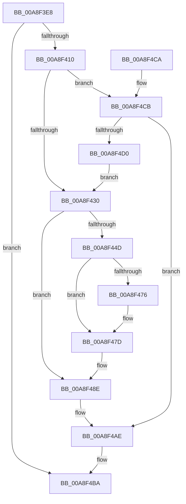

# PopTransitionCheckpoint

- RVA: `0x00A8F3E8`–`0x00A8F4D5` (길이 `237` bytes)
- VA: `0x0000000140A8F3E8`
- 실행 섹션: `PAGE`
- PDB 이름 있음: `예`; PDB Function 태그: `아니요`
- unwind 정보 RVA: `0x000B8C08`
- 디코드: `55`개 명령, `237/237` bytes 표시
- 미해석 바이트: `0` (있으면 어셈블리에 `.byte`로 보존)

> 이 문서는 커널 이미지의 기계어와 PDB 기호를 분석해 생성했습니다. 4번과 5번은 함수 원형과 자료형을 바이너리 사용 방식에서 추정한 C 해석이며 원본 소스 복구 결과는 아닙니다.

## 1. Dependencies

- 직접 호출 지점: **5**; 고유 호출 대상: **5**
- 직접 호출자로 확인된 함수: **4**
- RIP 상대 이미지 참조: **9**

### Outgoing calls
- `0x00A8F3FB` → [PsGetCurrentServerSilo](../../text/22/PsGetCurrentServerSilo_function_00225710.md) (function, `0x00225710`)
- `0x00A8F403` → [PsIsHostSilo](../../text/44/PsIsHostSilo_function_00443B30.md) (function, `0x00443B30`)
- `0x00A8F417` → [PopAcquireRwLockExclusive](../../text/43/PopAcquireRwLockExclusive_function_00430B44.md) (function, `0x00430B44`)
- `0x00A8F440` → [ExAllocatePool2](../../poolcode/B8/ExAllocatePool2_function_00B820F0.md) (function, `0x00B820F0`)
- `0x00A8F4B5` → [PopReleaseRwLock](../../text/2D/PopReleaseRwLock_function_002DFBBC.md) (function, `0x002DFBBC`)

### Direct callers
- [PopSwitchUpdateUserShutdownScenarioState](../75/PopSwitchUpdateUserShutdownScenarioState_function_0075F260.md) at `0x0075F2CE`
- [PopPowerInformationInternal](PopPowerInformationInternal_function_00A8B7C0.md) at `0x00A8C232`
- [PopGracefulShutdown](../../pagelk/B6/PopGracefulShutdown_function_00B6BEC8.md) at `0x00B6BED6`
- [PopGracefulShutdown](../../pagelk/B6/PopGracefulShutdown_function_00B6BEC8.md) at `0x00B6C0F0`
- [PopTransitionSystemPowerStateEx](../../pagelk/B7/PopTransitionSystemPowerStateEx_function_00B7E8C0.md) at `0x00B7E9BA`
- [PopTransitionSystemPowerStateEx](../../pagelk/B7/PopTransitionSystemPowerStateEx_function_00B7E8C0.md) at `0x00B7F017`
- [PopTransitionSystemPowerStateEx](../../pagelk/B7/PopTransitionSystemPowerStateEx_function_00B7E8C0.md) at `0x00B7FC13`

### Static image references
- `0x00A8F410` → RVA `0x00F0F0B0` (`.data`; read)
- `0x00A8F41C` → RVA `0x00F0F090` (`.data`; read)
- `0x00A8F44D` → RVA `0x00F0F0A0` (`.data`; read)
- `0x00A8F46A` → RVA `0x00F0F098` (`.data`; read)
- `0x00A8F487` → RVA `0x00F0F098` (`.data`; write)
- `0x00A8F494` → RVA `0x00F0EFF8` (`.data`; write)
- `0x00A8F49C` → RVA `0x00F0F0A0` (`.data`; write)
- `0x00A8F4A2` → RVA `0x00F0EFF0` (`.data`; write)
- `0x00A8F4A8` → RVA `0x00F0EFF4` (`.data`; write)

## 2. Other-region calls and transfers

- 다른 실행 섹션으로 향하는 call: **5**
  - `0x00A8F3FB` → [PsGetCurrentServerSilo](../../text/22/PsGetCurrentServerSilo_function_00225710.md) (`PAGE` → `.text`)
  - `0x00A8F403` → [PsIsHostSilo](../../text/44/PsIsHostSilo_function_00443B30.md) (`PAGE` → `.text`)
  - `0x00A8F417` → [PopAcquireRwLockExclusive](../../text/43/PopAcquireRwLockExclusive_function_00430B44.md) (`PAGE` → `.text`)
  - `0x00A8F440` → [ExAllocatePool2](../../poolcode/B8/ExAllocatePool2_function_00B820F0.md) (`PAGE` → `POOLCODE`)
  - `0x00A8F4B5` → [PopReleaseRwLock](../../text/2D/PopReleaseRwLock_function_002DFBBC.md) (`PAGE` → `.text`)
- 별도 외부 분기/꼬리 이동을 확인하지 못했습니다.

## 3. Assembly (complete function range)

```asm
00A8F3E8  48 89 5C 24 08                  mov qword ptr [rsp + 8], rbx
00A8F3ED  48 89 6C 24 10                  mov qword ptr [rsp + 0x10], rbp
00A8F3F2  57                              push rdi
00A8F3F3  48 83 EC 20                     sub rsp, 0x20
00A8F3F7  8B FA                           mov edi, edx
00A8F3F9  8B D9                           mov ebx, ecx
00A8F3FB  E8 10 63 79 FF                  call 0x140225710
00A8F400  48 8B C8                        mov rcx, rax
00A8F403  E8 28 47 9B FF                  call 0x140443b30
00A8F408  84 C0                           test al, al
00A8F40A  0F 84 AA 00 00 00               je 0x140a8f4ba
00A8F410  48 8D 0D 99 FC 47 00            lea rcx, [rip + 0x47fc99]
00A8F417  E8 28 17 9A FF                  call 0x140430b44
00A8F41C  48 8D 2D 6D FC 47 00            lea rbp, [rip + 0x47fc6d]
00A8F423  48 39 2D 66 FC 47 00            cmp qword ptr [rip + 0x47fc66], rbp
00A8F42A  0F 84 9B 00 00 00               je 0x140a8f4cb
00A8F430  BA 28 00 00 00                  mov edx, 0x28
00A8F435  B9 00 01 00 00                  mov ecx, 0x100
00A8F43A  41 B8 50 4B 43 50               mov r8d, 0x50434b50
00A8F440  E8 AB 2C 0F 00                  call 0x140b820f0
00A8F445  48 8B D0                        mov rdx, rax
00A8F448  48 85 C0                        test rax, rax
00A8F44B  74 41                           je 0x140a8f48e
00A8F44D  8B 0D 4D FC 47 00               mov ecx, dword ptr [rip + 0x47fc4d]
00A8F453  89 48 10                        mov dword ptr [rax + 0x10], ecx
00A8F456  89 58 14                        mov dword ptr [rax + 0x14], ebx
00A8F459  89 78 18                        mov dword ptr [rax + 0x18], edi
00A8F45C  48 A1 08 00 00 00 80 F7 FF FF   movabs rax, qword ptr [0xfffff78000000008]
00A8F466  48 89 42 20                     mov qword ptr [rdx + 0x20], rax
00A8F46A  48 8B 05 27 FC 47 00            mov rax, qword ptr [rip + 0x47fc27]
00A8F471  48 39 28                        cmp qword ptr [rax], rbp
00A8F474  74 07                           je 0x140a8f47d
00A8F476  B9 03 00 00 00                  mov ecx, 3
00A8F47B  CD 29                           int 0x29
00A8F47D  48 89 2A                        mov qword ptr [rdx], rbp
00A8F480  48 89 42 08                     mov qword ptr [rdx + 8], rax
00A8F484  48 89 10                        mov qword ptr [rax], rdx
00A8F487  48 89 15 0A FC 47 00            mov qword ptr [rip + 0x47fc0a], rdx
00A8F48E  8B 05 0C FC 47 00               mov eax, dword ptr [rip + 0x47fc0c]
00A8F494  89 05 5E FB 47 00               mov dword ptr [rip + 0x47fb5e], eax
00A8F49A  FF C0                           inc eax
00A8F49C  89 05 FE FB 47 00               mov dword ptr [rip + 0x47fbfe], eax
00A8F4A2  89 1D 48 FB 47 00               mov dword ptr [rip + 0x47fb48], ebx
00A8F4A8  89 3D 46 FB 47 00               mov dword ptr [rip + 0x47fb46], edi
00A8F4AE  48 8D 0D FB FB 47 00            lea rcx, [rip + 0x47fbfb]
00A8F4B5  E8 02 07 85 FF                  call 0x1402dfbbc
00A8F4BA  48 8B 5C 24 30                  mov rbx, qword ptr [rsp + 0x30]
00A8F4BF  48 8B 6C 24 38                  mov rbp, qword ptr [rsp + 0x38]
00A8F4C4  48 83 C4 20                     add rsp, 0x20
00A8F4C8  5F                              pop rdi
00A8F4C9  C3                              ret
00A8F4CA  CC                              int3
00A8F4CB  83 FB 01                        cmp ebx, 1
00A8F4CE  75 DE                           jne 0x140a8f4ae
00A8F4D0  E9 5B FF FF FF                  jmp 0x140a8f430
```

## 4. C-style interpretation (structured pseudocode)

```c
__int64 __fastcall PopTransitionCheckpoint(int a1, int a2)
{
    __int64 result;
    __int64 v_rsp;
    unsigned __int64 v_stack_p10;
    unsigned __int64 v_stack_p8;

    v_stack_p8 = v_rbx;
    v_stack_p10 = v_rbp;
    v_rsp = (v_rsp) - (32);
    result = PsGetCurrentServerSilo(a1, a2, a3, a4);
    result = PsIsHostSilo(result, a2, a3, a4);
    if ((unsigned __int8)(result) == 0) goto loc_00A8F4BA;
    result = PopAcquireRwLockExclusive(v_rip + 4717721, a2, a3, a4);
    if ((*(unsigned __int64 *)(v_rip + 4717670)) == (v_rip + 4717677)) goto loc_00A8F4CB;
loc_00A8F430:
    result = ExAllocatePool2(256, 40, (unsigned int)(0x50434B50ULL), a4);
    if (result == 0) goto loc_00A8F48E;
    *(unsigned int *)(result + 16) = (unsigned int)((unsigned int)(*(unsigned int *)(v_rip + 4717645)));
    *(unsigned int *)(result + 20) = (unsigned int)((unsigned int)(a1));
    *(unsigned int *)(result + 24) = (unsigned int)((unsigned int)(a2));
    *(unsigned __int64 *)(result + 32) = result;
    if ((*(unsigned __int64 *)(*(unsigned __int64 *)(v_rip + 4717607))) != (v_rip + 4717677)) {
        a1 = 3;
    }
    *(unsigned __int64 *)(result) = v_rip + 4717677;
    *(unsigned __int64 *)(result + 8) = *(unsigned __int64 *)(v_rip + 4717607);
    *(unsigned __int64 *)(*(unsigned __int64 *)(v_rip + 4717607)) = result;
    *(unsigned __int64 *)(v_rip + 4717578) = result;
loc_00A8F48E:
    *(unsigned int *)(v_rip + 4717406) = (unsigned int)((unsigned int)(*(unsigned int *)(v_rip + 4717580)));
    result = (unsigned int)(((unsigned int)(*(unsigned int *)(v_rip + 4717580))) + 1);
    *(unsigned int *)(v_rip + 4717566) = (unsigned int)(result);
    *(unsigned int *)(v_rip + 4717384) = (unsigned int)((unsigned int)(a1));
    *(unsigned int *)(v_rip + 4717382) = (unsigned int)((unsigned int)(a2));
loc_00A8F4AE:
    result = PopReleaseRwLock(v_rip + 4717563, result, (unsigned int)(0x50434B50ULL), a4);
loc_00A8F4BA:
    v_rsp = (v_rsp) + (32);
    return result;
loc_00A8F4CB:
    if (((unsigned int)(v_stack_p8)) != 1) goto loc_00A8F4AE;
    goto loc_00A8F430;
}
```

## 5. (Beta) C Style

```c
int64_t PopTransitionCheckpoint(int32_t Arg1, int32_t Arg2)
{
    int64_t result;
    int64_t local_rsp;
    uint64_t v_stack_p10;
    uint64_t v_stack_p8;

    v_stack_p8 = local_rbx;
    v_stack_p10 = local_rbp;
    local_rsp = (local_rsp) - (32);
    result = PsGetCurrentServerSilo(Arg1, Arg2, a3, a4);
    result = PsIsHostSilo(result, Arg2, a3, a4);
    if ((uint8_t)(result) == 0) goto loc_00A8F4BA;
    result = PopAcquireRwLockExclusive(v_rip + 4717721, Arg2, a3, a4);
    if ((*(uint64_t *)(v_rip + 0x47FC66)) == (v_rip + 4717677)) goto loc_00A8F4CB;
loc_00A8F430:
    result = ExAllocatePool2(256, 40, (uint32_t)(0x50434B50ULL), a4);
    if (result == 0) goto loc_00A8F48E;
    *(uint32_t *)(result + 0x10) = (uint32_t)((uint32_t)(*(uint32_t *)(v_rip + 0x47FC4D)));
    *(uint32_t *)(result + 0x14) = (uint32_t)((uint32_t)(Arg1));
    *(uint32_t *)(result + 0x18) = (uint32_t)((uint32_t)(Arg2));
    *(uint64_t *)(result + 0x20) = result;
    if ((*(uint64_t *)(*(uint64_t *)(v_rip + 0x47FC27))) != (v_rip + 4717677)) {
        Arg1 = 3;
    }
    *(uint64_t *)(result) = v_rip + 4717677;
    *(uint64_t *)(result + 0x8) = *(uint64_t *)(v_rip + 0x47FC27);
    *(uint64_t *)(*(uint64_t *)(v_rip + 0x47FC27)) = result;
    *(uint64_t *)(v_rip + 0x47FC0A) = result;
loc_00A8F48E:
    *(uint32_t *)(v_rip + 0x47FB5E) = (uint32_t)((uint32_t)(*(uint32_t *)(v_rip + 0x47FC0C)));
    result = (uint32_t)(((uint32_t)(*(uint32_t *)(v_rip + 0x47FC0C))) + 1);
    *(uint32_t *)(v_rip + 0x47FBFE) = (uint32_t)(result);
    *(uint32_t *)(v_rip + 0x47FB48) = (uint32_t)((uint32_t)(Arg1));
    *(uint32_t *)(v_rip + 0x47FB46) = (uint32_t)((uint32_t)(Arg2));
loc_00A8F4AE:
    result = PopReleaseRwLock(v_rip + 4717563, result, (uint32_t)(0x50434B50ULL), a4);
loc_00A8F4BA:
    local_rsp = (local_rsp) + (32);
    return result;
loc_00A8F4CB:
    if (((uint32_t)(v_stack_p8)) != 1) goto loc_00A8F4AE;
    goto loc_00A8F430;
}
```

## 6. Execution-region graph

[열기: 2D/3D 그래프와 함수 탐색 컨트롤 패널](../../../control-panel.html?section=page&rva=0x00A8F3E8&view=graph)

- 2D 그래프는 위에서 아래로 흐르고, 3D 그래프는 빈 공간을 드래그해 회전합니다. Shift+드래그는 이동, 휠은 확대·축소, 함수 노드 선택은 대상 보고서 이동입니다.

### Static fallback


