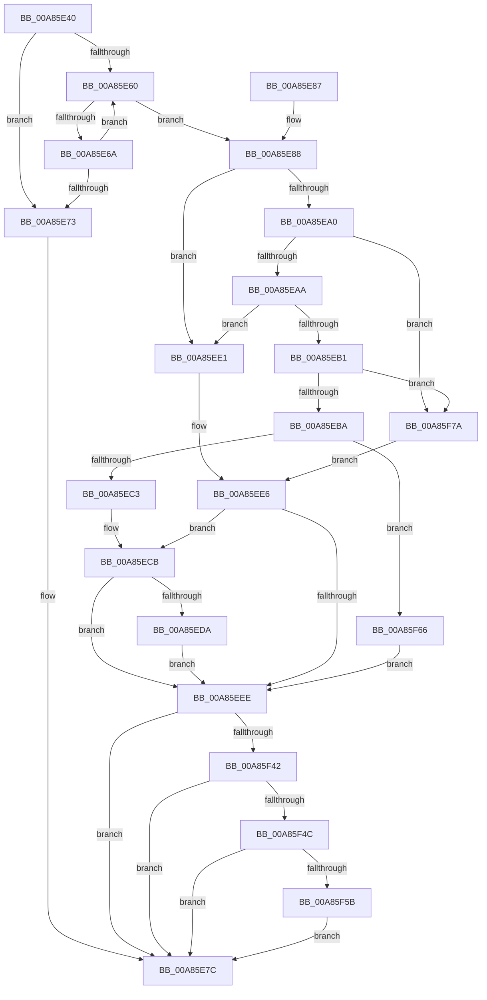

# PpHotSwapUpdateRemovalPolicy

- RVA: `0x00A85E40`–`0x00A85F84` (길이 `324` bytes)
- VA: `0x0000000140A85E40`
- 실행 섹션: `PAGE`
- PDB 이름 있음: `예`; PDB Function 태그: `아니요`
- unwind 정보 RVA: `0x000B7AB8`
- 디코드: `82`개 명령, `324/324` bytes 표시
- 미해석 바이트: `0` (있으면 어셈블리에 `.byte`로 보존)

> 이 문서는 커널 이미지의 기계어와 PDB 기호를 분석해 생성했습니다. 4번과 5번은 함수 원형과 자료형을 바이너리 사용 방식에서 추정한 C 해석이며 원본 소스 복구 결과는 아닙니다.

## 1. Dependencies

- 직접 호출 지점: **2**; 고유 호출 대상: **2**
- 직접 호출자로 확인된 함수: **1**
- RIP 상대 이미지 참조: **1**

### Outgoing calls
- `0x00A85F35` → [CmGetDeviceRegProp](../8E/CmGetDeviceRegProp_function_008ED870.md) (function, `0x008ED870`)
- `0x00A85F6D` → [PiHotSwapGetDefaultBusRemovalPolicy](PiHotSwapGetDefaultBusRemovalPolicy_function_00A85F8C.md) (function, `0x00A85F8C`)

### Direct callers
- [PiProcessNewDeviceNode](../A2/PiProcessNewDeviceNode_function_00A28F20.md) at `0x00A2A2D8`

### Static image references
- `0x00A85F22` → RVA `0x00E66398` (`.data`; read)

## 2. Other-region calls and transfers

- 다른 실행 섹션으로 향하는 call: **0**
- 별도 외부 분기/꼬리 이동을 확인하지 못했습니다.

## 3. Assembly (complete function range)

```asm
00A85E40  48 89 5C 24 20                  mov qword ptr [rsp + 0x20], rbx
00A85E45  55                              push rbp
00A85E46  48 8B EC                        mov rbp, rsp
00A85E49  48 83 EC 40                     sub rsp, 0x40
00A85E4D  83 65 10 00                     and dword ptr [rbp + 0x10], 0
00A85E51  48 8B D9                        mov rbx, rcx
00A85E54  83 65 18 00                     and dword ptr [rbp + 0x18], 0
00A85E58  48 8B D1                        mov rdx, rcx
00A85E5B  48 85 C9                        test rcx, rcx
00A85E5E  74 13                           je 0x140a85e73
00A85E60  8B 82 30 02 00 00               mov eax, dword ptr [rdx + 0x230]
00A85E66  A8 18                           test al, 0x18
00A85E68  75 1E                           jne 0x140a85e88
00A85E6A  48 8B 52 10                     mov rdx, qword ptr [rdx + 0x10]
00A85E6E  48 85 D2                        test rdx, rdx
00A85E71  75 ED                           jne 0x140a85e60
00A85E73  66 C7 81 D2 01 00 00 01 01      mov word ptr [rcx + 0x1d2], 0x101
00A85E7C  48 8B 5C 24 68                  mov rbx, qword ptr [rsp + 0x68]
00A85E81  48 83 C4 40                     add rsp, 0x40
00A85E85  5D                              pop rbp
00A85E86  C3                              ret
00A85E87  CC                              int3
00A85E88  48 8B 41 20                     mov rax, qword ptr [rcx + 0x20]
00A85E8C  41 B8 00 03 00 00               mov r8d, 0x300
00A85E92  8B 48 34                        mov ecx, dword ptr [rax + 0x34]
00A85E95  8B C1                           mov eax, ecx
00A85E97  41 23 C0                        and eax, r8d
00A85E9A  0F BA E1 0E                     bt ecx, 0xe
00A85E9E  72 41                           jb 0x140a85ee1
00A85EA0  0F BA E1 0F                     bt ecx, 0xf
00A85EA4  0F 82 D0 00 00 00               jb 0x140a85f7a
00A85EAA  3D 00 02 00 00                  cmp eax, 0x200
00A85EAF  74 30                           je 0x140a85ee1
00A85EB1  41 3B C0                        cmp eax, r8d
00A85EB4  0F 84 C0 00 00 00               je 0x140a85f7a
00A85EBA  48 3B DA                        cmp rbx, rdx
00A85EBD  0F 84 A3 00 00 00               je 0x140a85f66
00A85EC3  B9 06 00 00 00                  mov ecx, 6
00A85EC8  89 4D 10                        mov dword ptr [rbp + 0x10], ecx
00A85ECB  48 8B 43 10                     mov rax, qword ptr [rbx + 0x10]
00A85ECF  0F B6 90 D2 01 00 00            movzx edx, byte ptr [rax + 0x1d2]
00A85ED6  3B CA                           cmp ecx, edx
00A85ED8  7E 14                           jle 0x140a85eee
00A85EDA  8B CA                           mov ecx, edx
00A85EDC  89 55 10                        mov dword ptr [rbp + 0x10], edx
00A85EDF  EB 0D                           jmp 0x140a85eee
00A85EE1  B9 02 00 00 00                  mov ecx, 2
00A85EE6  89 4D 10                        mov dword ptr [rbp + 0x10], ecx
00A85EE9  48 3B DA                        cmp rbx, rdx
00A85EEC  75 DD                           jne 0x140a85ecb
00A85EEE  83 64 24 38 00                  and dword ptr [rsp + 0x38], 0
00A85EF3  48 8D 45 20                     lea rax, [rbp + 0x20]
00A85EF7  48 8B 53 30                     mov rdx, qword ptr [rbx + 0x30]
00A85EFB  41 B9 22 00 00 00               mov r9d, 0x22
00A85F01  48 89 44 24 30                  mov qword ptr [rsp + 0x30], rax
00A85F06  45 33 C0                        xor r8d, r8d
00A85F09  48 8D 45 10                     lea rax, [rbp + 0x10]
00A85F0D  88 8B D2 01 00 00               mov byte ptr [rbx + 0x1d2], cl
00A85F13  48 89 44 24 28                  mov qword ptr [rsp + 0x28], rax
00A85F18  48 8D 45 18                     lea rax, [rbp + 0x18]
00A85F1C  88 8B D3 01 00 00               mov byte ptr [rbx + 0x1d3], cl
00A85F22  48 8B 0D 6F 04 3E 00            mov rcx, qword ptr [rip + 0x3e046f]
00A85F29  48 89 44 24 20                  mov qword ptr [rsp + 0x20], rax
00A85F2E  C7 45 20 04 00 00 00            mov dword ptr [rbp + 0x20], 4
00A85F35  E8 36 79 E6 FF                  call 0x1408ed870
00A85F3A  85 C0                           test eax, eax
00A85F3C  0F 88 3A FF FF FF               js 0x140a85e7c
00A85F42  83 7D 18 04                     cmp dword ptr [rbp + 0x18], 4
00A85F46  0F 85 30 FF FF FF               jne 0x140a85e7c
00A85F4C  8B 4D 10                        mov ecx, dword ptr [rbp + 0x10]
00A85F4F  8D 41 FE                        lea eax, [rcx - 2]
00A85F52  83 F8 01                        cmp eax, 1
00A85F55  0F 87 21 FF FF FF               ja 0x140a85e7c
00A85F5B  88 8B D2 01 00 00               mov byte ptr [rbx + 0x1d2], cl
00A85F61  E9 16 FF FF FF                  jmp 0x140a85e7c
00A85F66  48 8D 55 10                     lea rdx, [rbp + 0x10]
00A85F6A  48 8B CB                        mov rcx, rbx
00A85F6D  E8 1A 00 00 00                  call 0x140a85f8c
00A85F72  8B 4D 10                        mov ecx, dword ptr [rbp + 0x10]
00A85F75  E9 74 FF FF FF                  jmp 0x140a85eee
00A85F7A  B9 03 00 00 00                  mov ecx, 3
00A85F7F  E9 62 FF FF FF                  jmp 0x140a85ee6
```

## 4. C-style interpretation (structured pseudocode)

```c
__int64 __fastcall PpHotSwapUpdateRemovalPolicy(__int64 a1)
{
    __int64 result;
    __int64 v_rsp;
    unsigned int v_stack_p10;
    unsigned __int64 v_stack_p18;
    unsigned __int64 v_stack_p20;
    unsigned __int64 v_stack_p28;
    unsigned __int64 v_stack_p30;
    unsigned int v_stack_p38;
    unsigned int v_stack_p8;

    v_stack_p20 = v_rbx;
    v_rsp = (v_rsp) - (64);
    if (a1 == 0) goto loc_00A85E73;
loc_00A85E60:
    if ((((unsigned __int8)((unsigned int)(*(unsigned int *)(a1 + 560)))) & (24)) != 0) goto loc_00A85E88;
    if (*(unsigned __int64 *)(a1 + 16) != 0) goto loc_00A85E60;
loc_00A85E73:
    *(unsigned __int16 *)(a1 + 466) = 257;
loc_00A85E7C:
    v_rsp = (v_rsp) + (64);
    return (unsigned int)(*(unsigned int *)(a1 + 560));
loc_00A85E88:
    result = (unsigned int)(((unsigned int)((unsigned int)((unsigned int)(*(unsigned int *)(*(unsigned __int64 *)(a1 + 32) + 52))))) & (768));
    if (condition_is_below) goto loc_00A85EE1;
    if (condition_is_below) goto loc_00A85F7A;
    if (((unsigned int)(result)) == 512) goto loc_00A85EE1;
    if (((unsigned int)(result)) == 768) goto loc_00A85F7A;
    if (v_stack_p20 == (*(unsigned __int64 *)(a1 + 16))) goto loc_00A85F66;
    v_stack_p8 = 6;
loc_00A85ECB:
    if (6 <= ((unsigned int)(*(unsigned __int8 *)(*(unsigned __int64 *)(v_stack_p20 + 16) + 466)))) goto loc_00A85EEE;
    v_stack_p8 = (unsigned int)(*(unsigned __int8 *)(*(unsigned __int64 *)(v_stack_p20 + 16) + 466));
    goto loc_00A85EEE;
loc_00A85EE1:
loc_00A85EE6:
    v_stack_p8 = 2;
    if (v_stack_p20 != (*(unsigned __int8 *)(*(unsigned __int64 *)(v_stack_p20 + 16) + 466))) goto loc_00A85ECB;
loc_00A85EEE:
    v_stack_p30 = v_stack_p18;
    a3 = 0;
    *(unsigned __int8 *)(v_stack_p20 + 466) = 2;
    v_stack_p28 = v_stack_p8;
    *(unsigned __int8 *)(v_stack_p20 + 467) = 2;
    v_stack_p20 = v_stack_p10;
    v_stack_p18 = 4;
    result = CmGetDeviceRegProp(*(unsigned __int64 *)(v_rip + 4064367), *(unsigned __int64 *)(v_stack_p20 + 48), a3, 34);
    if (sign_flag) goto loc_00A85E7C;
    if (v_stack_p10 != 4) goto loc_00A85E7C;
    if (((unsigned int)((unsigned int)(v_stack_p8) - 2)) > 1) goto loc_00A85E7C;
    *(unsigned __int8 *)(v_stack_p20 + 466) = (unsigned __int8)((unsigned int)(v_stack_p8));
    goto loc_00A85E7C;
loc_00A85F66:
    result = PiHotSwapGetDefaultBusRemovalPolicy(v_stack_p20, v_stack_p8, a3, 34);
    goto loc_00A85EEE;
loc_00A85F7A:
    goto loc_00A85EE6;
}
```

## 5. (Beta) C Style

```c
int64_t PpHotSwapUpdateRemovalPolicy(int64_t Arg1)
{
    int64_t result;
    int64_t local_rsp;
    uint32_t v_stack_p10;
    uint64_t v_stack_p18;
    uint64_t v_stack_p20;
    uint64_t v_stack_p28;
    uint64_t v_stack_p30;
    uint32_t v_stack_p38;
    uint32_t v_stack_p8;

    v_stack_p20 = local_rbx;
    local_rsp = (local_rsp) - (64);
    if (Arg1 == 0) goto loc_00A85E73;
loc_00A85E60:
    if ((((uint8_t)((uint32_t)(*(uint32_t *)(Arg1 + 0x230)))) & (24)) != 0) goto loc_00A85E88;
    if (*(uint64_t *)(Arg1 + 0x10) != 0) goto loc_00A85E60;
loc_00A85E73:
    *(uint16_t *)(Arg1 + 0x1D2) = 257;
loc_00A85E7C:
    local_rsp = (local_rsp) + (64);
    return (uint32_t)(*(uint32_t *)(Arg1 + 0x230));
loc_00A85E88:
    result = (uint32_t)(((uint32_t)((uint32_t)((uint32_t)(*(uint32_t *)(*(uint64_t *)(Arg1 + 0x20) + 0x34))))) & (768));
    if (condition_is_below) goto loc_00A85EE1;
    if (condition_is_below) goto loc_00A85F7A;
    if (((uint32_t)(result)) == 512) goto loc_00A85EE1;
    if (((uint32_t)(result)) == 768) goto loc_00A85F7A;
    if (v_stack_p20 == (*(uint64_t *)(Arg1 + 0x10))) goto loc_00A85F66;
    v_stack_p8 = 6;
loc_00A85ECB:
    if (6 <= ((uint32_t)(*(uint8_t *)(*(uint64_t *)(v_stack_p20 + 0x10) + 0x1D2)))) goto loc_00A85EEE;
    v_stack_p8 = (uint32_t)(*(uint8_t *)(*(uint64_t *)(v_stack_p20 + 0x10) + 0x1D2));
    goto loc_00A85EEE;
loc_00A85EE1:
loc_00A85EE6:
    v_stack_p8 = 2;
    if (v_stack_p20 != (*(uint8_t *)(*(uint64_t *)(v_stack_p20 + 0x10) + 0x1D2))) goto loc_00A85ECB;
loc_00A85EEE:
    v_stack_p30 = v_stack_p18;
    a3 = 0;
    *(uint8_t *)(v_stack_p20 + 0x1D2) = 2;
    v_stack_p28 = v_stack_p8;
    *(uint8_t *)(v_stack_p20 + 0x1D3) = 2;
    v_stack_p20 = v_stack_p10;
    v_stack_p18 = 4;
    result = CmGetDeviceRegProp(*(uint64_t *)(v_rip + 0x3E046F), *(uint64_t *)(v_stack_p20 + 0x30), a3, 34);
    if (sign_flag) goto loc_00A85E7C;
    if (v_stack_p10 != 4) goto loc_00A85E7C;
    if (((uint32_t)((uint32_t)(v_stack_p8) - 2)) > 1) goto loc_00A85E7C;
    *(uint8_t *)(v_stack_p20 + 0x1D2) = (uint8_t)((uint32_t)(v_stack_p8));
    goto loc_00A85E7C;
loc_00A85F66:
    result = PiHotSwapGetDefaultBusRemovalPolicy(v_stack_p20, v_stack_p8, a3, 34);
    goto loc_00A85EEE;
loc_00A85F7A:
    goto loc_00A85EE6;
}
```

## 6. Execution-region graph

[열기: 2D/3D 그래프와 함수 탐색 컨트롤 패널](../../../control-panel.html?section=page&rva=0x00A85E40&view=graph)

- 2D 그래프는 위에서 아래로 흐르고, 3D 그래프는 빈 공간을 드래그해 회전합니다. Shift+드래그는 이동, 휠은 확대·축소, 함수 노드 선택은 대상 보고서 이동입니다.

### Static fallback


