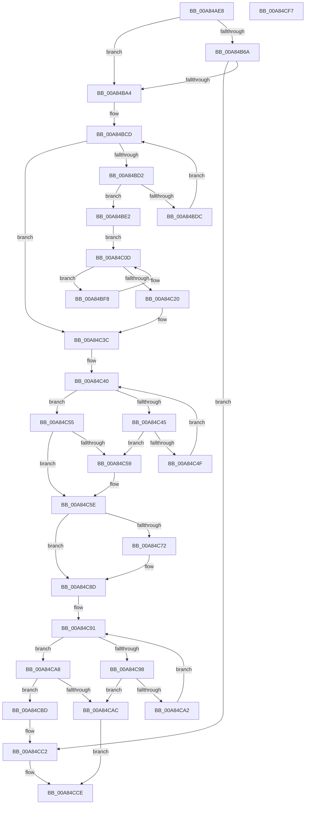

# PpmCheckInitProcessors

- RVA: `0x00A84AE8`–`0x00A84CF8` (길이 `528` bytes)
- VA: `0x0000000140A84AE8`
- 실행 섹션: `PAGE`
- PDB 이름 있음: `예`; PDB Function 태그: `아니요`
- unwind 정보 RVA: `0x000B77C4`
- 디코드: `126`개 명령, `528/528` bytes 표시
- 미해석 바이트: `0` (있으면 어셈블리에 `.byte`로 보존)

> 이 문서는 커널 이미지의 기계어와 PDB 기호를 분석해 생성했습니다. 4번과 5번은 함수 원형과 자료형을 바이너리 사용 방식에서 추정한 C 해석이며 원본 소스 복구 결과는 아닙니다.

## 1. Dependencies

- 직접 호출 지점: **18**; 고유 호출 대상: **16**
- 직접 호출자로 확인된 함수: **3**
- RIP 상대 이미지 참조: **6**

### Outgoing calls
- `0x00A84B3D` → [memset](../../text/6C/memset_function_006C6C40.md) (function, `0x006C6C40`)
- `0x00A84B61` → [memset](../../text/6C/memset_function_006C6C40.md) (function, `0x006C6C40`)
- `0x00A84B71` → [PpmAcquireLock](../../text/2D/PpmAcquireLock_function_002D9AA4.md) (function, `0x002D9AA4`)
- `0x00A84B7B` → [KeQueryActiveProcessorAffinity2](../../text/46/KeQueryActiveProcessorAffinity2_function_00469CC0.md) (function, `0x00469CC0`)
- `0x00A84B97` → [KiSubtractAffinityEx](../../text/2D/KiSubtractAffinityEx_function_002D61E8.md) (function, `0x002D61E8`)
- `0x00A84BBF` → [KiOrAffinityEx](../../text/39/KiOrAffinityEx_function_0039A84C.md) (function, `0x0039A84C`)
- `0x00A84BFC` → [KeGetPrcb](../../text/2D/KeGetPrcb_function_002D85D0.md) (function, `0x002D85D0`)
- `0x00A84C08` → [PpmAllocatePerfCheck](../76/PpmAllocatePerfCheck_function_00764070.md) (function, `0x00764070`)
- `0x00A84C17` → [KeEnumerateNextProcessor](../../text/41/KeEnumerateNextProcessor_function_00415480.md) (function, `0x00415480`)
- `0x00A84C32` → [PopExecuteOnTargetProcessors](../../text/2D/PopExecuteOnTargetProcessors_function_002DD834.md) (function, `0x002DD834`)
- `0x00A84C59` → [PpmParkRegisterParking](../../text/5D/PpmParkRegisterParking_function_005DB508.md) (function, `0x005DB508`)
- `0x00A84C88` → [PpmUpdateProcessorPolicy](../A5/PpmUpdateProcessorPolicy_function_00A53324.md) (function, `0x00A53324`)
- `0x00A84CAC` → [PpmCheckReInit](PpmCheckReInit_function_00A84DD8.md) (function, `0x00A84DD8`)
- `0x00A84CB1` → [PpmCheckApplyParkConstraints](../../text/3B/PpmCheckApplyParkConstraints_function_003BE994.md) (function, `0x003BE994`)
- `0x00A84CB6` → [PpmHvEnableQosEnlightenment](PpmHvEnableQosEnlightenment_function_00A84D00.md) (function, `0x00A84D00`)
- `0x00A84CBD` → [PpmHvEnableQosEnlightenment](PpmHvEnableQosEnlightenment_function_00A84D00.md) (function, `0x00A84D00`)
- `0x00A84CC9` → [PpmReleaseLock](../../text/2D/PpmReleaseLock_function_002DA428.md) (function, `0x002DA428`)
- `0x00A84CD5` → [_security_check_cookie](../../text/6A/_security_check_cookie_function_006AC640.md) (function, `0x006AC640`)

### Direct callers
- [PopNewProcessorCallback](../75/PopNewProcessorCallback_function_007539A0.md) at `0x007539D5`
- [PpmReapplyPerfPolicy](../A5/PpmReapplyPerfPolicy_function_00A53148.md) at `0x00A53300`
- [PoInitSystem](../../init/C7/PoInitSystem_function_00C72358.md) at `0x00C72E57`

### Static image references
- `0x00A84B07` → RVA `0x00E0A740` (`.data`; read)
- `0x00A84B6A` → RVA `0x00F0CC00` (`.data`; read)
- `0x00A84B8B` → RVA `0x00E0B5A0` (`.data`; read)
- `0x00A84BA4` → RVA `0x00E0B5A2` (`.data`; read)
- `0x00A84C23` → RVA `0x005D84A0` (`PpmCheckProcessorInit`; read)
- `0x00A84C7C` → RVA `0x00F0E180` (`.data`; read/write)

## 2. Other-region calls and transfers

- 다른 실행 섹션으로 향하는 call: **13**
  - `0x00A84B3D` → [memset](../../text/6C/memset_function_006C6C40.md) (`PAGE` → `.text`)
  - `0x00A84B61` → [memset](../../text/6C/memset_function_006C6C40.md) (`PAGE` → `.text`)
  - `0x00A84B71` → [PpmAcquireLock](../../text/2D/PpmAcquireLock_function_002D9AA4.md) (`PAGE` → `.text`)
  - `0x00A84B7B` → [KeQueryActiveProcessorAffinity2](../../text/46/KeQueryActiveProcessorAffinity2_function_00469CC0.md) (`PAGE` → `.text`)
  - `0x00A84B97` → [KiSubtractAffinityEx](../../text/2D/KiSubtractAffinityEx_function_002D61E8.md) (`PAGE` → `.text`)
  - `0x00A84BBF` → [KiOrAffinityEx](../../text/39/KiOrAffinityEx_function_0039A84C.md) (`PAGE` → `.text`)
  - `0x00A84BFC` → [KeGetPrcb](../../text/2D/KeGetPrcb_function_002D85D0.md) (`PAGE` → `.text`)
  - `0x00A84C17` → [KeEnumerateNextProcessor](../../text/41/KeEnumerateNextProcessor_function_00415480.md) (`PAGE` → `.text`)
  - `0x00A84C32` → [PopExecuteOnTargetProcessors](../../text/2D/PopExecuteOnTargetProcessors_function_002DD834.md) (`PAGE` → `.text`)
  - `0x00A84C59` → [PpmParkRegisterParking](../../text/5D/PpmParkRegisterParking_function_005DB508.md) (`PAGE` → `.text`)
  - `0x00A84CB1` → [PpmCheckApplyParkConstraints](../../text/3B/PpmCheckApplyParkConstraints_function_003BE994.md) (`PAGE` → `.text`)
  - `0x00A84CC9` → [PpmReleaseLock](../../text/2D/PpmReleaseLock_function_002DA428.md) (`PAGE` → `.text`)
  - `0x00A84CD5` → [_security_check_cookie](../../text/6A/_security_check_cookie_function_006AC640.md) (`PAGE` → `.text`)
- 별도 외부 분기/꼬리 이동을 확인하지 못했습니다.

## 3. Assembly (complete function range)

```asm
00A84AE8  48 8B C4                        mov rax, rsp
00A84AEB  48 89 58 08                     mov qword ptr [rax + 8], rbx
00A84AEF  48 89 78 10                     mov qword ptr [rax + 0x10], rdi
00A84AF3  4C 89 70 18                     mov qword ptr [rax + 0x18], r14
00A84AF7  4C 89 78 20                     mov qword ptr [rax + 0x20], r15
00A84AFB  55                              push rbp
00A84AFC  48 8D 68 98                     lea rbp, [rax - 0x68]
00A84B00  48 81 EC 60 01 00 00            sub rsp, 0x160
00A84B07  48 8B 05 32 5C 38 00            mov rax, qword ptr [rip + 0x385c32]
00A84B0E  48 33 C4                        xor rax, rsp
00A84B11  48 89 45 50                     mov qword ptr [rbp + 0x50], rax
00A84B15  8B FA                           mov edi, edx
00A84B17  8B D9                           mov ebx, ecx
00A84B19  0F 57 C0                        xorps xmm0, xmm0
00A84B1C  48 8D 4C 24 48                  lea rcx, [rsp + 0x48]
00A84B21  33 C0                           xor eax, eax
00A84B23  45 33 F6                        xor r14d, r14d
00A84B26  33 D2                           xor edx, edx
00A84B28  48 89 44 24 38                  mov qword ptr [rsp + 0x38], rax
00A84B2D  41 B8 00 01 00 00               mov r8d, 0x100
00A84B33  44 89 74 24 20                  mov dword ptr [rsp + 0x20], r14d
00A84B38  0F 11 44 24 28                  movups xmmword ptr [rsp + 0x28], xmm0
00A84B3D  E8 FE 20 C4 FF                  call 0x1406c6c40
00A84B42  33 D2                           xor edx, edx
00A84B44  44 89 74 24 24                  mov dword ptr [rsp + 0x24], r14d
00A84B49  41 B8 00 01 00 00               mov r8d, 0x100
00A84B4F  48 C7 44 24 40 01 00 20 00      mov qword ptr [rsp + 0x40], 0x200001
00A84B58  48 8D 4C 24 48                  lea rcx, [rsp + 0x48]
00A84B5D  45 8D 7E 01                     lea r15d, [r14 + 1]
00A84B61  E8 DA 20 C4 FF                  call 0x1406c6c40
00A84B66  85 DB                           test ebx, ebx
00A84B68  75 3A                           jne 0x140a84ba4
00A84B6A  48 8D 0D 8F 80 48 00            lea rcx, [rip + 0x48808f]
00A84B71  E8 2E 4F 85 FF                  call 0x1402d9aa4
00A84B76  48 8D 4C 24 40                  lea rcx, [rsp + 0x40]
00A84B7B  E8 40 51 9E FF                  call 0x140469cc0
00A84B80  44 0F B7 4C 24 42               movzx r9d, word ptr [rsp + 0x42]
00A84B86  4C 8D 44 24 40                  lea r8, [rsp + 0x40]
00A84B8B  48 8D 15 0E 6A 38 00            lea rdx, [rip + 0x386a0e]
00A84B92  48 8D 4C 24 40                  lea rcx, [rsp + 0x40]
00A84B97  E8 4C 16 85 FF                  call 0x1402d61e8
00A84B9C  84 C0                           test al, al
00A84B9E  0F 84 1E 01 00 00               je 0x140a84cc2
00A84BA4  44 0F B7 0D F6 69 38 00         movzx r9d, word ptr [rip + 0x3869f6]
00A84BAC  4C 8D 05 ED 69 38 00            lea r8, [rip + 0x3869ed]
00A84BB3  48 8D 54 24 40                  lea rdx, [rsp + 0x40]
00A84BB8  48 8D 0D E1 69 38 00            lea rcx, [rip + 0x3869e1]
00A84BBF  E8 88 5C 91 FF                  call 0x14039a84c
00A84BC4  0F B7 54 24 40                  movzx edx, word ptr [rsp + 0x40]
00A84BC9  41 0F B7 CE                     movzx ecx, r14w
00A84BCD  66 3B CA                        cmp cx, dx
00A84BD0  73 6A                           jae 0x140a84c3c
00A84BD2  0F B7 C1                        movzx eax, cx
00A84BD5  4C 39 74 C4 48                  cmp qword ptr [rsp + rax*8 + 0x48], r14
00A84BDA  75 06                           jne 0x140a84be2
00A84BDC  66 41 03 CF                     add cx, r15w
00A84BE0  EB EB                           jmp 0x140a84bcd
00A84BE2  48 8B 44 24 48                  mov rax, qword ptr [rsp + 0x48]
00A84BE7  48 89 44 24 30                  mov qword ptr [rsp + 0x30], rax
00A84BEC  48 8D 44 24 40                  lea rax, [rsp + 0x40]
00A84BF1  48 89 44 24 28                  mov qword ptr [rsp + 0x28], rax
00A84BF6  EB 15                           jmp 0x140a84c0d
00A84BF8  8B 4C 24 20                     mov ecx, dword ptr [rsp + 0x20]
00A84BFC  E8 CF 39 85 FF                  call 0x1402d85d0
00A84C01  48 8D 88 B0 89 00 00            lea rcx, [rax + 0x89b0]
00A84C08  E8 63 F4 CD FF                  call 0x140764070
00A84C0D  48 8D 54 24 28                  lea rdx, [rsp + 0x28]
00A84C12  48 8D 4C 24 20                  lea rcx, [rsp + 0x20]
00A84C17  E8 64 08 99 FF                  call 0x140415480
00A84C1C  85 C0                           test eax, eax
00A84C1E  74 D8                           je 0x140a84bf8
00A84C20  45 33 C9                        xor r9d, r9d
00A84C23  48 8D 15 76 38 B5 FF            lea rdx, [rip - 0x4ac78a]
00A84C2A  45 33 C0                        xor r8d, r8d
00A84C2D  48 8D 4C 24 40                  lea rcx, [rsp + 0x40]
00A84C32  E8 FD 8B 85 FF                  call 0x1402dd834
00A84C37  0F B7 54 24 40                  movzx edx, word ptr [rsp + 0x40]
00A84C3C  41 0F B7 CE                     movzx ecx, r14w
00A84C40  66 3B CA                        cmp cx, dx
00A84C43  73 10                           jae 0x140a84c55
00A84C45  0F B7 C1                        movzx eax, cx
00A84C48  4C 39 74 C4 48                  cmp qword ptr [rsp + rax*8 + 0x48], r14
00A84C4D  75 0A                           jne 0x140a84c59
00A84C4F  66 41 03 CF                     add cx, r15w
00A84C53  EB EB                           jmp 0x140a84c40
00A84C55  85 FF                           test edi, edi
00A84C57  74 05                           je 0x140a84c5e
00A84C59  E8 AA 68 B5 FF                  call 0x1405db508
00A84C5E  65 48 8B 04 25 20 00 00 00      mov rax, qword ptr gs:[0x20]
00A84C67  48 0F BA A0 A0 8F 00 00 27      bt qword ptr [rax + 0x8fa0], 0x27
00A84C70  73 1B                           jae 0x140a84c8d
00A84C72  B8 00 04 00 00                  mov eax, 0x400
00A84C77  48 8D 4C 24 24                  lea rcx, [rsp + 0x24]
00A84C7C  09 05 FE 94 48 00               or dword ptr [rip + 0x4894fe], eax
00A84C82  33 D2                           xor edx, edx
00A84C84  09 44 24 24                     or dword ptr [rsp + 0x24], eax
00A84C88  E8 97 E6 FC FF                  call 0x140a53324
00A84C8D  41 0F B7 CE                     movzx ecx, r14w
00A84C91  66 3B 4C 24 40                  cmp cx, word ptr [rsp + 0x40]
00A84C96  73 10                           jae 0x140a84ca8
00A84C98  0F B7 C1                        movzx eax, cx
00A84C9B  4C 39 74 C4 48                  cmp qword ptr [rsp + rax*8 + 0x48], r14
00A84CA0  75 0A                           jne 0x140a84cac
00A84CA2  66 41 03 CF                     add cx, r15w
00A84CA6  EB E9                           jmp 0x140a84c91
00A84CA8  85 FF                           test edi, edi
00A84CAA  74 11                           je 0x140a84cbd
00A84CAC  E8 27 01 00 00                  call 0x140a84dd8
00A84CB1  E8 DE 9C 93 FF                  call 0x1403be994
00A84CB6  E8 45 00 00 00                  call 0x140a84d00
00A84CBB  EB 11                           jmp 0x140a84cce
00A84CBD  E8 3E 00 00 00                  call 0x140a84d00
00A84CC2  48 8D 0D 37 7F 48 00            lea rcx, [rip + 0x487f37]
00A84CC9  E8 5A 57 85 FF                  call 0x1402da428
00A84CCE  48 8B 4D 50                     mov rcx, qword ptr [rbp + 0x50]
00A84CD2  48 33 CC                        xor rcx, rsp
00A84CD5  E8 66 79 C2 FF                  call 0x1406ac640
00A84CDA  4C 8D 9C 24 60 01 00 00         lea r11, [rsp + 0x160]
00A84CE2  49 8B 5B 10                     mov rbx, qword ptr [r11 + 0x10]
00A84CE6  49 8B 7B 18                     mov rdi, qword ptr [r11 + 0x18]
00A84CEA  4D 8B 73 20                     mov r14, qword ptr [r11 + 0x20]
00A84CEE  4D 8B 7B 28                     mov r15, qword ptr [r11 + 0x28]
00A84CF2  49 8B E3                        mov rsp, r11
00A84CF5  5D                              pop rbp
00A84CF6  C3                              ret
00A84CF7  CC                              int3
```

## 4. C-style interpretation (structured pseudocode)

```c
__int64 __fastcall PpmCheckInitProcessors(int a1, int a2)
{
    __int64 result;
    __int64 v_r14;
    __int64 v_rsp;
    unsigned __int64 v_stack_m120;
    unsigned __int16 v_stack_m126;
    unsigned __int64 v_stack_m128;
    unsigned __int64 v_stack_m130;
    unsigned __int64 v_stack_m138;
    unsigned __int64 v_stack_m140;
    unsigned int v_stack_m144;
    unsigned int v_stack_m148;
    unsigned __int64 v_stack_m8;

    *(unsigned __int64 *)(v_rsp + 8) = v_rbx;
    *(unsigned __int64 *)(v_rsp + 16) = v_rdi;
    *(unsigned __int64 *)(v_rsp + 24) = v_r14;
    *(unsigned __int64 *)(v_rsp + 32) = v_r15;
    v_rsp = (v_rsp) - (352);
    result = (*(unsigned __int64 *)(v_rip + 3693618)) ^ (v_rsp);
    *(unsigned __int64 *)(v_rsp - 104 + 80) = result;
    result = 0;
    v_r14 = 0;
    a2 = 0;
    v_stack_m130 = 0;
    v_stack_m148 = 0;
    v_stack_m140 = v_xmm0;
    result = memset(v_stack_m120, a2, 256, a4);
    a2 = 0;
    v_stack_m144 = 0;
    v_stack_m128 = 0x200001ULL;
    result = memset(v_stack_m120, a2, 256, a4);
    if ((unsigned int)((unsigned int)(a1)) != 0) goto loc_00A84BA4;
    result = PpmAcquireLock(v_rip + 4751503, a2, 256, a4);
    result = KeQueryActiveProcessorAffinity2(v_stack_m128, a2, 256, a4);
    result = KiSubtractAffinityEx(v_stack_m128, v_rip + 3697166, v_stack_m128, v_stack_m126);
    if ((unsigned __int8)(result) == 0) goto loc_00A84CC2;
loc_00A84BA4:
    result = KiOrAffinityEx(v_rip + 3697121, v_stack_m128, v_rip + 3697133, *(unsigned __int16 *)(v_rip + 3697142));
loc_00A84BCD:
    if (0 >= ((unsigned __int16)(v_stack_m128))) goto loc_00A84C3C;
    if ((*(unsigned __int64 *)(v_rsp + 0 * 8 + 72)) != 0) goto loc_00A84BE2;
    a1 = (unsigned __int16)((0) + ((unsigned __int16)(v_r14 + 1)));
    goto loc_00A84BCD;
loc_00A84BE2:
    v_stack_m138 = v_stack_m120;
    v_stack_m140 = v_stack_m128;
    goto loc_00A84C0D;
loc_00A84BF8:
    result = KeGetPrcb((unsigned int)(v_stack_m148), v_stack_m128, v_rip + 3697133, *(unsigned __int16 *)(v_rip + 3697142));
    result = PpmAllocatePerfCheck(result + 35248, v_stack_m128, v_rip + 3697133, *(unsigned __int16 *)(v_rip + 3697142));
loc_00A84C0D:
    result = KeEnumerateNextProcessor(v_stack_m148, v_stack_m140, v_rip + 3697133, *(unsigned __int16 *)(v_rip + 3697142));
    if ((unsigned int)(result) == 0) goto loc_00A84BF8;
    a4 = 0;
    a3 = 0;
    result = PopExecuteOnTargetProcessors(v_stack_m128, v_rip - 4900746, a3, a4);
loc_00A84C3C:
loc_00A84C40:
    if (0 >= ((unsigned __int16)(v_stack_m128))) goto loc_00A84C55;
    if ((*(unsigned __int64 *)(v_rsp + 0 * 8 + 72)) != 0) goto loc_00A84C59;
    a1 = (unsigned __int16)((0) + ((unsigned __int16)(v_r14 + 1)));
    goto loc_00A84C40;
loc_00A84C55:
    result = 0;
    if ((unsigned int)((unsigned int)(a2)) != 0) {
        result = PpmParkRegisterParking(a1, v_stack_m128, a3, a4);
    }
    result = *(unsigned __int64 *)(gs_base + (0 + 32));
    if (!(condition_is_above_or_equal)) {
        result = 0x400ULL;
        a1 = v_stack_m144;
        a2 = 0;
        result = PpmUpdateProcessorPolicy(a1, a2, a3, a4);
    }
loc_00A84C91:
    if (0 >= v_stack_m128) goto loc_00A84CA8;
    if ((*(unsigned __int64 *)(v_rsp + 0 * 8 + 72)) != 0) goto loc_00A84CAC;
    a1 = (unsigned __int16)((0) + ((unsigned __int16)(v_r14 + 1)));
    goto loc_00A84C91;
loc_00A84CA8:
    if ((unsigned int)((unsigned int)(a2)) == 0) goto loc_00A84CBD;
loc_00A84CAC:
    result = PpmCheckReInit(a1, a2, a3, a4);
    result = PpmCheckApplyParkConstraints(a1, a2, a3, a4);
    result = PpmHvEnableQosEnlightenment(a1, a2, a3, a4);
    goto loc_00A84CCE;
loc_00A84CBD:
    result = PpmHvEnableQosEnlightenment(a1, a2, a3, a4);
loc_00A84CC2:
    result = PpmReleaseLock(v_rip + 4751159, a2, a3, a4);
loc_00A84CCE:
    a1 = (*(unsigned __int64 *)(v_rsp - 104 + 80)) ^ (v_rsp);
    result = _security_check_cookie(a1, a2, a3, a4);
    return result;
}
```

## 5. (Beta) C Style

```c
int64_t PpmCheckInitProcessors(int32_t Arg1, int32_t Arg2)
{
    int64_t result;
    int64_t local_r14;
    int64_t local_rsp;
    uint64_t v_stack_m120;
    uint16_t v_stack_m126;
    uint64_t v_stack_m128;
    uint64_t v_stack_m130;
    uint64_t v_stack_m138;
    uint64_t v_stack_m140;
    uint32_t v_stack_m144;
    uint32_t v_stack_m148;
    uint64_t v_stack_m8;

    *(uint64_t *)(local_rsp + 0x8) = local_rbx;
    *(uint64_t *)(local_rsp + 0x10) = local_rdi;
    *(uint64_t *)(local_rsp + 0x18) = local_r14;
    *(uint64_t *)(local_rsp + 0x20) = local_r15;
    local_rsp = (local_rsp) - (352);
    result = (*(uint64_t *)(v_rip + 0x385C32)) ^ (local_rsp);
    *(uint64_t *)(local_rsp - 0x68 + 0x50) = result;
    result = 0;
    local_r14 = 0;
    Arg2 = 0;
    v_stack_m130 = 0;
    v_stack_m148 = 0;
    v_stack_m140 = v_xmm0;
    result = memset(v_stack_m120, Arg2, 256, a4);
    Arg2 = 0;
    v_stack_m144 = 0;
    v_stack_m128 = 0x200001ULL;
    result = memset(v_stack_m120, Arg2, 256, a4);
    if ((uint32_t)((uint32_t)(Arg1)) != 0) goto loc_00A84BA4;
    result = PpmAcquireLock(v_rip + 4751503, Arg2, 256, a4);
    result = KeQueryActiveProcessorAffinity2(v_stack_m128, Arg2, 256, a4);
    result = KiSubtractAffinityEx(v_stack_m128, v_rip + 3697166, v_stack_m128, v_stack_m126);
    if ((uint8_t)(result) == 0) goto loc_00A84CC2;
loc_00A84BA4:
    result = KiOrAffinityEx(v_rip + 3697121, v_stack_m128, v_rip + 3697133, *(uint16_t *)(v_rip + 0x3869F6));
loc_00A84BCD:
    if (0 >= ((uint16_t)(v_stack_m128))) goto loc_00A84C3C;
    if ((*(uint64_t *)(local_rsp + 0x0 * 8 + 0x48)) != 0) goto loc_00A84BE2;
    Arg1 = (uint16_t)((0) + ((uint16_t)(local_r14 + 1)));
    goto loc_00A84BCD;
loc_00A84BE2:
    v_stack_m138 = v_stack_m120;
    v_stack_m140 = v_stack_m128;
    goto loc_00A84C0D;
loc_00A84BF8:
    result = KeGetPrcb((uint32_t)(v_stack_m148), v_stack_m128, v_rip + 3697133, *(uint16_t *)(v_rip + 0x3869F6));
    result = PpmAllocatePerfCheck(result + 35248, v_stack_m128, v_rip + 3697133, *(uint16_t *)(v_rip + 0x3869F6));
loc_00A84C0D:
    result = KeEnumerateNextProcessor(v_stack_m148, v_stack_m140, v_rip + 3697133, *(uint16_t *)(v_rip + 0x3869F6));
    if ((uint32_t)(result) == 0) goto loc_00A84BF8;
    a4 = 0;
    a3 = 0;
    result = PopExecuteOnTargetProcessors(v_stack_m128, v_rip - 4900746, a3, a4);
loc_00A84C3C:
loc_00A84C40:
    if (0 >= ((uint16_t)(v_stack_m128))) goto loc_00A84C55;
    if ((*(uint64_t *)(local_rsp + 0x0 * 8 + 0x48)) != 0) goto loc_00A84C59;
    Arg1 = (uint16_t)((0) + ((uint16_t)(local_r14 + 1)));
    goto loc_00A84C40;
loc_00A84C55:
    result = 0;
    if ((uint32_t)((uint32_t)(Arg2)) != 0) {
        result = PpmParkRegisterParking(Arg1, v_stack_m128, a3, a4);
    }
    result = *(uint64_t *)(gs_base + (0 + 0x20));
    if (!(condition_is_above_or_equal)) {
        result = 0x400ULL;
        Arg1 = v_stack_m144;
        Arg2 = 0;
        result = PpmUpdateProcessorPolicy(Arg1, Arg2, a3, a4);
    }
loc_00A84C91:
    if (0 >= v_stack_m128) goto loc_00A84CA8;
    if ((*(uint64_t *)(local_rsp + 0x0 * 8 + 0x48)) != 0) goto loc_00A84CAC;
    Arg1 = (uint16_t)((0) + ((uint16_t)(local_r14 + 1)));
    goto loc_00A84C91;
loc_00A84CA8:
    if ((uint32_t)((uint32_t)(Arg2)) == 0) goto loc_00A84CBD;
loc_00A84CAC:
    result = PpmCheckReInit(Arg1, Arg2, a3, a4);
    result = PpmCheckApplyParkConstraints(Arg1, Arg2, a3, a4);
    result = PpmHvEnableQosEnlightenment(Arg1, Arg2, a3, a4);
    goto loc_00A84CCE;
loc_00A84CBD:
    result = PpmHvEnableQosEnlightenment(Arg1, Arg2, a3, a4);
loc_00A84CC2:
    result = PpmReleaseLock(v_rip + 4751159, Arg2, a3, a4);
loc_00A84CCE:
    Arg1 = (*(uint64_t *)(local_rsp - 0x68 + 0x50)) ^ (local_rsp);
    result = _security_check_cookie(Arg1, Arg2, a3, a4);
    return result;
}
```

## 6. Execution-region graph

[열기: 2D/3D 그래프와 함수 탐색 컨트롤 패널](../../../control-panel.html?section=page&rva=0x00A84AE8&view=graph)

- 2D 그래프는 위에서 아래로 흐르고, 3D 그래프는 빈 공간을 드래그해 회전합니다. Shift+드래그는 이동, 휠은 확대·축소, 함수 노드 선택은 대상 보고서 이동입니다.

### Static fallback


