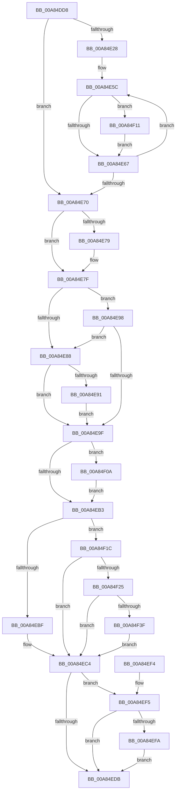

# PpmCheckReInit

- RVA: `0x00A84DD8`–`0x00A84F52` (길이 `378` bytes)
- VA: `0x0000000140A84DD8`
- 실행 섹션: `PAGE`
- PDB 이름 있음: `예`; PDB Function 태그: `아니요`
- unwind 정보 RVA: `0x000B77EC`
- 디코드: `97`개 명령, `378/378` bytes 표시
- 미해석 바이트: `0` (있으면 어셈블리에 `.byte`로 보존)

> 이 문서는 커널 이미지의 기계어와 PDB 기호를 분석해 생성했습니다. 4번과 5번은 함수 원형과 자료형을 바이너리 사용 방식에서 추정한 C 해석이며 원본 소스 복구 결과는 아닙니다.

## 1. Dependencies

- 직접 호출 지점: **9**; 고유 호출 대상: **9**
- 직접 호출자로 확인된 함수: **7**
- RIP 상대 이미지 참조: **14**

### Outgoing calls
- `0x00A84E2C` → [PpmPerfCheckRequired](../../text/4B/PpmPerfCheckRequired_function_004B2CC8.md) (function, `0x004B2CC8`)
- `0x00A84E45` → [PoEnergyEstimationEnabled](../../text/45/PoEnergyEstimationEnabled_function_00450000.md) (function, `0x00450000`)
- `0x00A84E70` → [PpmParkParkingAvailable](PpmParkParkingAvailable_function_00A84F58.md) (function, `0x00A84F58`)
- `0x00A84E7F` → [PopInterruptSteeringEnabled](../../text/4B/PopInterruptSteeringEnabled_function_004B2710.md) (function, `0x004B2710`)
- `0x00A84E91` → [PpmPerfResetHistoryAll](../AC/PpmPerfResetHistoryAll_function_00ACF5E4.md) (function, `0x00ACF5E4`)
- `0x00A84EB6` → [PpmParkUpdateConcurrencyTracking](PpmParkUpdateConcurrencyTracking_function_00A850B8.md) (function, `0x00A850B8`)
- `0x00A84EBF` → [PpmCheckArmPeriod](../../text/4B/PpmCheckArmPeriod_function_004B5D1C.md) (function, `0x004B5D1C`)
- `0x00A84F0A` → [PpmPerfClearResponsivenessHints](../../text/49/PpmPerfClearResponsivenessHints_function_00498B28.md) (function, `0x00498B28`)
- `0x00A84F48` → [KeCancelTimer2](../../text/3A/KeCancelTimer2_function_003A01E0.md) (function, `0x003A01E0`)

### Direct callers
- [PpmCheckPausePpmEngineForSx](../../text/49/PpmCheckPausePpmEngineForSx_function_00499104.md) at `0x00499129`
- [PpmCheckResumePpmEngineFromSx](../../text/49/PpmCheckResumePpmEngineFromSx_function_00499148.md) at `0x004991C4`
- [PpmParkSetLpiCap](../../text/4D/PpmParkSetLpiCap_function_004D9358.md) at `0x004D9482`
- [PopIntSteerSetMode](../../text/5D/PopIntSteerSetMode_function_005DD3B0.md) at `0x005DD3E9`
- [PpmRegisterPerfStates](../75/PpmRegisterPerfStates_function_0075B084.md) at `0x0075BC0F`
- [PpmReapplyPerfPolicy](../A5/PpmReapplyPerfPolicy_function_00A53148.md) at `0x00A532C7`
- [PpmCheckInitProcessors](PpmCheckInitProcessors_function_00A84AE8.md) at `0x00A84CAC`

### Static image references
- `0x00A84DF0` → RVA `0x00E08380` (`.data`; read)
- `0x00A84DFA` → RVA `0x00F0CE0C` (`.data`; read)
- `0x00A84E0B` → RVA `0x00FC6BA8` (`ALMOSTRO`; read)
- `0x00A84E37` → RVA `0x00F0B258` (`.data`; read)
- `0x00A84E88` → RVA `0x00F0B3EC` (`.data`; read)
- `0x00A84E9F` → RVA `0x00F0B300` (`.data`; read)
- `0x00A84EC4` → RVA `0x00FC5038` (`ALMOSTRO`; read)
- `0x00A84ECB` → RVA `0x00003748` (`.rdata`; read)
- `0x00A84ED2` → RVA `0x00F0B400` (`.data`; write)
- `0x00A84EFA` → RVA `0x00003778` (`.rdata`; read)
- `0x00A84F28` → RVA `0x00F0B270` (`.data`; read/write)
- `0x00A84F2F` → RVA `0x00F0B3E8` (`.data`; read)
- `0x00A84F36` → RVA `0x00F0B3EC` (`.data`; write)
- `0x00A84F41` → RVA `0x00F0B360` (`.data`; read)

## 2. Other-region calls and transfers

- 다른 실행 섹션으로 향하는 call: **6**
  - `0x00A84E2C` → [PpmPerfCheckRequired](../../text/4B/PpmPerfCheckRequired_function_004B2CC8.md) (`PAGE` → `.text`)
  - `0x00A84E45` → [PoEnergyEstimationEnabled](../../text/45/PoEnergyEstimationEnabled_function_00450000.md) (`PAGE` → `.text`)
  - `0x00A84E7F` → [PopInterruptSteeringEnabled](../../text/4B/PopInterruptSteeringEnabled_function_004B2710.md) (`PAGE` → `.text`)
  - `0x00A84EBF` → [PpmCheckArmPeriod](../../text/4B/PpmCheckArmPeriod_function_004B5D1C.md) (`PAGE` → `.text`)
  - `0x00A84F0A` → [PpmPerfClearResponsivenessHints](../../text/49/PpmPerfClearResponsivenessHints_function_00498B28.md) (`PAGE` → `.text`)
  - `0x00A84F48` → [KeCancelTimer2](../../text/3A/KeCancelTimer2_function_003A01E0.md) (`PAGE` → `.text`)
- 별도 외부 분기/꼬리 이동을 확인하지 못했습니다.

## 3. Assembly (complete function range)

```asm
00A84DD8  48 89 5C 24 10                  mov qword ptr [rsp + 0x10], rbx
00A84DDD  48 89 6C 24 18                  mov qword ptr [rsp + 0x18], rbp
00A84DE2  48 89 74 24 20                  mov qword ptr [rsp + 0x20], rsi
00A84DE7  57                              push rdi
00A84DE8  41 56                           push r14
00A84DEA  41 57                           push r15
00A84DEC  48 83 EC 20                     sub rsp, 0x20
00A84DF0  48 8B 15 89 35 38 00            mov rdx, qword ptr [rip + 0x383589]
00A84DF7  45 33 FF                        xor r15d, r15d
00A84DFA  48 63 05 0B 80 48 00            movsxd rax, dword ptr [rip + 0x48800b]
00A84E01  41 8A DF                        mov bl, r15b
00A84E04  4C 69 F0 E8 01 00 00            imul r14, rax, 0x1e8
00A84E0B  48 8D 05 96 1D 54 00            lea rax, [rip + 0x541d96]
00A84E12  41 8A F7                        mov sil, r15b
00A84E15  4C 03 F2                        add r14, rdx
00A84E18  41 8D 7F 01                     lea edi, [r15 + 1]
00A84E1C  48 39 05 85 1D 54 00            cmp qword ptr [rip + 0x541d85], rax
00A84E23  41 8A EF                        mov bpl, r15b
00A84E26  74 48                           je 0x140a84e70
00A84E28  49 8D 4E 28                     lea rcx, [r14 + 0x28]
00A84E2C  E8 97 DE A2 FF                  call 0x1404b2cc8
00A84E31  84 C0                           test al, al
00A84E33  40 0F 95 C6                     setne sil
00A84E37  44 38 3D 1A 64 48 00            cmp byte ptr [rip + 0x48641a], r15b
00A84E3E  40 0F B6 DE                     movzx ebx, sil
00A84E42  0F 45 DF                        cmovne ebx, edi
00A84E45  E8 B6 B1 9C FF                  call 0x140450000
00A84E4A  84 C0                           test al, al
00A84E4C  0F B6 DB                        movzx ebx, bl
00A84E4F  49 8D 8E 8C 00 00 00            lea rcx, [r14 + 0x8c]
00A84E56  0F 45 DF                        cmovne ebx, edi
00A84E59  8D 57 01                        lea edx, [rdi + 1]
00A84E5C  8B 41 08                        mov eax, dword ptr [rcx + 8]
00A84E5F  39 01                           cmp dword ptr [rcx], eax
00A84E61  0F 85 AA 00 00 00               jne 0x140a84f11
00A84E67  48 83 C1 04                     add rcx, 4
00A84E6B  48 2B D7                        sub rdx, rdi
00A84E6E  75 EC                           jne 0x140a84e5c
00A84E70  E8 E3 00 00 00                  call 0x140a84f58
00A84E75  84 C0                           test al, al
00A84E77  74 06                           je 0x140a84e7f
00A84E79  40 8A DF                        mov bl, dil
00A84E7C  40 8A F7                        mov sil, dil
00A84E7F  E8 8C D8 A2 FF                  call 0x1404b2710
00A84E84  84 C0                           test al, al
00A84E86  74 10                           je 0x140a84e98
00A84E88  44 38 3D 5D 65 48 00            cmp byte ptr [rip + 0x48655d], r15b
00A84E8F  75 0E                           jne 0x140a84e9f
00A84E91  E8 4E A7 04 00                  call 0x140acf5e4
00A84E96  EB 07                           jmp 0x140a84e9f
00A84E98  40 8A FB                        mov dil, bl
00A84E9B  84 DB                           test bl, bl
00A84E9D  75 E9                           jne 0x140a84e88
00A84E9F  44 38 3D 5A 64 48 00            cmp byte ptr [rip + 0x48645a], r15b
00A84EA6  40 0F B6 DF                     movzx ebx, dil
00A84EAA  41 0F 45 DF                     cmovne ebx, r15d
00A84EAE  40 84 ED                        test bpl, bpl
00A84EB1  74 57                           je 0x140a84f0a
00A84EB3  40 8A CE                        mov cl, sil
00A84EB6  E8 FD 01 00 00                  call 0x140a850b8
00A84EBB  84 DB                           test bl, bl
00A84EBD  74 5D                           je 0x140a84f1c
00A84EBF  E8 58 0E A3 FF                  call 0x1404b5d1c
00A84EC4  44 39 3D 6D 01 54 00            cmp dword ptr [rip + 0x54016d], r15d
00A84ECB  48 8D 05 76 E8 57 FF            lea rax, [rip - 0xa8178a]
00A84ED2  48 89 05 27 65 48 00            mov qword ptr [rip + 0x486527], rax
00A84ED9  75 1A                           jne 0x140a84ef5
00A84EDB  48 8B 5C 24 48                  mov rbx, qword ptr [rsp + 0x48]
00A84EE0  48 8B 6C 24 50                  mov rbp, qword ptr [rsp + 0x50]
00A84EE5  48 8B 74 24 58                  mov rsi, qword ptr [rsp + 0x58]
00A84EEA  48 83 C4 20                     add rsp, 0x20
00A84EEE  41 5F                           pop r15
00A84EF0  41 5E                           pop r14
00A84EF2  5F                              pop rdi
00A84EF3  C3                              ret
00A84EF4  CC                              int3
00A84EF5  40 84 F6                        test sil, sil
00A84EF8  74 E1                           je 0x140a84edb
00A84EFA  48 8D 05 77 E8 57 FF            lea rax, [rip - 0xa81789]
00A84F01  48 89 05 F8 64 48 00            mov qword ptr [rip + 0x4864f8], rax
00A84F08  EB D1                           jmp 0x140a84edb
00A84F0A  E8 19 3C A1 FF                  call 0x140498b28
00A84F0F  EB A2                           jmp 0x140a84eb3
00A84F11  40 8A DF                        mov bl, dil
00A84F14  40 8A EF                        mov bpl, dil
00A84F17  E9 4B FF FF FF                  jmp 0x140a84e67
00A84F1C  44 38 3D C9 64 48 00            cmp byte ptr [rip + 0x4864c9], r15b
00A84F23  74 9F                           je 0x140a84ec4
00A84F25  49 8B C7                        mov rax, r15
00A84F28  48 87 05 41 63 48 00            xchg qword ptr [rip + 0x486341], rax
00A84F2F  44 39 3D B2 64 48 00            cmp dword ptr [rip + 0x4864b2], r15d
00A84F36  44 88 3D AF 64 48 00            mov byte ptr [rip + 0x4864af], r15b
00A84F3D  74 85                           je 0x140a84ec4
00A84F3F  33 D2                           xor edx, edx
00A84F41  48 8D 0D 18 64 48 00            lea rcx, [rip + 0x486418]
00A84F48  E8 93 B2 91 FF                  call 0x1403a01e0
00A84F4D  E9 72 FF FF FF                  jmp 0x140a84ec4
```

## 4. C-style interpretation (structured pseudocode)

```c
__int64 __fastcall PpmCheckReInit(void)
{
    __int64 result;
    __int64 v_r14;
    __int64 v_r15;
    __int64 v_rbx;
    __int64 v_rsi;
    __int64 v_rsp;
    unsigned __int64 v_stack_p10;
    unsigned __int64 v_stack_p18;
    unsigned __int64 v_stack_p20;

    v_stack_p10 = v_rbx;
    v_stack_p18 = v_rbp;
    v_stack_p20 = v_rsi;
    v_rsp = (v_rsp) - (32);
    v_r15 = 0;
    v_r14 = (v_r14) * ((int)(*(unsigned int *)(v_rip + 4751371)));
    v_r14 = (v_r14) + (*(unsigned __int64 *)(v_rip + 3683721));
    if ((*(unsigned __int64 *)(v_rip + 5512581)) == (v_rip + 5512598)) goto loc_00A84E70;
    result = PpmPerfCheckRequired(v_r14 + 40, *(unsigned __int64 *)(v_rip + 3683721), a3, a4);
    v_rsi = ((unsigned __int8)(result) != 0) ? 1 : 0;
    v_rbx = (unsigned __int8)(v_rsi);
    if ((*(unsigned __int8 *)(v_rip + 4744218)) != 0) { v_rbx = (unsigned int)(v_r15 + 1); }
    result = PoEnergyEstimationEnabled(v_r14 + 40, *(unsigned __int64 *)(v_rip + 3683721), a3, a4);
    v_rbx = (unsigned __int8)(v_rbx);
    if ((unsigned __int8)(result) != 0) { v_rbx = (unsigned int)(v_r15 + 1); }
loc_00A84E5C:
    if ((*(unsigned int *)(v_r14 + 140)) != ((unsigned int)((unsigned int)(*(unsigned int *)(v_r14 + 140 + 8))))) goto loc_00A84F11;
loc_00A84E67:
    a1 = (v_r14 + 140) + (4);
    a2 = (v_r15 + 1 + 1) - (v_r15 + 1);
    if (condition_is_not_equal) goto loc_00A84E5C;
loc_00A84E70:
    result = PpmParkParkingAvailable(a1, a2, a3, a4);
    if ((unsigned __int8)(result) != 0) {
        v_rbx = (unsigned __int8)(v_r15 + 1);
        v_rsi = (unsigned __int8)(v_r15 + 1);
    }
    result = PopInterruptSteeringEnabled(a1, a2, a3, a4);
    if ((unsigned __int8)(result) == 0) goto loc_00A84E98;
loc_00A84E88:
    if ((*(unsigned __int8 *)(v_rip + 4744541)) != 0) goto loc_00A84E9F;
    result = PpmPerfResetHistoryAll(a1, a2, a3, a4);
    goto loc_00A84E9F;
loc_00A84E98:
    if ((unsigned __int8)(v_rbx) != 0) goto loc_00A84E88;
loc_00A84E9F:
    v_rbx = (unsigned __int8)((unsigned __int8)(v_rbx));
    if ((*(unsigned __int8 *)(v_rip + 4744282)) != 0) { v_rbx = 0; }
    if (0 == 0) goto loc_00A84F0A;
loc_00A84EB3:
    result = PpmParkUpdateConcurrencyTracking((unsigned __int8)(v_rsi), a2, a3, a4);
    if ((unsigned __int8)(v_rbx) == 0) goto loc_00A84F1C;
    result = PpmCheckArmPeriod((unsigned __int8)(v_rsi), a2, a3, a4);
loc_00A84EC4:
    *(unsigned __int64 *)(v_rip + 4744487) = v_rip - 11016074;
    if ((*(unsigned int *)(v_rip + 5505389)) != 0) goto loc_00A84EF5;
loc_00A84EDB:
    v_rsp = (v_rsp) + (32);
    return v_rip - 11016074;
loc_00A84EF5:
    if ((unsigned __int8)(v_stack_p20) == 0) goto loc_00A84EDB;
    *(unsigned __int64 *)(v_rip + 4744440) = v_rip - 11016073;
    goto loc_00A84EDB;
loc_00A84F0A:
    result = PpmPerfClearResponsivenessHints((unsigned __int8)(v_rsi), a2, a3, a4);
    goto loc_00A84EB3;
loc_00A84F11:
    goto loc_00A84E67;
loc_00A84F1C:
    if ((*(unsigned __int8 *)(v_rip + 4744393)) == 0) goto loc_00A84EC4;
    *(unsigned __int8 *)(v_rip + 4744367) = 0;
    if ((*(unsigned int *)(v_rip + 4744370)) == 0) goto loc_00A84EC4;
    a2 = 0;
    result = KeCancelTimer2(v_rip + 4744216, a2, a3, a4);
    goto loc_00A84EC4;
}
```

## 5. (Beta) C Style

```c
void PpmCheckReInit(void)
{
    int64_t result;
    int64_t local_r14;
    int64_t local_r15;
    int64_t local_rbx;
    int64_t local_rsi;
    int64_t local_rsp;
    uint64_t v_stack_p10;
    uint64_t v_stack_p18;
    uint64_t v_stack_p20;

    v_stack_p10 = local_rbx;
    v_stack_p18 = local_rbp;
    v_stack_p20 = local_rsi;
    local_rsp = (local_rsp) - (32);
    local_r15 = 0;
    local_r14 = (local_r14) * ((int32_t)(*(uint32_t *)(v_rip + 0x48800B)));
    local_r14 = (local_r14) + (*(uint64_t *)(v_rip + 0x383589));
    if ((*(uint64_t *)(v_rip + 0x541D85)) == (v_rip + 5512598)) goto loc_00A84E70;
    result = PpmPerfCheckRequired(local_r14 + 40, *(uint64_t *)(v_rip + 0x383589), a3, a4);
    local_rsi = ((uint8_t)(result) != 0) ? 1 : 0;
    local_rbx = (uint8_t)(local_rsi);
    if ((*(uint8_t *)(v_rip + 0x48641A)) != 0) { local_rbx = (uint32_t)(local_r15 + 1); }
    result = PoEnergyEstimationEnabled(local_r14 + 40, *(uint64_t *)(v_rip + 0x383589), a3, a4);
    local_rbx = (uint8_t)(local_rbx);
    if ((uint8_t)(result) != 0) { local_rbx = (uint32_t)(local_r15 + 1); }
loc_00A84E5C:
    if ((*(uint32_t *)(local_r14 + 0x8C)) != ((uint32_t)((uint32_t)(*(uint32_t *)(local_r14 + 0x8C + 0x8))))) goto loc_00A84F11;
loc_00A84E67:
    a1 = (local_r14 + 140) + (4);
    a2 = (local_r15 + 1 + 1) - (local_r15 + 1);
    if (condition_is_not_equal) goto loc_00A84E5C;
loc_00A84E70:
    result = PpmParkParkingAvailable(a1, a2, a3, a4);
    if ((uint8_t)(result) != 0) {
        local_rbx = (uint8_t)(local_r15 + 1);
        local_rsi = (uint8_t)(local_r15 + 1);
    }
    result = PopInterruptSteeringEnabled(a1, a2, a3, a4);
    if ((uint8_t)(result) == 0) goto loc_00A84E98;
loc_00A84E88:
    if ((*(uint8_t *)(v_rip + 0x48655D)) != 0) goto loc_00A84E9F;
    result = PpmPerfResetHistoryAll(a1, a2, a3, a4);
    goto loc_00A84E9F;
loc_00A84E98:
    if ((uint8_t)(local_rbx) != 0) goto loc_00A84E88;
loc_00A84E9F:
    local_rbx = (uint8_t)((uint8_t)(local_rbx));
    if ((*(uint8_t *)(v_rip + 0x48645A)) != 0) { local_rbx = 0; }
    if (0 == 0) goto loc_00A84F0A;
loc_00A84EB3:
    result = PpmParkUpdateConcurrencyTracking((uint8_t)(local_rsi), a2, a3, a4);
    if ((uint8_t)(local_rbx) == 0) goto loc_00A84F1C;
    result = PpmCheckArmPeriod((uint8_t)(local_rsi), a2, a3, a4);
loc_00A84EC4:
    *(uint64_t *)(v_rip + 0x486527) = v_rip - 11016074;
    if ((*(uint32_t *)(v_rip + 0x54016D)) != 0) goto loc_00A84EF5;
loc_00A84EDB:
    local_rsp = (local_rsp) + (32);
    return v_rip - 11016074;
loc_00A84EF5:
    if ((uint8_t)(v_stack_p20) == 0) goto loc_00A84EDB;
    *(uint64_t *)(v_rip + 0x4864F8) = v_rip - 11016073;
    goto loc_00A84EDB;
loc_00A84F0A:
    result = PpmPerfClearResponsivenessHints((uint8_t)(local_rsi), a2, a3, a4);
    goto loc_00A84EB3;
loc_00A84F11:
    goto loc_00A84E67;
loc_00A84F1C:
    if ((*(uint8_t *)(v_rip + 0x4864C9)) == 0) goto loc_00A84EC4;
    *(uint8_t *)(v_rip + 0x4864AF) = 0;
    if ((*(uint32_t *)(v_rip + 0x4864B2)) == 0) goto loc_00A84EC4;
    a2 = 0;
    result = KeCancelTimer2(v_rip + 4744216, a2, a3, a4);
    goto loc_00A84EC4;
}
```

## 6. Execution-region graph

[열기: 2D/3D 그래프와 함수 탐색 컨트롤 패널](../../../control-panel.html?section=page&rva=0x00A84DD8&view=graph)

- 2D 그래프는 위에서 아래로 흐르고, 3D 그래프는 빈 공간을 드래그해 회전합니다. Shift+드래그는 이동, 휠은 확대·축소, 함수 노드 선택은 대상 보고서 이동입니다.

### Static fallback


