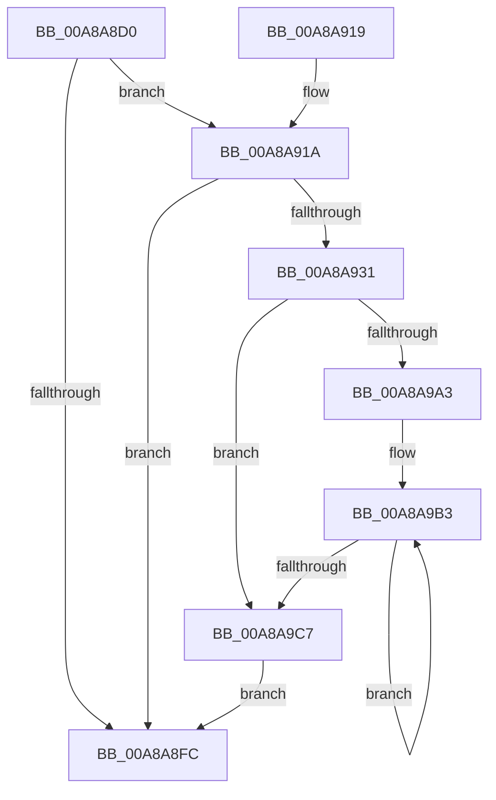

# PpmEventTraceParkNodeRundown

- RVA: `0x00A8A8D0`–`0x00A8AA11` (길이 `321` bytes)
- VA: `0x0000000140A8A8D0`
- 실행 섹션: `PAGE`
- PDB 이름 있음: `예`; PDB Function 태그: `아니요`
- unwind 정보 RVA: `0x000B85B0`
- 디코드: `73`개 명령, `321/321` bytes 표시
- 미해석 바이트: `0` (있으면 어셈블리에 `.byte`로 보존)

> 이 문서는 커널 이미지의 기계어와 PDB 기호를 분석해 생성했습니다. 4번과 5번은 함수 원형과 자료형을 바이너리 사용 방식에서 추정한 C 해석이며 원본 소스 복구 결과는 아닙니다.

## 1. Dependencies

- 직접 호출 지점: **3**; 고유 호출 대상: **3**
- 직접 호출자로 확인된 함수: **1**
- RIP 상대 이미지 참조: **4**

### Outgoing calls
- `0x00A8A903` → [_security_check_cookie](../../text/6A/_security_check_cookie_function_006AC640.md) (function, `0x006AC640`)
- `0x00A8A928` → [EtwEventEnabled](../../text/39/EtwEventEnabled_function_00392450.md) (function, `0x00392450`)
- `0x00A8AA07` → [EtwWrite](../../text/41/EtwWrite_function_0041C720.md) (function, `0x0041C720`)

### Direct callers
- [PpmEventTraceControlCallback](../A5/PpmEventTraceControlCallback_function_00A51F60.md) at `0x00A5222E`

### Static image references
- `0x00A8A8E2` → RVA `0x00E0A740` (`.data`; read)
- `0x00A8A8F0` → RVA `0x00E67A39` (`.data`; read)
- `0x00A8A91A` → RVA `0x00F083E8` (`.data`; read)
- `0x00A8A921` → RVA `0x0001BF38` (`.rdata`; read)

## 2. Other-region calls and transfers

- 다른 실행 섹션으로 향하는 call: **3**
  - `0x00A8A903` → [_security_check_cookie](../../text/6A/_security_check_cookie_function_006AC640.md) (`PAGE` → `.text`)
  - `0x00A8A928` → [EtwEventEnabled](../../text/39/EtwEventEnabled_function_00392450.md) (`PAGE` → `.text`)
  - `0x00A8AA07` → [EtwWrite](../../text/41/EtwWrite_function_0041C720.md) (`PAGE` → `.text`)
- 별도 외부 분기/꼬리 이동을 확인하지 못했습니다.

## 3. Assembly (complete function range)

```asm
00A8A8D0  48 89 5C 24 08                  mov qword ptr [rsp + 8], rbx
00A8A8D5  55                              push rbp
00A8A8D6  48 8D 6C 24 A9                  lea rbp, [rsp - 0x57]
00A8A8DB  48 81 EC C0 00 00 00            sub rsp, 0xc0
00A8A8E2  48 8B 05 57 FE 37 00            mov rax, qword ptr [rip + 0x37fe57]
00A8A8E9  48 33 C4                        xor rax, rsp
00A8A8EC  48 89 45 47                     mov qword ptr [rbp + 0x47], rax
00A8A8F0  80 3D 42 D1 3D 00 00            cmp byte ptr [rip + 0x3dd142], 0
00A8A8F7  48 8B D9                        mov rbx, rcx
00A8A8FA  75 1E                           jne 0x140a8a91a
00A8A8FC  48 8B 4D 47                     mov rcx, qword ptr [rbp + 0x47]
00A8A900  48 33 CC                        xor rcx, rsp
00A8A903  E8 38 1D C2 FF                  call 0x1406ac640
00A8A908  48 8B 9C 24 D0 00 00 00         mov rbx, qword ptr [rsp + 0xd0]
00A8A910  48 81 C4 C0 00 00 00            add rsp, 0xc0
00A8A917  5D                              pop rbp
00A8A918  C3                              ret
00A8A919  CC                              int3
00A8A91A  48 8B 0D C7 DA 47 00            mov rcx, qword ptr [rip + 0x47dac7]
00A8A921  48 8D 15 10 16 59 FF            lea rdx, [rip - 0xa6e9f0]
00A8A928  E8 23 7B 90 FF                  call 0x140392450
00A8A92D  84 C0                           test al, al
00A8A92F  74 CB                           je 0x140a8a8fc
00A8A931  83 65 E3 00                     and dword ptr [rbp - 0x1d], 0
00A8A935  48 8D 43 04                     lea rax, [rbx + 4]
00A8A939  83 65 F3 00                     and dword ptr [rbp - 0xd], 0
00A8A93D  41 B9 08 00 00 00               mov r9d, 8
00A8A943  83 65 03 00                     and dword ptr [rbp + 3], 0
00A8A947  83 65 13 00                     and dword ptr [rbp + 0x13], 0
00A8A94B  83 65 23 00                     and dword ptr [rbp + 0x23], 0
00A8A94F  48 83 65 C7 00                  and qword ptr [rbp - 0x39], 0
00A8A954  0F B6 53 0C                     movzx edx, byte ptr [rbx + 0xc]
00A8A958  48 89 45 D7                     mov qword ptr [rbp - 0x29], rax
00A8A95C  48 8D 43 10                     lea rax, [rbx + 0x10]
00A8A960  48 89 45 E7                     mov qword ptr [rbp - 0x19], rax
00A8A964  48 8D 43 18                     lea rax, [rbx + 0x18]
00A8A968  48 89 45 F7                     mov qword ptr [rbp - 9], rax
00A8A96C  48 8D 83 90 04 00 00            lea rax, [rbx + 0x490]
00A8A973  48 89 45 07                     mov qword ptr [rbp + 7], rax
00A8A977  48 8D 83 94 04 00 00            lea rax, [rbx + 0x494]
00A8A97E  48 89 45 17                     mov qword ptr [rbp + 0x17], rax
00A8A982  C7 45 DF 02 00 00 00            mov dword ptr [rbp - 0x21], 2
00A8A989  44 89 4D EF                     mov dword ptr [rbp - 0x11], r9d
00A8A98D  44 89 4D FF                     mov dword ptr [rbp - 1], r9d
00A8A991  C7 45 0F 01 00 00 00            mov dword ptr [rbp + 0xf], 1
00A8A998  C7 45 1F 01 00 00 00            mov dword ptr [rbp + 0x1f], 1
00A8A99F  84 D2                           test dl, dl
00A8A9A1  74 24                           je 0x140a8a9c7
00A8A9A3  48 8B 83 08 05 00 00            mov rax, qword ptr [rbx + 0x508]
00A8A9AA  33 C9                           xor ecx, ecx
00A8A9AC  48 83 C0 20                     add rax, 0x20
00A8A9B0  44 8B C2                        mov r8d, edx
00A8A9B3  48 0B 08                        or rcx, qword ptr [rax]
00A8A9B6  48 8D 80 80 02 00 00            lea rax, [rax + 0x280]
00A8A9BD  48 89 4D C7                     mov qword ptr [rbp - 0x39], rcx
00A8A9C1  49 83 E8 01                     sub r8, 1
00A8A9C5  75 EC                           jne 0x140a8a9b3
00A8A9C7  83 65 33 00                     and dword ptr [rbp + 0x33], 0
00A8A9CB  48 8D 45 C7                     lea rax, [rbp - 0x39]
00A8A9CF  83 65 43 00                     and dword ptr [rbp + 0x43], 0
00A8A9D3  48 8D 15 5E 15 59 FF            lea rdx, [rip - 0xa6eaa2]
00A8A9DA  48 8B 0D 07 DA 47 00            mov rcx, qword ptr [rip + 0x47da07]
00A8A9E1  45 33 C0                        xor r8d, r8d
00A8A9E4  48 89 45 27                     mov qword ptr [rbp + 0x27], rax
00A8A9E8  48 8D 43 28                     lea rax, [rbx + 0x28]
00A8A9EC  48 89 45 37                     mov qword ptr [rbp + 0x37], rax
00A8A9F0  48 8D 45 D7                     lea rax, [rbp - 0x29]
00A8A9F4  44 89 4D 2F                     mov dword ptr [rbp + 0x2f], r9d
00A8A9F8  44 89 4D 3F                     mov dword ptr [rbp + 0x3f], r9d
00A8A9FC  41 B9 07 00 00 00               mov r9d, 7
00A8AA02  48 89 44 24 20                  mov qword ptr [rsp + 0x20], rax
00A8AA07  E8 14 1D 99 FF                  call 0x14041c720
00A8AA0C  E9 EB FE FF FF                  jmp 0x140a8a8fc
```

## 4. C-style interpretation (structured pseudocode)

```c
__int64 __fastcall PpmEventTraceParkNodeRundown(__int64 a1)
{
    __int64 result;
    __int64 v_rsp;
    unsigned __int64 v_stack_m18;
    unsigned int v_stack_m1C;
    unsigned int v_stack_m20;
    unsigned __int64 v_stack_m28;
    unsigned int v_stack_m2C;
    unsigned int v_stack_m30;
    unsigned __int64 v_stack_m38;
    unsigned int v_stack_m3C;
    unsigned int v_stack_m40;
    unsigned __int64 v_stack_m48;
    unsigned int v_stack_m4C;
    unsigned int v_stack_m50;
    unsigned __int64 v_stack_m58;
    unsigned int v_stack_m5C;
    unsigned __int64 v_stack_m5F;
    unsigned int v_stack_m60;
    unsigned __int64 v_stack_m68;
    unsigned int v_stack_m6C;
    unsigned int v_stack_m70;
    unsigned __int64 v_stack_m78;
    unsigned int v_stack_m7C;
    unsigned int v_stack_m80;
    unsigned __int64 v_stack_m88;
    unsigned __int64 v_stack_m98;
    unsigned __int64 v_stack_p20;
    unsigned __int64 v_stack_p8;

    v_stack_p8 = v_rbx;
    v_rsp = (v_rsp) - (192);
    result = (*(unsigned __int64 *)(v_rip + 3669591)) ^ (v_rsp);
    v_stack_m18 = result;
    if ((*(unsigned __int8 *)(v_rip + 4051266)) != 0) goto loc_00A8A91A;
loc_00A8A8FC:
    a1 = (v_stack_m18) ^ (v_rsp);
    result = _security_check_cookie(a1, a2, a3, a4);
    v_rsp = (v_rsp) + (192);
    return result;
loc_00A8A91A:
    result = EtwEventEnabled(*(unsigned __int64 *)(v_rip + 4709063), v_rip - 10938864, a3, a4);
    if ((unsigned __int8)(result) == 0) goto loc_00A8A8FC;
    v_stack_m88 = v_stack_p8 + 4;
    v_stack_m78 = v_stack_p8 + 16;
    v_stack_m68 = v_stack_p8 + 24;
    v_stack_m58 = v_stack_p8 + 1168;
    v_stack_m48 = v_stack_p8 + 1172;
    v_stack_m80 = 2;
    v_stack_m70 = 8;
    v_stack_m60 = 8;
    v_stack_m50 = 1;
    v_stack_m40 = 1;
    if ((unsigned __int8)(*(unsigned __int8 *)(v_stack_p8 + 12)) == 0) goto loc_00A8A9C7;
    a1 = 0;
    result = (*(unsigned __int64 *)(v_stack_p8 + 1288)) + (32);
loc_00A8A9B3:
    a1 = (a1) | (*(unsigned __int64 *)(result));
    v_stack_m98 = a1;
    a3 = ((unsigned int)((unsigned int)(*(unsigned __int8 *)(v_stack_p8 + 12)))) - (1);
    if (condition_is_not_equal) goto loc_00A8A9B3;
loc_00A8A9C7:
    a3 = 0;
    v_stack_m38 = v_stack_m98;
    v_stack_m28 = v_stack_p8 + 40;
    v_stack_m30 = 8;
    v_stack_m20 = 8;
    v_stack_p20 = v_stack_m88;
    result = EtwWrite(*(unsigned __int64 *)(v_rip + 4708871), v_rip - 10939042, a3, 7);
    goto loc_00A8A8FC;
}
```

## 5. (Beta) C Style

```c
int64_t PpmEventTraceParkNodeRundown(void *Arg1)
{
    uint8_t *arg1 = (uint8_t *)Arg1;

    int64_t result;
    int64_t local_rsp;
    uint64_t v_stack_m18;
    uint32_t v_stack_m1C;
    uint32_t v_stack_m20;
    uint64_t v_stack_m28;
    uint32_t v_stack_m2C;
    uint32_t v_stack_m30;
    uint64_t v_stack_m38;
    uint32_t v_stack_m3C;
    uint32_t v_stack_m40;
    uint64_t v_stack_m48;
    uint32_t v_stack_m4C;
    uint32_t v_stack_m50;
    uint64_t v_stack_m58;
    uint32_t v_stack_m5C;
    uint64_t v_stack_m5F;
    uint32_t v_stack_m60;
    uint64_t v_stack_m68;
    uint32_t v_stack_m6C;
    uint32_t v_stack_m70;
    uint64_t v_stack_m78;
    uint32_t v_stack_m7C;
    uint32_t v_stack_m80;
    uint64_t v_stack_m88;
    uint64_t v_stack_m98;
    uint64_t v_stack_p20;
    uint64_t v_stack_p8;

    v_stack_p8 = local_rbx;
    local_rsp = (local_rsp) - (192);
    result = (*(uint64_t *)(v_rip + 0x37FE57)) ^ (local_rsp);
    v_stack_m18 = result;
    if ((*(uint8_t *)(v_rip + 0x3DD142)) != 0) goto loc_00A8A91A;
loc_00A8A8FC:
    Arg1 = (v_stack_m18) ^ (local_rsp);
    result = _security_check_cookie(Arg1, a2, a3, a4);
    local_rsp = (local_rsp) + (192);
    return result;
loc_00A8A91A:
    result = EtwEventEnabled(*(uint64_t *)(v_rip + 0x47DAC7), v_rip - 10938864, a3, a4);
    if ((uint8_t)(result) == 0) goto loc_00A8A8FC;
    v_stack_m88 = v_stack_p8 + 4;
    v_stack_m78 = v_stack_p8 + 16;
    v_stack_m68 = v_stack_p8 + 24;
    v_stack_m58 = v_stack_p8 + 1168;
    v_stack_m48 = v_stack_p8 + 1172;
    v_stack_m80 = 2;
    v_stack_m70 = 8;
    v_stack_m60 = 8;
    v_stack_m50 = 1;
    v_stack_m40 = 1;
    if ((uint8_t)(*(uint8_t *)(v_stack_p8 + 0xC)) == 0) goto loc_00A8A9C7;
    Arg1 = 0;
    result = (*(uint64_t *)(v_stack_p8 + 0x508)) + (32);
loc_00A8A9B3:
    Arg1 = (Arg1) | (*(uint64_t *)(result));
    v_stack_m98 = Arg1;
    a3 = ((uint32_t)((uint32_t)(*(uint8_t *)(v_stack_p8 + 0xC)))) - (1);
    if (condition_is_not_equal) goto loc_00A8A9B3;
loc_00A8A9C7:
    a3 = 0;
    v_stack_m38 = v_stack_m98;
    v_stack_m28 = v_stack_p8 + 40;
    v_stack_m30 = 8;
    v_stack_m20 = 8;
    v_stack_p20 = v_stack_m88;
    result = EtwWrite(*(uint64_t *)(v_rip + 0x47DA07), v_rip - 10939042, a3, 7);
    goto loc_00A8A8FC;
}
```

### 관측된 메모리 오프셋

구조체 형식이 확인되지 않은 접근은 인자 기준의 오프셋으로만 기록했습니다.

| 기준 인자 | 오프셋 표현 | 폭 (bit) | 접근 |
|---|---:|---:|---|
| `Arg1` | `+ 0x4` | `64` | `R` |
| `Arg1` | `+ 0xC` | `8` | `R` |
| `Arg1` | `+ 0x10` | `64` | `R` |
| `Arg1` | `+ 0x18` | `64` | `R` |
| `Arg1` | `+ 0x28` | `64` | `R` |
| `Arg1` | `+ 0x490` | `64` | `R` |
| `Arg1` | `+ 0x494` | `64` | `R` |
| `Arg1` | `+ 0x508` | `64` | `R` |

## 6. Execution-region graph

[열기: 2D/3D 그래프와 함수 탐색 컨트롤 패널](../../../control-panel.html?section=page&rva=0x00A8A8D0&view=graph)

- 2D 그래프는 위에서 아래로 흐르고, 3D 그래프는 빈 공간을 드래그해 회전합니다. Shift+드래그는 이동, 휠은 확대·축소, 함수 노드 선택은 대상 보고서 이동입니다.

### Static fallback


