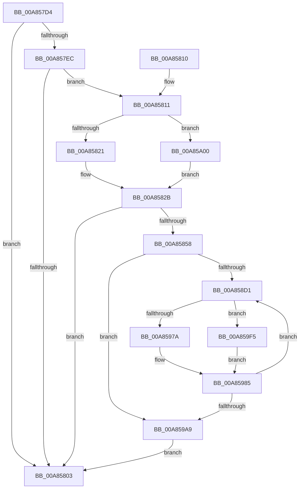

# PpmEventTraceProcessorIdle

- RVA: `0x00A857D4`–`0x00A85A0E` (길이 `570` bytes)
- VA: `0x0000000140A857D4`
- 실행 섹션: `PAGE`
- PDB 이름 있음: `예`; PDB Function 태그: `아니요`
- unwind 정보 RVA: `0x000B7A18`
- 디코드: `128`개 명령, `570/570` bytes 표시
- 미해석 바이트: `0` (있으면 어셈블리에 `.byte`로 보존)

> 이 문서는 커널 이미지의 기계어와 PDB 기호를 분석해 생성했습니다. 4번과 5번은 함수 원형과 자료형을 바이너리 사용 방식에서 추정한 C 해석이며 원본 소스 복구 결과는 아닙니다.

## 1. Dependencies

- 직접 호출 지점: **4**; 고유 호출 대상: **4**
- 직접 호출자로 확인된 함수: **1**
- RIP 상대 이미지 참조: **4**

### Outgoing calls
- `0x00A857FA` → [EtwEventEnabled](../../text/39/EtwEventEnabled_function_00392450.md) (function, `0x00392450`)
- `0x00A8584B` → [ExAllocatePool2](../../poolcode/B8/ExAllocatePool2_function_00B820F0.md) (function, `0x00B820F0`)
- `0x00A859DE` → [EtwWrite](../../text/41/EtwWrite_function_0041C720.md) (function, `0x0041C720`)
- `0x00A859EB` → [ExFreePoolWithTag](../../poolcode/B8/ExFreePoolWithTag_function_00B82870.md) (function, `0x00B82870`)

### Direct callers
- [PpmEventTraceControlCallback](../A5/PpmEventTraceControlCallback_function_00A51F60.md) at `0x00A52305`

### Static image references
- `0x00A857E0` → RVA `0x00E67A39` (`.data`; read)
- `0x00A857EC` → RVA `0x00F083E8` (`.data`; read)
- `0x00A857F3` → RVA `0x0001BD28` (`.rdata`; read)
- `0x00A8597E` → RVA `0x00B02F00` (` ?? ::NNGAKEGL::`string'`; read)

## 2. Other-region calls and transfers

- 다른 실행 섹션으로 향하는 call: **4**
  - `0x00A857FA` → [EtwEventEnabled](../../text/39/EtwEventEnabled_function_00392450.md) (`PAGE` → `.text`)
  - `0x00A8584B` → [ExAllocatePool2](../../poolcode/B8/ExAllocatePool2_function_00B820F0.md) (`PAGE` → `POOLCODE`)
  - `0x00A859DE` → [EtwWrite](../../text/41/EtwWrite_function_0041C720.md) (`PAGE` → `.text`)
  - `0x00A859EB` → [ExFreePoolWithTag](../../poolcode/B8/ExFreePoolWithTag_function_00B82870.md) (`PAGE` → `POOLCODE`)
- 별도 외부 분기/꼬리 이동을 확인하지 못했습니다.

## 3. Assembly (complete function range)

```asm
00A857D4  48 89 5C 24 08                  mov qword ptr [rsp + 8], rbx
00A857D9  55                              push rbp
00A857DA  56                              push rsi
00A857DB  57                              push rdi
00A857DC  48 83 EC 30                     sub rsp, 0x30
00A857E0  80 3D 52 22 3E 00 00            cmp byte ptr [rip + 0x3e2252], 0
00A857E7  48 8B F1                        mov rsi, rcx
00A857EA  74 17                           je 0x140a85803
00A857EC  48 8B 0D F5 2B 48 00            mov rcx, qword ptr [rip + 0x482bf5]
00A857F3  48 8D 15 2E 65 59 FF            lea rdx, [rip - 0xa69ad2]
00A857FA  E8 51 CC 90 FF                  call 0x140392450
00A857FF  84 C0                           test al, al
00A85801  75 0E                           jne 0x140a85811
00A85803  48 8B 5C 24 50                  mov rbx, qword ptr [rsp + 0x50]
00A85808  48 83 C4 30                     add rsp, 0x30
00A8580C  5F                              pop rdi
00A8580D  5E                              pop rsi
00A8580E  5D                              pop rbp
00A8580F  C3                              ret
00A85810  CC                              int3
00A85811  48 8B BE 40 88 00 00            mov rdi, qword ptr [rsi + 0x8840]
00A85818  48 85 FF                        test rdi, rdi
00A8581B  0F 84 DF 01 00 00               je 0x140a85a00
00A85821  8B 47 28                        mov eax, dword ptr [rdi + 0x28]
00A85824  89 44 24 60                     mov dword ptr [rsp + 0x60], eax
00A85828  8B 4F 2C                        mov ecx, dword ptr [rdi + 0x2c]
00A8582B  6B D0 25                        imul edx, eax, 0x25
00A8582E  8D 2C 45 05 00 00 00            lea ebp, [rax*2 + 5]
00A85835  8B C5                           mov eax, ebp
00A85837  89 4C 24 68                     mov dword ptr [rsp + 0x68], ecx
00A8583B  C1 E0 04                        shl eax, 4
00A8583E  B9 00 01 00 00                  mov ecx, 0x100
00A85843  41 B8 50 50 4D 65               mov r8d, 0x654d5050
00A85849  03 D0                           add edx, eax
00A8584B  E8 A0 C8 0F 00                  call 0x140b820f0
00A85850  48 8B D8                        mov rbx, rax
00A85853  48 85 C0                        test rax, rax
00A85856  74 AB                           je 0x140a85803
00A85858  0F B6 8E D0 00 00 00            movzx ecx, byte ptr [rsi + 0xd0]
00A8585F  45 33 C0                        xor r8d, r8d
00A85862  66 89 4C 24 58                  mov word ptr [rsp + 0x58], cx
00A85867  83 63 0C 00                     and dword ptr [rbx + 0xc], 0
00A8586B  C7 43 08 02 00 00 00            mov dword ptr [rbx + 8], 2
00A85872  8B D5                           mov edx, ebp
00A85874  48 C1 E2 04                     shl rdx, 4
00A85878  48 03 D0                        add rdx, rax
00A8587B  B9 04 00 00 00                  mov ecx, 4
00A85880  48 8D 44 24 58                  lea rax, [rsp + 0x58]
00A85885  48 89 03                        mov qword ptr [rbx], rax
00A85888  48 8D 86 D1 00 00 00            lea rax, [rsi + 0xd1]
00A8588F  83 63 1C 00                     and dword ptr [rbx + 0x1c], 0
00A85893  48 89 43 10                     mov qword ptr [rbx + 0x10], rax
00A85897  48 8D 44 24 68                  lea rax, [rsp + 0x68]
00A8589C  C7 43 18 01 00 00 00            mov dword ptr [rbx + 0x18], 1
00A858A3  83 63 2C 00                     and dword ptr [rbx + 0x2c], 0
00A858A7  48 89 43 20                     mov qword ptr [rbx + 0x20], rax
00A858AB  48 8D 44 24 60                  lea rax, [rsp + 0x60]
00A858B0  C7 43 28 04 00 00 00            mov dword ptr [rbx + 0x28], 4
00A858B7  83 63 3C 00                     and dword ptr [rbx + 0x3c], 0
00A858BB  48 89 43 30                     mov qword ptr [rbx + 0x30], rax
00A858BF  C7 43 38 04 00 00 00            mov dword ptr [rbx + 0x38], 4
00A858C6  44 39 44 24 60                  cmp dword ptr [rsp + 0x60], r8d
00A858CB  0F 86 D8 00 00 00               jbe 0x140a859a9
00A858D1  41 8B C0                        mov eax, r8d
00A858D4  44 8D 49 01                     lea r9d, [rcx + 1]
00A858D8  4C 69 D0 58 01 00 00            imul r10, rax, 0x158
00A858DF  4D 03 C9                        add r9, r9
00A858E2  41 8B 84 3A 38 05 00 00         mov eax, dword ptr [r10 + rdi + 0x538]
00A858EA  89 02                           mov dword ptr [rdx], eax
00A858EC  41 8B 84 3A 3C 05 00 00         mov eax, dword ptr [r10 + rdi + 0x53c]
00A858F4  89 42 04                        mov dword ptr [rdx + 4], eax
00A858F7  41 8A 84 3A 70 05 00 00         mov al, byte ptr [r10 + rdi + 0x570]
00A858FF  88 42 08                        mov byte ptr [rdx + 8], al
00A85902  41 0F B6 84 3A 71 05 00 00      movzx eax, byte ptr [r10 + rdi + 0x571]
00A8590B  89 42 09                        mov dword ptr [rdx + 9], eax
00A8590E  41 0F B6 84 3A 72 05 00 00      movzx eax, byte ptr [r10 + rdi + 0x572]
00A85917  89 42 0D                        mov dword ptr [rdx + 0xd], eax
00A8591A  41 0F B6 84 3A 73 05 00 00      movzx eax, byte ptr [r10 + rdi + 0x573]
00A85923  89 42 11                        mov dword ptr [rdx + 0x11], eax
00A85926  41 0F B6 84 3A 74 05 00 00      movzx eax, byte ptr [r10 + rdi + 0x574]
00A8592F  89 42 15                        mov dword ptr [rdx + 0x15], eax
00A85932  41 0F B6 84 3A 75 05 00 00      movzx eax, byte ptr [r10 + rdi + 0x575]
00A8593B  89 42 19                        mov dword ptr [rdx + 0x19], eax
00A8593E  41 0F B6 84 3A 76 05 00 00      movzx eax, byte ptr [r10 + rdi + 0x576]
00A85947  89 42 1D                        mov dword ptr [rdx + 0x1d], eax
00A8594A  41 0F B6 84 3A 77 05 00 00      movzx eax, byte ptr [r10 + rdi + 0x577]
00A85953  89 42 21                        mov dword ptr [rdx + 0x21], eax
00A85956  8B C1                           mov eax, ecx
00A85958  48 C1 E0 04                     shl rax, 4
00A8595C  48 03 C3                        add rax, rbx
00A8595F  83 60 0C 00                     and dword ptr [rax + 0xc], 0
00A85963  48 89 10                        mov qword ptr [rax], rdx
00A85966  C7 40 08 25 00 00 00            mov dword ptr [rax + 8], 0x25
00A8596D  4D 8B 9C 3A 30 05 00 00         mov r11, qword ptr [r10 + rdi + 0x530]
00A85975  4D 85 DB                        test r11, r11
00A85978  75 7B                           jne 0x140a859f5
00A8597A  41 8D 43 1C                     lea eax, [r11 + 0x1c]
00A8597E  4C 8D 1D 7B D5 07 00            lea r11, [rip + 0x7d57b]
00A85985  4E 89 1C CB                     mov qword ptr [rbx + r9*8], r11
00A85989  48 83 C2 25                     add rdx, 0x25
00A8598D  42 89 44 CB 08                  mov dword ptr [rbx + r9*8 + 8], eax
00A85992  83 C1 02                        add ecx, 2
00A85995  42 83 64 CB 0C 00               and dword ptr [rbx + r9*8 + 0xc], 0
00A8599B  41 FF C0                        inc r8d
00A8599E  44 3B 44 24 60                  cmp r8d, dword ptr [rsp + 0x60]
00A859A3  0F 82 28 FF FF FF               jb 0x140a858d1
00A859A9  48 C1 E1 04                     shl rcx, 4
00A859AD  48 8D 86 78 88 00 00            lea rax, [rsi + 0x8878]
00A859B4  48 03 CB                        add rcx, rbx
00A859B7  48 89 5C 24 20                  mov qword ptr [rsp + 0x20], rbx
00A859BC  44 8B CD                        mov r9d, ebp
00A859BF  48 8D 15 62 63 59 FF            lea rdx, [rip - 0xa69c9e]
00A859C6  45 33 C0                        xor r8d, r8d
00A859C9  83 61 0C 00                     and dword ptr [rcx + 0xc], 0
00A859CD  48 89 01                        mov qword ptr [rcx], rax
00A859D0  C7 41 08 04 00 00 00            mov dword ptr [rcx + 8], 4
00A859D7  48 8B 0D 0A 2A 48 00            mov rcx, qword ptr [rip + 0x482a0a]
00A859DE  E8 3D 6D 99 FF                  call 0x14041c720
00A859E3  BA 50 50 4D 65                  mov edx, 0x654d5050
00A859E8  48 8B CB                        mov rcx, rbx
00A859EB  E8 80 CE 0F 00                  call 0x140b82870
00A859F0  E9 0E FE FF FF                  jmp 0x140a85803
00A859F5  41 0F B7 84 3A 2A 05 00 00      movzx eax, word ptr [r10 + rdi + 0x52a]
00A859FE  EB 85                           jmp 0x140a85985
00A85A00  83 64 24 60 00                  and dword ptr [rsp + 0x60], 0
00A85A05  33 C9                           xor ecx, ecx
00A85A07  33 C0                           xor eax, eax
00A85A09  E9 1D FE FF FF                  jmp 0x140a8582b
```

## 4. C-style interpretation (structured pseudocode)

```c
__int64 __fastcall PpmEventTraceProcessorIdle(__int64 a1)
{
    __int64 result;
    __int64 v_r10;
    __int64 v_rsp;
    unsigned __int64 v_stack_p20;
    unsigned __int16 v_stack_p58;
    unsigned int v_stack_p60;
    unsigned int v_stack_p68;
    unsigned __int64 v_stack_p8;

    v_stack_p8 = v_rbx;
    v_rsp = (v_rsp) - (48);
    if ((*(unsigned __int8 *)(v_rip + 4072018)) == 0) goto loc_00A85803;
    result = EtwEventEnabled(*(unsigned __int64 *)(v_rip + 4729845), v_rip - 10918610, a3, a4);
    if ((unsigned __int8)(result) != 0) goto loc_00A85811;
loc_00A85803:
    v_rsp = (v_rsp) + (48);
    return result;
loc_00A85811:
    if (*(unsigned __int64 *)(a1 + 34880) == 0) goto loc_00A85A00;
    v_stack_p60 = (unsigned int)((unsigned int)(*(unsigned int *)(*(unsigned __int64 *)(a1 + 34880) + 40)));
loc_00A8582B:
    a2 = (unsigned int)((v_rip - 10918610) * ((unsigned int)((unsigned int)(*(unsigned int *)(*(unsigned __int64 *)(a1 + 34880) + 40)))));
    v_stack_p68 = (unsigned int)((unsigned int)(*(unsigned int *)(*(unsigned __int64 *)(a1 + 34880) + 44)));
    result = (unsigned int)(((unsigned int)((unsigned int)((unsigned int)(*(unsigned int *)(*(unsigned __int64 *)(a1 + 34880) + 40)) * 2 + 5))) << (4));
    a2 = (unsigned int)((a2) + ((unsigned int)(result)));
    result = ExAllocatePool2(256, a2, (unsigned int)(0x654D5050ULL), a4);
    if (result == 0) goto loc_00A85803;
    a3 = 0;
    v_stack_p58 = (unsigned __int16)(*(unsigned __int8 *)(a1 + 208));
    *(unsigned int *)(result + 8) = 2;
    a2 = ((unsigned int)((unsigned int)((unsigned int)(*(unsigned int *)(*(unsigned __int64 *)(a1 + 34880) + 40)) * 2 + 5))) << (4);
    a2 = (a2) + (result);
    *(unsigned __int64 *)(result) = v_stack_p58;
    *(unsigned __int64 *)(result + 16) = a1 + 209;
    *(unsigned int *)(result + 24) = 1;
    *(unsigned __int64 *)(result + 32) = v_stack_p68;
    *(unsigned int *)(result + 40) = 4;
    *(unsigned __int64 *)(result + 48) = v_stack_p60;
    *(unsigned int *)(result + 56) = 4;
    if (v_stack_p60 <= 0) goto loc_00A859A9;
loc_00A858D1:
    v_r10 = (v_r10) * (0);
    a4 = (4 + 1) + (4 + 1);
    *(unsigned int *)(a2) = (unsigned int)((unsigned int)(*(unsigned int *)(v_r10 + *(unsigned __int64 *)(a1 + 34880) * 1 + 1336)));
    *(unsigned int *)(a2 + 4) = (unsigned int)((unsigned int)(*(unsigned int *)(v_r10 + *(unsigned __int64 *)(a1 + 34880) * 1 + 1340)));
    *(unsigned __int8 *)(a2 + 8) = (unsigned __int8)(*(unsigned __int8 *)(v_r10 + *(unsigned __int64 *)(a1 + 34880) * 1 + 1392));
    *(unsigned int *)(a2 + 9) = (unsigned int)(*(unsigned __int8 *)(v_r10 + *(unsigned __int64 *)(a1 + 34880) * 1 + 1393));
    *(unsigned int *)(a2 + 13) = (unsigned int)(*(unsigned __int8 *)(v_r10 + *(unsigned __int64 *)(a1 + 34880) * 1 + 1394));
    *(unsigned int *)(a2 + 17) = (unsigned int)(*(unsigned __int8 *)(v_r10 + *(unsigned __int64 *)(a1 + 34880) * 1 + 1395));
    *(unsigned int *)(a2 + 21) = (unsigned int)(*(unsigned __int8 *)(v_r10 + *(unsigned __int64 *)(a1 + 34880) * 1 + 1396));
    *(unsigned int *)(a2 + 25) = (unsigned int)(*(unsigned __int8 *)(v_r10 + *(unsigned __int64 *)(a1 + 34880) * 1 + 1397));
    *(unsigned int *)(a2 + 29) = (unsigned int)(*(unsigned __int8 *)(v_r10 + *(unsigned __int64 *)(a1 + 34880) * 1 + 1398));
    *(unsigned int *)(a2 + 33) = (unsigned int)(*(unsigned __int8 *)(v_r10 + *(unsigned __int64 *)(a1 + 34880) * 1 + 1399));
    result = (4) << (4);
    result = (result) + (result);
    *(unsigned __int64 *)(result) = a2;
    *(unsigned int *)(result + 8) = 37;
    if (*(unsigned __int64 *)(v_r10 + *(unsigned __int64 *)(a1 + 34880) * 1 + 1328) != 0) goto loc_00A859F5;
loc_00A85985:
    *(unsigned __int64 *)(result + a4 * 8) = v_rip + 513403;
    a2 = (a2) + (37);
    *(unsigned int *)(result + a4 * 8 + 8) = (unsigned int)(*(unsigned __int64 *)(v_r10 + *(unsigned __int64 *)(a1 + 34880) * 1 + 1328) + 28);
    a1 = (unsigned int)((4) + (2));
    a3 = (unsigned int)((a3) + 1);
    if (((unsigned int)(a3)) < v_stack_p60) goto loc_00A858D1;
loc_00A859A9:
    a1 = (a1) << (4);
    a1 = (a1) + (result);
    v_stack_p20 = result;
    a3 = 0;
    *(unsigned __int64 *)(a1) = a1 + 34936;
    *(unsigned int *)(a1 + 8) = 4;
    result = EtwWrite(*(unsigned __int64 *)(v_rip + 4729354), v_rip - 10919070, a3, (unsigned int)((unsigned int)((unsigned int)(*(unsigned int *)(*(unsigned __int64 *)(a1 + 34880) + 40)) * 2 + 5)));
    result = ExFreePoolWithTag(result, (unsigned int)(0x654D5050ULL), a3, (unsigned int)((unsigned int)((unsigned int)(*(unsigned int *)(*(unsigned __int64 *)(a1 + 34880) + 40)) * 2 + 5)));
    goto loc_00A85803;
loc_00A859F5:
    goto loc_00A85985;
loc_00A85A00:
    a1 = 0;
    result = 0;
    goto loc_00A8582B;
}
```

## 5. (Beta) C Style

```c
int64_t PpmEventTraceProcessorIdle(void *Arg1)
{
    uint8_t *arg1 = (uint8_t *)Arg1;

    int64_t result;
    int64_t local_r10;
    int64_t local_rsp;
    uint64_t v_stack_p20;
    uint16_t v_stack_p58;
    uint32_t v_stack_p60;
    uint32_t v_stack_p68;
    uint64_t v_stack_p8;

    v_stack_p8 = local_rbx;
    local_rsp = (local_rsp) - (48);
    if ((*(uint8_t *)(v_rip + 0x3E2252)) == 0) goto loc_00A85803;
    result = EtwEventEnabled(*(uint64_t *)(v_rip + 0x482BF5), v_rip - 10918610, a3, a4);
    if ((uint8_t)(result) != 0) goto loc_00A85811;
loc_00A85803:
    local_rsp = (local_rsp) + (48);
    return result;
loc_00A85811:
    if (*(uint64_t *)(arg1 + 0x8840) == 0) goto loc_00A85A00;
    v_stack_p60 = (uint32_t)((uint32_t)(*(uint32_t *)(*(uint64_t *)(arg1 + 0x8840) + 0x28)));
loc_00A8582B:
    a2 = (uint32_t)((v_rip - 10918610) * ((uint32_t)((uint32_t)(*(uint32_t *)(*(uint64_t *)(arg1 + 0x8840) + 0x28)))));
    v_stack_p68 = (uint32_t)((uint32_t)(*(uint32_t *)(*(uint64_t *)(arg1 + 0x8840) + 0x2C)));
    result = (uint32_t)(((uint32_t)((uint32_t)((uint32_t)(*(uint32_t *)(*(uint64_t *)(arg1 + 0x8840) + 0x28)) * 2 + 5))) << (4));
    a2 = (uint32_t)((a2) + ((uint32_t)(result)));
    result = ExAllocatePool2(256, a2, (uint32_t)(0x654D5050ULL), a4);
    if (result == 0) goto loc_00A85803;
    a3 = 0;
    v_stack_p58 = (uint16_t)(*(uint8_t *)(arg1 + 0xD0));
    *(uint32_t *)(result + 0x8) = 2;
    a2 = ((uint32_t)((uint32_t)((uint32_t)(*(uint32_t *)(*(uint64_t *)(arg1 + 0x8840) + 0x28)) * 2 + 5))) << (4);
    a2 = (a2) + (result);
    *(uint64_t *)(result) = v_stack_p58;
    *(void **)(result + 0x10) = Arg1 + 209;
    *(uint32_t *)(result + 0x18) = 1;
    *(uint64_t *)(result + 0x20) = v_stack_p68;
    *(uint32_t *)(result + 0x28) = 4;
    *(uint64_t *)(result + 0x30) = v_stack_p60;
    *(uint32_t *)(result + 0x38) = 4;
    if (v_stack_p60 <= 0) goto loc_00A859A9;
loc_00A858D1:
    local_r10 = (local_r10) * (0);
    a4 = (4 + 1) + (4 + 1);
    *(uint32_t *)(a2) = (uint32_t)((uint32_t)(*(uint32_t *)(local_r10 + *(uint64_t *)(arg1 + 0x8840) * 1 + 0x538)));
    *(uint32_t *)(a2 + 0x4) = (uint32_t)((uint32_t)(*(uint32_t *)(local_r10 + *(uint64_t *)(arg1 + 0x8840) * 1 + 0x53C)));
    *(uint8_t *)(a2 + 0x8) = (uint8_t)(*(uint8_t *)(local_r10 + *(uint64_t *)(arg1 + 0x8840) * 1 + 0x570));
    *(uint32_t *)(a2 + 0x9) = (uint32_t)(*(uint8_t *)(local_r10 + *(uint64_t *)(arg1 + 0x8840) * 1 + 0x571));
    *(uint32_t *)(a2 + 0xD) = (uint32_t)(*(uint8_t *)(local_r10 + *(uint64_t *)(arg1 + 0x8840) * 1 + 0x572));
    *(uint32_t *)(a2 + 0x11) = (uint32_t)(*(uint8_t *)(local_r10 + *(uint64_t *)(arg1 + 0x8840) * 1 + 0x573));
    *(uint32_t *)(a2 + 0x15) = (uint32_t)(*(uint8_t *)(local_r10 + *(uint64_t *)(arg1 + 0x8840) * 1 + 0x574));
    *(uint32_t *)(a2 + 0x19) = (uint32_t)(*(uint8_t *)(local_r10 + *(uint64_t *)(arg1 + 0x8840) * 1 + 0x575));
    *(uint32_t *)(a2 + 0x1D) = (uint32_t)(*(uint8_t *)(local_r10 + *(uint64_t *)(arg1 + 0x8840) * 1 + 0x576));
    *(uint32_t *)(a2 + 0x21) = (uint32_t)(*(uint8_t *)(local_r10 + *(uint64_t *)(arg1 + 0x8840) * 1 + 0x577));
    result = (4) << (4);
    result = (result) + (result);
    *(uint64_t *)(result) = a2;
    *(uint32_t *)(result + 0x8) = 37;
    if (*(uint64_t *)(local_r10 + *(uint64_t *)(arg1 + 0x8840) * 1 + 0x530) != 0) goto loc_00A859F5;
loc_00A85985:
    *(uint64_t *)(result + a4 * 8) = v_rip + 513403;
    a2 = (a2) + (37);
    *(uint32_t *)(result + a4 * 8 + 0x8) = (uint32_t)(*(uint64_t *)(local_r10 + *(uint64_t *)(arg1 + 0x8840) * 1 + 0x530) + 28);
    Arg1 = (uint32_t)((4) + (2));
    a3 = (uint32_t)((a3) + 1);
    if (((uint32_t)(a3)) < v_stack_p60) goto loc_00A858D1;
loc_00A859A9:
    Arg1 = (Arg1) << (4);
    Arg1 = (Arg1) + (result);
    v_stack_p20 = result;
    a3 = 0;
    *(void **)(arg1) = Arg1 + 34936;
    *(uint32_t *)(arg1 + 0x8) = 4;
    result = EtwWrite(*(uint64_t *)(v_rip + 0x482A0A), v_rip - 10919070, a3, (uint32_t)((uint32_t)((uint32_t)(*(uint32_t *)(*(uint64_t *)(arg1 + 0x8840) + 0x28)) * 2 + 5)));
    result = ExFreePoolWithTag(result, (uint32_t)(0x654D5050ULL), a3, (uint32_t)((uint32_t)((uint32_t)(*(uint32_t *)(*(uint64_t *)(arg1 + 0x8840) + 0x28)) * 2 + 5)));
    goto loc_00A85803;
loc_00A859F5:
    goto loc_00A85985;
loc_00A85A00:
    Arg1 = 0;
    result = 0;
    goto loc_00A8582B;
}
```

### 관측된 메모리 오프셋

구조체 형식이 확인되지 않은 접근은 인자 기준의 오프셋으로만 기록했습니다.

| 기준 인자 | 오프셋 표현 | 폭 (bit) | 접근 |
|---|---:|---:|---|
| `Arg1` | `+ 0xD0` | `8` | `R` |
| `Arg1` | `+ 0xD1` | `64` | `R` |
| `Arg1` | `+ 0x8840` | `64` | `R` |
| `Arg1` | `+ 0x8878` | `64` | `R` |

## 6. Execution-region graph

[열기: 2D/3D 그래프와 함수 탐색 컨트롤 패널](../../../control-panel.html?section=page&rva=0x00A857D4&view=graph)

- 2D 그래프는 위에서 아래로 흐르고, 3D 그래프는 빈 공간을 드래그해 회전합니다. Shift+드래그는 이동, 휠은 확대·축소, 함수 노드 선택은 대상 보고서 이동입니다.

### Static fallback


