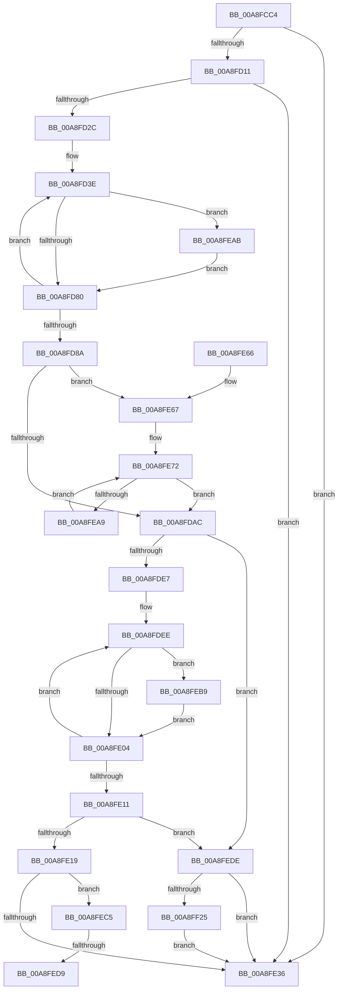

# PpmEventTraceProcessorPerformanceDomainRundown

- RVA: `0x00A8FCC4`–`0x00A8FF34` (길이 `624` bytes)
- VA: `0x0000000140A8FCC4`
- 실행 섹션: `PAGE`
- PDB 이름 있음: `예`; PDB Function 태그: `예`
- unwind 정보 RVA: `0x000B8DB8`
- 디코드: `146`개 명령, `624/624` bytes 표시
- 미해석 바이트: `0` (있으면 어셈블리에 `.byte`로 보존)

> 이 문서는 커널 이미지의 기계어와 PDB 기호를 분석해 생성했습니다. 4번과 5번은 함수 원형과 자료형을 바이너리 사용 방식에서 추정한 C 해석이며 원본 소스 복구 결과는 아닙니다.

## 1. Dependencies

- 직접 호출 지점: **7**; 고유 호출 대상: **7**
- 직접 호출자로 확인된 함수: **1**
- RIP 상대 이미지 참조: **4**

### Outgoing calls
- `0x00A8FD1F` → [EtwEventEnabled](../../text/39/EtwEventEnabled_function_00392450.md) (function, `0x00392450`)
- `0x00A8FD5C` → [KeQueryGroupAffinity](../../text/47/KeQueryGroupAffinity_function_00471A60.md) (function, `0x00471A60`)
- `0x00A8FD6E` → [KeAndGroupAffinityEx](../../text/2C/KeAndGroupAffinityEx_function_002CF6B0.md) (function, `0x002CF6B0`)
- `0x00A8FE25` → [ExAllocatePool2](../../poolcode/B8/ExAllocatePool2_function_00B820F0.md) (function, `0x00B820F0`)
- `0x00A8FE40` → [_security_check_cookie](../../text/6A/_security_check_cookie_function_006AC640.md) (function, `0x006AC640`)
- `0x00A8FF17` → [EtwWrite](../../text/41/EtwWrite_function_0041C720.md) (function, `0x0041C720`)
- `0x00A8FF2A` → [ExFreePoolWithTag](../../poolcode/B8/ExFreePoolWithTag_function_00B82870.md) (function, `0x00B82870`)

### Direct callers
- [PpmEventTraceControlCallback](../A5/PpmEventTraceControlCallback_function_00A51F60.md) at `0x00A52069`

### Static image references
- `0x00A8FCEA` → RVA `0x00E0A740` (`.data`; read)
- `0x00A8FD01` → RVA `0x00E67A39` (`.data`; read)
- `0x00A8FD11` → RVA `0x00F083E8` (`.data`; read)
- `0x00A8FD18` → RVA `0x0001C120` (`.rdata`; read)

## 2. Other-region calls and transfers

- 다른 실행 섹션으로 향하는 call: **7**
  - `0x00A8FD1F` → [EtwEventEnabled](../../text/39/EtwEventEnabled_function_00392450.md) (`PAGE` → `.text`)
  - `0x00A8FD5C` → [KeQueryGroupAffinity](../../text/47/KeQueryGroupAffinity_function_00471A60.md) (`PAGE` → `.text`)
  - `0x00A8FD6E` → [KeAndGroupAffinityEx](../../text/2C/KeAndGroupAffinityEx_function_002CF6B0.md) (`PAGE` → `.text`)
  - `0x00A8FE25` → [ExAllocatePool2](../../poolcode/B8/ExAllocatePool2_function_00B820F0.md) (`PAGE` → `POOLCODE`)
  - `0x00A8FE40` → [_security_check_cookie](../../text/6A/_security_check_cookie_function_006AC640.md) (`PAGE` → `.text`)
  - `0x00A8FF17` → [EtwWrite](../../text/41/EtwWrite_function_0041C720.md) (`PAGE` → `.text`)
  - `0x00A8FF2A` → [ExFreePoolWithTag](../../poolcode/B8/ExFreePoolWithTag_function_00B82870.md) (`PAGE` → `POOLCODE`)
- call이 아닌 외부 분기/꼬리 이동: **2**
  - `0x00A8FED3` → [sub_00B4674E](../B4/Unknown_function_00B4674E.md) (`tail-transfer`)
  - `0x00A8FED9` → [sub_00B4674E + 0x36](../B4/Unknown_function_00B4674E.md) (`tail-transfer`)

## 3. Assembly (complete function range)

```asm
00A8FCC4  48 8B C4                        mov rax, rsp
00A8FCC7  48 89 58 08                     mov qword ptr [rax + 8], rbx
00A8FCCB  48 89 70 10                     mov qword ptr [rax + 0x10], rsi
00A8FCCF  48 89 78 18                     mov qword ptr [rax + 0x18], rdi
00A8FCD3  55                              push rbp
00A8FCD4  41 54                           push r12
00A8FCD6  41 55                           push r13
00A8FCD8  41 56                           push r14
00A8FCDA  41 57                           push r15
00A8FCDC  48 8D A8 48 FA FF FF            lea rbp, [rax - 0x5b8]
00A8FCE3  48 81 EC 90 06 00 00            sub rsp, 0x690
00A8FCEA  48 8B 05 4F AA 37 00            mov rax, qword ptr [rip + 0x37aa4f]
00A8FCF1  48 33 C4                        xor rax, rsp
00A8FCF4  48 89 85 80 05 00 00            mov qword ptr [rbp + 0x580], rax
00A8FCFB  45 33 E4                        xor r12d, r12d
00A8FCFE  48 8B F1                        mov rsi, rcx
00A8FD01  44 38 25 31 7D 3D 00            cmp byte ptr [rip + 0x3d7d31], r12b
00A8FD08  45 8B F4                        mov r14d, r12d
00A8FD0B  0F 84 25 01 00 00               je 0x140a8fe36
00A8FD11  48 8B 0D D0 86 47 00            mov rcx, qword ptr [rip + 0x4786d0]
00A8FD18  48 8D 15 01 C4 58 FF            lea rdx, [rip - 0xa73bff]
00A8FD1F  E8 2C 27 90 FF                  call 0x140392450
00A8FD24  84 C0                           test al, al
00A8FD26  0F 84 0A 01 00 00               je 0x140a8fe36
00A8FD2C  41 0F B7 C4                     movzx eax, r12w
00A8FD30  45 8D 6C 24 01                  lea r13d, [r12 + 1]
00A8FD35  66 89 44 24 30                  mov word ptr [rsp + 0x30], ax
00A8FD3A  41 0F B7 FC                     movzx edi, r12w
00A8FD3E  0F B7 C0                        movzx eax, ax
00A8FD41  48 8D 9D 80 03 00 00            lea rbx, [rbp + 0x380]
00A8FD48  48 C1 E0 04                     shl rax, 4
00A8FD4C  0F 57 C0                        xorps xmm0, xmm0
00A8FD4F  48 03 D8                        add rbx, rax
00A8FD52  0F B7 CF                        movzx ecx, di
00A8FD55  0F 11 03                        movups xmmword ptr [rbx], xmm0
00A8FD58  66 89 7B 08                     mov word ptr [rbx + 8], di
00A8FD5C  E8 FF 1C 9E FF                  call 0x140471a60
00A8FD61  4C 8B C3                        mov r8, rbx
00A8FD64  48 89 03                        mov qword ptr [rbx], rax
00A8FD67  48 8B D3                        mov rdx, rbx
00A8FD6A  48 8D 4E 18                     lea rcx, [rsi + 0x18]
00A8FD6E  E8 3D F9 83 FF                  call 0x1402cf6b0
00A8FD73  85 C0                           test eax, eax
00A8FD75  0F B7 44 24 30                  movzx eax, word ptr [rsp + 0x30]
00A8FD7A  0F 85 2B 01 00 00               jne 0x140a8feab
00A8FD80  66 41 03 FD                     add di, r13w
00A8FD84  66 83 FF 20                     cmp di, 0x20
00A8FD88  72 B4                           jb 0x140a8fd3e
00A8FD8A  48 8D 4C 24 30                  lea rcx, [rsp + 0x30]
00A8FD8F  41 B9 02 00 00 00               mov r9d, 2
00A8FD95  48 89 4C 24 40                  mov qword ptr [rsp + 0x40], rcx
00A8FD9A  41 8B DD                        mov ebx, r13d
00A8FD9D  4C 89 4C 24 48                  mov qword ptr [rsp + 0x48], r9
00A8FDA2  66 44 3B E0                     cmp r12w, ax
00A8FDA6  0F 82 BB 00 00 00               jb 0x140a8fe67
00A8FDAC  44 8B 8E 28 01 00 00            mov r9d, dword ptr [rsi + 0x128]
00A8FDB3  48 8D 4C 24 34                  lea rcx, [rsp + 0x34]
00A8FDB8  8B C3                           mov eax, ebx
00A8FDBA  45 0F B7 C4                     movzx r8d, r12w
00A8FDBE  48 03 C0                        add rax, rax
00A8FDC1  41 8B D4                        mov edx, r12d
00A8FDC4  41 03 DD                        add ebx, r13d
00A8FDC7  89 54 24 34                     mov dword ptr [rsp + 0x34], edx
00A8FDCB  BF 50 50 4D 65                  mov edi, 0x654d5050
00A8FDD0  48 89 4C C4 40                  mov qword ptr [rsp + rax*8 + 0x40], rcx
00A8FDD5  48 C7 44 C4 48 04 00 00 00      mov qword ptr [rsp + rax*8 + 0x48], 4
00A8FDDE  45 85 C9                        test r9d, r9d
00A8FDE1  0F 84 F7 00 00 00               je 0x140a8fede
00A8FDE7  4C 8B 96 38 01 00 00            mov r10, qword ptr [rsi + 0x138]
00A8FDEE  41 0F B7 C0                     movzx eax, r8w
00A8FDF2  48 69 C8 A8 04 00 00            imul rcx, rax, 0x4a8
00A8FDF9  46 39 6C 11 10                  cmp dword ptr [rcx + r10 + 0x10], r13d
00A8FDFE  0F 84 B5 00 00 00               je 0x140a8feb9
00A8FE04  66 45 03 C5                     add r8w, r13w
00A8FE08  41 0F B7 C0                     movzx eax, r8w
00A8FE0C  41 3B C1                        cmp eax, r9d
00A8FE0F  72 DD                           jb 0x140a8fdee
00A8FE11  85 D2                           test edx, edx
00A8FE13  0F 84 C5 00 00 00               je 0x140a8fede
00A8FE19  48 C1 E2 02                     shl rdx, 2
00A8FE1D  44 8B C7                        mov r8d, edi
00A8FE20  B9 00 01 00 00                  mov ecx, 0x100
00A8FE25  E8 C6 22 0F 00                  call 0x140b820f0
00A8FE2A  4C 8B F0                        mov r14, rax
00A8FE2D  48 85 C0                        test rax, rax
00A8FE30  0F 85 8F 00 00 00               jne 0x140a8fec5
00A8FE36  48 8B 8D 80 05 00 00            mov rcx, qword ptr [rbp + 0x580]
00A8FE3D  48 33 CC                        xor rcx, rsp
00A8FE40  E8 FB C7 C1 FF                  call 0x1406ac640
00A8FE45  4C 8D 9C 24 90 06 00 00         lea r11, [rsp + 0x690]
00A8FE4D  49 8B 5B 30                     mov rbx, qword ptr [r11 + 0x30]
00A8FE51  49 8B 73 38                     mov rsi, qword ptr [r11 + 0x38]
00A8FE55  49 8B 7B 40                     mov rdi, qword ptr [r11 + 0x40]
00A8FE59  49 8B E3                        mov rsp, r11
00A8FE5C  41 5F                           pop r15
00A8FE5E  41 5E                           pop r14
00A8FE60  41 5D                           pop r13
00A8FE62  41 5C                           pop r12
00A8FE64  5D                              pop rbp
00A8FE65  C3                              ret
00A8FE66  CC                              int3
00A8FE67  48 8D 95 80 03 00 00            lea rdx, [rbp + 0x380]
00A8FE6E  44 0F B7 C0                     movzx r8d, ax
00A8FE72  8B CB                           mov ecx, ebx
00A8FE74  48 8D 42 08                     lea rax, [rdx + 8]
00A8FE78  48 03 C9                        add rcx, rcx
00A8FE7B  48 89 44 CC 40                  mov qword ptr [rsp + rcx*8 + 0x40], rax
00A8FE80  4C 89 4C CC 48                  mov qword ptr [rsp + rcx*8 + 0x48], r9
00A8FE85  8D 4B 01                        lea ecx, [rbx + 1]
00A8FE88  48 03 C9                        add rcx, rcx
00A8FE8B  41 03 D9                        add ebx, r9d
00A8FE8E  48 89 54 CC 40                  mov qword ptr [rsp + rcx*8 + 0x40], rdx
00A8FE93  48 83 C2 10                     add rdx, 0x10
00A8FE97  48 C7 44 CC 48 08 00 00 00      mov qword ptr [rsp + rcx*8 + 0x48], 8
00A8FEA0  4D 2B C5                        sub r8, r13
00A8FEA3  0F 84 03 FF FF FF               je 0x140a8fdac
00A8FEA9  EB C7                           jmp 0x140a8fe72
00A8FEAB  66 41 03 C5                     add ax, r13w
00A8FEAF  66 89 44 24 30                  mov word ptr [rsp + 0x30], ax
00A8FEB4  E9 C7 FE FF FF                  jmp 0x140a8fd80
00A8FEB9  41 03 D5                        add edx, r13d
00A8FEBC  89 54 24 34                     mov dword ptr [rsp + 0x34], edx
00A8FEC0  E9 3F FF FF FF                  jmp 0x140a8fe04
00A8FEC5  45 8B C4                        mov r8d, r12d
00A8FEC8  41 0F B7 D4                     movzx edx, r12w
00A8FECC  44 39 A6 28 01 00 00            cmp dword ptr [rsi + 0x128], r12d
00A8FED3  0F 87 75 68 0B 00               ja 0x140b4674e
00A8FED9  E9 A6 68 0B 00                  jmp 0x140b46784
00A8FEDE  48 8D 86 B8 01 00 00            lea rax, [rsi + 0x1b8]
00A8FEE5  8B CB                           mov ecx, ebx
00A8FEE7  48 03 C9                        add rcx, rcx
00A8FEEA  44 8D 4B 01                     lea r9d, [rbx + 1]
00A8FEEE  45 33 C0                        xor r8d, r8d
00A8FEF1  48 8D 15 28 C2 58 FF            lea rdx, [rip - 0xa73dd8]
00A8FEF8  48 89 44 CC 40                  mov qword ptr [rsp + rcx*8 + 0x40], rax
00A8FEFD  48 8D 44 24 40                  lea rax, [rsp + 0x40]
00A8FF02  48 C7 44 CC 48 04 00 00 00      mov qword ptr [rsp + rcx*8 + 0x48], 4
00A8FF0B  48 8B 0D D6 84 47 00            mov rcx, qword ptr [rip + 0x4784d6]
00A8FF12  48 89 44 24 20                  mov qword ptr [rsp + 0x20], rax
00A8FF17  E8 04 C8 98 FF                  call 0x14041c720
00A8FF1C  4D 85 F6                        test r14, r14
00A8FF1F  0F 84 11 FF FF FF               je 0x140a8fe36
00A8FF25  8B D7                           mov edx, edi
00A8FF27  49 8B CE                        mov rcx, r14
00A8FF2A  E8 41 29 0F 00                  call 0x140b82870
00A8FF2F  E9 02 FF FF FF                  jmp 0x140a8fe36
```

## 4. C-style interpretation (structured pseudocode)

```c
__int64 __fastcall PpmEventTraceProcessorPerformanceDomainRundown(__int64 a1)
{
    __int64 result;
    __int64 v_r12;
    __int64 v_rbx;
    __int64 v_rdi;
    __int64 v_rsp;
    unsigned __int64 v_stack_m28;
    unsigned __int64 v_stack_m650;
    unsigned int v_stack_m65C;
    unsigned __int16 v_stack_m660;
    unsigned __int64 v_stack_m670;
    unsigned __int64 v_stack_m678;
    unsigned __int64 v_stack_m684;
    unsigned __int16 v_stack_m688;

    *(unsigned __int64 *)(v_rsp + 8) = v_rbx;
    *(unsigned __int64 *)(v_rsp + 16) = v_rsi;
    *(unsigned __int64 *)(v_rsp + 24) = v_rdi;
    v_rsp = (v_rsp) - (0x690ULL);
    result = (*(unsigned __int64 *)(v_rip + 3648079)) ^ (v_rsp);
    *(unsigned __int64 *)(v_rsp - 1464 + 1408) = result;
    v_r12 = 0;
    if ((*(unsigned __int8 *)(v_rip + 4029745)) == 0) goto loc_00A8FE36;
    result = EtwEventEnabled(*(unsigned __int64 *)(v_rip + 4687568), v_rip - 10959871, a3, a4);
    if ((unsigned __int8)(result) == 0) goto loc_00A8FE36;
    v_stack_m688 = 0;
loc_00A8FD3E:
    result = (0) << (4);
    v_rbx = (v_rsp - 1464 + 896) + (result);
    *(unsigned __int64 *)(v_rbx) = v_xmm0;
    *(unsigned __int16 *)(v_rbx + 8) = 0;
    result = KeQueryGroupAffinity(0, v_rip - 10959871, a3, a4);
    *(unsigned __int64 *)(v_rbx) = result;
    result = KeAndGroupAffinityEx(a1 + 24, v_rbx, v_rbx, a4);
    if ((unsigned int)(result) != 0) goto loc_00A8FEAB;
loc_00A8FD80:
    v_rdi = (unsigned __int16)((0) + ((unsigned __int16)(v_r12 + 1)));
    if (((unsigned __int16)(v_rdi)) < 32) goto loc_00A8FD3E;
    v_stack_m678 = v_stack_m688;
    v_stack_m670 = 2;
    if (0 < ((unsigned __int16)(v_stack_m688))) goto loc_00A8FE67;
loc_00A8FDAC:
    result = ((unsigned int)((unsigned int)((unsigned int)((unsigned int)(v_r12 + 1))))) + ((unsigned int)((unsigned int)((unsigned int)((unsigned int)(v_r12 + 1)))));
    v_rbx = (unsigned int)(((unsigned int)((unsigned int)(v_r12 + 1))) + ((unsigned int)(v_r12 + 1)));
    v_stack_m684 = 0;
    *(unsigned __int64 *)(v_rsp + result * 8 + 64) = v_stack_m684;
    *(unsigned __int64 *)(v_rsp + result * 8 + 72) = 4;
    if ((unsigned int)((unsigned int)(*(unsigned int *)(a1 + 296))) == 0) goto loc_00A8FEDE;
loc_00A8FDEE:
    a1 = (v_stack_m684) * (0);
    if ((*(unsigned int *)(a1 + *(unsigned __int64 *)(a1 + 312) * 1 + 16)) == ((unsigned int)(v_r12 + 1))) goto loc_00A8FEB9;
loc_00A8FE04:
    a3 = (unsigned __int16)((0) + ((unsigned __int16)(v_r12 + 1)));
    if (((unsigned int)((unsigned __int16)(a3))) < ((unsigned int)((unsigned int)(*(unsigned int *)(a1 + 296))))) goto loc_00A8FDEE;
    if (0 == 0) goto loc_00A8FEDE;
    a2 = (0) << (2);
    result = ExAllocatePool2(256, a2, (unsigned int)((unsigned int)((unsigned int)(0x654D5050ULL))), (unsigned int)(*(unsigned int *)(a1 + 296)));
    if (result != 0) goto loc_00A8FEC5;
loc_00A8FE36:
    a1 = (*(unsigned __int64 *)(v_rsp - 1464 + 1408)) ^ (v_rsp);
    result = _security_check_cookie(a1, a2, (unsigned int)((unsigned int)((unsigned int)(0x654D5050ULL))), (unsigned int)(*(unsigned int *)(a1 + 296)));
    return result;
loc_00A8FE67:
loc_00A8FE72:
    a1 = ((unsigned int)((unsigned int)(*(unsigned __int64 *)(v_stack_m28 + 48)))) + ((unsigned int)((unsigned int)(*(unsigned __int64 *)(v_stack_m28 + 48))));
    *(unsigned __int64 *)(v_stack_m28 + a1 * 8 + 64) = v_rsp - 1464 + 896 + 8;
    *(unsigned __int64 *)(v_stack_m28 + a1 * 8 + 72) = (unsigned int)(*(unsigned int *)(a1 + 296));
    a1 = (*(unsigned __int64 *)(v_stack_m28 + 48) + 1) + (*(unsigned __int64 *)(v_stack_m28 + 48) + 1);
    v_rbx = (unsigned int)((*(unsigned __int64 *)(v_stack_m28 + 48)) + ((unsigned int)((unsigned int)(*(unsigned int *)(a1 + 296)))));
    *(unsigned __int64 *)(v_stack_m28 + a1 * 8 + 64) = v_rsp - 1464 + 896;
    a2 = (v_rsp - 1464 + 896) + (16);
    *(unsigned __int64 *)(v_stack_m28 + a1 * 8 + 72) = 8;
    a3 = ((unsigned __int16)(result)) - (v_r12 + 1);
    if (condition_is_equal) goto loc_00A8FDAC;
    goto loc_00A8FE72;
loc_00A8FEAB:
    result = (unsigned __int16)((v_rsp - 1464 + 896 + 8) + ((unsigned __int16)(v_r12 + 1)));
    v_stack_m660 = (unsigned __int16)(result);
    goto loc_00A8FD80;
loc_00A8FEB9:
    a2 = (unsigned int)((a2) + ((unsigned int)(v_r12 + 1)));
    v_stack_m65C = (unsigned int)(a2);
    goto loc_00A8FE04;
loc_00A8FEC5:
loc_00A8FEDE:
    a1 = ((unsigned int)((unsigned int)(v_rbx))) + ((unsigned int)((unsigned int)(v_rbx)));
    a3 = 0;
    *(unsigned __int64 *)(v_stack_m28 + a1 * 8 + 64) = *(unsigned __int64 *)(v_stack_m28 + 56) + 440;
    *(unsigned __int64 *)(v_stack_m28 + a1 * 8 + 72) = 4;
    v_stack_m670 = v_stack_m650;
    result = EtwWrite(*(unsigned __int64 *)(v_rip + 4687062), v_rip - 10960344, a3, v_rbx + 1);
    if (result == 0) goto loc_00A8FE36;
    result = ExFreePoolWithTag(result, (unsigned int)((unsigned int)(*(unsigned __int64 *)(v_stack_m28 + 64))), a3, v_rbx + 1);
    goto loc_00A8FE36;
}
```

## 5. (Beta) C Style

```c
int64_t PpmEventTraceProcessorPerformanceDomainRundown(void *Arg1)
{
    uint8_t *arg1 = (uint8_t *)Arg1;

    int64_t result;
    int64_t local_r12;
    int64_t local_rbx;
    int64_t local_rdi;
    int64_t local_rsp;
    uint64_t v_stack_m28;
    uint64_t v_stack_m650;
    uint32_t v_stack_m65C;
    uint16_t v_stack_m660;
    uint64_t v_stack_m670;
    uint64_t v_stack_m678;
    uint64_t v_stack_m684;
    uint16_t v_stack_m688;

    *(uint64_t *)(local_rsp + 0x8) = local_rbx;
    *(uint64_t *)(local_rsp + 0x10) = local_rsi;
    *(uint64_t *)(local_rsp + 0x18) = local_rdi;
    local_rsp = (local_rsp) - (0x690ULL);
    result = (*(uint64_t *)(v_rip + 0x37AA4F)) ^ (local_rsp);
    *(uint64_t *)(local_rsp - 0x5B8 + 0x580) = result;
    local_r12 = 0;
    if ((*(uint8_t *)(v_rip + 0x3D7D31)) == 0) goto loc_00A8FE36;
    result = EtwEventEnabled(*(uint64_t *)(v_rip + 0x4786D0), v_rip - 10959871, a3, a4);
    if ((uint8_t)(result) == 0) goto loc_00A8FE36;
    v_stack_m688 = 0;
loc_00A8FD3E:
    result = (0) << (4);
    local_rbx = (local_rsp - 1464 + 896) + (result);
    *(uint64_t *)(local_rbx) = v_xmm0;
    *(uint16_t *)(local_rbx + 0x8) = 0;
    result = KeQueryGroupAffinity(0, v_rip - 10959871, a3, a4);
    *(uint64_t *)(local_rbx) = result;
    result = KeAndGroupAffinityEx(Arg1 + 24, local_rbx, local_rbx, a4);
    if ((uint32_t)(result) != 0) goto loc_00A8FEAB;
loc_00A8FD80:
    local_rdi = (uint16_t)((0) + ((uint16_t)(local_r12 + 1)));
    if (((uint16_t)(local_rdi)) < 32) goto loc_00A8FD3E;
    v_stack_m678 = v_stack_m688;
    v_stack_m670 = 2;
    if (0 < ((uint16_t)(v_stack_m688))) goto loc_00A8FE67;
loc_00A8FDAC:
    result = ((uint32_t)((uint32_t)((uint32_t)((uint32_t)(local_r12 + 1))))) + ((uint32_t)((uint32_t)((uint32_t)((uint32_t)(local_r12 + 1)))));
    local_rbx = (uint32_t)(((uint32_t)((uint32_t)(local_r12 + 1))) + ((uint32_t)(local_r12 + 1)));
    v_stack_m684 = 0;
    *(uint64_t *)(local_rsp + result * 8 + 0x40) = v_stack_m684;
    *(uint64_t *)(local_rsp + result * 8 + 0x48) = 4;
    if ((uint32_t)((uint32_t)(*(uint32_t *)(arg1 + 0x128))) == 0) goto loc_00A8FEDE;
loc_00A8FDEE:
    Arg1 = (v_stack_m684) * (0);
    if ((*(uint32_t *)(arg1 + *(uint64_t *)(arg1 + 0x138) * 1 + 0x10)) == ((uint32_t)(local_r12 + 1))) goto loc_00A8FEB9;
loc_00A8FE04:
    a3 = (uint16_t)((0) + ((uint16_t)(local_r12 + 1)));
    if (((uint32_t)((uint16_t)(a3))) < ((uint32_t)((uint32_t)(*(uint32_t *)(arg1 + 0x128))))) goto loc_00A8FDEE;
    if (0 == 0) goto loc_00A8FEDE;
    a2 = (0) << (2);
    result = ExAllocatePool2(256, a2, (uint32_t)((uint32_t)((uint32_t)(0x654D5050ULL))), (uint32_t)(*(uint32_t *)(arg1 + 0x128)));
    if (result != 0) goto loc_00A8FEC5;
loc_00A8FE36:
    Arg1 = (*(uint64_t *)(local_rsp - 0x5B8 + 0x580)) ^ (local_rsp);
    result = _security_check_cookie(Arg1, a2, (uint32_t)((uint32_t)((uint32_t)(0x654D5050ULL))), (uint32_t)(*(uint32_t *)(arg1 + 0x128)));
    return result;
loc_00A8FE67:
loc_00A8FE72:
    Arg1 = ((uint32_t)((uint32_t)(*(uint64_t *)(v_stack_m28 + 0x30)))) + ((uint32_t)((uint32_t)(*(uint64_t *)(v_stack_m28 + 0x30))));
    *(uint64_t *)(v_stack_m28 + arg1 * 8 + 0x40) = local_rsp - 1464 + 896 + 8;
    *(uint64_t *)(v_stack_m28 + arg1 * 8 + 0x48) = (uint32_t)(*(uint32_t *)(arg1 + 0x128));
    Arg1 = (*(uint64_t *)(v_stack_m28 + 0x30) + 1) + (*(uint64_t *)(v_stack_m28 + 0x30) + 1);
    local_rbx = (uint32_t)((*(uint64_t *)(v_stack_m28 + 0x30)) + ((uint32_t)((uint32_t)(*(uint32_t *)(arg1 + 0x128)))));
    *(uint64_t *)(v_stack_m28 + arg1 * 8 + 0x40) = local_rsp - 1464 + 896;
    a2 = (local_rsp - 1464 + 896) + (16);
    *(uint64_t *)(v_stack_m28 + arg1 * 8 + 0x48) = 8;
    a3 = ((uint16_t)(result)) - (local_r12 + 1);
    if (condition_is_equal) goto loc_00A8FDAC;
    goto loc_00A8FE72;
loc_00A8FEAB:
    result = (uint16_t)((local_rsp - 1464 + 896 + 8) + ((uint16_t)(local_r12 + 1)));
    v_stack_m660 = (uint16_t)(result);
    goto loc_00A8FD80;
loc_00A8FEB9:
    a2 = (uint32_t)((a2) + ((uint32_t)(local_r12 + 1)));
    v_stack_m65C = (uint32_t)(a2);
    goto loc_00A8FE04;
loc_00A8FEC5:
loc_00A8FEDE:
    Arg1 = ((uint32_t)((uint32_t)(local_rbx))) + ((uint32_t)((uint32_t)(local_rbx)));
    a3 = 0;
    *(uint64_t *)(v_stack_m28 + arg1 * 8 + 0x40) = *(uint64_t *)(v_stack_m28 + 0x38) + 440;
    *(uint64_t *)(v_stack_m28 + arg1 * 8 + 0x48) = 4;
    v_stack_m670 = v_stack_m650;
    result = EtwWrite(*(uint64_t *)(v_rip + 0x4784D6), v_rip - 10960344, a3, local_rbx + 1);
    if (result == 0) goto loc_00A8FE36;
    result = ExFreePoolWithTag(result, (uint32_t)((uint32_t)(*(uint64_t *)(v_stack_m28 + 0x40))), a3, local_rbx + 1);
    goto loc_00A8FE36;
}
```

### 관측된 메모리 오프셋

구조체 형식이 확인되지 않은 접근은 인자 기준의 오프셋으로만 기록했습니다.

| 기준 인자 | 오프셋 표현 | 폭 (bit) | 접근 |
|---|---:|---:|---|
| `Arg1` | `+ 0x18` | `64` | `R` |
| `Arg1` | `+ 0x128` | `32` | `R` |
| `Arg1` | `+ 0x138` | `64` | `R` |
| `Arg1` | `+ 0x1B8` | `64` | `R` |

## 6. Execution-region graph

[열기: 2D/3D 그래프와 함수 탐색 컨트롤 패널](../../../control-panel.html?section=page&rva=0x00A8FCC4&view=graph)

- 2D 그래프는 위에서 아래로 흐르고, 3D 그래프는 빈 공간을 드래그해 회전합니다. Shift+드래그는 이동, 휠은 확대·축소, 함수 노드 선택은 대상 보고서 이동입니다.

### Static fallback


