# PpmGetPolicyAction

- RVA: `0x00A87C44`–`0x00A87E0D` (길이 `457` bytes)
- VA: `0x0000000140A87C44`
- 실행 섹션: `PAGE`
- PDB 이름 있음: `예`; PDB Function 태그: `아니요`
- unwind 정보 RVA: `0x000DB714`
- 디코드: `116`개 명령, `457/457` bytes 표시
- 미해석 바이트: `0` (있으면 어셈블리에 `.byte`로 보존)

> 이 문서는 커널 이미지의 기계어와 PDB 기호를 분석해 생성했습니다. 4번과 5번은 함수 원형과 자료형을 바이너리 사용 방식에서 추정한 C 해석이며 원본 소스 복구 결과는 아닙니다.

## 1. Dependencies

- 직접 호출 지점: **0**; 고유 호출 대상: **0**
- 직접 호출자로 확인된 함수: **2**
- RIP 상대 이미지 참조: **9**

### Outgoing calls
- 직접 디코드된 call 명령이 없습니다.

### Direct callers
- [PpmInfoApplySettingUpdate](../91/PpmInfoApplySettingUpdate_function_009160A8.md) at `0x00916122`
- [PpmCompareAndApplyPolicySettings](../A5/PpmCompareAndApplyPolicySettings_function_00A52CEC.md) at `0x00A52E95`

### Static image references
- `0x00A87C44` → RVA `0x0001BE58` (`.rdata`; read)
- `0x00A87C7B` → RVA `0x0001BE38` (`.rdata`; read)
- `0x00A87CA8` → RVA `0x0001BE08` (`.rdata`; read)
- `0x00A87CD1` → RVA `0x0001BE68` (`.rdata`; read)
- `0x00A87CF9` → RVA `0x0001BE18` (`.rdata`; read)
- `0x00A87D21` → RVA `0x0001BE28` (`.rdata`; read)
- `0x00A87D4A` → RVA `0x0001BE48` (`.rdata`; read)
- `0x00A87DB5` → RVA `0x00FC6AF7` (`ALMOSTRO`; read)
- `0x00A87DE5` → RVA `0x00FC6AFB` (`ALMOSTRO`; read)

## 2. Other-region calls and transfers

- 다른 실행 섹션으로 향하는 call: **0**
- 별도 외부 분기/꼬리 이동을 확인하지 못했습니다.

## 3. Assembly (complete function range)

```asm
00A87C44  F3 0F 6F 05 0C 42 59 FF         movdqu xmm0, xmmword ptr [rip - 0xa6bdf4]
00A87C4C  4C 8B C1                        mov r8, rcx
00A87C4F  F3 0F 6F 09                     movdqu xmm1, xmmword ptr [rcx]
00A87C53  0F 54 C8                        andps xmm1, xmm0
00A87C56  66 0F 6F C1                     movdqa xmm0, xmm1
00A87C5A  66 0F 73 D8 08                  psrldq xmm0, 8
00A87C5F  0F 56 C8                        orps xmm1, xmm0
00A87C62  66 48 0F 7E C8                  movq rax, xmm1
00A87C67  48 85 C0                        test rax, rax
00A87C6A  0F 85 01 01 00 00               jne 0x140a87d71
00A87C70  49 0F BA 20 21                  bt qword ptr [r8], 0x21
00A87C75  0F 82 3A 01 00 00               jb 0x140a87db5
00A87C7B  F3 0F 6F 05 B5 41 59 FF         movdqu xmm0, xmmword ptr [rip - 0xa6be4b]
00A87C83  F3 41 0F 6F 10                  movdqu xmm2, xmmword ptr [r8]
00A87C88  66 0F 6F CA                     movdqa xmm1, xmm2
00A87C8C  0F 54 C8                        andps xmm1, xmm0
00A87C8F  66 0F 6F C1                     movdqa xmm0, xmm1
00A87C93  66 0F 73 D8 08                  psrldq xmm0, 8
00A87C98  0F 56 C8                        orps xmm1, xmm0
00A87C9B  66 48 0F 7E C8                  movq rax, xmm1
00A87CA0  48 85 C0                        test rax, rax
00A87CA3  74 03                           je 0x140a87ca8
00A87CA5  83 0A 02                        or dword ptr [rdx], 2
00A87CA8  F3 0F 6F 05 58 41 59 FF         movdqu xmm0, xmmword ptr [rip - 0xa6bea8]
00A87CB0  66 0F 6F CA                     movdqa xmm1, xmm2
00A87CB4  0F 54 C8                        andps xmm1, xmm0
00A87CB7  66 0F 6F C1                     movdqa xmm0, xmm1
00A87CBB  66 0F 73 D8 08                  psrldq xmm0, 8
00A87CC0  0F 56 C8                        orps xmm1, xmm0
00A87CC3  66 48 0F 7E C8                  movq rax, xmm1
00A87CC8  48 85 C0                        test rax, rax
00A87CCB  0F 85 26 01 00 00               jne 0x140a87df7
00A87CD1  F3 0F 6F 05 8F 41 59 FF         movdqu xmm0, xmmword ptr [rip - 0xa6be71]
00A87CD9  66 0F 6F CA                     movdqa xmm1, xmm2
00A87CDD  0F 54 C8                        andps xmm1, xmm0
00A87CE0  66 0F 6F C1                     movdqa xmm0, xmm1
00A87CE4  66 0F 73 D8 08                  psrldq xmm0, 8
00A87CE9  0F 56 C8                        orps xmm1, xmm0
00A87CEC  66 48 0F 7E C8                  movq rax, xmm1
00A87CF1  48 85 C0                        test rax, rax
00A87CF4  74 03                           je 0x140a87cf9
00A87CF6  83 0A 0C                        or dword ptr [rdx], 0xc
00A87CF9  F3 0F 6F 05 17 41 59 FF         movdqu xmm0, xmmword ptr [rip - 0xa6bee9]
00A87D01  66 0F 6F CA                     movdqa xmm1, xmm2
00A87D05  0F 54 C8                        andps xmm1, xmm0
00A87D08  66 0F 6F C1                     movdqa xmm0, xmm1
00A87D0C  66 0F 73 D8 08                  psrldq xmm0, 8
00A87D11  0F 56 C8                        orps xmm1, xmm0
00A87D14  66 48 0F 7E C8                  movq rax, xmm1
00A87D19  48 85 C0                        test rax, rax
00A87D1C  74 03                           je 0x140a87d21
00A87D1E  83 0A 08                        or dword ptr [rdx], 8
00A87D21  F3 0F 6F 05 FF 40 59 FF         movdqu xmm0, xmmword ptr [rip - 0xa6bf01]
00A87D29  66 0F 6F CA                     movdqa xmm1, xmm2
00A87D2D  0F 54 C8                        andps xmm1, xmm0
00A87D30  66 0F 6F C1                     movdqa xmm0, xmm1
00A87D34  66 0F 73 D8 08                  psrldq xmm0, 8
00A87D39  0F 56 C8                        orps xmm1, xmm0
00A87D3C  66 48 0F 7E C8                  movq rax, xmm1
00A87D41  48 85 C0                        test rax, rax
00A87D44  0F 85 B6 00 00 00               jne 0x140a87e00
00A87D4A  F3 0F 6F 05 F6 40 59 FF         movdqu xmm0, xmmword ptr [rip - 0xa6bf0a]
00A87D52  0F 54 D0                        andps xmm2, xmm0
00A87D55  66 0F 6F C2                     movdqa xmm0, xmm2
00A87D59  66 0F 73 D8 08                  psrldq xmm0, 8
00A87D5E  0F 56 D0                        orps xmm2, xmm0
00A87D61  66 48 0F 7E D0                  movq rax, xmm2
00A87D66  48 85 C0                        test rax, rax
00A87D69  0F 85 99 00 00 00               jne 0x140a87e08
00A87D6F  C3                              ret
00A87D70  CC                              int3
00A87D71  48 8B 09                        mov rcx, qword ptr [rcx]
00A87D74  41 BA 00 01 00 00               mov r10d, 0x100
00A87D7A  B8 00 02 00 00                  mov eax, 0x200
00A87D7F  49 85 CA                        test r10, rcx
00A87D82  75 46                           jne 0x140a87dca
00A87D84  41 B9 00 04 00 00               mov r9d, 0x400
00A87D8A  49 85 C9                        test r9, rcx
00A87D8D  75 3F                           jne 0x140a87dce
00A87D8F  48 85 C8                        test rax, rcx
00A87D92  75 3F                           jne 0x140a87dd3
00A87D94  48 0F BA E1 23                  bt rcx, 0x23
00A87D99  72 3D                           jb 0x140a87dd8
00A87D9B  48 0F BA E1 22                  bt rcx, 0x22
00A87DA0  72 3E                           jb 0x140a87de0
00A87DA2  48 0F BA E1 24                  bt rcx, 0x24
00A87DA7  0F 83 C3 FE FF FF               jae 0x140a87c70
00A87DAD  44 09 0A                        or dword ptr [rdx], r9d
00A87DB0  E9 BB FE FF FF                  jmp 0x140a87c70
00A87DB5  80 3D 3B ED 53 00 00            cmp byte ptr [rip + 0x53ed3b], 0
00A87DBC  0F 84 B9 FE FF FF               je 0x140a87c7b
00A87DC2  83 0A 02                        or dword ptr [rdx], 2
00A87DC5  E9 B1 FE FF FF                  jmp 0x140a87c7b
00A87DCA  09 02                           or dword ptr [rdx], eax
00A87DCC  EB B6                           jmp 0x140a87d84
00A87DCE  83 0A 40                        or dword ptr [rdx], 0x40
00A87DD1  EB BC                           jmp 0x140a87d8f
00A87DD3  83 0A 20                        or dword ptr [rdx], 0x20
00A87DD6  EB BC                           jmp 0x140a87d94
00A87DD8  81 0A 82 00 00 00               or dword ptr [rdx], 0x82
00A87DDE  EB BB                           jmp 0x140a87d9b
00A87DE0  8B 02                           mov eax, dword ptr [rdx]
00A87DE2  41 0B C2                        or eax, r10d
00A87DE5  80 3D 0F ED 53 00 00            cmp byte ptr [rip + 0x53ed0f], 0
00A87DEC  89 02                           mov dword ptr [rdx], eax
00A87DEE  74 B2                           je 0x140a87da2
00A87DF0  83 C8 02                        or eax, 2
00A87DF3  89 02                           mov dword ptr [rdx], eax
00A87DF5  EB AB                           jmp 0x140a87da2
00A87DF7  0F BA 2A 0C                     bts dword ptr [rdx], 0xc
00A87DFB  E9 D1 FE FF FF                  jmp 0x140a87cd1
00A87E00  83 0A 01                        or dword ptr [rdx], 1
00A87E03  E9 42 FF FF FF                  jmp 0x140a87d4a
00A87E08  83 0A 10                        or dword ptr [rdx], 0x10
00A87E0B  C3                              ret
00A87E0C  CC                              int3
```

## 4. C-style interpretation (structured pseudocode)

```c
__int64 __fastcall PpmGetPolicyAction(__int64 a1, __int64 a2)
{
    __int64 result;

    if (result != 0) goto loc_00A87D71;
loc_00A87C70:
    if (condition_is_below) goto loc_00A87DB5;
loc_00A87C7B:
    if (result != 0) {
    }
    if (result != 0) goto loc_00A87DF7;
loc_00A87CD1:
    if (result != 0) {
    }
    if (result != 0) {
    }
    if (result != 0) goto loc_00A87E00;
loc_00A87D4A:
    if (result != 0) goto loc_00A87E08;
    return result;
loc_00A87D71:
    if (((256) & (*(unsigned __int64 *)(a1))) != 0) goto loc_00A87DCA;
loc_00A87D84:
    if ((((unsigned int)(0x400ULL)) & (*(unsigned __int64 *)(a1))) != 0) goto loc_00A87DCE;
loc_00A87D8F:
    if (((512) & (*(unsigned __int64 *)(a1))) != 0) goto loc_00A87DD3;
loc_00A87D94:
    if (condition_is_below) goto loc_00A87DD8;
loc_00A87D9B:
    if (condition_is_below) goto loc_00A87DE0;
loc_00A87DA2:
    if (condition_is_above_or_equal) goto loc_00A87C70;
    goto loc_00A87C70;
loc_00A87DB5:
    if ((*(unsigned __int8 *)(v_rip + 5500219)) == 0) goto loc_00A87C7B;
    goto loc_00A87C7B;
loc_00A87DCA:
    goto loc_00A87D84;
loc_00A87DCE:
    goto loc_00A87D8F;
loc_00A87DD3:
    goto loc_00A87D94;
loc_00A87DD8:
    goto loc_00A87D9B;
loc_00A87DE0:
    result = (unsigned int)(((unsigned int)(*(unsigned int *)(a2))) | (256));
    *(unsigned int *)(a2) = (unsigned int)(result);
    if ((*(unsigned __int8 *)(v_rip + 5500175)) == 0) goto loc_00A87DA2;
    result = (unsigned int)((result) | (2));
    *(unsigned int *)(a2) = (unsigned int)(result);
    goto loc_00A87DA2;
loc_00A87DF7:
    goto loc_00A87CD1;
loc_00A87E00:
    goto loc_00A87D4A;
loc_00A87E08:
    return result;
}
```

## 5. (Beta) C Style

```c
int64_t PpmGetPolicyAction(void *Arg1, void *Arg2)
{
    uint8_t *arg1 = (uint8_t *)Arg1;
    uint8_t *arg2 = (uint8_t *)Arg2;

    int64_t result;

    if (result != 0) goto loc_00A87D71;
loc_00A87C70:
    if (condition_is_below) goto loc_00A87DB5;
loc_00A87C7B:
    if (result != 0) {
    }
    if (result != 0) goto loc_00A87DF7;
loc_00A87CD1:
    if (result != 0) {
    }
    if (result != 0) {
    }
    if (result != 0) goto loc_00A87E00;
loc_00A87D4A:
    if (result != 0) goto loc_00A87E08;
    return result;
loc_00A87D71:
    if (((256) & (*(uint64_t *)(arg1))) != 0) goto loc_00A87DCA;
loc_00A87D84:
    if ((((uint32_t)(0x400ULL)) & (*(uint64_t *)(arg1))) != 0) goto loc_00A87DCE;
loc_00A87D8F:
    if (((512) & (*(uint64_t *)(arg1))) != 0) goto loc_00A87DD3;
loc_00A87D94:
    if (condition_is_below) goto loc_00A87DD8;
loc_00A87D9B:
    if (condition_is_below) goto loc_00A87DE0;
loc_00A87DA2:
    if (condition_is_above_or_equal) goto loc_00A87C70;
    goto loc_00A87C70;
loc_00A87DB5:
    if ((*(uint8_t *)(v_rip + 0x53ED3B)) == 0) goto loc_00A87C7B;
    goto loc_00A87C7B;
loc_00A87DCA:
    goto loc_00A87D84;
loc_00A87DCE:
    goto loc_00A87D8F;
loc_00A87DD3:
    goto loc_00A87D94;
loc_00A87DD8:
    goto loc_00A87D9B;
loc_00A87DE0:
    result = (uint32_t)(((uint32_t)(*(uint32_t *)(arg2))) | (256));
    *(uint32_t *)(arg2) = (uint32_t)(result);
    if ((*(uint8_t *)(v_rip + 0x53ED0F)) == 0) goto loc_00A87DA2;
    result = (uint32_t)((result) | (2));
    *(uint32_t *)(arg2) = (uint32_t)(result);
    goto loc_00A87DA2;
loc_00A87DF7:
    goto loc_00A87CD1;
loc_00A87E00:
    goto loc_00A87D4A;
loc_00A87E08:
    return result;
}
```

### 관측된 메모리 오프셋

구조체 형식이 확인되지 않은 접근은 인자 기준의 오프셋으로만 기록했습니다.

| 기준 인자 | 오프셋 표현 | 폭 (bit) | 접근 |
|---|---:|---:|---|
| `Arg1` | `+ 0x0` | `64` | `R` |
| `Arg1` | `+ 0x0` | `128` | `R` |
| `Arg2` | `+ 0x0` | `32` | `R` |
| `Arg2` | `+ 0x0` | `32` | `R/W` |
| `Arg2` | `+ 0x0` | `32` | `W` |

## 6. Execution-region graph

[열기: 2D/3D 그래프와 함수 탐색 컨트롤 패널](../../../control-panel.html?section=page&rva=0x00A87C44&view=graph)

- 2D 그래프는 위에서 아래로 흐르고, 3D 그래프는 빈 공간을 드래그해 회전합니다. Shift+드래그는 이동, 휠은 확대·축소, 함수 노드 선택은 대상 보고서 이동입니다.

### Static fallback

```mermaid
flowchart TD
  bb_00A87C44[BB_00A87C44]
  bb_00A87C70[BB_00A87C70]
  bb_00A87C7B[BB_00A87C7B]
  bb_00A87CA5[BB_00A87CA5]
  bb_00A87CA8[BB_00A87CA8]
  bb_00A87CD1[BB_00A87CD1]
  bb_00A87CF6[BB_00A87CF6]
  bb_00A87CF9[BB_00A87CF9]
  bb_00A87D1E[BB_00A87D1E]
  bb_00A87D21[BB_00A87D21]
  bb_00A87D4A[BB_00A87D4A]
  bb_00A87D6F[BB_00A87D6F]
  bb_00A87D70[BB_00A87D70]
  bb_00A87D71[BB_00A87D71]
  bb_00A87D84[BB_00A87D84]
  bb_00A87D8F[BB_00A87D8F]
  bb_00A87D94[BB_00A87D94]
  bb_00A87D9B[BB_00A87D9B]
  bb_00A87DA2[BB_00A87DA2]
  bb_00A87DAD[BB_00A87DAD]
  bb_00A87DB5[BB_00A87DB5]
  bb_00A87DC2[BB_00A87DC2]
  bb_00A87DCA[BB_00A87DCA]
  bb_00A87DCE[BB_00A87DCE]
  bb_00A87DD3[BB_00A87DD3]
  bb_00A87DD8[BB_00A87DD8]
  bb_00A87DE0[BB_00A87DE0]
  bb_00A87DF0[BB_00A87DF0]
  bb_00A87DF7[BB_00A87DF7]
  bb_00A87E00[BB_00A87E00]
  bb_00A87E08[BB_00A87E08]
  bb_00A87E0C[BB_00A87E0C]
  bb_00A87C44 -->|branch| bb_00A87D71
  bb_00A87C44 -->|fallthrough| bb_00A87C70
  bb_00A87C70 -->|branch| bb_00A87DB5
  bb_00A87C70 -->|fallthrough| bb_00A87C7B
  bb_00A87C7B -->|branch| bb_00A87CA8
  bb_00A87C7B -->|fallthrough| bb_00A87CA5
  bb_00A87CA5 -->|flow| bb_00A87CA8
  bb_00A87CA8 -->|branch| bb_00A87DF7
  bb_00A87CA8 -->|fallthrough| bb_00A87CD1
  bb_00A87CD1 -->|branch| bb_00A87CF9
  bb_00A87CD1 -->|fallthrough| bb_00A87CF6
  bb_00A87CF6 -->|flow| bb_00A87CF9
  bb_00A87CF9 -->|branch| bb_00A87D21
  bb_00A87CF9 -->|fallthrough| bb_00A87D1E
  bb_00A87D1E -->|flow| bb_00A87D21
  bb_00A87D21 -->|branch| bb_00A87E00
  bb_00A87D21 -->|fallthrough| bb_00A87D4A
  bb_00A87D4A -->|branch| bb_00A87E08
  bb_00A87D4A -->|fallthrough| bb_00A87D6F
  bb_00A87D70 -->|flow| bb_00A87D71
  bb_00A87D71 -->|branch| bb_00A87DCA
  bb_00A87D71 -->|fallthrough| bb_00A87D84
  bb_00A87D84 -->|branch| bb_00A87DCE
  bb_00A87D84 -->|fallthrough| bb_00A87D8F
  bb_00A87D8F -->|branch| bb_00A87DD3
  bb_00A87D8F -->|fallthrough| bb_00A87D94
  bb_00A87D94 -->|branch| bb_00A87DD8
  bb_00A87D94 -->|fallthrough| bb_00A87D9B
  bb_00A87D9B -->|branch| bb_00A87DE0
  bb_00A87D9B -->|fallthrough| bb_00A87DA2
  bb_00A87DA2 -->|branch| bb_00A87C70
  bb_00A87DA2 -->|fallthrough| bb_00A87DAD
  bb_00A87DAD -->|branch| bb_00A87C70
  bb_00A87DB5 -->|branch| bb_00A87C7B
  bb_00A87DB5 -->|fallthrough| bb_00A87DC2
  bb_00A87DC2 -->|branch| bb_00A87C7B
  bb_00A87DCA -->|branch| bb_00A87D84
  bb_00A87DCE -->|branch| bb_00A87D8F
  bb_00A87DD3 -->|branch| bb_00A87D94
  bb_00A87DD8 -->|branch| bb_00A87D9B
  bb_00A87DE0 -->|branch| bb_00A87DA2
  bb_00A87DE0 -->|fallthrough| bb_00A87DF0
  bb_00A87DF0 -->|branch| bb_00A87DA2
  bb_00A87DF7 -->|branch| bb_00A87CD1
  bb_00A87E00 -->|branch| bb_00A87D4A
```


