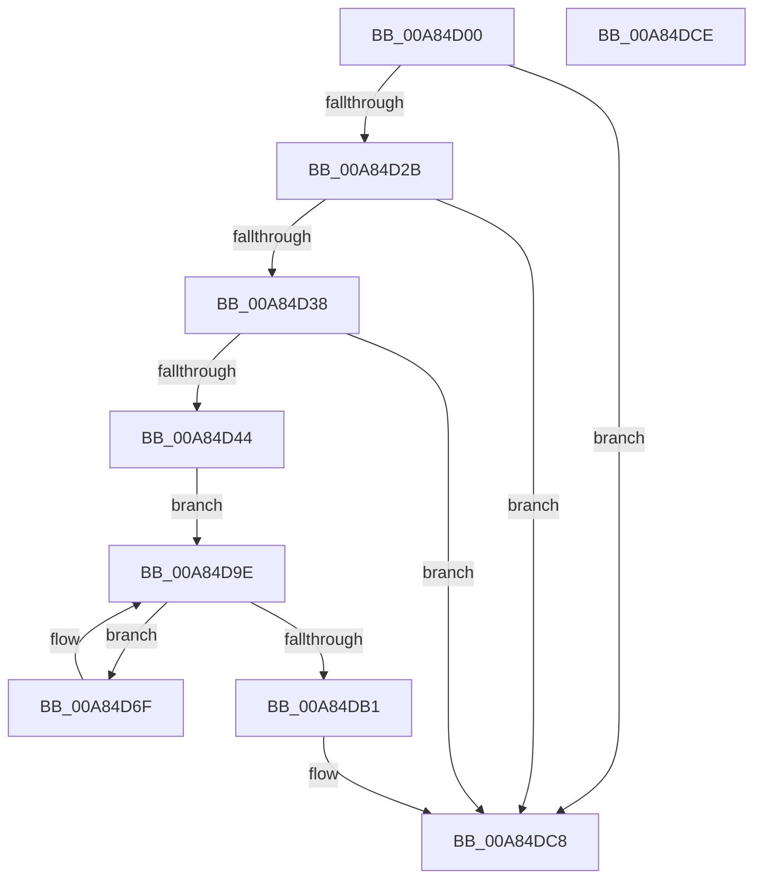

# PpmHvEnableQosEnlightenment

- RVA: `0x00A84D00`–`0x00A84DCF` (길이 `207` bytes)
- VA: `0x0000000140A84D00`
- 실행 섹션: `PAGE`
- PDB 이름 있음: `예`; PDB Function 태그: `아니요`
- unwind 정보 RVA: `0x000697A4`
- 디코드: `46`개 명령, `207/207` bytes 표시
- 미해석 바이트: `0` (있으면 어셈블리에 `.byte`로 보존)

> 이 문서는 커널 이미지의 기계어와 PDB 기호를 분석해 생성했습니다. 4번과 5번은 함수 원형과 자료형을 바이너리 사용 방식에서 추정한 C 해석이며 원본 소스 복구 결과는 아닙니다.

## 1. Dependencies

- 직접 호출 지점: **6**; 고유 호출 대상: **6**
- 직접 호출자로 확인된 함수: **1**
- RIP 상대 이미지 참조: **8**

### Outgoing calls
- `0x00A84D2B` → [HvlIsRootPowerSchedulerQosPresent](../../text/58/HvlIsRootPowerSchedulerQosPresent_function_00583B94.md) (function, `0x00583B94`)
- `0x00A84D4B` → [PpmAcquireLock](../../text/2D/PpmAcquireLock_function_002D9AA4.md) (function, `0x002D9AA4`)
- `0x00A84D73` → [KeGetPrcb](../../text/2D/KeGetPrcb_function_002D85D0.md) (function, `0x002D85D0`)
- `0x00A84D92` → [PpmConvertTimeFrom](../../text/44/PpmConvertTimeFrom_function_00447510.md) (function, `0x00447510`)
- `0x00A84DA8` → [KeEnumerateNextProcessor](../../text/41/KeEnumerateNextProcessor_function_00415480.md) (function, `0x00415480`)
- `0x00A84DC3` → [PpmReinitializeHeteroEngine](../A5/PpmReinitializeHeteroEngine_function_00A53108.md) (function, `0x00A53108`)

### Direct callers
- [PpmCheckInitProcessors](PpmCheckInitProcessors_function_00A84AE8.md) at `0x00A84CB6`
- [PpmCheckInitProcessors](PpmCheckInitProcessors_function_00A84AE8.md) at `0x00A84CBD`

### Static image references
- `0x00A84D38` → RVA `0x00FC6AED` (`ALMOSTRO`; read)
- `0x00A84D44` → RVA `0x00F0CC00` (`.data`; read)
- `0x00A84D50` → RVA `0x00E0B5A8` (`.data`; read)
- `0x00A84D5C` → RVA `0x00E0B5A0` (`.data`; read)
- `0x00A84D78` → RVA `0x00FC5050` (`ALMOSTRO`; read)
- `0x00A84D84` → RVA `0x00FC506C` (`ALMOSTRO`; read)
- `0x00A84DB4` → RVA `0x00FC50B0` (`ALMOSTRO`; write)
- `0x00A84DBC` → RVA `0x00FC6AED` (`ALMOSTRO`; write)

## 2. Other-region calls and transfers

- 다른 실행 섹션으로 향하는 call: **5**
  - `0x00A84D2B` → [HvlIsRootPowerSchedulerQosPresent](../../text/58/HvlIsRootPowerSchedulerQosPresent_function_00583B94.md) (`PAGE` → `.text`)
  - `0x00A84D4B` → [PpmAcquireLock](../../text/2D/PpmAcquireLock_function_002D9AA4.md) (`PAGE` → `.text`)
  - `0x00A84D73` → [KeGetPrcb](../../text/2D/KeGetPrcb_function_002D85D0.md) (`PAGE` → `.text`)
  - `0x00A84D92` → [PpmConvertTimeFrom](../../text/44/PpmConvertTimeFrom_function_00447510.md) (`PAGE` → `.text`)
  - `0x00A84DA8` → [KeEnumerateNextProcessor](../../text/41/KeEnumerateNextProcessor_function_00415480.md) (`PAGE` → `.text`)
- 별도 외부 분기/꼬리 이동을 확인하지 못했습니다.

## 3. Assembly (complete function range)

```asm
00A84D00  40 53                           push rbx
00A84D02  48 83 EC 40                     sub rsp, 0x40
00A84D06  65 48 8B 04 25 20 00 00 00      mov rax, qword ptr gs:[0x20]
00A84D0F  33 DB                           xor ebx, ebx
00A84D11  89 5C 24 32                     mov dword ptr [rsp + 0x32], ebx
00A84D15  66 89 5C 24 36                  mov word ptr [rsp + 0x36], bx
00A84D1A  89 5C 24 50                     mov dword ptr [rsp + 0x50], ebx
00A84D1E  83 B8 20 89 00 00 01            cmp dword ptr [rax + 0x8920], 1
00A84D25  0F 85 9D 00 00 00               jne 0x140a84dc8
00A84D2B  E8 64 EE AF FF                  call 0x140583b94
00A84D30  84 C0                           test al, al
00A84D32  0F 84 90 00 00 00               je 0x140a84dc8
00A84D38  38 1D AF 1D 54 00               cmp byte ptr [rip + 0x541daf], bl
00A84D3E  0F 85 84 00 00 00               jne 0x140a84dc8
00A84D44  48 8D 0D B5 7E 48 00            lea rcx, [rip + 0x487eb5]
00A84D4B  E8 54 4D 85 FF                  call 0x1402d9aa4
00A84D50  48 8B 05 51 68 38 00            mov rax, qword ptr [rip + 0x386851]
00A84D57  48 89 44 24 28                  mov qword ptr [rsp + 0x28], rax
00A84D5C  48 8D 05 3D 68 38 00            lea rax, [rip + 0x38683d]
00A84D63  48 89 44 24 20                  mov qword ptr [rsp + 0x20], rax
00A84D68  66 89 5C 24 30                  mov word ptr [rsp + 0x30], bx
00A84D6D  EB 2F                           jmp 0x140a84d9e
00A84D6F  8B 4C 24 50                     mov ecx, dword ptr [rsp + 0x50]
00A84D73  E8 58 38 85 FF                  call 0x1402d85d0
00A84D78  8B 15 D2 02 54 00               mov edx, dword ptr [rip + 0x5402d2]
00A84D7E  4C 8B D8                        mov r11, rax
00A84D81  83 FA FF                        cmp edx, -1
00A84D84  0F 44 15 E1 02 54 00            cmove edx, dword ptr [rip + 0x5402e1]
00A84D8B  8B CA                           mov ecx, edx
00A84D8D  BA 40 42 0F 00                  mov edx, 0xf4240
00A84D92  E8 79 27 9C FF                  call 0x140447510
00A84D97  49 89 83 38 8A 00 00            mov qword ptr [r11 + 0x8a38], rax
00A84D9E  48 8D 54 24 20                  lea rdx, [rsp + 0x20]
00A84DA3  48 8D 4C 24 50                  lea rcx, [rsp + 0x50]
00A84DA8  E8 D3 06 99 FF                  call 0x140415480
00A84DAD  85 C0                           test eax, eax
00A84DAF  74 BE                           je 0x140a84d6f
00A84DB1  45 33 C0                        xor r8d, r8d
00A84DB4  89 1D F6 02 54 00               mov dword ptr [rip + 0x5402f6], ebx
00A84DBA  B1 01                           mov cl, 1
00A84DBC  C6 05 2A 1D 54 00 01            mov byte ptr [rip + 0x541d2a], 1
00A84DC3  E8 40 E3 FC FF                  call 0x140a53108
00A84DC8  48 83 C4 40                     add rsp, 0x40
00A84DCC  5B                              pop rbx
00A84DCD  C3                              ret
00A84DCE  CC                              int3
```

## 4. C-style interpretation (structured pseudocode)

```c
__int64 __fastcall PpmHvEnableQosEnlightenment(__int64 a1, __int64 a2, int a3)
{
    __int64 result;
    __int64 v_rbx;
    __int64 v_rsp;
    unsigned __int16 v_stack_m12;
    unsigned int v_stack_m16;
    unsigned __int16 v_stack_m18;
    unsigned __int64 v_stack_m20;
    unsigned __int64 v_stack_m28;
    unsigned int v_stack_p8;

    v_rsp = (v_rsp) - (64);
    v_rbx = 0;
    v_stack_m16 = 0;
    v_stack_m12 = 0;
    v_stack_p8 = 0;
    if ((*(unsigned int *)(*(unsigned __int64 *)(gs_base + (0 + 32)) + 35104)) != 1) goto loc_00A84DC8;
    result = HvlIsRootPowerSchedulerQosPresent(a1, a2, a3, a4);
    if ((unsigned __int8)(result) == 0) goto loc_00A84DC8;
    if ((*(unsigned __int8 *)(v_rip + 5512623)) != 0) goto loc_00A84DC8;
    result = PpmAcquireLock(v_rip + 4751029, a2, a3, a4);
    v_stack_m20 = *(unsigned __int64 *)(v_rip + 3696721);
    v_stack_m28 = v_rip + 3696701;
    v_stack_m18 = 0;
    goto loc_00A84D9E;
loc_00A84D6F:
    result = KeGetPrcb((unsigned int)(v_stack_p8), a2, a3, a4);
    a2 = (unsigned int)(*(unsigned int *)(v_rip + 5505746));
    if (((unsigned int)((unsigned int)(*(unsigned int *)(v_rip + 5505746)))) == -1) { a2 = *(unsigned int *)(v_rip + 5505761); }
    result = PpmConvertTimeFrom((unsigned int)((unsigned int)(a2)), (unsigned int)(0xF4240ULL), a3, a4);
    *(unsigned __int64 *)(result + 35384) = result;
loc_00A84D9E:
    result = KeEnumerateNextProcessor(v_stack_p8, v_stack_m28, a3, a4);
    if ((unsigned int)(result) == 0) goto loc_00A84D6F;
    a3 = 0;
    *(unsigned int *)(v_rip + 5505782) = 0;
    *(unsigned __int8 *)(v_rip + 5512490) = 1;
    result = PpmReinitializeHeteroEngine(1, v_stack_m28, a3, a4);
loc_00A84DC8:
    v_rsp = (v_rsp) + (64);
    return result;
}
```

## 5. (Beta) C Style

```c
int64_t PpmHvEnableQosEnlightenment(int64_t Arg1, int64_t Arg2, int32_t Arg3)
{
    int64_t result;
    int64_t local_rbx;
    int64_t local_rsp;
    uint16_t v_stack_m12;
    uint32_t v_stack_m16;
    uint16_t v_stack_m18;
    uint64_t v_stack_m20;
    uint64_t v_stack_m28;
    uint32_t v_stack_p8;

    local_rsp = (local_rsp) - (64);
    local_rbx = 0;
    v_stack_m16 = 0;
    v_stack_m12 = 0;
    v_stack_p8 = 0;
    if ((*(uint32_t *)(*(uint64_t *)(gs_base + (0 + 0x20)) + 0x8920)) != 1) goto loc_00A84DC8;
    result = HvlIsRootPowerSchedulerQosPresent(Arg1, Arg2, Arg3, a4);
    if ((uint8_t)(result) == 0) goto loc_00A84DC8;
    if ((*(uint8_t *)(v_rip + 0x541DAF)) != 0) goto loc_00A84DC8;
    result = PpmAcquireLock(v_rip + 4751029, Arg2, Arg3, a4);
    v_stack_m20 = *(uint64_t *)(v_rip + 0x386851);
    v_stack_m28 = v_rip + 3696701;
    v_stack_m18 = 0;
    goto loc_00A84D9E;
loc_00A84D6F:
    result = KeGetPrcb((uint32_t)(v_stack_p8), Arg2, Arg3, a4);
    Arg2 = (uint32_t)(*(uint32_t *)(v_rip + 0x5402D2));
    if (((uint32_t)((uint32_t)(*(uint32_t *)(v_rip + 0x5402D2)))) == -1) { Arg2 = *(uint32_t *)(v_rip + 0x5402E1); }
    result = PpmConvertTimeFrom((uint32_t)((uint32_t)(Arg2)), (uint32_t)(0xF4240ULL), Arg3, a4);
    *(uint64_t *)(result + 0x8A38) = result;
loc_00A84D9E:
    result = KeEnumerateNextProcessor(v_stack_p8, v_stack_m28, Arg3, a4);
    if ((uint32_t)(result) == 0) goto loc_00A84D6F;
    Arg3 = 0;
    *(uint32_t *)(v_rip + 0x5402F6) = 0;
    *(uint8_t *)(v_rip + 0x541D2A) = 1;
    result = PpmReinitializeHeteroEngine(1, v_stack_m28, Arg3, a4);
loc_00A84DC8:
    local_rsp = (local_rsp) + (64);
    return result;
}
```

## 6. Execution-region graph

[열기: 2D/3D 그래프와 함수 탐색 컨트롤 패널](../../../control-panel.html?section=page&rva=0x00A84D00&view=graph)

- 2D 그래프는 위에서 아래로 흐르고, 3D 그래프는 빈 공간을 드래그해 회전합니다. Shift+드래그는 이동, 휠은 확대·축소, 함수 노드 선택은 대상 보고서 이동입니다.

### Static fallback


