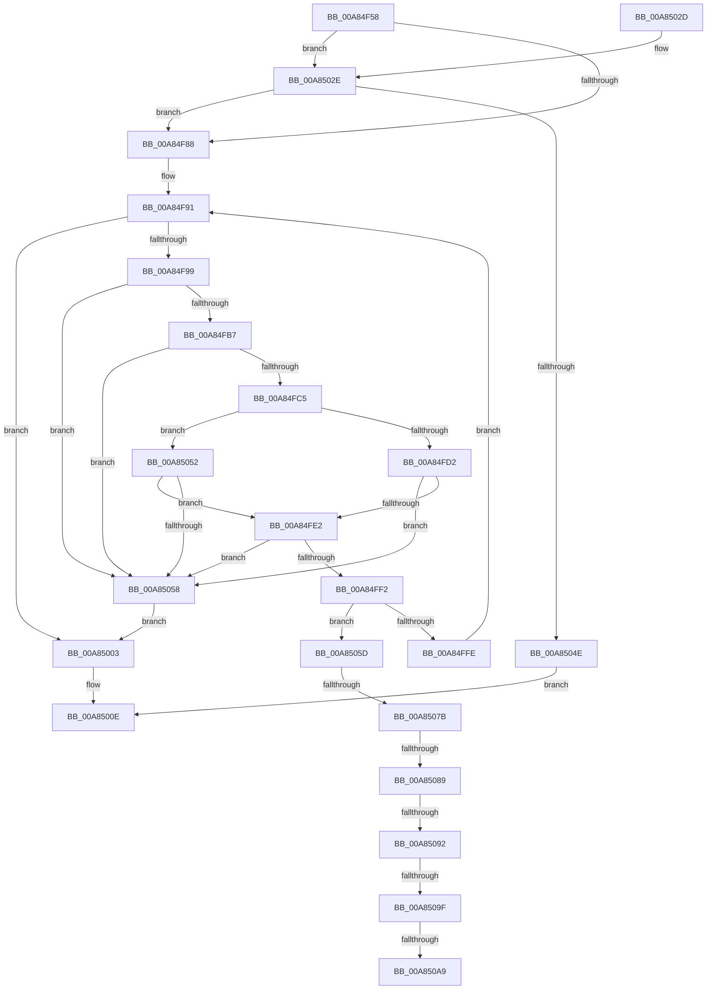

# PpmParkParkingAvailable

- RVA: `0x00A84F58`–`0x00A850B1` (길이 `345` bytes)
- VA: `0x0000000140A84F58`
- 실행 섹션: `PAGE`
- PDB 이름 있음: `예`; PDB Function 태그: `예`
- unwind 정보 RVA: `0x000B7808`
- 디코드: `84`개 명령, `345/345` bytes 표시
- 미해석 바이트: `0` (있으면 어셈블리에 `.byte`로 보존)

> 이 문서는 커널 이미지의 기계어와 PDB 기호를 분석해 생성했습니다. 4번과 5번은 함수 원형과 자료형을 바이너리 사용 방식에서 추정한 C 해석이며 원본 소스 복구 결과는 아닙니다.

## 1. Dependencies

- 직접 호출 지점: **4**; 고유 호출 대상: **2**
- 직접 호출자로 확인된 함수: **5**
- RIP 상대 이미지 참조: **4**

### Outgoing calls
- `0x00A84FC5` → [Feature_PpmParkEx__private_IsEnabledDeviceUsageNoInline](../../text/4F/Feature_PpmParkEx__private_IsEnabledDeviceUsageNoInline_function_004F135C.md) (function, `0x004F135C`)
- `0x00A84FD9` → [KeIsEmptyAffinityEx](../../text/2D/KeIsEmptyAffinityEx_function_002D1580.md) (function, `0x002D1580`)
- `0x00A84FE9` → [KeIsEmptyAffinityEx](../../text/2D/KeIsEmptyAffinityEx_function_002D1580.md) (function, `0x002D1580`)
- `0x00A85092` → [Feature_PpmParkEx__private_IsEnabledDeviceUsageNoInline](../../text/4F/Feature_PpmParkEx__private_IsEnabledDeviceUsageNoInline_function_004F135C.md) (function, `0x004F135C`)

### Direct callers
- [PpmParkRegisterParking](../../text/5D/PpmParkRegisterParking_function_005DB508.md) at `0x005DBD9D`
- [PpmParkRegisterParkingEx](../../text/5E/PpmParkRegisterParkingEx_function_005E183C.md) at `0x005E1D85`
- [PpmParkApplyForcedMask](../76/PpmParkApplyForcedMask_function_0076A904.md) at `0x0076AB09`
- [PpmParkClearForcedMask](../76/PpmParkClearForcedMask_function_0076AB20.md) at `0x0076ABF6`
- [PpmCheckReInit](PpmCheckReInit_function_00A84DD8.md) at `0x00A84E70`

### Static image references
- `0x00A84F7B` → RVA `0x00F083E0` (`.data`; read)
- `0x00A84FA2` → RVA `0x00F083D8` (`.data`; read)
- `0x00A84FE2` → RVA `0x00E0C0F0` (`.data`; read)
- `0x00A85008` → RVA `0x00F083D0` (`.data`; write)

## 2. Other-region calls and transfers

- 다른 실행 섹션으로 향하는 call: **4**
  - `0x00A84FC5` → [Feature_PpmParkEx__private_IsEnabledDeviceUsageNoInline](../../text/4F/Feature_PpmParkEx__private_IsEnabledDeviceUsageNoInline_function_004F135C.md) (`PAGE` → `.text`)
  - `0x00A84FD9` → [KeIsEmptyAffinityEx](../../text/2D/KeIsEmptyAffinityEx_function_002D1580.md) (`PAGE` → `.text`)
  - `0x00A84FE9` → [KeIsEmptyAffinityEx](../../text/2D/KeIsEmptyAffinityEx_function_002D1580.md) (`PAGE` → `.text`)
  - `0x00A85092` → [Feature_PpmParkEx__private_IsEnabledDeviceUsageNoInline](../../text/4F/Feature_PpmParkEx__private_IsEnabledDeviceUsageNoInline_function_004F135C.md) (`PAGE` → `.text`)
- call이 아닌 외부 분기/꼬리 이동: **6**
  - `0x00A85075` → [sub_00B441F0 + 0x15](../B4/Unknown_function_00B441F0.md) (`tail-transfer`)
  - `0x00A85083` → [sub_00B441F0 + 0x1D](../B4/Unknown_function_00B441F0.md) (`tail-transfer`)
  - `0x00A8508C` → [sub_00B441F0 + 0x1D](../B4/Unknown_function_00B441F0.md) (`tail-transfer`)
  - `0x00A85099` → [sub_00B441F0](../B4/Unknown_function_00B441F0.md) (`tail-transfer`)
  - `0x00A850A3` → [sub_00B441F0 + 0x15](../B4/Unknown_function_00B441F0.md) (`tail-transfer`)
  - `0x00A850AC` → [sub_00B441F0 + 0x15](../B4/Unknown_function_00B441F0.md) (`tail-transfer`)

## 3. Assembly (complete function range)

```asm
00A84F58  48 8B C4                        mov rax, rsp
00A84F5B  48 89 58 08                     mov qword ptr [rax + 8], rbx
00A84F5F  48 89 68 10                     mov qword ptr [rax + 0x10], rbp
00A84F63  48 89 70 18                     mov qword ptr [rax + 0x18], rsi
00A84F67  48 89 78 20                     mov qword ptr [rax + 0x20], rdi
00A84F6B  41 54                           push r12
00A84F6D  41 56                           push r14
00A84F6F  41 57                           push r15
00A84F71  48 83 EC 20                     sub rsp, 0x20
00A84F75  41 BC 01 00 00 00               mov r12d, 1
00A84F7B  44 39 25 5E 34 48 00            cmp dword ptr [rip + 0x48345e], r12d
00A84F82  0F 84 A6 00 00 00               je 0x140a8502e
00A84F88  45 33 FF                        xor r15d, r15d
00A84F8B  41 8A DF                        mov bl, r15b
00A84F8E  41 8B EF                        mov ebp, r15d
00A84F91  3B 2D 49 34 48 00               cmp ebp, dword ptr [rip + 0x483449]
00A84F97  73 6A                           jae 0x140a85003
00A84F99  8B C5                           mov eax, ebp
00A84F9B  48 69 F8 10 05 00 00            imul rdi, rax, 0x510
00A84FA2  48 03 3D 2F 34 48 00            add rdi, qword ptr [rip + 0x48342f]
00A84FA9  66 44 39 BF 90 04 00 00         cmp word ptr [rdi + 0x490], r15w
00A84FB1  0F 87 A1 00 00 00               ja 0x140a85058
00A84FB7  66 44 39 BF 94 04 00 00         cmp word ptr [rdi + 0x494], r15w
00A84FBF  0F 87 93 00 00 00               ja 0x140a85058
00A84FC5  E8 92 C3 A6 FF                  call 0x1404f135c
00A84FCA  85 C0                           test eax, eax
00A84FCC  0F 84 80 00 00 00               je 0x140a85052
00A84FD2  48 8D 8F 38 01 00 00            lea rcx, [rdi + 0x138]
00A84FD9  E8 A2 C5 84 FF                  call 0x1402d1580
00A84FDE  85 C0                           test eax, eax
00A84FE0  74 76                           je 0x140a85058
00A84FE2  48 8D 0D 07 71 38 00            lea rcx, [rip + 0x387107]
00A84FE9  E8 92 C5 84 FF                  call 0x1402d1580
00A84FEE  85 C0                           test eax, eax
00A84FF0  74 66                           je 0x140a85058
00A84FF2  45 8B F7                        mov r14d, r15d
00A84FF5  0F B6 47 0C                     movzx eax, byte ptr [rdi + 0xc]
00A84FF9  44 3B F0                        cmp r14d, eax
00A84FFC  72 5F                           jb 0x140a8505d
00A84FFE  41 03 EC                        add ebp, r12d
00A85001  EB 8E                           jmp 0x140a84f91
00A85003  0F B6 CB                        movzx ecx, bl
00A85006  8A C3                           mov al, bl
00A85008  89 0D C2 33 48 00               mov dword ptr [rip + 0x4833c2], ecx
00A8500E  48 8B 5C 24 40                  mov rbx, qword ptr [rsp + 0x40]
00A85013  48 8B 6C 24 48                  mov rbp, qword ptr [rsp + 0x48]
00A85018  48 8B 74 24 50                  mov rsi, qword ptr [rsp + 0x50]
00A8501D  48 8B 7C 24 58                  mov rdi, qword ptr [rsp + 0x58]
00A85022  48 83 C4 20                     add rsp, 0x20
00A85026  41 5F                           pop r15
00A85028  41 5E                           pop r14
00A8502A  41 5C                           pop r12
00A8502C  C3                              ret
00A8502D  CC                              int3
00A8502E  65 48 8B 14 25 20 00 00 00      mov rdx, qword ptr gs:[0x20]
00A85037  48 8B 05 9A 33 48 00            mov rax, qword ptr [rip + 0x48339a]
00A8503E  0F B7 48 0A                     movzx ecx, word ptr [rax + 0xa]
00A85042  39 8A A4 00 00 00               cmp dword ptr [rdx + 0xa4], ecx
00A85048  0F 85 3A FF FF FF               jne 0x140a84f88
00A8504E  32 C0                           xor al, al
00A85050  EB BC                           jmp 0x140a8500e
00A85052  4C 39 7F 18                     cmp qword ptr [rdi + 0x18], r15
00A85056  74 8A                           je 0x140a84fe2
00A85058  41 8A DC                        mov bl, r12b
00A8505B  EB A6                           jmp 0x140a85003
00A8505D  41 8B C6                        mov eax, r14d
00A85060  48 8D 34 80                     lea rsi, [rax + rax*4]
00A85064  48 C1 E6 07                     shl rsi, 7
00A85068  48 03 B7 08 05 00 00            add rsi, qword ptr [rdi + 0x508]
00A8506F  0F B7 0E                        movzx ecx, word ptr [rsi]
00A85072  66 85 C9                        test cx, cx
00A85075  0F 84 8A F1 0B 00               je 0x140b44205
00A8507B  0F B7 46 04                     movzx eax, word ptr [rsi + 4]
00A8507F  66 39 46 02                     cmp word ptr [rsi + 2], ax
00A85083  0F 82 84 F1 0B 00               jb 0x140b4420d
00A85089  66 3B C1                        cmp ax, cx
00A8508C  0F 82 7B F1 0B 00               jb 0x140b4420d
00A85092  E8 C5 C2 A6 FF                  call 0x1404f135c
00A85097  85 C0                           test eax, eax
00A85099  0F 85 51 F1 0B 00               jne 0x140b441f0
00A8509F  4C 39 7E 20                     cmp qword ptr [rsi + 0x20], r15
00A850A3  0F 84 5C F1 0B 00               je 0x140b44205
00A850A9  41 8A DC                        mov bl, r12b
00A850AC  E9 54 F1 0B 00                  jmp 0x140b44205
```

## 4. C-style interpretation (structured pseudocode)

```c
__int64 __fastcall PpmParkParkingAvailable(void)
{
    __int64 result;
    __int64 v_r15;
    __int64 v_rbp;
    __int64 v_rdi;
    __int64 v_rsi;
    __int64 v_rsp;
    unsigned __int64 v_stack_p10;
    unsigned __int64 v_stack_p18;
    unsigned __int64 v_stack_p20;
    unsigned __int64 v_stack_p8;

    *(unsigned __int64 *)(v_rsp + 8) = v_rbx;
    *(unsigned __int64 *)(v_rsp + 16) = v_rbp;
    *(unsigned __int64 *)(v_rsp + 24) = v_rsi;
    *(unsigned __int64 *)(v_rsp + 32) = v_rdi;
    v_rsp = (v_rsp) - (32);
    if ((*(unsigned int *)(v_rip + 4731998)) == 1) goto loc_00A8502E;
loc_00A84F88:
    v_r15 = 0;
loc_00A84F91:
    if (0 >= (*(unsigned int *)(v_rip + 4731977))) goto loc_00A85003;
    v_rdi = (v_rdi) * (0);
    v_rdi = (v_rdi) + (*(unsigned __int64 *)(v_rip + 4731951));
    if ((*(unsigned __int16 *)(v_rdi + 1168)) > 0) goto loc_00A85058;
    if ((*(unsigned __int16 *)(v_rdi + 1172)) > 0) goto loc_00A85058;
    result = Feature_PpmParkEx__private_IsEnabledDeviceUsageNoInline(a1, a2, a3, a4);
    if ((unsigned int)(result) == 0) goto loc_00A85052;
    result = KeIsEmptyAffinityEx(v_rdi + 312, a2, a3, a4);
    if ((unsigned int)(result) == 0) goto loc_00A85058;
loc_00A84FE2:
    result = KeIsEmptyAffinityEx(v_rip + 3698951, a2, a3, a4);
    if ((unsigned int)(result) == 0) goto loc_00A85058;
    if (0 < ((unsigned int)(*(unsigned __int8 *)(v_rdi + 12)))) goto loc_00A8505D;
    v_rbp = (unsigned int)((0) + (1));
    goto loc_00A84F91;
loc_00A85003:
    *(unsigned int *)(v_rip + 4731842) = 0;
loc_00A8500E:
    v_rsp = (v_rsp) + (32);
    return 0;
loc_00A8502E:
    if ((*(unsigned int *)(*(unsigned __int64 *)(gs_base + (0 + 32)) + 164)) != ((unsigned int)(*(unsigned __int16 *)(*(unsigned __int64 *)(v_rip + 4731802) + 10)))) goto loc_00A84F88;
    result = 0;
    goto loc_00A8500E;
loc_00A85052:
    if ((*(unsigned __int64 *)(v_stack_p20 + 24)) == 0) goto loc_00A84FE2;
loc_00A85058:
    goto loc_00A85003;
loc_00A8505D:
    v_rsi = (0 + 0 * 4) << (7);
    v_rsi = (v_rsi) + (*(unsigned __int64 *)(v_stack_p20 + 1288));
    result = Feature_PpmParkEx__private_IsEnabledDeviceUsageNoInline(*(unsigned __int16 *)(v_rsi), *(unsigned __int64 *)(gs_base + (0 + 32)), a3, a4);
}
```

## 5. (Beta) C Style

```c
void PpmParkParkingAvailable(void)
{
    int64_t result;
    int64_t local_r15;
    int64_t local_rbp;
    int64_t local_rdi;
    int64_t local_rsi;
    int64_t local_rsp;
    uint64_t v_stack_p10;
    uint64_t v_stack_p18;
    uint64_t v_stack_p20;
    uint64_t v_stack_p8;

    *(uint64_t *)(local_rsp + 0x8) = local_rbx;
    *(uint64_t *)(local_rsp + 0x10) = local_rbp;
    *(uint64_t *)(local_rsp + 0x18) = local_rsi;
    *(uint64_t *)(local_rsp + 0x20) = local_rdi;
    local_rsp = (local_rsp) - (32);
    if ((*(uint32_t *)(v_rip + 0x48345E)) == 1) goto loc_00A8502E;
loc_00A84F88:
    local_r15 = 0;
loc_00A84F91:
    if (0 >= (*(uint32_t *)(v_rip + 0x483449))) goto loc_00A85003;
    local_rdi = (local_rdi) * (0);
    local_rdi = (local_rdi) + (*(uint64_t *)(v_rip + 0x48342F));
    if ((*(uint16_t *)(local_rdi + 0x490)) > 0) goto loc_00A85058;
    if ((*(uint16_t *)(local_rdi + 0x494)) > 0) goto loc_00A85058;
    result = Feature_PpmParkEx__private_IsEnabledDeviceUsageNoInline(a1, a2, a3, a4);
    if ((uint32_t)(result) == 0) goto loc_00A85052;
    result = KeIsEmptyAffinityEx(local_rdi + 312, a2, a3, a4);
    if ((uint32_t)(result) == 0) goto loc_00A85058;
loc_00A84FE2:
    result = KeIsEmptyAffinityEx(v_rip + 3698951, a2, a3, a4);
    if ((uint32_t)(result) == 0) goto loc_00A85058;
    if (0 < ((uint32_t)(*(uint8_t *)(local_rdi + 0xC)))) goto loc_00A8505D;
    local_rbp = (uint32_t)((0) + (1));
    goto loc_00A84F91;
loc_00A85003:
    *(uint32_t *)(v_rip + 0x4833C2) = 0;
loc_00A8500E:
    local_rsp = (local_rsp) + (32);
    return 0;
loc_00A8502E:
    if ((*(uint32_t *)(*(uint64_t *)(gs_base + (0 + 0x20)) + 0xA4)) != ((uint32_t)(*(uint16_t *)(*(uint64_t *)(v_rip + 0x48339A) + 0xA)))) goto loc_00A84F88;
    result = 0;
    goto loc_00A8500E;
loc_00A85052:
    if ((*(uint64_t *)(v_stack_p20 + 0x18)) == 0) goto loc_00A84FE2;
loc_00A85058:
    goto loc_00A85003;
loc_00A8505D:
    local_rsi = (0 + 0 * 4) << (7);
    local_rsi = (local_rsi) + (*(uint64_t *)(v_stack_p20 + 0x508));
    result = Feature_PpmParkEx__private_IsEnabledDeviceUsageNoInline(*(uint16_t *)(local_rsi), *(uint64_t *)(gs_base + (0 + 0x20)), a3, a4);
}
```

## 6. Execution-region graph

[열기: 2D/3D 그래프와 함수 탐색 컨트롤 패널](../../../control-panel.html?section=page&rva=0x00A84F58&view=graph)

- 2D 그래프는 위에서 아래로 흐르고, 3D 그래프는 빈 공간을 드래그해 회전합니다. Shift+드래그는 이동, 휠은 확대·축소, 함수 노드 선택은 대상 보고서 이동입니다.

### Static fallback


