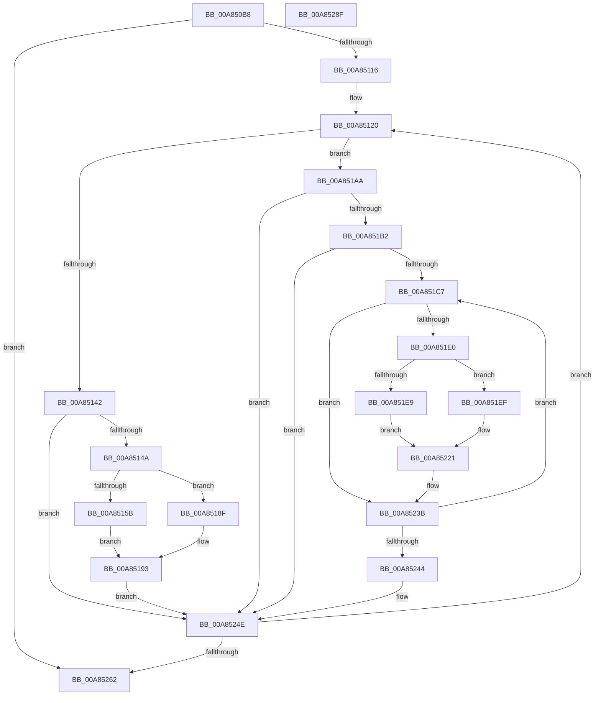

# PpmParkUpdateConcurrencyTracking

- RVA: `0x00A850B8`–`0x00A85290` (길이 `472` bytes)
- VA: `0x0000000140A850B8`
- 실행 섹션: `PAGE`
- PDB 이름 있음: `예`; PDB Function 태그: `아니요`
- unwind 정보 RVA: `0x000B7838`
- 디코드: `114`개 명령, `472/472` bytes 표시
- 미해석 바이트: `0` (있으면 어셈블리에 `.byte`로 보존)

> 이 문서는 커널 이미지의 기계어와 PDB 기호를 분석해 생성했습니다. 4번과 5번은 함수 원형과 자료형을 바이너리 사용 방식에서 추정한 C 해석이며 원본 소스 복구 결과는 아닙니다.

## 1. Dependencies

- 직접 호출 지점: **10**; 고유 호출 대상: **5**
- 직접 호출자로 확인된 함수: **1**
- RIP 상대 이미지 참조: **5**

### Outgoing calls
- `0x00A850FD` → [memset](../../text/6C/memset_function_006C6C40.md) (function, `0x006C6C40`)
- `0x00A85152` → [Feature_PpmParkEx__private_IsEnabledDeviceUsageNoInline](../../text/4F/Feature_PpmParkEx__private_IsEnabledDeviceUsageNoInline_function_004F135C.md) (function, `0x004F135C`)
- `0x00A85171` → [memset](../../text/6C/memset_function_006C6C40.md) (function, `0x006C6C40`)
- `0x00A85183` → [KeAddGroupAffinityEx](../../text/25/KeAddGroupAffinityEx_function_0025B6C0.md) (function, `0x0025B6C0`)
- `0x00A851A0` → [PopExecuteOnTargetProcessors](../../text/2D/PopExecuteOnTargetProcessors_function_002DD834.md) (function, `0x002DD834`)
- `0x00A851E0` → [Feature_PpmParkEx__private_IsEnabledDeviceUsageNoInline](../../text/4F/Feature_PpmParkEx__private_IsEnabledDeviceUsageNoInline_function_004F135C.md) (function, `0x004F135C`)
- `0x00A85205` → [memset](../../text/6C/memset_function_006C6C40.md) (function, `0x006C6C40`)
- `0x00A85217` → [KeAddGroupAffinityEx](../../text/25/KeAddGroupAffinityEx_function_0025B6C0.md) (function, `0x0025B6C0`)
- `0x00A85236` → [PopExecuteOnTargetProcessors](../../text/2D/PopExecuteOnTargetProcessors_function_002DD834.md) (function, `0x002DD834`)
- `0x00A85269` → [_security_check_cookie](../../text/6A/_security_check_cookie_function_006AC640.md) (function, `0x006AC640`)

### Direct callers
- [PpmCheckReInit](PpmCheckReInit_function_00A84DD8.md) at `0x00A84EB6`

### Static image references
- `0x00A850DB` → RVA `0x00E0A740` (`.data`; read)
- `0x00A85105` → RVA `0x00F083E0` (`.data`; read)
- `0x00A8512B` → RVA `0x00F083D8` (`.data`; read)
- `0x00A85196` → RVA `0x004853C0` (`PpmIdleRemoveConcurrency`; read)
- `0x00A85228` → RVA `0x00485440` (`PpmIdleInstallConcurrency`; read)

## 2. Other-region calls and transfers

- 다른 실행 섹션으로 향하는 call: **10**
  - `0x00A850FD` → [memset](../../text/6C/memset_function_006C6C40.md) (`PAGE` → `.text`)
  - `0x00A85152` → [Feature_PpmParkEx__private_IsEnabledDeviceUsageNoInline](../../text/4F/Feature_PpmParkEx__private_IsEnabledDeviceUsageNoInline_function_004F135C.md) (`PAGE` → `.text`)
  - `0x00A85171` → [memset](../../text/6C/memset_function_006C6C40.md) (`PAGE` → `.text`)
  - `0x00A85183` → [KeAddGroupAffinityEx](../../text/25/KeAddGroupAffinityEx_function_0025B6C0.md) (`PAGE` → `.text`)
  - `0x00A851A0` → [PopExecuteOnTargetProcessors](../../text/2D/PopExecuteOnTargetProcessors_function_002DD834.md) (`PAGE` → `.text`)
  - `0x00A851E0` → [Feature_PpmParkEx__private_IsEnabledDeviceUsageNoInline](../../text/4F/Feature_PpmParkEx__private_IsEnabledDeviceUsageNoInline_function_004F135C.md) (`PAGE` → `.text`)
  - `0x00A85205` → [memset](../../text/6C/memset_function_006C6C40.md) (`PAGE` → `.text`)
  - `0x00A85217` → [KeAddGroupAffinityEx](../../text/25/KeAddGroupAffinityEx_function_0025B6C0.md) (`PAGE` → `.text`)
  - `0x00A85236` → [PopExecuteOnTargetProcessors](../../text/2D/PopExecuteOnTargetProcessors_function_002DD834.md) (`PAGE` → `.text`)
  - `0x00A85269` → [_security_check_cookie](../../text/6A/_security_check_cookie_function_006AC640.md) (`PAGE` → `.text`)
- 별도 외부 분기/꼬리 이동을 확인하지 못했습니다.

## 3. Assembly (complete function range)

```asm
00A850B8  48 8B C4                        mov rax, rsp
00A850BB  48 89 58 08                     mov qword ptr [rax + 8], rbx
00A850BF  48 89 70 10                     mov qword ptr [rax + 0x10], rsi
00A850C3  48 89 78 18                     mov qword ptr [rax + 0x18], rdi
00A850C7  55                              push rbp
00A850C8  41 54                           push r12
00A850CA  41 55                           push r13
00A850CC  41 56                           push r14
00A850CE  41 57                           push r15
00A850D0  48 8D 68 88                     lea rbp, [rax - 0x78]
00A850D4  48 81 EC 50 01 00 00            sub rsp, 0x150
00A850DB  48 8B 05 5E 56 38 00            mov rax, qword ptr [rip + 0x38565e]
00A850E2  48 33 C4                        xor rax, rsp
00A850E5  48 89 45 40                     mov qword ptr [rbp + 0x40], rax
00A850E9  44 8A F9                        mov r15b, cl
00A850EC  88 4C 24 20                     mov byte ptr [rsp + 0x20], cl
00A850F0  48 8D 4C 24 30                  lea rcx, [rsp + 0x30]
00A850F5  33 D2                           xor edx, edx
00A850F7  41 B8 08 01 00 00               mov r8d, 0x108
00A850FD  E8 3E 1B C4 FF                  call 0x1406c6c40
00A85102  45 33 E4                        xor r12d, r12d
00A85105  44 39 25 D4 32 48 00            cmp dword ptr [rip + 0x4832d4], r12d
00A8510C  45 0F B7 F4                     movzx r14d, r12w
00A85110  0F 84 4C 01 00 00               je 0x140a85262
00A85116  41 8D 7C 24 20                  lea edi, [r12 + 0x20]
00A8511B  45 8D 6C 24 01                  lea r13d, [r12 + 1]
00A85120  41 0F B7 C6                     movzx eax, r14w
00A85124  48 69 D8 10 05 00 00            imul rbx, rax, 0x510
00A8512B  48 03 1D A6 32 48 00            add rbx, qword ptr [rip + 0x4832a6]
00A85132  8A 83 A0 04 00 00               mov al, byte ptr [rbx + 0x4a0]
00A85138  8A C8                           mov cl, al
00A8513A  80 E1 08                        and cl, 8
00A8513D  45 84 FF                        test r15b, r15b
00A85140  75 68                           jne 0x140a851aa
00A85142  84 C9                           test cl, cl
00A85144  0F 84 04 01 00 00               je 0x140a8524e
00A8514A  24 F7                           and al, 0xf7
00A8514C  88 83 A0 04 00 00               mov byte ptr [rbx + 0x4a0], al
00A85152  E8 05 C2 A6 FF                  call 0x1404f135c
00A85157  85 C0                           test eax, eax
00A85159  75 34                           jne 0x140a8518f
00A8515B  33 D2                           xor edx, edx
00A8515D  48 C7 44 24 30 01 00 20 00      mov qword ptr [rsp + 0x30], 0x200001
00A85166  41 B8 00 01 00 00               mov r8d, 0x100
00A8516C  48 8D 4C 24 38                  lea rcx, [rsp + 0x38]
00A85171  E8 CA 1A C4 FF                  call 0x1406c6c40
00A85176  4C 8B 43 10                     mov r8, qword ptr [rbx + 0x10]
00A8517A  48 8D 4C 24 30                  lea rcx, [rsp + 0x30]
00A8517F  0F B7 53 04                     movzx edx, word ptr [rbx + 4]
00A85183  E8 38 65 7D FF                  call 0x14025b6c0
00A85188  48 8D 4C 24 30                  lea rcx, [rsp + 0x30]
00A8518D  EB 04                           jmp 0x140a85193
00A8518F  48 8D 4B 30                     lea rcx, [rbx + 0x30]
00A85193  45 33 C9                        xor r9d, r9d
00A85196  48 8D 15 23 02 A0 FF            lea rdx, [rip - 0x5ffddd]
00A8519D  45 33 C0                        xor r8d, r8d
00A851A0  E8 8F 86 85 FF                  call 0x1402dd834
00A851A5  E9 A4 00 00 00                  jmp 0x140a8524e
00A851AA  84 C9                           test cl, cl
00A851AC  0F 85 9C 00 00 00               jne 0x140a8524e
00A851B2  0C 08                           or al, 8
00A851B4  41 8A F4                        mov sil, r12b
00A851B7  88 83 A0 04 00 00               mov byte ptr [rbx + 0x4a0], al
00A851BD  44 38 63 0C                     cmp byte ptr [rbx + 0xc], r12b
00A851C1  0F 86 87 00 00 00               jbe 0x140a8524e
00A851C7  40 0F B6 C6                     movzx eax, sil
00A851CB  48 8D 3C 80                     lea rdi, [rax + rax*4]
00A851CF  48 C1 E7 07                     shl rdi, 7
00A851D3  48 03 BB 08 05 00 00            add rdi, qword ptr [rbx + 0x508]
00A851DA  66 44 39 27                     cmp word ptr [rdi], r12w
00A851DE  74 5B                           je 0x140a8523b
00A851E0  E8 77 C1 A6 FF                  call 0x1404f135c
00A851E5  85 C0                           test eax, eax
00A851E7  74 06                           je 0x140a851ef
00A851E9  48 8D 4F 28                     lea rcx, [rdi + 0x28]
00A851ED  EB 32                           jmp 0x140a85221
00A851EF  33 D2                           xor edx, edx
00A851F1  48 C7 44 24 30 01 00 20 00      mov qword ptr [rsp + 0x30], 0x200001
00A851FA  41 B8 00 01 00 00               mov r8d, 0x100
00A85200  48 8D 4C 24 38                  lea rcx, [rsp + 0x38]
00A85205  E8 36 1A C4 FF                  call 0x1406c6c40
00A8520A  4C 8B 47 18                     mov r8, qword ptr [rdi + 0x18]
00A8520E  48 8D 4C 24 30                  lea rcx, [rsp + 0x30]
00A85213  0F B7 53 04                     movzx edx, word ptr [rbx + 4]
00A85217  E8 A4 64 7D FF                  call 0x14025b6c0
00A8521C  48 8D 4C 24 30                  lea rcx, [rsp + 0x30]
00A85221  4C 8B 8F 38 02 00 00            mov r9, qword ptr [rdi + 0x238]
00A85228  48 8D 15 11 02 A0 FF            lea rdx, [rip - 0x5ffdef]
00A8522F  4C 8B 83 50 04 00 00            mov r8, qword ptr [rbx + 0x450]
00A85236  E8 F9 85 85 FF                  call 0x1402dd834
00A8523B  41 02 F5                        add sil, r13b
00A8523E  40 3A 73 0C                     cmp sil, byte ptr [rbx + 0xc]
00A85242  72 83                           jb 0x140a851c7
00A85244  44 8A 7C 24 20                  mov r15b, byte ptr [rsp + 0x20]
00A85249  BF 20 00 00 00                  mov edi, 0x20
00A8524E  66 45 03 F5                     add r14w, r13w
00A85252  41 0F B7 C6                     movzx eax, r14w
00A85256  3B 05 84 31 48 00               cmp eax, dword ptr [rip + 0x483184]
00A8525C  0F 82 BE FE FF FF               jb 0x140a85120
00A85262  48 8B 4D 40                     mov rcx, qword ptr [rbp + 0x40]
00A85266  48 33 CC                        xor rcx, rsp
00A85269  E8 D2 73 C2 FF                  call 0x1406ac640
00A8526E  4C 8D 9C 24 50 01 00 00         lea r11, [rsp + 0x150]
00A85276  49 8B 5B 30                     mov rbx, qword ptr [r11 + 0x30]
00A8527A  49 8B 73 38                     mov rsi, qword ptr [r11 + 0x38]
00A8527E  49 8B 7B 40                     mov rdi, qword ptr [r11 + 0x40]
00A85282  49 8B E3                        mov rsp, r11
00A85285  41 5F                           pop r15
00A85287  41 5E                           pop r14
00A85289  41 5D                           pop r13
00A8528B  41 5C                           pop r12
00A8528D  5D                              pop rbp
00A8528E  C3                              ret
00A8528F  CC                              int3
```

## 4. C-style interpretation (structured pseudocode)

```c
__int64 __fastcall PpmParkUpdateConcurrencyTracking(unsigned __int8 a1, int a2, __int64 a3, int a4)
{
    __int64 result;
    __int64 v_r12;
    __int64 v_r14;
    __int64 v_rbx;
    __int64 v_rdi;
    __int64 v_rsi;
    __int64 v_rsp;
    unsigned __int64 v_stack_m140;
    unsigned __int64 v_stack_m148;
    unsigned __int8 v_stack_m158;
    unsigned __int64 v_stack_m28;

    *(unsigned __int64 *)(v_rsp + 8) = v_rbx;
    *(unsigned __int64 *)(v_rsp + 16) = v_rsi;
    *(unsigned __int64 *)(v_rsp + 24) = v_rdi;
    v_rsp = (v_rsp) - (336);
    result = (*(unsigned __int64 *)(v_rip + 3692126)) ^ (v_rsp);
    *(unsigned __int64 *)(v_rsp - 120 + 64) = result;
    v_stack_m158 = a1;
    a2 = 0;
    result = memset(v_stack_m148, a2, 264, a4);
    v_r12 = 0;
    if ((*(unsigned int *)(v_rip + 4731604)) == 0) goto loc_00A85262;
loc_00A85120:
    v_rbx = (v_rbx) * (0);
    v_rbx = (v_rbx) + (*(unsigned __int64 *)(v_rip + 4731558));
    a1 = (unsigned __int8)(((unsigned __int8)(*(unsigned __int8 *)(v_rbx + 1184))) & (8));
    if (a1 != 0) goto loc_00A851AA;
    if (a1 == 0) goto loc_00A8524E;
    result = (unsigned __int8)((*(unsigned __int8 *)(v_rbx + 1184)) & (247));
    *(unsigned __int8 *)(v_rbx + 1184) = (unsigned __int8)(result);
    result = Feature_PpmParkEx__private_IsEnabledDeviceUsageNoInline(a1, a2, 264, a4);
    if ((unsigned int)(result) != 0) goto loc_00A8518F;
    a2 = 0;
    v_stack_m148 = 0x200001ULL;
    result = memset(v_stack_m140, a2, 256, a4);
    result = KeAddGroupAffinityEx(v_stack_m148, *(unsigned __int16 *)(v_rbx + 4), *(unsigned __int64 *)(v_rbx + 16), a4);
    goto loc_00A85193;
loc_00A8518F:
loc_00A85193:
    a4 = 0;
    a3 = 0;
    result = PopExecuteOnTargetProcessors(v_rbx + 48, v_rip - 6290909, a3, a4);
    goto loc_00A8524E;
loc_00A851AA:
    if ((unsigned __int8)(v_rbx + 48) != 0) goto loc_00A8524E;
    result = (unsigned __int8)((result) | (8));
    *(unsigned __int8 *)(v_rbx + 1184) = (unsigned __int8)(result);
    if ((*(unsigned __int8 *)(v_rbx + 12)) <= 0) goto loc_00A8524E;
loc_00A851C7:
    v_rdi = (0 + 0 * 4) << (7);
    v_rdi = (v_rdi) + (*(unsigned __int64 *)(v_rbx + 1288));
    if ((*(unsigned __int16 *)(v_rdi)) == 0) goto loc_00A8523B;
    result = Feature_PpmParkEx__private_IsEnabledDeviceUsageNoInline(v_rbx + 48, v_rip - 6290909, a3, a4);
    if ((unsigned int)(result) == 0) goto loc_00A851EF;
    goto loc_00A85221;
loc_00A851EF:
    a2 = 0;
    v_stack_m148 = 0x200001ULL;
    result = memset(v_stack_m140, a2, 256, a4);
    result = KeAddGroupAffinityEx(v_stack_m148, *(unsigned __int16 *)(v_rbx + 4), *(unsigned __int64 *)(v_rdi + 24), a4);
loc_00A85221:
    result = PopExecuteOnTargetProcessors(v_stack_m148, v_rip - 6290927, *(unsigned __int64 *)(v_rbx + 1104), *(unsigned __int64 *)(v_rdi + 568));
loc_00A8523B:
    v_rsi = (unsigned __int8)((0) + ((unsigned __int8)(v_r12 + 1)));
    if (((unsigned __int8)(v_rsi)) < (*(unsigned __int8 *)(v_rbx + 12))) goto loc_00A851C7;
loc_00A8524E:
    v_r14 = (unsigned __int16)((0) + ((unsigned __int16)(v_r12 + 1)));
    if (((unsigned int)((unsigned __int16)(v_r14))) < (*(unsigned int *)(v_rip + 4731268))) goto loc_00A85120;
loc_00A85262:
    a1 = (*(unsigned __int64 *)(v_rsp - 120 + 64)) ^ (v_rsp);
    result = _security_check_cookie(a1, v_rip - 6290927, *(unsigned __int64 *)(v_rbx + 1104), *(unsigned __int64 *)(v_rdi + 568));
    return result;
}
```

## 5. (Beta) C Style

```c
int64_t PpmParkUpdateConcurrencyTracking(uint8_t Arg1, int32_t Arg2, int64_t Arg3, int32_t Arg4)
{
    int64_t result;
    int64_t local_r12;
    int64_t local_r14;
    int64_t local_rbx;
    int64_t local_rdi;
    int64_t local_rsi;
    int64_t local_rsp;
    uint64_t v_stack_m140;
    uint64_t v_stack_m148;
    uint8_t v_stack_m158;
    uint64_t v_stack_m28;

    *(uint64_t *)(local_rsp + 0x8) = local_rbx;
    *(uint64_t *)(local_rsp + 0x10) = local_rsi;
    *(uint64_t *)(local_rsp + 0x18) = local_rdi;
    local_rsp = (local_rsp) - (336);
    result = (*(uint64_t *)(v_rip + 0x38565E)) ^ (local_rsp);
    *(uint64_t *)(local_rsp - 0x78 + 0x40) = result;
    v_stack_m158 = Arg1;
    Arg2 = 0;
    result = memset(v_stack_m148, Arg2, 264, Arg4);
    local_r12 = 0;
    if ((*(uint32_t *)(v_rip + 0x4832D4)) == 0) goto loc_00A85262;
loc_00A85120:
    local_rbx = (local_rbx) * (0);
    local_rbx = (local_rbx) + (*(uint64_t *)(v_rip + 0x4832A6));
    Arg1 = (uint8_t)(((uint8_t)(*(uint8_t *)(local_rbx + 0x4A0))) & (8));
    if (Arg1 != 0) goto loc_00A851AA;
    if (Arg1 == 0) goto loc_00A8524E;
    result = (uint8_t)((*(uint8_t *)(local_rbx + 0x4A0)) & (247));
    *(uint8_t *)(local_rbx + 0x4A0) = (uint8_t)(result);
    result = Feature_PpmParkEx__private_IsEnabledDeviceUsageNoInline(Arg1, Arg2, 264, Arg4);
    if ((uint32_t)(result) != 0) goto loc_00A8518F;
    Arg2 = 0;
    v_stack_m148 = 0x200001ULL;
    result = memset(v_stack_m140, Arg2, 256, Arg4);
    result = KeAddGroupAffinityEx(v_stack_m148, *(uint16_t *)(local_rbx + 0x4), *(uint64_t *)(local_rbx + 0x10), Arg4);
    goto loc_00A85193;
loc_00A8518F:
loc_00A85193:
    Arg4 = 0;
    Arg3 = 0;
    result = PopExecuteOnTargetProcessors(local_rbx + 48, v_rip - 6290909, Arg3, Arg4);
    goto loc_00A8524E;
loc_00A851AA:
    if ((uint8_t)(local_rbx + 48) != 0) goto loc_00A8524E;
    result = (uint8_t)((result) | (8));
    *(uint8_t *)(local_rbx + 0x4A0) = (uint8_t)(result);
    if ((*(uint8_t *)(local_rbx + 0xC)) <= 0) goto loc_00A8524E;
loc_00A851C7:
    local_rdi = (0 + 0 * 4) << (7);
    local_rdi = (local_rdi) + (*(uint64_t *)(local_rbx + 0x508));
    if ((*(uint16_t *)(local_rdi)) == 0) goto loc_00A8523B;
    result = Feature_PpmParkEx__private_IsEnabledDeviceUsageNoInline(local_rbx + 48, v_rip - 6290909, Arg3, Arg4);
    if ((uint32_t)(result) == 0) goto loc_00A851EF;
    goto loc_00A85221;
loc_00A851EF:
    Arg2 = 0;
    v_stack_m148 = 0x200001ULL;
    result = memset(v_stack_m140, Arg2, 256, Arg4);
    result = KeAddGroupAffinityEx(v_stack_m148, *(uint16_t *)(local_rbx + 0x4), *(uint64_t *)(local_rdi + 0x18), Arg4);
loc_00A85221:
    result = PopExecuteOnTargetProcessors(v_stack_m148, v_rip - 6290927, *(uint64_t *)(local_rbx + 0x450), *(uint64_t *)(local_rdi + 0x238));
loc_00A8523B:
    local_rsi = (uint8_t)((0) + ((uint8_t)(local_r12 + 1)));
    if (((uint8_t)(local_rsi)) < (*(uint8_t *)(local_rbx + 0xC))) goto loc_00A851C7;
loc_00A8524E:
    local_r14 = (uint16_t)((0) + ((uint16_t)(local_r12 + 1)));
    if (((uint32_t)((uint16_t)(local_r14))) < (*(uint32_t *)(v_rip + 0x483184))) goto loc_00A85120;
loc_00A85262:
    Arg1 = (*(uint64_t *)(local_rsp - 0x78 + 0x40)) ^ (local_rsp);
    result = _security_check_cookie(Arg1, v_rip - 6290927, *(uint64_t *)(local_rbx + 0x450), *(uint64_t *)(local_rdi + 0x238));
    return result;
}
```

## 6. Execution-region graph

[열기: 2D/3D 그래프와 함수 탐색 컨트롤 패널](../../../control-panel.html?section=page&rva=0x00A850B8&view=graph)

- 2D 그래프는 위에서 아래로 흐르고, 3D 그래프는 빈 공간을 드래그해 회전합니다. Shift+드래그는 이동, 휠은 확대·축소, 함수 노드 선택은 대상 보고서 이동입니다.

### Static fallback


