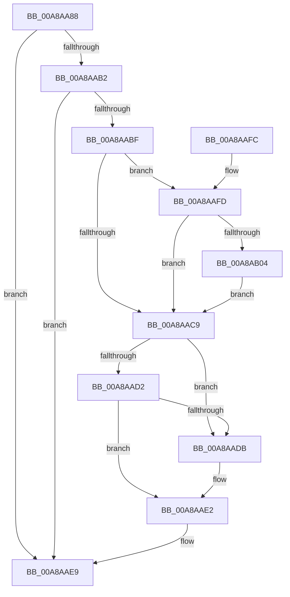

# PsUnlinkProcessFromSession

- RVA: `0x00A8AA88`–`0x00A8AB0E` (길이 `134` bytes)
- VA: `0x0000000140A8AA88`
- 실행 섹션: `PAGE`
- PDB 이름 있음: `예`; PDB Function 태그: `아니요`
- unwind 정보 RVA: `0x00070544`
- 디코드: `37`개 명령, `134/134` bytes 표시
- 미해석 바이트: `0` (있으면 어셈블리에 `.byte`로 보존)

> 이 문서는 커널 이미지의 기계어와 PDB 기호를 분석해 생성했습니다. 4번과 5번은 함수 원형과 자료형을 바이너리 사용 방식에서 추정한 C 해석이며 원본 소스 복구 결과는 아닙니다.

## 1. Dependencies

- 직접 호출 지점: **2**; 고유 호출 대상: **2**
- 직접 호출자로 확인된 함수: **1**
- RIP 상대 이미지 참조: **0**

### Outgoing calls
- `0x00A8AAA1` → [PspLockProcessListExclusive](../../text/22/PspLockProcessListExclusive_function_0022578C.md) (function, `0x0022578C`)
- `0x00A8AAEC` → [PspUnlockProcessListExclusive](../../text/2D/PspUnlockProcessListExclusive_function_002DFD18.md) (function, `0x002DFD18`)

### Direct callers
- [MiDeleteFinalPageTables](../../text/46/MiDeleteFinalPageTables_function_004659AC.md) at `0x00465ABC`

### Static image references
- 디코드된 RIP-relative 메모리 참조가 없습니다.

## 2. Other-region calls and transfers

- 다른 실행 섹션으로 향하는 call: **2**
  - `0x00A8AAA1` → [PspLockProcessListExclusive](../../text/22/PspLockProcessListExclusive_function_0022578C.md) (`PAGE` → `.text`)
  - `0x00A8AAEC` → [PspUnlockProcessListExclusive](../../text/2D/PspUnlockProcessListExclusive_function_002DFD18.md) (`PAGE` → `.text`)
- 별도 외부 분기/꼬리 이동을 확인하지 못했습니다.

## 3. Assembly (complete function range)

```asm
00A8AA88  48 89 5C 24 08                  mov qword ptr [rsp + 8], rbx
00A8AA8D  57                              push rdi
00A8AA8E  48 83 EC 20                     sub rsp, 0x20
00A8AA92  65 48 8B 3C 25 88 01 00 00      mov rdi, qword ptr gs:[0x188]
00A8AA9B  48 8B D9                        mov rbx, rcx
00A8AA9E  48 8B CF                        mov rcx, rdi
00A8AAA1  E8 E6 AC 79 FF                  call 0x14022578c
00A8AAA6  4C 8B 83 E8 02 00 00            mov r8, qword ptr [rbx + 0x2e8]
00A8AAAD  4D 85 C0                        test r8, r8
00A8AAB0  74 37                           je 0x140a8aae9
00A8AAB2  48 8D 93 30 02 00 00            lea rdx, [rbx + 0x230]
00A8AAB9  48 83 3A 00                     cmp qword ptr [rdx], 0
00A8AABD  74 2A                           je 0x140a8aae9
00A8AABF  8B 83 DC 07 00 00               mov eax, dword ptr [rbx + 0x7dc]
00A8AAC5  A8 08                           test al, 8
00A8AAC7  75 34                           jne 0x140a8aafd
00A8AAC9  48 8B 0A                        mov rcx, qword ptr [rdx]
00A8AACC  48 39 51 08                     cmp qword ptr [rcx + 8], rdx
00A8AAD0  75 09                           jne 0x140a8aadb
00A8AAD2  48 8B 42 08                     mov rax, qword ptr [rdx + 8]
00A8AAD6  48 39 10                        cmp qword ptr [rax], rdx
00A8AAD9  74 07                           je 0x140a8aae2
00A8AADB  B9 03 00 00 00                  mov ecx, 3
00A8AAE0  CD 29                           int 0x29
00A8AAE2  48 89 08                        mov qword ptr [rax], rcx
00A8AAE5  48 89 41 08                     mov qword ptr [rcx + 8], rax
00A8AAE9  48 8B CF                        mov rcx, rdi
00A8AAEC  E8 27 52 85 FF                  call 0x1402dfd18
00A8AAF1  48 8B 5C 24 30                  mov rbx, qword ptr [rsp + 0x30]
00A8AAF6  48 83 C4 20                     add rsp, 0x20
00A8AAFA  5F                              pop rdi
00A8AAFB  C3                              ret
00A8AAFC  CC                              int3
00A8AAFD  49 83 78 78 00                  cmp qword ptr [r8 + 0x78], 0
00A8AB02  75 C5                           jne 0x140a8aac9
00A8AB04  49 C7 40 78 01 00 00 00         mov qword ptr [r8 + 0x78], 1
00A8AB0C  EB BB                           jmp 0x140a8aac9
```

## 4. C-style interpretation (structured pseudocode)

```c
__int64 __fastcall PsUnlinkProcessFromSession(__int64 a1)
{
    __int64 result;
    __int64 v_rsp;
    unsigned __int64 v_stack_p8;

    v_stack_p8 = v_rbx;
    v_rsp = (v_rsp) - (32);
    result = PspLockProcessListExclusive(*(unsigned __int64 *)(gs_base + (0 + 392)), a2, a3, a4);
    if (*(unsigned __int64 *)(a1 + 744) == 0) goto loc_00A8AAE9;
    if ((*(unsigned __int64 *)(a1 + 560)) == 0) goto loc_00A8AAE9;
    if ((((unsigned __int8)((unsigned int)(*(unsigned int *)(a1 + 2012)))) & (8)) != 0) goto loc_00A8AAFD;
loc_00A8AAC9:
    if ((*(unsigned __int64 *)(*(unsigned __int64 *)(a1 + 560) + 8)) != (a1 + 560)) goto loc_00A8AADB;
    if ((*(unsigned __int64 *)(*(unsigned __int64 *)(a1 + 560 + 8))) != (a1 + 560)) {
        a1 = 3;
    }
    *(unsigned __int64 *)(*(unsigned __int64 *)(a1 + 560 + 8)) = a1;
    *(unsigned __int64 *)(a1 + 8) = *(unsigned __int64 *)(a1 + 560 + 8);
loc_00A8AAE9:
    result = PspUnlockProcessListExclusive(*(unsigned __int64 *)(gs_base + (0 + 392)), a1 + 560, *(unsigned __int64 *)(a1 + 744), a4);
    v_rsp = (v_rsp) + (32);
    return result;
loc_00A8AAFD:
    if ((*(unsigned __int64 *)(*(unsigned __int64 *)(a1 + 744) + 120)) != 0) goto loc_00A8AAC9;
    *(unsigned __int64 *)(*(unsigned __int64 *)(a1 + 744) + 120) = 1;
    goto loc_00A8AAC9;
}
```

## 5. (Beta) C Style

```c
int64_t PsUnlinkProcessFromSession(void *Arg1)
{
    uint8_t *arg1 = (uint8_t *)Arg1;

    int64_t result;
    int64_t local_rsp;
    uint64_t v_stack_p8;

    v_stack_p8 = local_rbx;
    local_rsp = (local_rsp) - (32);
    result = PspLockProcessListExclusive(*(uint64_t *)(gs_base + (0 + 0x188)), a2, a3, a4);
    if (*(uint64_t *)(arg1 + 0x2E8) == 0) goto loc_00A8AAE9;
    if ((*(uint64_t *)(arg1 + 0x230)) == 0) goto loc_00A8AAE9;
    if ((((uint8_t)((uint32_t)(*(uint32_t *)(arg1 + 0x7DC)))) & (8)) != 0) goto loc_00A8AAFD;
loc_00A8AAC9:
    if ((*(uint64_t *)(*(uint64_t *)(arg1 + 0x230) + 0x8)) != (Arg1 + 560)) goto loc_00A8AADB;
    if ((*(uint64_t *)(*(uint64_t *)(arg1 + 0x230 + 0x8))) != (Arg1 + 560)) {
        Arg1 = 3;
    }
    *(void **)(*(uint64_t *)(arg1 + 0x230 + 0x8)) = Arg1;
    *(uint64_t *)(arg1 + 0x8) = *(uint64_t *)(arg1 + 0x230 + 0x8);
loc_00A8AAE9:
    result = PspUnlockProcessListExclusive(*(uint64_t *)(gs_base + (0 + 0x188)), Arg1 + 560, *(uint64_t *)(arg1 + 0x2E8), a4);
    local_rsp = (local_rsp) + (32);
    return result;
loc_00A8AAFD:
    if ((*(uint64_t *)(*(uint64_t *)(arg1 + 0x2E8) + 0x78)) != 0) goto loc_00A8AAC9;
    *(uint64_t *)(*(uint64_t *)(arg1 + 0x2E8) + 0x78) = 1;
    goto loc_00A8AAC9;
}
```

### 관측된 메모리 오프셋

구조체 형식이 확인되지 않은 접근은 인자 기준의 오프셋으로만 기록했습니다.

| 기준 인자 | 오프셋 표현 | 폭 (bit) | 접근 |
|---|---:|---:|---|
| `Arg1` | `+ 0x0` | `64` | `R` |
| `Arg1` | `+ 0x8` | `64` | `R` |
| `Arg1` | `+ 0x230` | `64` | `R` |
| `Arg1` | `+ 0x2E8` | `64` | `R` |
| `Arg1` | `+ 0x7DC` | `32` | `R` |

## 6. Execution-region graph

[열기: 2D/3D 그래프와 함수 탐색 컨트롤 패널](../../../control-panel.html?section=page&rva=0x00A8AA88&view=graph)

- 2D 그래프는 위에서 아래로 흐르고, 3D 그래프는 빈 공간을 드래그해 회전합니다. Shift+드래그는 이동, 휠은 확대·축소, 함수 노드 선택은 대상 보고서 이동입니다.

### Static fallback


