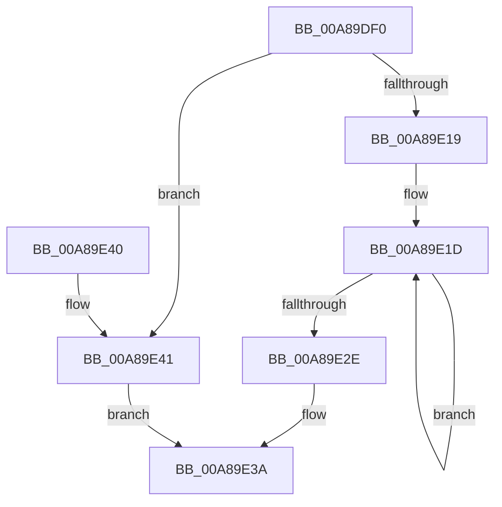

# PspAllocStorage

- RVA: `0x00A89DF0`–`0x00A89E48` (길이 `88` bytes)
- VA: `0x0000000140A89DF0`
- 실행 섹션: `PAGE`
- PDB 이름 있음: `예`; PDB Function 태그: `아니요`
- unwind 정보 RVA: `0x0005DAC8`
- 디코드: `26`개 명령, `88/88` bytes 표시
- 미해석 바이트: `0` (있으면 어셈블리에 `.byte`로 보존)

> 이 문서는 커널 이미지의 기계어와 PDB 기호를 분석해 생성했습니다. 4번과 5번은 함수 원형과 자료형을 바이너리 사용 방식에서 추정한 C 해석이며 원본 소스 복구 결과는 아닙니다.

## 1. Dependencies

- 직접 호출 지점: **1**; 고유 호출 대상: **1**
- 직접 호출자로 확인된 함수: **2**
- RIP 상대 이미지 참조: **0**

### Outgoing calls
- `0x00A89E09` → [ExAllocatePool2](../../poolcode/B8/ExAllocatePool2_function_00B820F0.md) (function, `0x00B820F0`)

### Direct callers
- [PspCreateSilo](PspCreateSilo_function_00A89CFC.md) at `0x00A89D39`
- [PspInitializeSiloStructures](../../init/C4/PspInitializeSiloStructures_function_00C461B0.md) at `0x00C46332`

### Static image references
- 디코드된 RIP-relative 메모리 참조가 없습니다.

## 2. Other-region calls and transfers

- 다른 실행 섹션으로 향하는 call: **1**
  - `0x00A89E09` → [ExAllocatePool2](../../poolcode/B8/ExAllocatePool2_function_00B820F0.md) (`PAGE` → `POOLCODE`)
- 별도 외부 분기/꼬리 이동을 확인하지 못했습니다.

## 3. Assembly (complete function range)

```asm
00A89DF0  40 53                           push rbx
00A89DF2  48 83 EC 20                     sub rsp, 0x20
00A89DF6  48 8B D9                        mov rbx, rcx
00A89DF9  BA 40 02 00 00                  mov edx, 0x240
00A89DFE  B9 48 00 00 00                  mov ecx, 0x48
00A89E03  41 B8 50 73 53 74               mov r8d, 0x74537350
00A89E09  E8 E2 82 0F 00                  call 0x140b820f0
00A89E0E  45 33 C0                        xor r8d, r8d
00A89E11  48 8B D0                        mov rdx, rax
00A89E14  48 85 C0                        test rax, rax
00A89E17  74 28                           je 0x140a89e41
00A89E19  41 8D 48 20                     lea ecx, [r8 + 0x20]
00A89E1D  4C 89 00                        mov qword ptr [rax], r8
00A89E20  4C 89 40 08                     mov qword ptr [rax + 8], r8
00A89E24  48 8D 40 10                     lea rax, [rax + 0x10]
00A89E28  48 83 E9 01                     sub rcx, 1
00A89E2C  75 EF                           jne 0x140a89e1d
00A89E2E  4C 89 82 00 02 00 00            mov qword ptr [rdx + 0x200], r8
00A89E35  33 C0                           xor eax, eax
00A89E37  48 89 13                        mov qword ptr [rbx], rdx
00A89E3A  48 83 C4 20                     add rsp, 0x20
00A89E3E  5B                              pop rbx
00A89E3F  C3                              ret
00A89E40  CC                              int3
00A89E41  B8 9A 00 00 C0                  mov eax, 0xc000009a
00A89E46  EB F2                           jmp 0x140a89e3a
```

## 4. C-style interpretation (structured pseudocode)

```c
__int64 __fastcall PspAllocStorage(__int64 a1)
{
    __int64 result;
    __int64 v_rsp;

    v_rsp = (v_rsp) - (32);
    result = ExAllocatePool2(72, 576, (unsigned int)(0x74537350ULL), a4);
    a3 = 0;
    if (result == 0) goto loc_00A89E41;
loc_00A89E1D:
    *(unsigned __int64 *)(result) = 0;
    *(unsigned __int64 *)(result + 8) = 0;
    a1 = (a3 + 32) - (1);
    if (condition_is_not_equal) goto loc_00A89E1D;
    *(unsigned __int64 *)(result + 512) = 0;
    result = 0;
    *(unsigned __int64 *)(a1) = 0;
loc_00A89E3A:
    v_rsp = (v_rsp) + (32);
    return result;
loc_00A89E41:
    goto loc_00A89E3A;
}
```

## 5. (Beta) C Style

```c
int64_t PspAllocStorage(void *Arg1)
{
    uint8_t *arg1 = (uint8_t *)Arg1;

    int64_t result;
    int64_t local_rsp;

    local_rsp = (local_rsp) - (32);
    result = ExAllocatePool2(72, 576, (uint32_t)(0x74537350ULL), a4);
    a3 = 0;
    if (result == 0) goto loc_00A89E41;
loc_00A89E1D:
    *(uint64_t *)(result) = 0;
    *(uint64_t *)(result + 0x8) = 0;
    Arg1 = (a3 + 32) - (1);
    if (condition_is_not_equal) goto loc_00A89E1D;
    *(uint64_t *)(result + 0x200) = 0;
    result = 0;
    *(uint64_t *)(arg1) = 0;
loc_00A89E3A:
    local_rsp = (local_rsp) + (32);
    return result;
loc_00A89E41:
    goto loc_00A89E3A;
}
```

### 관측된 메모리 오프셋

구조체 형식이 확인되지 않은 접근은 인자 기준의 오프셋으로만 기록했습니다.

| 기준 인자 | 오프셋 표현 | 폭 (bit) | 접근 |
|---|---:|---:|---|
| `Arg1` | `+ 0x0` | `64` | `W` |

## 6. Execution-region graph

[열기: 2D/3D 그래프와 함수 탐색 컨트롤 패널](../../../control-panel.html?section=page&rva=0x00A89DF0&view=graph)

- 2D 그래프는 위에서 아래로 흐르고, 3D 그래프는 빈 공간을 드래그해 회전합니다. Shift+드래그는 이동, 휠은 확대·축소, 함수 노드 선택은 대상 보고서 이동입니다.

### Static fallback


