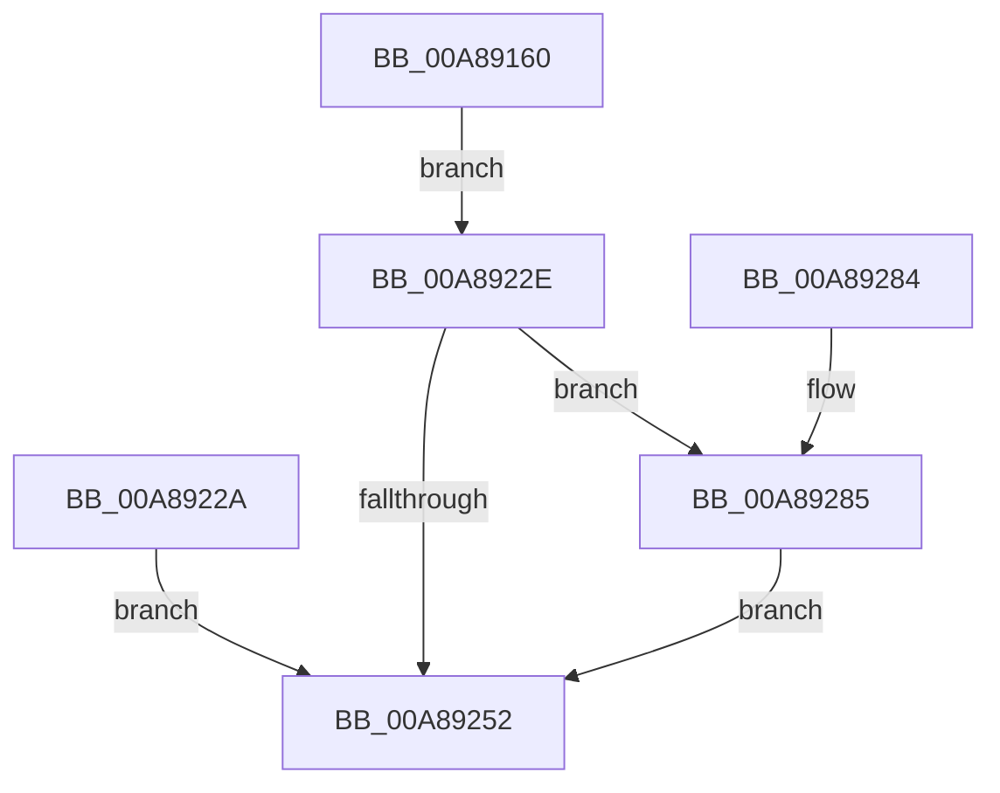

# PspCreateSecureThread

- RVA: `0x00A89160`–`0x00A8929C` (길이 `316` bytes)
- VA: `0x0000000140A89160`
- 실행 섹션: `PAGE`
- PDB 이름 있음: `예`; PDB Function 태그: `아니요`
- unwind 정보 RVA: `0x000B825C`
- 디코드: `83`개 명령, `316/316` bytes 표시
- 미해석 바이트: `0` (있으면 어셈블리에 `.byte`로 보존)

> 이 문서는 커널 이미지의 기계어와 PDB 기호를 분석해 생성했습니다. 4번과 5번은 함수 원형과 자료형을 바이너리 사용 방식에서 추정한 C 해석이며 원본 소스 복구 결과는 아닙니다.

## 1. Dependencies

- 직접 호출 지점: **9**; 고유 호출 대상: **9**
- 직접 호출자로 확인된 함수: **1**
- RIP 상대 이미지 참조: **1**

### Outgoing calls
- `0x00A891A9` → [KiStackAttachProcess](../../text/21/KiStackAttachProcess_function_00216820.md) (function, `0x00216820`)
- `0x00A891B6` → [MmSizeOfMdl](../../text/46/MmSizeOfMdl_function_00460A10.md) (function, `0x00460A10`)
- `0x00A891C9` → [ExAllocatePool2](../../poolcode/B8/ExAllocatePool2_function_00B820F0.md) (function, `0x00B820F0`)
- `0x00A89223` → [MmProbeAndLockPages](../../text/23/MmProbeAndLockPages_function_0023B990.md) (function, `0x0023B990`)
- `0x00A89247` → [KeSecureThread](../../text/4C/KeSecureThread_function_004C5D74.md) (function, `0x004C5D74`)
- `0x00A89259` → [KiUnstackDetachProcess](../../text/21/KiUnstackDetachProcess_function_00217D30.md) (function, `0x00217D30`)
- `0x00A89268` → [_security_check_cookie](../../text/6A/_security_check_cookie_function_006AC640.md) (function, `0x006AC640`)
- `0x00A89288` → [MmUnlockPages](../../text/29/MmUnlockPages_function_0029EEE0.md) (function, `0x0029EEE0`)
- `0x00A89295` → [ExFreePoolWithTag](../../poolcode/B8/ExFreePoolWithTag_function_00B82870.md) (function, `0x00B82870`)

### Direct callers
- [PspInsertThread](../9F/PspInsertThread_function_009F0314.md) at `0x009F0582`

### Static image references
- `0x00A89175` → RVA `0x00E0A740` (`.data`; read)

## 2. Other-region calls and transfers

- 다른 실행 섹션으로 향하는 call: **9**
  - `0x00A891A9` → [KiStackAttachProcess](../../text/21/KiStackAttachProcess_function_00216820.md) (`PAGE` → `.text`)
  - `0x00A891B6` → [MmSizeOfMdl](../../text/46/MmSizeOfMdl_function_00460A10.md) (`PAGE` → `.text`)
  - `0x00A891C9` → [ExAllocatePool2](../../poolcode/B8/ExAllocatePool2_function_00B820F0.md) (`PAGE` → `POOLCODE`)
  - `0x00A89223` → [MmProbeAndLockPages](../../text/23/MmProbeAndLockPages_function_0023B990.md) (`PAGE` → `.text`)
  - `0x00A89247` → [KeSecureThread](../../text/4C/KeSecureThread_function_004C5D74.md) (`PAGE` → `.text`)
  - `0x00A89259` → [KiUnstackDetachProcess](../../text/21/KiUnstackDetachProcess_function_00217D30.md) (`PAGE` → `.text`)
  - `0x00A89268` → [_security_check_cookie](../../text/6A/_security_check_cookie_function_006AC640.md) (`PAGE` → `.text`)
  - `0x00A89288` → [MmUnlockPages](../../text/29/MmUnlockPages_function_0029EEE0.md) (`PAGE` → `.text`)
  - `0x00A89295` → [ExFreePoolWithTag](../../poolcode/B8/ExFreePoolWithTag_function_00B82870.md) (`PAGE` → `POOLCODE`)
- 별도 외부 분기/꼬리 이동을 확인하지 못했습니다.

## 3. Assembly (complete function range)

```asm
00A89160  4C 8B DC                        mov r11, rsp
00A89163  49 89 5B 10                     mov qword ptr [r11 + 0x10], rbx
00A89167  49 89 73 18                     mov qword ptr [r11 + 0x18], rsi
00A8916B  49 89 7B 20                     mov qword ptr [r11 + 0x20], rdi
00A8916F  41 57                           push r15
00A89171  48 83 EC 70                     sub rsp, 0x70
00A89175  48 8B 05 C4 15 38 00            mov rax, qword ptr [rip + 0x3815c4]
00A8917C  48 33 C4                        xor rax, rsp
00A8917F  48 89 44 24 60                  mov qword ptr [rsp + 0x60], rax
00A89184  48 8B F2                        mov rsi, rdx
00A89187  48 8B F9                        mov rdi, rcx
00A8918A  0F 57 C0                        xorps xmm0, xmm0
00A8918D  0F 11 44 24 30                  movups xmmword ptr [rsp + 0x30], xmm0
00A89192  0F 11 44 24 40                  movups xmmword ptr [rsp + 0x40], xmm0
00A89197  0F 11 44 24 50                  movups xmmword ptr [rsp + 0x50], xmm0
00A8919C  48 8B 89 20 02 00 00            mov rcx, qword ptr [rcx + 0x220]
00A891A3  4D 8D 43 B8                     lea r8, [r11 - 0x48]
00A891A7  33 D2                           xor edx, edx
00A891A9  E8 72 D6 78 FF                  call 0x140216820
00A891AE  BA 98 07 00 00                  mov edx, 0x798
00A891B3  48 8B CF                        mov rcx, rdi
00A891B6  E8 55 78 9D FF                  call 0x140460a10
00A891BB  48 8B D0                        mov rdx, rax
00A891BE  B9 40 00 00 00                  mov ecx, 0x40
00A891C3  41 B8 50 73 53 65               mov r8d, 0x65537350
00A891C9  E8 22 8F 0F 00                  call 0x140b820f0
00A891CE  48 8B D8                        mov rbx, rax
00A891D1  45 33 FF                        xor r15d, r15d
00A891D4  4C 89 38                        mov qword ptr [rax], r15
00A891D7  0F B7 CF                        movzx ecx, di
00A891DA  BA FF 0F 00 00                  mov edx, 0xfff
00A891DF  66 23 CA                        and cx, dx
00A891E2  B8 97 17 00 00                  mov eax, 0x1797
00A891E7  66 03 C8                        add cx, ax
00A891EA  66 C1 E9 0C                     shr cx, 0xc
00A891EE  66 83 C1 06                     add cx, 6
00A891F2  66 C1 E1 03                     shl cx, 3
00A891F6  66 89 4B 08                     mov word ptr [rbx + 8], cx
00A891FA  66 44 89 7B 0A                  mov word ptr [rbx + 0xa], r15w
00A891FF  48 8B C7                        mov rax, rdi
00A89202  48 25 00 F0 FF FF               and rax, 0xfffffffffffff000
00A89208  48 89 43 20                     mov qword ptr [rbx + 0x20], rax
00A8920C  8B C7                           mov eax, edi
00A8920E  23 C2                           and eax, edx
00A89210  89 43 2C                        mov dword ptr [rbx + 0x2c], eax
00A89213  C7 43 28 98 07 00 00            mov dword ptr [rbx + 0x28], 0x798
00A8921A  33 D2                           xor edx, edx
00A8921C  45 8D 47 02                     lea r8d, [r15 + 2]
00A89220  48 8B CB                        mov rcx, rbx
00A89223  E8 68 27 7B FF                  call 0x14023b990
00A89228  EB 04                           jmp 0x140a8922e
00A8922A  8B F8                           mov edi, eax
00A8922C  EB 24                           jmp 0x140a89252
00A8922E  48 89 74 24 20                  mov qword ptr [rsp + 0x20], rsi
00A89233  4C 8B 8F 60 05 00 00            mov r9, qword ptr [rdi + 0x560]
00A8923A  4C 8B 87 10 05 00 00            mov r8, qword ptr [rdi + 0x510]
00A89241  48 8B D3                        mov rdx, rbx
00A89244  48 8B CF                        mov rcx, rdi
00A89247  E8 28 CB A3 FF                  call 0x1404c5d74
00A8924C  8B F8                           mov edi, eax
00A8924E  85 C0                           test eax, eax
00A89250  78 33                           js 0x140a89285
00A89252  33 D2                           xor edx, edx
00A89254  48 8D 4C 24 30                  lea rcx, [rsp + 0x30]
00A89259  E8 D2 EA 78 FF                  call 0x140217d30
00A8925E  8B C7                           mov eax, edi
00A89260  48 8B 4C 24 60                  mov rcx, qword ptr [rsp + 0x60]
00A89265  48 33 CC                        xor rcx, rsp
00A89268  E8 D3 33 C2 FF                  call 0x1406ac640
00A8926D  4C 8D 5C 24 70                  lea r11, [rsp + 0x70]
00A89272  49 8B 5B 18                     mov rbx, qword ptr [r11 + 0x18]
00A89276  49 8B 73 20                     mov rsi, qword ptr [r11 + 0x20]
00A8927A  49 8B 7B 28                     mov rdi, qword ptr [r11 + 0x28]
00A8927E  49 8B E3                        mov rsp, r11
00A89281  41 5F                           pop r15
00A89283  C3                              ret
00A89284  CC                              int3
00A89285  48 8B CB                        mov rcx, rbx
00A89288  E8 53 5C 81 FF                  call 0x14029eee0
00A8928D  BA 50 73 53 65                  mov edx, 0x65537350
00A89292  48 8B CB                        mov rcx, rbx
00A89295  E8 D6 95 0F 00                  call 0x140b82870
00A8929A  EB B6                           jmp 0x140a89252
```

## 4. C-style interpretation (structured pseudocode)

```c
__int64 __fastcall PspCreateSecureThread(__int64 a1, __int64 a2)
{
    __int64 result;
    __int64 v_r15;
    __int64 v_rsp;
    unsigned __int64 v_stack_m18;
    unsigned __int64 v_stack_m28;
    unsigned __int64 v_stack_m38;
    unsigned __int64 v_stack_m48;
    unsigned __int64 v_stack_m58;
    unsigned __int64 v_stack_m8;

    *(unsigned __int64 *)(v_rsp + 16) = v_rbx;
    *(unsigned __int64 *)(v_rsp + 24) = v_rsi;
    *(unsigned __int64 *)(v_rsp + 32) = v_rdi;
    v_rsp = (v_rsp) - (112);
    result = (*(unsigned __int64 *)(v_rip + 3675588)) ^ (v_rsp);
    v_stack_m18 = result;
    v_stack_m48 = v_xmm0;
    v_stack_m38 = v_xmm0;
    v_stack_m28 = v_xmm0;
    a2 = 0;
    result = KiStackAttachProcess(*(unsigned __int64 *)(a1 + 544), a2, v_rsp - 72, a4);
    result = MmSizeOfMdl(a1, (unsigned int)(0x798ULL), v_rsp - 72, a4);
    result = ExAllocatePool2(64, result, (unsigned int)(0x65537350ULL), a4);
    v_r15 = 0;
    *(unsigned __int64 *)(result) = 0;
    a1 = (unsigned __int16)(((unsigned __int16)(a1)) & ((unsigned __int16)((unsigned int)(0xFFFULL))));
    a1 = (unsigned __int16)((a1) + ((unsigned __int16)((unsigned int)(0x1797ULL))));
    a1 = (unsigned __int16)((a1) >> (12));
    a1 = (unsigned __int16)((a1) + (6));
    a1 = (unsigned __int16)((a1) << (3));
    *(unsigned __int16 *)(result + 8) = (unsigned __int16)(a1);
    *(unsigned __int16 *)(result + 10) = 0;
    result = (a1) & (0xFFFFFFFFFFFFF000ULL);
    *(unsigned __int64 *)(result + 32) = result;
    result = (unsigned int)(((unsigned int)((unsigned int)(a1))) & ((unsigned int)((unsigned int)(0xFFFULL))));
    *(unsigned int *)(result + 44) = (unsigned int)(result);
    *(unsigned int *)(result + 40) = 0x798ULL;
    a2 = 0;
    result = MmProbeAndLockPages(result, a2, v_r15 + 2, a4);
    goto loc_00A8922E;
loc_00A8922E:
    v_stack_m58 = 0;
    result = KeSecureThread(a1, result, *(unsigned __int64 *)(a1 + 1296), *(unsigned __int64 *)(a1 + 1376));
    if (sign_flag) goto loc_00A89285;
loc_00A89252:
    a2 = 0;
    result = KiUnstackDetachProcess(v_stack_m48, a2, *(unsigned __int64 *)(a1 + 1296), *(unsigned __int64 *)(a1 + 1376));
    a1 = (v_stack_m18) ^ (v_rsp);
    result = _security_check_cookie(a1, a2, *(unsigned __int64 *)(a1 + 1296), *(unsigned __int64 *)(a1 + 1376));
    return result;
loc_00A89285:
    result = MmUnlockPages(*(unsigned __int64 *)(v_stack_m8 + 24), a2, *(unsigned __int64 *)(a1 + 1296), *(unsigned __int64 *)(a1 + 1376));
    result = ExFreePoolWithTag(*(unsigned __int64 *)(v_stack_m8 + 24), (unsigned int)(0x65537350ULL), *(unsigned __int64 *)(a1 + 1296), *(unsigned __int64 *)(a1 + 1376));
    goto loc_00A89252;
}
```

## 5. (Beta) C Style

```c
int64_t PspCreateSecureThread(void *Arg1, int64_t Arg2)
{
    uint8_t *arg1 = (uint8_t *)Arg1;

    int64_t result;
    int64_t local_r15;
    int64_t local_rsp;
    uint64_t v_stack_m18;
    uint64_t v_stack_m28;
    uint64_t v_stack_m38;
    uint64_t v_stack_m48;
    uint64_t v_stack_m58;
    uint64_t v_stack_m8;

    *(uint64_t *)(local_rsp + 0x10) = local_rbx;
    *(uint64_t *)(local_rsp + 0x18) = local_rsi;
    *(uint64_t *)(local_rsp + 0x20) = local_rdi;
    local_rsp = (local_rsp) - (112);
    result = (*(uint64_t *)(v_rip + 0x3815C4)) ^ (local_rsp);
    v_stack_m18 = result;
    v_stack_m48 = v_xmm0;
    v_stack_m38 = v_xmm0;
    v_stack_m28 = v_xmm0;
    Arg2 = 0;
    result = KiStackAttachProcess(*(uint64_t *)(arg1 + 0x220), Arg2, local_rsp - 72, a4);
    result = MmSizeOfMdl(Arg1, (uint32_t)(0x798ULL), local_rsp - 72, a4);
    result = ExAllocatePool2(64, result, (uint32_t)(0x65537350ULL), a4);
    local_r15 = 0;
    *(uint64_t *)(result) = 0;
    Arg1 = (uint16_t)(((uint16_t)(Arg1)) & ((uint16_t)((uint32_t)(0xFFFULL))));
    Arg1 = (uint16_t)((Arg1) + ((uint16_t)((uint32_t)(0x1797ULL))));
    Arg1 = (uint16_t)((Arg1) >> (12));
    Arg1 = (uint16_t)((Arg1) + (6));
    Arg1 = (uint16_t)((Arg1) << (3));
    *(uint16_t *)(result + 0x8) = (uint16_t)(Arg1);
    *(uint16_t *)(result + 0xA) = 0;
    result = (Arg1) & (0xFFFFFFFFFFFFF000ULL);
    *(uint64_t *)(result + 0x20) = result;
    result = (uint32_t)(((uint32_t)((uint32_t)(Arg1))) & ((uint32_t)((uint32_t)(0xFFFULL))));
    *(uint32_t *)(result + 0x2C) = (uint32_t)(result);
    *(uint32_t *)(result + 0x28) = 0x798ULL;
    Arg2 = 0;
    result = MmProbeAndLockPages(result, Arg2, local_r15 + 2, a4);
    goto loc_00A8922E;
loc_00A8922E:
    v_stack_m58 = 0;
    result = KeSecureThread(Arg1, result, *(uint64_t *)(arg1 + 0x510), *(uint64_t *)(arg1 + 0x560));
    if (sign_flag) goto loc_00A89285;
loc_00A89252:
    Arg2 = 0;
    result = KiUnstackDetachProcess(v_stack_m48, Arg2, *(uint64_t *)(arg1 + 0x510), *(uint64_t *)(arg1 + 0x560));
    Arg1 = (v_stack_m18) ^ (local_rsp);
    result = _security_check_cookie(Arg1, Arg2, *(uint64_t *)(arg1 + 0x510), *(uint64_t *)(arg1 + 0x560));
    return result;
loc_00A89285:
    result = MmUnlockPages(*(uint64_t *)(v_stack_m8 + 0x18), Arg2, *(uint64_t *)(arg1 + 0x510), *(uint64_t *)(arg1 + 0x560));
    result = ExFreePoolWithTag(*(uint64_t *)(v_stack_m8 + 0x18), (uint32_t)(0x65537350ULL), *(uint64_t *)(arg1 + 0x510), *(uint64_t *)(arg1 + 0x560));
    goto loc_00A89252;
}
```

### 관측된 메모리 오프셋

구조체 형식이 확인되지 않은 접근은 인자 기준의 오프셋으로만 기록했습니다.

| 기준 인자 | 오프셋 표현 | 폭 (bit) | 접근 |
|---|---:|---:|---|
| `Arg1` | `+ 0x220` | `64` | `R` |
| `Arg1` | `+ 0x510` | `64` | `R` |
| `Arg1` | `+ 0x560` | `64` | `R` |

## 6. Execution-region graph

[열기: 2D/3D 그래프와 함수 탐색 컨트롤 패널](../../../control-panel.html?section=page&rva=0x00A89160&view=graph)

- 2D 그래프는 위에서 아래로 흐르고, 3D 그래프는 빈 공간을 드래그해 회전합니다. Shift+드래그는 이동, 휠은 확대·축소, 함수 노드 선택은 대상 보고서 이동입니다.

### Static fallback


