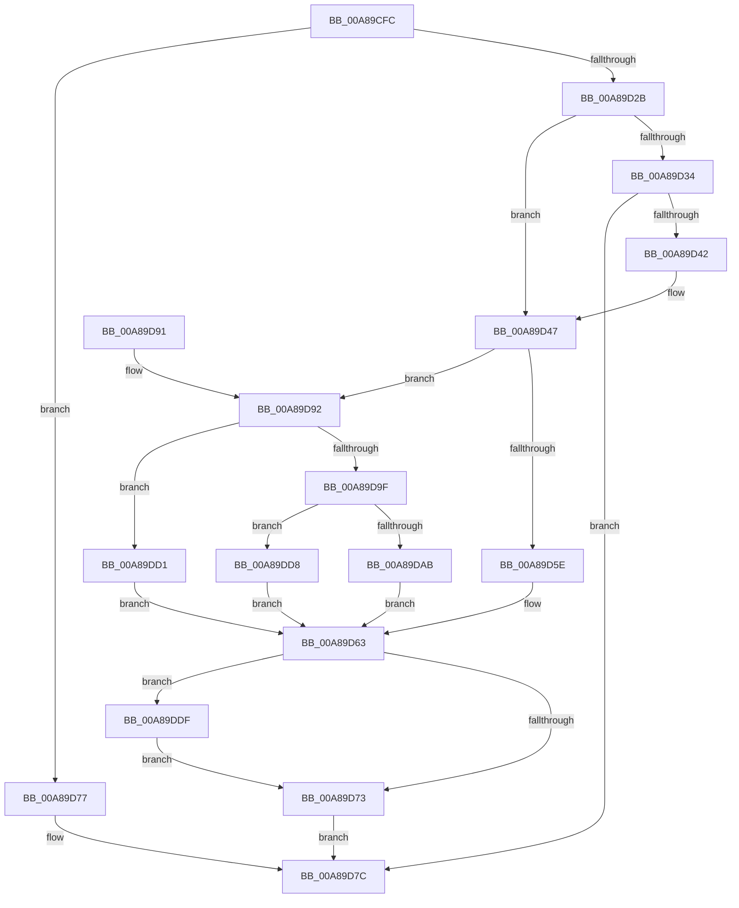

# PspCreateSilo

- RVA: `0x00A89CFC`–`0x00A89DE9` (길이 `237` bytes)
- VA: `0x0000000140A89CFC`
- 실행 섹션: `PAGE`
- PDB 이름 있음: `예`; PDB Function 태그: `아니요`
- unwind 정보 RVA: `0x000B8458`
- 디코드: `64`개 명령, `237/237` bytes 표시
- 미해석 바이트: `0` (있으면 어셈블리에 `.byte`로 보존)

> 이 문서는 커널 이미지의 기계어와 PDB 기호를 분석해 생성했습니다. 4번과 5번은 함수 원형과 자료형을 바이너리 사용 방식에서 추정한 C 해석이며 원본 소스 복구 결과는 아닙니다.

## 1. Dependencies

- 직접 호출 지점: **6**; 고유 호출 대상: **6**
- 직접 호출자로 확인된 함수: **1**
- RIP 상대 이미지 참조: **0**

### Outgoing calls
- `0x00A89D22` → [PsIsCurrentThreadInServerSilo](../../text/43/PsIsCurrentThreadInServerSilo_function_004362E0.md) (function, `0x004362E0`)
- `0x00A89D39` → [PspAllocStorage](PspAllocStorage_function_00A89DF0.md) (function, `0x00A89DF0`)
- `0x00A89D4D` → [PspLockJobExclusive](../91/PspLockJobExclusive_function_0091A4B8.md) (function, `0x0091A4B8`)
- `0x00A89D55` → [PspJobHasChildren](../70/PspJobHasChildren_function_007051E4.md) (function, `0x007051E4`)
- `0x00A89D69` → [PspUnlockJob](../91/PspUnlockJob_function_00919E00.md) (function, `0x00919E00`)
- `0x00A89DE2` → [PspFreeStorage](../A6/PspFreeStorage_function_00A6DF98.md) (function, `0x00A6DF98`)

### Direct callers
- [NtSetInformationJobObject](../9F/NtSetInformationJobObject_function_009F84C0.md) at `0x009FA350`

### Static image references
- 디코드된 RIP-relative 메모리 참조가 없습니다.

## 2. Other-region calls and transfers

- 다른 실행 섹션으로 향하는 call: **1**
  - `0x00A89D22` → [PsIsCurrentThreadInServerSilo](../../text/43/PsIsCurrentThreadInServerSilo_function_004362E0.md) (`PAGE` → `.text`)
- 별도 외부 분기/꼬리 이동을 확인하지 못했습니다.

## 3. Assembly (complete function range)

```asm
00A89CFC  48 8B C4                        mov rax, rsp
00A89CFF  48 89 58 08                     mov qword ptr [rax + 8], rbx
00A89D03  48 89 68 18                     mov qword ptr [rax + 0x18], rbp
00A89D07  48 89 70 20                     mov qword ptr [rax + 0x20], rsi
00A89D0B  57                              push rdi
00A89D0C  48 83 EC 20                     sub rsp, 0x20
00A89D10  65 48 8B 2C 25 88 01 00 00      mov rbp, qword ptr gs:[0x188]
00A89D19  33 FF                           xor edi, edi
00A89D1B  48 89 78 10                     mov qword ptr [rax + 0x10], rdi
00A89D1F  48 8B D9                        mov rbx, rcx
00A89D22  E8 B9 C5 9A FF                  call 0x1404362e0
00A89D27  84 C0                           test al, al
00A89D29  75 4C                           jne 0x140a89d77
00A89D2B  48 39 BB 00 06 00 00            cmp qword ptr [rbx + 0x600], rdi
00A89D32  75 13                           jne 0x140a89d47
00A89D34  48 8D 4C 24 38                  lea rcx, [rsp + 0x38]
00A89D39  E8 B2 00 00 00                  call 0x140a89df0
00A89D3E  85 C0                           test eax, eax
00A89D40  78 3A                           js 0x140a89d7c
00A89D42  48 8B 7C 24 38                  mov rdi, qword ptr [rsp + 0x38]
00A89D47  48 8B D5                        mov rdx, rbp
00A89D4A  48 8B CB                        mov rcx, rbx
00A89D4D  E8 66 07 E9 FF                  call 0x14091a4b8
00A89D52  48 8B CB                        mov rcx, rbx
00A89D55  E8 8A B4 C7 FF                  call 0x1407051e4
00A89D5A  84 C0                           test al, al
00A89D5C  74 34                           je 0x140a89d92
00A89D5E  BE 0F 05 00 C0                  mov esi, 0xc000050f
00A89D63  48 8B D5                        mov rdx, rbp
00A89D66  48 8B CB                        mov rcx, rbx
00A89D69  E8 92 00 E9 FF                  call 0x140919e00
00A89D6E  48 85 FF                        test rdi, rdi
00A89D71  75 6C                           jne 0x140a89ddf
00A89D73  8B C6                           mov eax, esi
00A89D75  EB 05                           jmp 0x140a89d7c
00A89D77  B8 61 00 00 C0                  mov eax, 0xc0000061
00A89D7C  48 8B 5C 24 30                  mov rbx, qword ptr [rsp + 0x30]
00A89D81  48 8B 6C 24 40                  mov rbp, qword ptr [rsp + 0x40]
00A89D86  48 8B 74 24 48                  mov rsi, qword ptr [rsp + 0x48]
00A89D8B  48 83 C4 20                     add rsp, 0x20
00A89D8F  5F                              pop rdi
00A89D90  C3                              ret
00A89D91  CC                              int3
00A89D92  BA 00 00 00 40                  mov edx, 0x40000000
00A89D97  85 93 10 06 00 00               test dword ptr [rbx + 0x610], edx
00A89D9D  75 32                           jne 0x140a89dd1
00A89D9F  F7 83 00 01 00 00 00 20 40 00   test dword ptr [rbx + 0x100], 0x402000
00A89DA9  74 2D                           je 0x140a89dd8
00A89DAB  33 C0                           xor eax, eax
00A89DAD  F0 48 0F B1 BB 00 06 00 00      lock cmpxchg qword ptr [rbx + 0x600], rdi
00A89DB6  48 F7 D8                        neg rax
00A89DB9  48 1B C9                        sbb rcx, rcx
00A89DBC  48 21 4C 24 38                  and qword ptr [rsp + 0x38], rcx
00A89DC1  F0 09 93 10 06 00 00            lock or dword ptr [rbx + 0x610], edx
00A89DC8  48 8B 7C 24 38                  mov rdi, qword ptr [rsp + 0x38]
00A89DCD  33 F6                           xor esi, esi
00A89DCF  EB 92                           jmp 0x140a89d63
00A89DD1  BE 08 05 00 C0                  mov esi, 0xc0000508
00A89DD6  EB 8B                           jmp 0x140a89d63
00A89DD8  BE 0D 00 00 C0                  mov esi, 0xc000000d
00A89DDD  EB 84                           jmp 0x140a89d63
00A89DDF  48 8B CF                        mov rcx, rdi
00A89DE2  E8 B1 41 FE FF                  call 0x140a6df98
00A89DE7  EB 8A                           jmp 0x140a89d73
```

## 4. C-style interpretation (structured pseudocode)

```c
__int64 __fastcall PspCreateSilo(__int64 a1)
{
    __int64 result;
    __int64 v_rdi;
    __int64 v_rsi;
    __int64 v_rsp;
    unsigned __int64 v_stack_p10;
    unsigned __int64 v_stack_p18;
    unsigned __int64 v_stack_p20;
    unsigned __int64 v_stack_p38;
    unsigned __int64 v_stack_p8;

    *(unsigned __int64 *)(v_rsp + 8) = v_rbx;
    *(unsigned __int64 *)(v_rsp + 24) = v_rbp;
    *(unsigned __int64 *)(v_rsp + 32) = v_rsi;
    v_rsp = (v_rsp) - (32);
    v_rdi = 0;
    *(unsigned __int64 *)(v_rsp + 16) = 0;
    result = PsIsCurrentThreadInServerSilo(a1, a2, a3, a4);
    if ((unsigned __int8)(result) != 0) goto loc_00A89D77;
    if ((*(unsigned __int64 *)(a1 + 1536)) != 0) goto loc_00A89D47;
    result = PspAllocStorage(v_stack_p10, a2, a3, a4);
    if (sign_flag) goto loc_00A89D7C;
loc_00A89D47:
    result = PspLockJobExclusive(a1, *(unsigned __int64 *)(gs_base + (0 + 392)), a3, a4);
    result = PspJobHasChildren(a1, *(unsigned __int64 *)(gs_base + (0 + 392)), a3, a4);
    if ((unsigned __int8)(result) == 0) goto loc_00A89D92;
loc_00A89D63:
    result = PspUnlockJob(a1, *(unsigned __int64 *)(gs_base + (0 + 392)), a3, a4);
    if (v_stack_p10 != 0) goto loc_00A89DDF;
loc_00A89D73:
    goto loc_00A89D7C;
loc_00A89D77:
loc_00A89D7C:
    v_rsp = (v_rsp) + (32);
    return (unsigned int)(0xC0000061ULL);
loc_00A89D92:
    if (((*(unsigned int *)(v_stack_p8 + 1552)) & ((unsigned int)((unsigned int)(0x40000000ULL)))) != 0) goto loc_00A89DD1;
    if (((*(unsigned int *)(v_stack_p8 + 256)) & (0x402000ULL)) == 0) goto loc_00A89DD8;
    result = 0;
    result = -(result);
    v_rsi = 0;
    goto loc_00A89D63;
loc_00A89DD1:
    goto loc_00A89D63;
loc_00A89DD8:
    goto loc_00A89D63;
loc_00A89DDF:
    result = PspFreeStorage(v_stack_p38, (unsigned int)(0x40000000ULL), a3, a4);
    goto loc_00A89D73;
}
```

## 5. (Beta) C Style

```c
int64_t PspCreateSilo(void *Arg1)
{
    uint8_t *arg1 = (uint8_t *)Arg1;

    int64_t result;
    int64_t local_rdi;
    int64_t local_rsi;
    int64_t local_rsp;
    uint64_t v_stack_p10;
    uint64_t v_stack_p18;
    uint64_t v_stack_p20;
    uint64_t v_stack_p38;
    uint64_t v_stack_p8;

    *(uint64_t *)(local_rsp + 0x8) = local_rbx;
    *(uint64_t *)(local_rsp + 0x18) = local_rbp;
    *(uint64_t *)(local_rsp + 0x20) = local_rsi;
    local_rsp = (local_rsp) - (32);
    local_rdi = 0;
    *(uint64_t *)(local_rsp + 0x10) = 0;
    result = PsIsCurrentThreadInServerSilo(Arg1, a2, a3, a4);
    if ((uint8_t)(result) != 0) goto loc_00A89D77;
    if ((*(uint64_t *)(arg1 + 0x600)) != 0) goto loc_00A89D47;
    result = PspAllocStorage(v_stack_p10, a2, a3, a4);
    if (sign_flag) goto loc_00A89D7C;
loc_00A89D47:
    result = PspLockJobExclusive(Arg1, *(uint64_t *)(gs_base + (0 + 0x188)), a3, a4);
    result = PspJobHasChildren(Arg1, *(uint64_t *)(gs_base + (0 + 0x188)), a3, a4);
    if ((uint8_t)(result) == 0) goto loc_00A89D92;
loc_00A89D63:
    result = PspUnlockJob(Arg1, *(uint64_t *)(gs_base + (0 + 0x188)), a3, a4);
    if (v_stack_p10 != 0) goto loc_00A89DDF;
loc_00A89D73:
    goto loc_00A89D7C;
loc_00A89D77:
loc_00A89D7C:
    local_rsp = (local_rsp) + (32);
    return (uint32_t)(0xC0000061ULL);
loc_00A89D92:
    if (((*(uint32_t *)(v_stack_p8 + 0x610)) & ((uint32_t)((uint32_t)(0x40000000ULL)))) != 0) goto loc_00A89DD1;
    if (((*(uint32_t *)(v_stack_p8 + 0x100)) & (0x402000ULL)) == 0) goto loc_00A89DD8;
    result = 0;
    result = -(result);
    local_rsi = 0;
    goto loc_00A89D63;
loc_00A89DD1:
    goto loc_00A89D63;
loc_00A89DD8:
    goto loc_00A89D63;
loc_00A89DDF:
    result = PspFreeStorage(v_stack_p38, (uint32_t)(0x40000000ULL), a3, a4);
    goto loc_00A89D73;
}
```

### 관측된 메모리 오프셋

구조체 형식이 확인되지 않은 접근은 인자 기준의 오프셋으로만 기록했습니다.

| 기준 인자 | 오프셋 표현 | 폭 (bit) | 접근 |
|---|---:|---:|---|
| `Arg1` | `+ 0x100` | `32` | `R` |
| `Arg1` | `+ 0x600` | `64` | `R` |
| `Arg1` | `+ 0x610` | `32` | `R` |
| `Arg1` | `+ 0x610` | `32` | `R/W` |

## 6. Execution-region graph

[열기: 2D/3D 그래프와 함수 탐색 컨트롤 패널](../../../control-panel.html?section=page&rva=0x00A89CFC&view=graph)

- 2D 그래프는 위에서 아래로 흐르고, 3D 그래프는 빈 공간을 드래그해 회전합니다. Shift+드래그는 이동, 휠은 확대·축소, 함수 노드 선택은 대상 보고서 이동입니다.

### Static fallback


