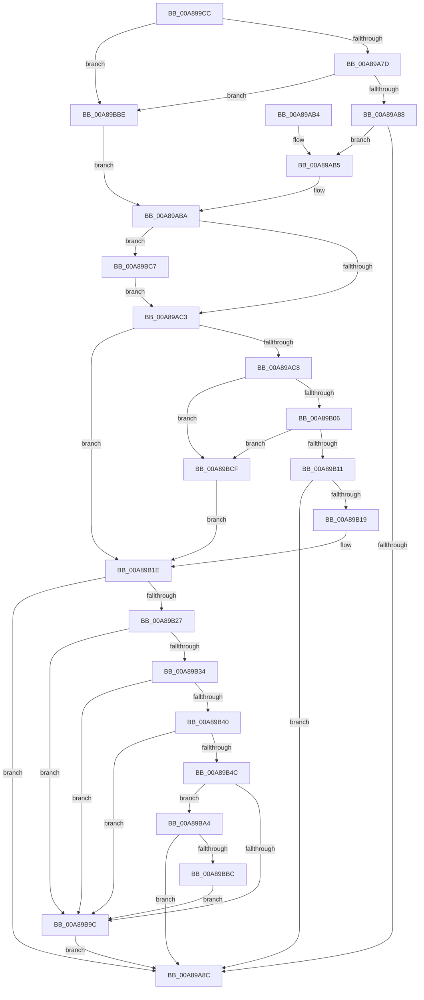

# PspIdentityBasedJobBreakaway

- RVA: `0x00A899CC`–`0x00A89BD6` (길이 `522` bytes)
- VA: `0x0000000140A899CC`
- 실행 섹션: `PAGE`
- PDB 이름 있음: `예`; PDB Function 태그: `아니요`
- unwind 정보 RVA: `0x000B83B8`
- 디코드: `127`개 명령, `522/522` bytes 표시
- 미해석 바이트: `0` (있으면 어셈블리에 `.byte`로 보존)

> 이 문서는 커널 이미지의 기계어와 PDB 기호를 분석해 생성했습니다. 4번과 5번은 함수 원형과 자료형을 바이너리 사용 방식에서 추정한 C 해석이며 원본 소스 복구 결과는 아닙니다.

## 1. Dependencies

- 직접 호출 지점: **9**; 고유 호출 대상: **4**
- 직접 호출자로 확인된 함수: **1**
- RIP 상대 이미지 참조: **1**

### Outgoing calls
- `0x00A89A6B` → [RtlQueryPackageIdentityEx](../../text/45/RtlQueryPackageIdentityEx_function_0045C320.md) (function, `0x0045C320`)
- `0x00A89A98` → [_security_check_cookie](../../text/6A/_security_check_cookie_function_006AC640.md) (function, `0x006AC640`)
- `0x00A89AF4` → [RtlQueryPackageIdentityEx](../../text/45/RtlQueryPackageIdentityEx_function_0045C320.md) (function, `0x0045C320`)
- `0x00A89B57` → [RtlInitUnicodeString](../../text/42/RtlInitUnicodeString_function_0042A780.md) (function, `0x0042A780`)
- `0x00A89B64` → [RtlInitUnicodeString](../../text/42/RtlInitUnicodeString_function_0042A780.md) (function, `0x0042A780`)
- `0x00A89B75` → [RtlInitUnicodeString](../../text/42/RtlInitUnicodeString_function_0042A780.md) (function, `0x0042A780`)
- `0x00A89B82` → [RtlInitUnicodeString](../../text/42/RtlInitUnicodeString_function_0042A780.md) (function, `0x0042A780`)
- `0x00A89B93` → [RtlEqualUnicodeString](../93/RtlEqualUnicodeString_function_00932A20.md) (function, `0x00932A20`)
- `0x00A89BAF` → [RtlEqualUnicodeString](../93/RtlEqualUnicodeString_function_00932A20.md) (function, `0x00932A20`)

### Direct callers
- [PspInitializeProcessSecurity](../AA/PspInitializeProcessSecurity_function_00AAD368.md) at `0x00AAD4BE`

### Static image references
- `0x00A899E7` → RVA `0x00E0A740` (`.data`; read)

## 2. Other-region calls and transfers

- 다른 실행 섹션으로 향하는 call: **7**
  - `0x00A89A6B` → [RtlQueryPackageIdentityEx](../../text/45/RtlQueryPackageIdentityEx_function_0045C320.md) (`PAGE` → `.text`)
  - `0x00A89A98` → [_security_check_cookie](../../text/6A/_security_check_cookie_function_006AC640.md) (`PAGE` → `.text`)
  - `0x00A89AF4` → [RtlQueryPackageIdentityEx](../../text/45/RtlQueryPackageIdentityEx_function_0045C320.md) (`PAGE` → `.text`)
  - `0x00A89B57` → [RtlInitUnicodeString](../../text/42/RtlInitUnicodeString_function_0042A780.md) (`PAGE` → `.text`)
  - `0x00A89B64` → [RtlInitUnicodeString](../../text/42/RtlInitUnicodeString_function_0042A780.md) (`PAGE` → `.text`)
  - `0x00A89B75` → [RtlInitUnicodeString](../../text/42/RtlInitUnicodeString_function_0042A780.md) (`PAGE` → `.text`)
  - `0x00A89B82` → [RtlInitUnicodeString](../../text/42/RtlInitUnicodeString_function_0042A780.md) (`PAGE` → `.text`)
- 별도 외부 분기/꼬리 이동을 확인하지 못했습니다.

## 3. Assembly (complete function range)

```asm
00A899CC  48 89 5C 24 20                  mov qword ptr [rsp + 0x20], rbx
00A899D1  55                              push rbp
00A899D2  56                              push rsi
00A899D3  57                              push rdi
00A899D4  41 56                           push r14
00A899D6  41 57                           push r15
00A899D8  48 8D AC 24 10 FD FF FF         lea rbp, [rsp - 0x2f0]
00A899E0  48 81 EC F0 03 00 00            sub rsp, 0x3f0
00A899E7  48 8B 05 52 0D 38 00            mov rax, qword ptr [rip + 0x380d52]
00A899EE  48 33 C4                        xor rax, rsp
00A899F1  48 89 85 E0 02 00 00            mov qword ptr [rbp + 0x2e0], rax
00A899F8  48 83 64 24 48 00               and qword ptr [rsp + 0x48], 0
00A899FE  4C 8D 4D C0                     lea r9, [rbp - 0x40]
00A89A02  4C 8B FA                        mov r15, rdx
00A89A05  45 33 F6                        xor r14d, r14d
00A89A08  BA 00 01 00 00                  mov edx, 0x100
00A89A0D  45 88 30                        mov byte ptr [r8], r14b
00A89A10  0F 57 C0                        xorps xmm0, xmm0
00A89A13  48 89 54 24 60                  mov qword ptr [rsp + 0x60], rdx
00A89A18  0F 57 C9                        xorps xmm1, xmm1
00A89A1B  48 89 54 24 58                  mov qword ptr [rsp + 0x58], rdx
00A89A20  49 8B F0                        mov rsi, r8
00A89A23  4C 89 74 24 50                  mov qword ptr [rsp + 0x50], r14
00A89A28  8D 42 84                        lea eax, [rdx - 0x7c]
00A89A2B  48 89 44 24 70                  mov qword ptr [rsp + 0x70], rax
00A89A30  4C 8D 44 24 60                  lea r8, [rsp + 0x60]
00A89A35  48 89 44 24 68                  mov qword ptr [rsp + 0x68], rax
00A89A3A  48 8D 95 E0 00 00 00            lea rdx, [rbp + 0xe0]
00A89A41  48 8D 44 24 48                  lea rax, [rsp + 0x48]
00A89A46  48 89 44 24 30                  mov qword ptr [rsp + 0x30], rax
00A89A4B  48 8D 44 24 70                  lea rax, [rsp + 0x70]
00A89A50  4C 21 74 24 28                  and qword ptr [rsp + 0x28], r14
00A89A55  48 89 44 24 20                  mov qword ptr [rsp + 0x20], rax
00A89A5A  0F 11 45 88                     movups xmmword ptr [rbp - 0x78], xmm0
00A89A5E  0F 11 4D A8                     movups xmmword ptr [rbp - 0x58], xmm1
00A89A62  0F 11 44 24 78                  movups xmmword ptr [rsp + 0x78], xmm0
00A89A67  0F 11 4D 98                     movups xmmword ptr [rbp - 0x68], xmm1
00A89A6B  E8 B0 28 9D FF                  call 0x14045c320
00A89A70  8B D8                           mov ebx, eax
00A89A72  3D 05 00 00 80                  cmp eax, 0x80000005
00A89A77  0F 84 41 01 00 00               je 0x140a89bbe
00A89A7D  3D 25 02 00 C0                  cmp eax, 0xc0000225
00A89A82  0F 84 36 01 00 00               je 0x140a89bbe
00A89A88  85 C0                           test eax, eax
00A89A8A  79 29                           jns 0x140a89ab5
00A89A8C  8B C3                           mov eax, ebx
00A89A8E  48 8B 8D E0 02 00 00            mov rcx, qword ptr [rbp + 0x2e0]
00A89A95  48 33 CC                        xor rcx, rsp
00A89A98  E8 A3 2B C2 FF                  call 0x1406ac640
00A89A9D  48 8B 9C 24 38 04 00 00         mov rbx, qword ptr [rsp + 0x438]
00A89AA5  48 81 C4 F0 03 00 00            add rsp, 0x3f0
00A89AAC  41 5F                           pop r15
00A89AAE  41 5E                           pop r14
00A89AB0  5F                              pop rdi
00A89AB1  5E                              pop rsi
00A89AB2  5D                              pop rbp
00A89AB3  C3                              ret
00A89AB4  CC                              int3
00A89AB5  48 8B 7C 24 48                  mov rdi, qword ptr [rsp + 0x48]
00A89ABA  48 85 FF                        test rdi, rdi
00A89ABD  0F 84 04 01 00 00               je 0x140a89bc7
00A89AC3  44 38 36                        cmp byte ptr [rsi], r14b
00A89AC6  75 56                           jne 0x140a89b1e
00A89AC8  48 8D 44 24 50                  lea rax, [rsp + 0x50]
00A89ACD  49 8B CF                        mov rcx, r15
00A89AD0  48 89 44 24 30                  mov qword ptr [rsp + 0x30], rax
00A89AD5  4C 8D 4D 50                     lea r9, [rbp + 0x50]
00A89AD9  4C 21 74 24 28                  and qword ptr [rsp + 0x28], r14
00A89ADE  48 8D 44 24 68                  lea rax, [rsp + 0x68]
00A89AE3  4C 8D 44 24 58                  lea r8, [rsp + 0x58]
00A89AE8  48 89 44 24 20                  mov qword ptr [rsp + 0x20], rax
00A89AED  48 8D 95 E0 01 00 00            lea rdx, [rbp + 0x1e0]
00A89AF4  E8 27 28 9D FF                  call 0x14045c320
00A89AF9  8B D8                           mov ebx, eax
00A89AFB  3D 25 02 00 C0                  cmp eax, 0xc0000225
00A89B00  0F 84 C9 00 00 00               je 0x140a89bcf
00A89B06  3D 05 00 00 80                  cmp eax, 0x80000005
00A89B0B  0F 84 BE 00 00 00               je 0x140a89bcf
00A89B11  85 C0                           test eax, eax
00A89B13  0F 88 73 FF FF FF               js 0x140a89a8c
00A89B19  4C 8B 74 24 50                  mov r14, qword ptr [rsp + 0x50]
00A89B1E  4D 85 F6                        test r14, r14
00A89B21  0F 84 65 FF FF FF               je 0x140a89a8c
00A89B27  49 33 FE                        xor rdi, r14
00A89B2A  B8 DF FF FF FF                  mov eax, 0xffffffdf
00A89B2F  48 85 F8                        test rax, rdi
00A89B32  75 68                           jne 0x140a89b9c
00A89B34  48 8B 44 24 58                  mov rax, qword ptr [rsp + 0x58]
00A89B39  48 39 44 24 60                  cmp qword ptr [rsp + 0x60], rax
00A89B3E  75 5C                           jne 0x140a89b9c
00A89B40  48 8B 44 24 68                  mov rax, qword ptr [rsp + 0x68]
00A89B45  48 39 44 24 70                  cmp qword ptr [rsp + 0x70], rax
00A89B4A  75 50                           jne 0x140a89b9c
00A89B4C  48 8D 95 E0 00 00 00            lea rdx, [rbp + 0xe0]
00A89B53  48 8D 4D 88                     lea rcx, [rbp - 0x78]
00A89B57  E8 24 0C 9A FF                  call 0x14042a780
00A89B5C  48 8D 55 C0                     lea rdx, [rbp - 0x40]
00A89B60  48 8D 4D A8                     lea rcx, [rbp - 0x58]
00A89B64  E8 17 0C 9A FF                  call 0x14042a780
00A89B69  48 8D 95 E0 01 00 00            lea rdx, [rbp + 0x1e0]
00A89B70  48 8D 4C 24 78                  lea rcx, [rsp + 0x78]
00A89B75  E8 06 0C 9A FF                  call 0x14042a780
00A89B7A  48 8D 55 50                     lea rdx, [rbp + 0x50]
00A89B7E  48 8D 4D 98                     lea rcx, [rbp - 0x68]
00A89B82  E8 F9 0B 9A FF                  call 0x14042a780
00A89B87  41 B0 01                        mov r8b, 1
00A89B8A  48 8D 54 24 78                  lea rdx, [rsp + 0x78]
00A89B8F  48 8D 4D 88                     lea rcx, [rbp - 0x78]
00A89B93  E8 88 8E EA FF                  call 0x140932a20
00A89B98  84 C0                           test al, al
00A89B9A  75 08                           jne 0x140a89ba4
00A89B9C  C6 06 01                        mov byte ptr [rsi], 1
00A89B9F  E9 E8 FE FF FF                  jmp 0x140a89a8c
00A89BA4  41 B0 01                        mov r8b, 1
00A89BA7  48 8D 55 98                     lea rdx, [rbp - 0x68]
00A89BAB  48 8D 4D A8                     lea rcx, [rbp - 0x58]
00A89BAF  E8 6C 8E EA FF                  call 0x140932a20
00A89BB4  84 C0                           test al, al
00A89BB6  0F 85 D0 FE FF FF               jne 0x140a89a8c
00A89BBC  EB DE                           jmp 0x140a89b9c
00A89BBE  33 FF                           xor edi, edi
00A89BC0  33 DB                           xor ebx, ebx
00A89BC2  E9 F3 FE FF FF                  jmp 0x140a89aba
00A89BC7  C6 06 01                        mov byte ptr [rsi], 1
00A89BCA  E9 F4 FE FF FF                  jmp 0x140a89ac3
00A89BCF  33 DB                           xor ebx, ebx
00A89BD1  E9 48 FF FF FF                  jmp 0x140a89b1e
```

## 4. C-style interpretation (structured pseudocode)

```c
__int64 __fastcall PspIdentityBasedJobBreakaway(__int64 a1, __int64 a2, __int64 a3)
{
    __int64 result;
    __int64 v_r14;
    __int64 v_rbx;
    __int64 v_rdi;
    __int64 v_rsp;
    unsigned __int64 v_stack_m138;
    unsigned __int64 v_stack_m238;
    unsigned __int64 v_stack_m2C8;
    unsigned __int64 v_stack_m318;
    unsigned __int64 v_stack_m358;
    unsigned __int64 v_stack_m370;
    unsigned __int64 v_stack_m38;
    unsigned __int64 v_stack_m380;
    unsigned __int64 v_stack_m390;
    unsigned __int64 v_stack_m3A0;
    unsigned __int64 v_stack_m3A8;
    unsigned __int64 v_stack_m3B0;
    unsigned __int64 v_stack_m3B8;
    unsigned __int64 v_stack_m3C0;
    unsigned __int64 v_stack_m3C8;
    unsigned __int64 v_stack_m3D0;
    unsigned __int64 v_stack_m3E8;
    unsigned __int64 v_stack_m3F0;
    unsigned __int64 v_stack_m3F8;
    unsigned __int64 v_stack_p20;
    unsigned __int64 v_stack_p28;
    unsigned __int64 v_stack_p30;
    unsigned __int64 v_stack_p48;
    unsigned __int64 v_stack_p50;
    unsigned __int64 v_stack_p58;
    unsigned __int64 v_stack_p60;
    unsigned __int64 v_stack_p68;
    unsigned __int64 v_stack_p70;
    unsigned __int64 v_stack_p78;

    v_stack_p20 = v_rbx;
    v_rsp = (v_rsp) - (0x3F0ULL);
    result = (*(unsigned __int64 *)(v_rip + 3673426)) ^ (v_rsp);
    v_stack_m38 = result;
    v_r14 = 0;
    *(unsigned __int8 *)(a3) = 0;
    v_stack_m3B8 = 256;
    v_stack_m3C0 = 256;
    v_stack_m3C8 = 0;
    v_stack_m3A8 = 256 - 124;
    v_stack_m3B0 = 256 - 124;
    v_stack_m3E8 = v_stack_m3D0;
    v_stack_m3F8 = v_stack_m3A8;
    v_stack_m390 = v_xmm0;
    v_stack_m370 = v_xmm1;
    v_stack_m3A0 = v_xmm0;
    v_stack_m380 = v_xmm1;
    result = RtlQueryPackageIdentityEx(a1, v_stack_m238, v_stack_m3B8, v_stack_m358);
    if (((unsigned int)(result)) == 0x80000005ULL) goto loc_00A89BBE;
    if (((unsigned int)(result)) == 0xC0000225ULL) goto loc_00A89BBE;
    if (!sign_flag) goto loc_00A89AB5;
loc_00A89A8C:
    a1 = (v_stack_m38) ^ (v_rsp);
    result = _security_check_cookie(a1, v_stack_m238, v_stack_m3B8, v_stack_m358);
    v_rsp = (v_rsp) + (0x3F0ULL);
    return result;
loc_00A89AB5:
loc_00A89ABA:
    if (v_stack_p48 == 0) goto loc_00A89BC7;
loc_00A89AC3:
    if ((*(unsigned __int8 *)(a3)) != 0) goto loc_00A89B1E;
    v_stack_p30 = v_stack_p50;
    v_stack_p20 = v_stack_p68;
    result = RtlQueryPackageIdentityEx(a2, v_stack_m138, v_stack_p58, v_stack_m2C8);
    if (((unsigned int)(result)) == 0xC0000225ULL) goto loc_00A89BCF;
    if (((unsigned int)(result)) == 0x80000005ULL) goto loc_00A89BCF;
    if (sign_flag) goto loc_00A89A8C;
loc_00A89B1E:
    if (v_stack_p50 == 0) goto loc_00A89A8C;
    v_rdi = (v_stack_p48) ^ (v_stack_p50);
    if ((((unsigned int)(0xFFFFFFDFULL)) & (v_rdi)) != 0) goto loc_00A89B9C;
    if (v_stack_p60 != v_stack_p58) goto loc_00A89B9C;
    if (v_stack_p70 != v_stack_p68) goto loc_00A89B9C;
    result = RtlInitUnicodeString(v_stack_m390, v_stack_m238, v_stack_p58, v_stack_m2C8);
    result = RtlInitUnicodeString(v_stack_m370, v_stack_m358, v_stack_p58, v_stack_m2C8);
    result = RtlInitUnicodeString(v_stack_p78, v_stack_m138, v_stack_p58, v_stack_m2C8);
    result = RtlInitUnicodeString(v_stack_m380, v_stack_m2C8, v_stack_p58, v_stack_m2C8);
    result = RtlEqualUnicodeString(v_stack_m390, v_stack_p78, 1, v_stack_m2C8);
    if ((unsigned __int8)(result) != 0) goto loc_00A89BA4;
loc_00A89B9C:
    *(unsigned __int8 *)(a3) = 1;
    goto loc_00A89A8C;
loc_00A89BA4:
    result = RtlEqualUnicodeString(v_stack_m370, v_stack_m380, 1, v_stack_m2C8);
    if ((unsigned __int8)(result) != 0) goto loc_00A89A8C;
    goto loc_00A89B9C;
loc_00A89BBE:
    v_rdi = 0;
    v_rbx = 0;
    goto loc_00A89ABA;
loc_00A89BC7:
    *(unsigned __int8 *)(a3) = 1;
    goto loc_00A89AC3;
loc_00A89BCF:
    v_rbx = 0;
    goto loc_00A89B1E;
}
```

## 5. (Beta) C Style

```c
int64_t PspIdentityBasedJobBreakaway(int64_t Arg1, int64_t Arg2, void *Arg3)
{
    uint8_t *arg3 = (uint8_t *)Arg3;

    int64_t result;
    int64_t local_r14;
    int64_t local_rbx;
    int64_t local_rdi;
    int64_t local_rsp;
    uint64_t v_stack_m138;
    uint64_t v_stack_m238;
    uint64_t v_stack_m2C8;
    uint64_t v_stack_m318;
    uint64_t v_stack_m358;
    uint64_t v_stack_m370;
    uint64_t v_stack_m38;
    uint64_t v_stack_m380;
    uint64_t v_stack_m390;
    uint64_t v_stack_m3A0;
    uint64_t v_stack_m3A8;
    uint64_t v_stack_m3B0;
    uint64_t v_stack_m3B8;
    uint64_t v_stack_m3C0;
    uint64_t v_stack_m3C8;
    uint64_t v_stack_m3D0;
    uint64_t v_stack_m3E8;
    uint64_t v_stack_m3F0;
    uint64_t v_stack_m3F8;
    uint64_t v_stack_p20;
    uint64_t v_stack_p28;
    uint64_t v_stack_p30;
    uint64_t v_stack_p48;
    uint64_t v_stack_p50;
    uint64_t v_stack_p58;
    uint64_t v_stack_p60;
    uint64_t v_stack_p68;
    uint64_t v_stack_p70;
    uint64_t v_stack_p78;

    v_stack_p20 = local_rbx;
    local_rsp = (local_rsp) - (0x3F0ULL);
    result = (*(uint64_t *)(v_rip + 0x380D52)) ^ (local_rsp);
    v_stack_m38 = result;
    local_r14 = 0;
    *(uint8_t *)(arg3) = 0;
    v_stack_m3B8 = 256;
    v_stack_m3C0 = 256;
    v_stack_m3C8 = 0;
    v_stack_m3A8 = 256 - 124;
    v_stack_m3B0 = 256 - 124;
    v_stack_m3E8 = v_stack_m3D0;
    v_stack_m3F8 = v_stack_m3A8;
    v_stack_m390 = v_xmm0;
    v_stack_m370 = v_xmm1;
    v_stack_m3A0 = v_xmm0;
    v_stack_m380 = v_xmm1;
    result = RtlQueryPackageIdentityEx(Arg1, v_stack_m238, v_stack_m3B8, v_stack_m358);
    if (((uint32_t)(result)) == 0x80000005ULL) goto loc_00A89BBE;
    if (((uint32_t)(result)) == 0xC0000225ULL) goto loc_00A89BBE;
    if (!sign_flag) goto loc_00A89AB5;
loc_00A89A8C:
    Arg1 = (v_stack_m38) ^ (local_rsp);
    result = _security_check_cookie(Arg1, v_stack_m238, v_stack_m3B8, v_stack_m358);
    local_rsp = (local_rsp) + (0x3F0ULL);
    return result;
loc_00A89AB5:
loc_00A89ABA:
    if (v_stack_p48 == 0) goto loc_00A89BC7;
loc_00A89AC3:
    if ((*(uint8_t *)(arg3)) != 0) goto loc_00A89B1E;
    v_stack_p30 = v_stack_p50;
    v_stack_p20 = v_stack_p68;
    result = RtlQueryPackageIdentityEx(Arg2, v_stack_m138, v_stack_p58, v_stack_m2C8);
    if (((uint32_t)(result)) == 0xC0000225ULL) goto loc_00A89BCF;
    if (((uint32_t)(result)) == 0x80000005ULL) goto loc_00A89BCF;
    if (sign_flag) goto loc_00A89A8C;
loc_00A89B1E:
    if (v_stack_p50 == 0) goto loc_00A89A8C;
    local_rdi = (v_stack_p48) ^ (v_stack_p50);
    if ((((uint32_t)(0xFFFFFFDFULL)) & (local_rdi)) != 0) goto loc_00A89B9C;
    if (v_stack_p60 != v_stack_p58) goto loc_00A89B9C;
    if (v_stack_p70 != v_stack_p68) goto loc_00A89B9C;
    result = RtlInitUnicodeString(v_stack_m390, v_stack_m238, v_stack_p58, v_stack_m2C8);
    result = RtlInitUnicodeString(v_stack_m370, v_stack_m358, v_stack_p58, v_stack_m2C8);
    result = RtlInitUnicodeString(v_stack_p78, v_stack_m138, v_stack_p58, v_stack_m2C8);
    result = RtlInitUnicodeString(v_stack_m380, v_stack_m2C8, v_stack_p58, v_stack_m2C8);
    result = RtlEqualUnicodeString(v_stack_m390, v_stack_p78, 1, v_stack_m2C8);
    if ((uint8_t)(result) != 0) goto loc_00A89BA4;
loc_00A89B9C:
    *(uint8_t *)(arg3) = 1;
    goto loc_00A89A8C;
loc_00A89BA4:
    result = RtlEqualUnicodeString(v_stack_m370, v_stack_m380, 1, v_stack_m2C8);
    if ((uint8_t)(result) != 0) goto loc_00A89A8C;
    goto loc_00A89B9C;
loc_00A89BBE:
    local_rdi = 0;
    local_rbx = 0;
    goto loc_00A89ABA;
loc_00A89BC7:
    *(uint8_t *)(arg3) = 1;
    goto loc_00A89AC3;
loc_00A89BCF:
    local_rbx = 0;
    goto loc_00A89B1E;
}
```

### 관측된 메모리 오프셋

구조체 형식이 확인되지 않은 접근은 인자 기준의 오프셋으로만 기록했습니다.

| 기준 인자 | 오프셋 표현 | 폭 (bit) | 접근 |
|---|---:|---:|---|
| `Arg3` | `+ 0x0` | `8` | `R` |
| `Arg3` | `+ 0x0` | `8` | `W` |

## 6. Execution-region graph

[열기: 2D/3D 그래프와 함수 탐색 컨트롤 패널](../../../control-panel.html?section=page&rva=0x00A899CC&view=graph)

- 2D 그래프는 위에서 아래로 흐르고, 3D 그래프는 빈 공간을 드래그해 회전합니다. Shift+드래그는 이동, 휠은 확대·축소, 함수 노드 선택은 대상 보고서 이동입니다.

### Static fallback


