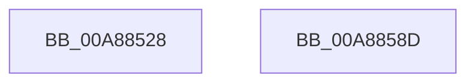

# PspLogAuditSetContextThreadEvent

- RVA: `0x00A88528`–`0x00A8858E` (길이 `102` bytes)
- VA: `0x0000000140A88528`
- 실행 섹션: `PAGE`
- PDB 이름 있음: `예`; PDB Function 태그: `아니요`
- unwind 정보 RVA: `0x000B8004`
- 디코드: `23`개 명령, `102/102` bytes 표시
- 미해석 바이트: `0` (있으면 어셈블리에 `.byte`로 보존)

> 이 문서는 커널 이미지의 기계어와 PDB 기호를 분석해 생성했습니다. 4번과 5번은 함수 원형과 자료형을 바이너리 사용 방식에서 추정한 C 해석이며 원본 소스 복구 결과는 아닙니다.

## 1. Dependencies

- 직접 호출 지점: **2**; 고유 호출 대상: **2**
- 직접 호출자로 확인된 함수: **1**
- RIP 상대 이미지 참조: **3**

### Outgoing calls
- `0x00A88576` → [EtwWrite](../../text/41/EtwWrite_function_0041C720.md) (function, `0x0041C720`)
- `0x00A88583` → [_security_check_cookie](../../text/6A/_security_check_cookie_function_006AC640.md) (function, `0x006AC640`)

### Direct callers
- [NtSetContextThread](NtSetContextThread_function_00A88440.md) at `0x00A884C7`

### Static image references
- `0x00A88533` → RVA `0x00E0A740` (`.data`; read)
- `0x00A88542` → RVA `0x00EFFA38` (`.data`; read)
- `0x00A88551` → RVA `0x0001BE88` (`.rdata`; read)

## 2. Other-region calls and transfers

- 다른 실행 섹션으로 향하는 call: **2**
  - `0x00A88576` → [EtwWrite](../../text/41/EtwWrite_function_0041C720.md) (`PAGE` → `.text`)
  - `0x00A88583` → [_security_check_cookie](../../text/6A/_security_check_cookie_function_006AC640.md) (`PAGE` → `.text`)
- 별도 외부 분기/꼬리 이동을 확인하지 못했습니다.

## 3. Assembly (complete function range)

```asm
00A88528  89 4C 24 08                     mov dword ptr [rsp + 8], ecx
00A8852C  4C 8B DC                        mov r11, rsp
00A8852F  48 83 EC 58                     sub rsp, 0x58
00A88533  48 8B 05 06 22 38 00            mov rax, qword ptr [rip + 0x382206]
00A8853A  48 33 C4                        xor rax, rsp
00A8853D  48 89 44 24 40                  mov qword ptr [rsp + 0x40], rax
00A88542  48 8B 0D EF 74 47 00            mov rcx, qword ptr [rip + 0x4774ef]
00A88549  49 8D 43 08                     lea rax, [r11 + 8]
00A8854D  49 89 43 D8                     mov qword ptr [r11 - 0x28], rax
00A88551  48 8D 15 30 39 59 FF            lea rdx, [rip - 0xa6c6d0]
00A88558  83 64 24 3C 00                  and dword ptr [rsp + 0x3c], 0
00A8855D  49 8D 43 D8                     lea rax, [r11 - 0x28]
00A88561  41 B9 01 00 00 00               mov r9d, 1
00A88567  49 89 43 C8                     mov qword ptr [r11 - 0x38], rax
00A8856B  45 33 C0                        xor r8d, r8d
00A8856E  C7 44 24 38 04 00 00 00         mov dword ptr [rsp + 0x38], 4
00A88576  E8 A5 41 99 FF                  call 0x14041c720
00A8857B  48 8B 4C 24 40                  mov rcx, qword ptr [rsp + 0x40]
00A88580  48 33 CC                        xor rcx, rsp
00A88583  E8 B8 40 C2 FF                  call 0x1406ac640
00A88588  48 83 C4 58                     add rsp, 0x58
00A8858C  C3                              ret
00A8858D  CC                              int3
```

## 4. C-style interpretation (structured pseudocode)

```c
__int64 __fastcall PspLogAuditSetContextThreadEvent(int a1, __int64 a2, int a3)
{
    __int64 result;
    __int64 v_rsp;
    unsigned __int64 v_stack_m18;
    unsigned int v_stack_m1C;
    unsigned int v_stack_m20;
    unsigned int v_stack_p8;

    v_stack_p8 = a1;
    v_rsp = (v_rsp) - (88);
    result = (*(unsigned __int64 *)(v_rip + 3678726)) ^ (v_rsp);
    v_stack_m18 = result;
    *(unsigned __int64 *)(v_rsp - 40) = v_rsp + 8;
    *(unsigned __int64 *)(v_rsp - 56) = v_rsp - 40;
    a3 = 0;
    v_stack_m20 = 4;
    result = EtwWrite(*(unsigned __int64 *)(v_rip + 4682991), v_rip - 10929872, a3, 1);
    a1 = (v_stack_m18) ^ (v_rsp);
    result = _security_check_cookie(a1, v_rip - 10929872, a3, 1);
    v_rsp = (v_rsp) + (88);
    return result;
}
```

## 5. (Beta) C Style

```c
int64_t PspLogAuditSetContextThreadEvent(int32_t Arg1, int64_t Arg2, int32_t Arg3)
{
    int64_t result;
    int64_t local_rsp;
    uint64_t v_stack_m18;
    uint32_t v_stack_m1C;
    uint32_t v_stack_m20;
    uint32_t v_stack_p8;

    v_stack_p8 = Arg1;
    local_rsp = (local_rsp) - (88);
    result = (*(uint64_t *)(v_rip + 0x382206)) ^ (local_rsp);
    v_stack_m18 = result;
    *(uint64_t *)(local_rsp - 0x28) = local_rsp + 8;
    *(uint64_t *)(local_rsp - 0x38) = local_rsp - 40;
    Arg3 = 0;
    v_stack_m20 = 4;
    result = EtwWrite(*(uint64_t *)(v_rip + 0x4774EF), v_rip - 10929872, Arg3, 1);
    Arg1 = (v_stack_m18) ^ (local_rsp);
    result = _security_check_cookie(Arg1, v_rip - 10929872, Arg3, 1);
    local_rsp = (local_rsp) + (88);
    return result;
}
```

## 6. Execution-region graph

[열기: 2D/3D 그래프와 함수 탐색 컨트롤 패널](../../../control-panel.html?section=page&rva=0x00A88528&view=graph)

- 2D 그래프는 위에서 아래로 흐르고, 3D 그래프는 빈 공간을 드래그해 회전합니다. Shift+드래그는 이동, 휠은 확대·축소, 함수 노드 선택은 대상 보고서 이동입니다.

### Static fallback


