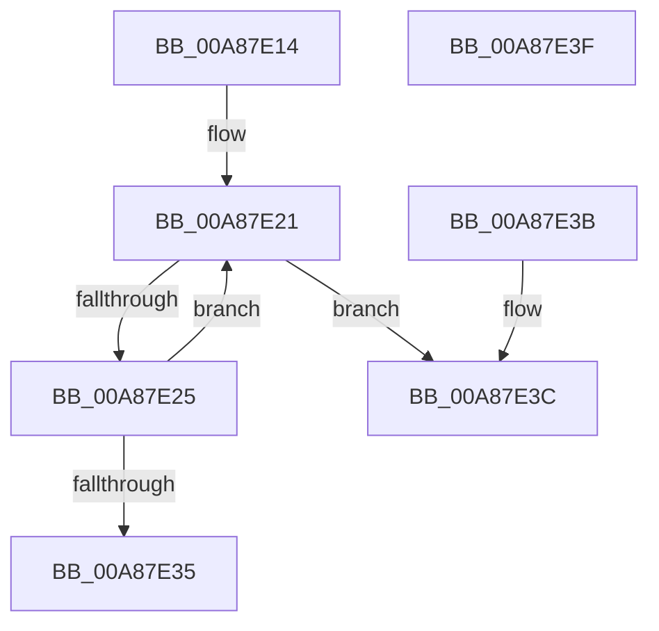

# PspSafeReferenceQuotaBlock

- RVA: `0x00A87E14`–`0x00A87E40` (길이 `44` bytes)
- VA: `0x0000000140A87E14`
- 실행 섹션: `PAGE`
- PDB 이름 있음: `예`; PDB Function 태그: `아니요`
- unwind 정보 RVA: `0x000DB714`
- 디코드: `15`개 명령, `44/44` bytes 표시
- 미해석 바이트: `0` (있으면 어셈블리에 `.byte`로 보존)

> 이 문서는 커널 이미지의 기계어와 PDB 기호를 분석해 생성했습니다. 4번과 5번은 함수 원형과 자료형을 바이너리 사용 방식에서 추정한 C 해석이며 원본 소스 복구 결과는 아닙니다.

## 1. Dependencies

- 직접 호출 지점: **0**; 고유 호출 대상: **0**
- 직접 호출자로 확인된 함수: **2**
- RIP 상대 이미지 참조: **0**

### Outgoing calls
- 직접 디코드된 call 명령이 없습니다.

### Direct callers
- [PspAssignProcessQuotaBlock](../AE/PspAssignProcessQuotaBlock_function_00AE3124.md) at `0x00AE322D`
- [PspLookupProcessQuotaBlock](../AE/PspLookupProcessQuotaBlock_function_00AE336C.md) at `0x00AE341F`

### Static image references
- 디코드된 RIP-relative 메모리 참조가 없습니다.

## 2. Other-region calls and transfers

- 다른 실행 섹션으로 향하는 call: **0**
- 별도 외부 분기/꼬리 이동을 확인하지 못했습니다.

## 3. Assembly (complete function range)

```asm
00A87E14  0F 0D 89 00 02 00 00            prefetchw byte ptr [rcx + 0x200]
00A87E1B  8B 91 00 02 00 00               mov edx, dword ptr [rcx + 0x200]
00A87E21  85 D2                           test edx, edx
00A87E23  74 17                           je 0x140a87e3c
00A87E25  8B C2                           mov eax, edx
00A87E27  FF C2                           inc edx
00A87E29  F0 0F B1 91 00 02 00 00         lock cmpxchg dword ptr [rcx + 0x200], edx
00A87E31  8B D0                           mov edx, eax
00A87E33  75 EC                           jne 0x140a87e21
00A87E35  B8 01 00 00 00                  mov eax, 1
00A87E3A  C3                              ret
00A87E3B  CC                              int3
00A87E3C  33 C0                           xor eax, eax
00A87E3E  C3                              ret
00A87E3F  CC                              int3
```

## 4. C-style interpretation (structured pseudocode)

```c
__int64 __fastcall PspSafeReferenceQuotaBlock(__int64 a1)
{
    __int64 result;

loc_00A87E21:
    if ((unsigned int)((unsigned int)(*(unsigned int *)(a1 + 512))) == 0) goto loc_00A87E3C;
    a2 = (unsigned int)(((unsigned int)(*(unsigned int *)(a1 + 512))) + 1);
    if ((unsigned int)((unsigned int)(*(unsigned int *)(a1 + 512))) != 0) goto loc_00A87E21;
    return 1;
loc_00A87E3C:
    result = 0;
    return result;
}
```

## 5. (Beta) C Style

```c
int64_t PspSafeReferenceQuotaBlock(void *Arg1)
{
    uint8_t *arg1 = (uint8_t *)Arg1;

    int64_t result;

loc_00A87E21:
    if ((uint32_t)((uint32_t)(*(uint32_t *)(arg1 + 0x200))) == 0) goto loc_00A87E3C;
    a2 = (uint32_t)(((uint32_t)(*(uint32_t *)(arg1 + 0x200))) + 1);
    if ((uint32_t)((uint32_t)(*(uint32_t *)(arg1 + 0x200))) != 0) goto loc_00A87E21;
    return 1;
loc_00A87E3C:
    result = 0;
    return result;
}
```

### 관측된 메모리 오프셋

구조체 형식이 확인되지 않은 접근은 인자 기준의 오프셋으로만 기록했습니다.

| 기준 인자 | 오프셋 표현 | 폭 (bit) | 접근 |
|---|---:|---:|---|
| `Arg1` | `+ 0x200` | `8` | `R` |
| `Arg1` | `+ 0x200` | `32` | `R` |

## 6. Execution-region graph

[열기: 2D/3D 그래프와 함수 탐색 컨트롤 패널](../../../control-panel.html?section=page&rva=0x00A87E14&view=graph)

- 2D 그래프는 위에서 아래로 흐르고, 3D 그래프는 빈 공간을 드래그해 회전합니다. Shift+드래그는 이동, 휠은 확대·축소, 함수 노드 선택은 대상 보고서 이동입니다.

### Static fallback


