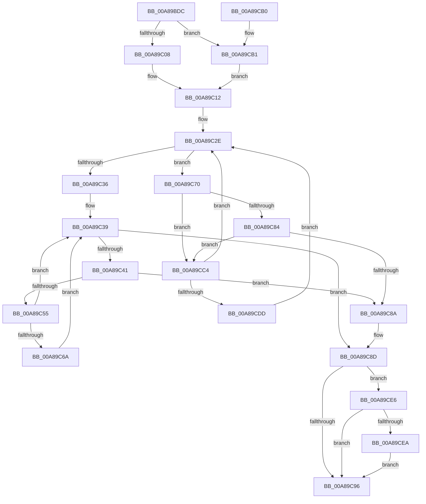

# PspSelectNodeForProcess

- RVA: `0x00A89BDC`–`0x00A89CF3` (길이 `279` bytes)
- VA: `0x0000000140A89BDC`
- 실행 섹션: `PAGE`
- PDB 이름 있음: `예`; PDB Function 태그: `아니요`
- unwind 정보 RVA: `0x000B843C`
- 디코드: `78`개 명령, `279/279` bytes 표시
- 미해석 바이트: `0` (있으면 어셈블리에 `.byte`로 보존)

> 이 문서는 커널 이미지의 기계어와 PDB 기호를 분석해 생성했습니다. 4번과 5번은 함수 원형과 자료형을 바이너리 사용 방식에서 추정한 C 해석이며 원본 소스 복구 결과는 아닙니다.

## 1. Dependencies

- 직접 호출 지점: **3**; 고유 호출 대상: **2**
- 직접 호출자로 확인된 함수: **1**
- RIP 상대 이미지 참조: **4**

### Outgoing calls
- `0x00A89C0D` → [RtlRandomEx](../../text/41/RtlRandomEx_function_0041AFE0.md) (function, `0x0041AFE0`)
- `0x00A89C4C` → [KeIsEmptyGroupMask](../../text/25/KeIsEmptyGroupMask_function_002553B0.md) (function, `0x002553B0`)
- `0x00A89C7B` → [KeIsEmptyGroupMask](../../text/25/KeIsEmptyGroupMask_function_002553B0.md) (function, `0x002553B0`)

### Direct callers
- [PspAllocateProcess](../A1/PspAllocateProcess_function_00A13B3C.md) at `0x00A14DFA`

### Static image references
- `0x00A89BFB` → RVA `0x00E0C588` (`.data`; read)
- `0x00A89C12` → RVA `0x00FC5000` (`ALMOSTRO`; read)
- `0x00A89C1A` → RVA `0x00FCF6C0` (`CACHEALI`; read)
- `0x00A89CB4` → RVA `0x00FD8198` (`PAGEDATA`; read/write)

## 2. Other-region calls and transfers

- 다른 실행 섹션으로 향하는 call: **3**
  - `0x00A89C0D` → [RtlRandomEx](../../text/41/RtlRandomEx_function_0041AFE0.md) (`PAGE` → `.text`)
  - `0x00A89C4C` → [KeIsEmptyGroupMask](../../text/25/KeIsEmptyGroupMask_function_002553B0.md) (`PAGE` → `.text`)
  - `0x00A89C7B` → [KeIsEmptyGroupMask](../../text/25/KeIsEmptyGroupMask_function_002553B0.md) (`PAGE` → `.text`)
- 별도 외부 분기/꼬리 이동을 확인하지 못했습니다.

## 3. Assembly (complete function range)

```asm
00A89BDC  48 89 5C 24 10                  mov qword ptr [rsp + 0x10], rbx
00A89BE1  48 89 6C 24 18                  mov qword ptr [rsp + 0x18], rbp
00A89BE6  56                              push rsi
00A89BE7  57                              push rdi
00A89BE8  41 54                           push r12
00A89BEA  41 56                           push r14
00A89BEC  41 57                           push r15
00A89BEE  48 83 EC 20                     sub rsp, 0x20
00A89BF2  45 33 F6                        xor r14d, r14d
00A89BF5  41 BF 01 00 00 00               mov r15d, 1
00A89BFB  44 39 35 86 29 38 00            cmp dword ptr [rip + 0x382986], r14d
00A89C02  0F 84 A9 00 00 00               je 0x140a89cb1
00A89C08  48 8D 4C 24 50                  lea rcx, [rsp + 0x50]
00A89C0D  E8 CE 13 99 FF                  call 0x14041afe0
00A89C12  44 0F B7 05 E6 B3 53 00         movzx r8d, word ptr [rip + 0x53b3e6]
00A89C1A  4C 8D 25 9F 5A 54 00            lea r12, [rip + 0x545a9f]
00A89C21  33 D2                           xor edx, edx
00A89C23  49 8B F6                        mov rsi, r14
00A89C26  41 F7 F0                        div r8d
00A89C29  41 8B DE                        mov ebx, r14d
00A89C2C  8B FA                           mov edi, edx
00A89C2E  41 0F B7 C0                     movzx eax, r8w
00A89C32  3B D8                           cmp ebx, eax
00A89C34  72 3A                           jb 0x140a89c70
00A89C36  41 8B DE                        mov ebx, r14d
00A89C39  41 0F B7 C0                     movzx eax, r8w
00A89C3D  3B D8                           cmp ebx, eax
00A89C3F  73 4C                           jae 0x140a89c8d
00A89C41  0F B7 C7                        movzx eax, di
00A89C44  49 8B 2C C4                     mov rbp, qword ptr [r12 + rax*8]
00A89C48  48 8D 4D 10                     lea rcx, [rbp + 0x10]
00A89C4C  E8 5F B7 7C FF                  call 0x1402553b0
00A89C51  85 C0                           test eax, eax
00A89C53  74 35                           je 0x140a89c8a
00A89C55  44 0F B7 05 A3 B3 53 00         movzx r8d, word ptr [rip + 0x53b3a3]
00A89C5D  41 03 DF                        add ebx, r15d
00A89C60  66 41 03 FF                     add di, r15w
00A89C64  66 41 3B F8                     cmp di, r8w
00A89C68  72 CF                           jb 0x140a89c39
00A89C6A  41 0F B7 FE                     movzx edi, r14w
00A89C6E  EB C9                           jmp 0x140a89c39
00A89C70  0F B7 C7                        movzx eax, di
00A89C73  49 8B 2C C4                     mov rbp, qword ptr [r12 + rax*8]
00A89C77  48 8D 4D 10                     lea rcx, [rbp + 0x10]
00A89C7B  E8 30 B7 7C FF                  call 0x1402553b0
00A89C80  85 C0                           test eax, eax
00A89C82  75 40                           jne 0x140a89cc4
00A89C84  44 84 7D 0A                     test byte ptr [rbp + 0xa], r15b
00A89C88  75 3A                           jne 0x140a89cc4
00A89C8A  48 8B F5                        mov rsi, rbp
00A89C8D  44 39 35 F4 28 38 00            cmp dword ptr [rip + 0x3828f4], r14d
00A89C94  74 50                           je 0x140a89ce6
00A89C96  48 8B 5C 24 58                  mov rbx, qword ptr [rsp + 0x58]
00A89C9B  48 8B C6                        mov rax, rsi
00A89C9E  48 8B 6C 24 60                  mov rbp, qword ptr [rsp + 0x60]
00A89CA3  48 83 C4 20                     add rsp, 0x20
00A89CA7  41 5F                           pop r15
00A89CA9  41 5E                           pop r14
00A89CAB  41 5C                           pop r12
00A89CAD  5F                              pop rdi
00A89CAE  5E                              pop rsi
00A89CAF  C3                              ret
00A89CB0  CC                              int3
00A89CB1  41 8B C7                        mov eax, r15d
00A89CB4  F0 0F C1 05 DC E4 54 00         lock xadd dword ptr [rip + 0x54e4dc], eax
00A89CBC  41 03 C7                        add eax, r15d
00A89CBF  E9 4E FF FF FF                  jmp 0x140a89c12
00A89CC4  44 0F B7 05 34 B3 53 00         movzx r8d, word ptr [rip + 0x53b334]
00A89CCC  41 03 DF                        add ebx, r15d
00A89CCF  66 41 03 FF                     add di, r15w
00A89CD3  66 41 3B F8                     cmp di, r8w
00A89CD7  0F 82 51 FF FF FF               jb 0x140a89c2e
00A89CDD  41 0F B7 FE                     movzx edi, r14w
00A89CE1  E9 48 FF FF FF                  jmp 0x140a89c2e
00A89CE6  85 DB                           test ebx, ebx
00A89CE8  74 AC                           je 0x140a89c96
00A89CEA  F0 01 1D A7 E4 54 00            lock add dword ptr [rip + 0x54e4a7], ebx
00A89CF1  EB A3                           jmp 0x140a89c96
```

## 4. C-style interpretation (structured pseudocode)

```c
__int64 __fastcall PspSelectNodeForProcess(__int64 a1, int a2)
{
    __int64 result;
    __int64 v_r14;
    __int64 v_rbx;
    __int64 v_rdi;
    __int64 v_rsp;
    unsigned __int64 v_stack_p10;
    unsigned __int64 v_stack_p18;
    unsigned __int64 v_stack_p8;

    v_stack_p10 = v_rbx;
    v_stack_p18 = v_rbp;
    v_rsp = (v_rsp) - (32);
    v_r14 = 0;
    if ((*(unsigned int *)(v_rip + 3680646)) == 0) goto loc_00A89CB1;
    result = RtlRandomEx(v_stack_p8, a2, a3, a4);
loc_00A89C12:
    a2 = 0;
loc_00A89C2E:
    if (0 < ((unsigned int)((unsigned __int16)(*(unsigned __int16 *)(v_rip + 5485542))))) goto loc_00A89C70;
loc_00A89C39:
    if (0 >= ((unsigned int)((unsigned __int16)(*(unsigned __int16 *)(v_rip + 5485542))))) goto loc_00A89C8D;
    result = KeIsEmptyGroupMask(*(unsigned __int64 *)(v_rip + 5528223 + 0 * 8) + 16, a2, *(unsigned __int16 *)(v_rip + 5485542), a4);
    if ((unsigned int)(result) == 0) goto loc_00A89C8A;
    v_rbx = (unsigned int)((0) + (1));
    v_rdi = (unsigned __int16)((0) + (1));
    if (((unsigned __int16)(v_rdi)) < ((unsigned __int16)(*(unsigned __int16 *)(v_rip + 5485475)))) goto loc_00A89C39;
    goto loc_00A89C39;
loc_00A89C70:
    result = KeIsEmptyGroupMask(*(unsigned __int64 *)(v_rip + 5528223 + 0 * 8) + 16, a2, *(unsigned __int16 *)(v_rip + 5485475), a4);
    if ((unsigned int)(result) != 0) goto loc_00A89CC4;
    if (((*(unsigned __int8 *)(*(unsigned __int64 *)(v_rip + 5528223 + 0 * 8) + 10)) & (1)) != 0) goto loc_00A89CC4;
loc_00A89C8A:
loc_00A89C8D:
    if ((*(unsigned int *)(v_rip + 3680500)) == 0) goto loc_00A89CE6;
loc_00A89C96:
    v_rsp = (v_rsp) + (32);
    return *(unsigned __int64 *)(v_rip + 5528223 + 0 * 8);
loc_00A89CB1:
    result = (unsigned int)((1) + (1));
    goto loc_00A89C12;
loc_00A89CC4:
    v_rbx = (unsigned int)((v_stack_p10) + (1));
    v_rdi = (unsigned __int16)((0) + (1));
    if (((unsigned __int16)(v_rdi)) < ((unsigned __int16)(*(unsigned __int16 *)(v_rip + 5485364)))) goto loc_00A89C2E;
    goto loc_00A89C2E;
loc_00A89CE6:
    if ((unsigned int)(v_rbx) == 0) goto loc_00A89C96;
    goto loc_00A89C96;
}
```

## 5. (Beta) C Style

```c
int64_t PspSelectNodeForProcess(int64_t Arg1, int32_t Arg2)
{
    int64_t result;
    int64_t local_r14;
    int64_t local_rbx;
    int64_t local_rdi;
    int64_t local_rsp;
    uint64_t v_stack_p10;
    uint64_t v_stack_p18;
    uint64_t v_stack_p8;

    v_stack_p10 = local_rbx;
    v_stack_p18 = local_rbp;
    local_rsp = (local_rsp) - (32);
    local_r14 = 0;
    if ((*(uint32_t *)(v_rip + 0x382986)) == 0) goto loc_00A89CB1;
    result = RtlRandomEx(v_stack_p8, Arg2, a3, a4);
loc_00A89C12:
    Arg2 = 0;
loc_00A89C2E:
    if (0 < ((uint32_t)((uint16_t)(*(uint16_t *)(v_rip + 0x53B3E6))))) goto loc_00A89C70;
loc_00A89C39:
    if (0 >= ((uint32_t)((uint16_t)(*(uint16_t *)(v_rip + 0x53B3E6))))) goto loc_00A89C8D;
    result = KeIsEmptyGroupMask(*(uint64_t *)(v_rip + 0x545A9F + 0x0 * 8) + 16, Arg2, *(uint16_t *)(v_rip + 0x53B3E6), a4);
    if ((uint32_t)(result) == 0) goto loc_00A89C8A;
    local_rbx = (uint32_t)((0) + (1));
    local_rdi = (uint16_t)((0) + (1));
    if (((uint16_t)(local_rdi)) < ((uint16_t)(*(uint16_t *)(v_rip + 0x53B3A3)))) goto loc_00A89C39;
    goto loc_00A89C39;
loc_00A89C70:
    result = KeIsEmptyGroupMask(*(uint64_t *)(v_rip + 0x545A9F + 0x0 * 8) + 16, Arg2, *(uint16_t *)(v_rip + 0x53B3A3), a4);
    if ((uint32_t)(result) != 0) goto loc_00A89CC4;
    if (((*(uint8_t *)(*(uint64_t *)(v_rip + 0x545A9F + 0x0 * 8) + 0xA)) & (1)) != 0) goto loc_00A89CC4;
loc_00A89C8A:
loc_00A89C8D:
    if ((*(uint32_t *)(v_rip + 0x3828F4)) == 0) goto loc_00A89CE6;
loc_00A89C96:
    local_rsp = (local_rsp) + (32);
    return *(uint64_t *)(v_rip + 0x545A9F + 0x0 * 8);
loc_00A89CB1:
    result = (uint32_t)((1) + (1));
    goto loc_00A89C12;
loc_00A89CC4:
    local_rbx = (uint32_t)((v_stack_p10) + (1));
    local_rdi = (uint16_t)((0) + (1));
    if (((uint16_t)(local_rdi)) < ((uint16_t)(*(uint16_t *)(v_rip + 0x53B334)))) goto loc_00A89C2E;
    goto loc_00A89C2E;
loc_00A89CE6:
    if ((uint32_t)(local_rbx) == 0) goto loc_00A89C96;
    goto loc_00A89C96;
}
```

## 6. Execution-region graph

[열기: 2D/3D 그래프와 함수 탐색 컨트롤 패널](../../../control-panel.html?section=page&rva=0x00A89BDC&view=graph)

- 2D 그래프는 위에서 아래로 흐르고, 3D 그래프는 빈 공간을 드래그해 회전합니다. Shift+드래그는 이동, 휠은 확대·축소, 함수 노드 선택은 대상 보고서 이동입니다.

### Static fallback


