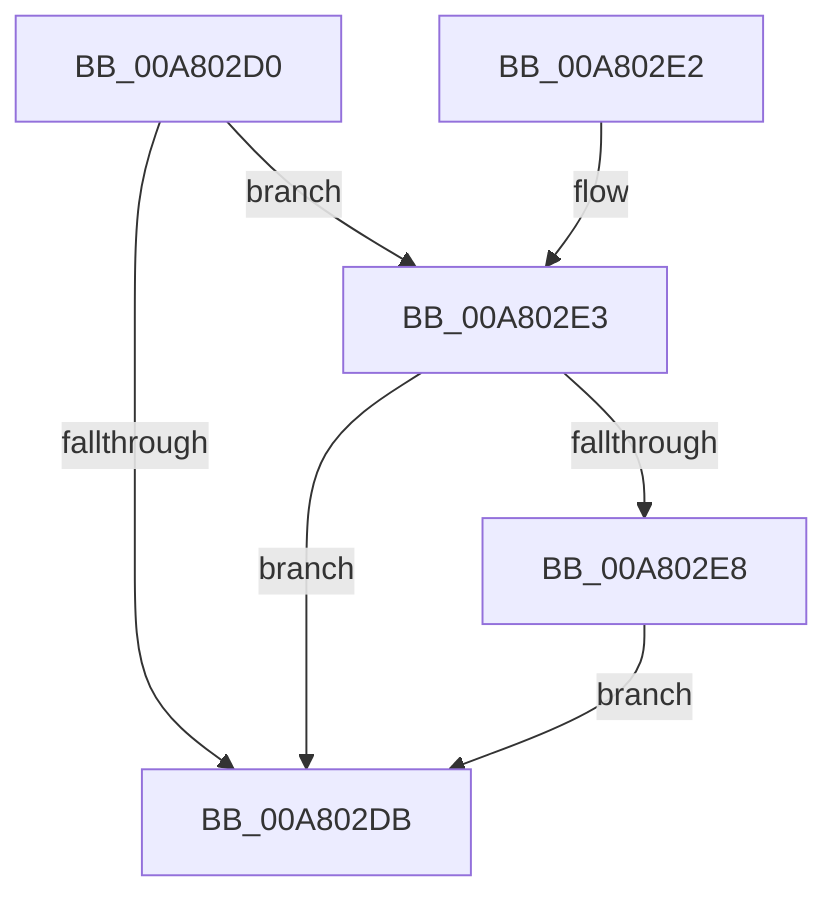

# PspSetJobLimitsJobPostCallback

- RVA: `0x00A802D0`–`0x00A802EF` (길이 `31` bytes)
- VA: `0x0000000140A802D0`
- 실행 섹션: `PAGE`
- PDB 이름 있음: `예`; PDB Function 태그: `아니요`
- unwind 정보 RVA: `0x00090138`
- 디코드: `12`개 명령, `31/31` bytes 표시
- 미해석 바이트: `0` (있으면 어셈블리에 `.byte`로 보존)

> 이 문서는 커널 이미지의 기계어와 PDB 기호를 분석해 생성했습니다. 4번과 5번은 함수 원형과 자료형을 바이너리 사용 방식에서 추정한 C 해석이며 원본 소스 복구 결과는 아닙니다.

## 1. Dependencies

- 직접 호출 지점: **1**; 고유 호출 대상: **1**
- 직접 호출자로 확인된 함수: **0**
- RIP 상대 이미지 참조: **0**

### Outgoing calls
- `0x00A802E8` → [PspApplyWorkingSetLimits](../78/PspApplyWorkingSetLimits_function_00784C00.md) (function, `0x00784C00`)

### Direct callers
- 이 함수 시작 RVA로 연결되는 직접 call은 확인되지 않았습니다. 간접 호출은 완전히 역산할 수 없습니다.

### Static image references
- 디코드된 RIP-relative 메모리 참조가 없습니다.

## 2. Other-region calls and transfers

- 다른 실행 섹션으로 향하는 call: **0**
- 별도 외부 분기/꼬리 이동을 확인하지 못했습니다.

## 3. Assembly (complete function range)

```asm
00A802D0  48 83 EC 28                     sub rsp, 0x28
00A802D4  8B 42 08                        mov eax, dword ptr [rdx + 8]
00A802D7  A8 01                           test al, 1
00A802D9  74 08                           je 0x140a802e3
00A802DB  33 C0                           xor eax, eax
00A802DD  48 83 C4 28                     add rsp, 0x28
00A802E1  C3                              ret
00A802E2  CC                              int3
00A802E3  48 39 0A                        cmp qword ptr [rdx], rcx
00A802E6  74 F3                           je 0x140a802db
00A802E8  E8 13 49 D0 FF                  call 0x140784c00
00A802ED  EB EC                           jmp 0x140a802db
```

## 4. C-style interpretation (structured pseudocode)

```c
__int64 __fastcall PspSetJobLimitsJobPostCallback(__int64 a1, __int64 a2)
{
    __int64 result;
    __int64 v_rsp;

    v_rsp = (v_rsp) - (40);
    if ((((unsigned __int8)((unsigned int)(*(unsigned int *)(a2 + 8)))) & (1)) == 0) goto loc_00A802E3;
loc_00A802DB:
    result = 0;
    v_rsp = (v_rsp) + (40);
    return result;
loc_00A802E3:
    if ((*(unsigned __int64 *)(a2)) == a1) goto loc_00A802DB;
    result = PspApplyWorkingSetLimits(a1, a2, a3, a4);
    goto loc_00A802DB;
}
```

## 5. (Beta) C Style

```c
int64_t PspSetJobLimitsJobPostCallback(int64_t Arg1, void *Arg2)
{
    uint8_t *arg2 = (uint8_t *)Arg2;

    int64_t result;
    int64_t local_rsp;

    local_rsp = (local_rsp) - (40);
    if ((((uint8_t)((uint32_t)(*(uint32_t *)(arg2 + 0x8)))) & (1)) == 0) goto loc_00A802E3;
loc_00A802DB:
    result = 0;
    local_rsp = (local_rsp) + (40);
    return result;
loc_00A802E3:
    if ((*(uint64_t *)(arg2)) == Arg1) goto loc_00A802DB;
    result = PspApplyWorkingSetLimits(Arg1, Arg2, a3, a4);
    goto loc_00A802DB;
}
```

### 관측된 메모리 오프셋

구조체 형식이 확인되지 않은 접근은 인자 기준의 오프셋으로만 기록했습니다.

| 기준 인자 | 오프셋 표현 | 폭 (bit) | 접근 |
|---|---:|---:|---|
| `Arg2` | `+ 0x0` | `64` | `R` |
| `Arg2` | `+ 0x8` | `32` | `R` |

## 6. Execution-region graph

[열기: 2D/3D 그래프와 함수 탐색 컨트롤 패널](../../../control-panel.html?section=page&rva=0x00A802D0&view=graph)

- 2D 그래프는 위에서 아래로 흐르고, 3D 그래프는 빈 공간을 드래그해 회전합니다. Shift+드래그는 이동, 휠은 확대·축소, 함수 노드 선택은 대상 보고서 이동입니다.

### Static fallback


