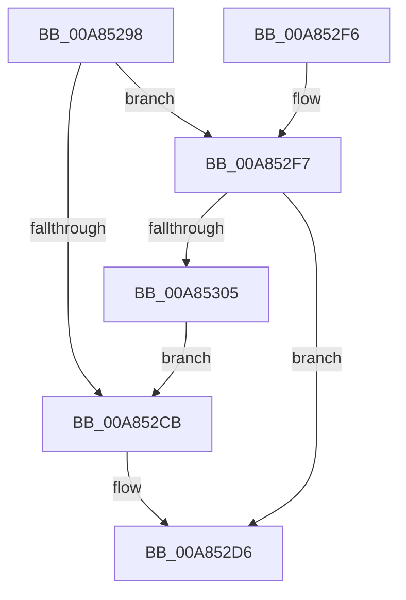

# PspValidateJobAffinityState

- RVA: `0x00A85298`–`0x00A85307` (길이 `111` bytes)
- VA: `0x0000000140A85298`
- 실행 섹션: `PAGE`
- PDB 이름 있음: `예`; PDB Function 태그: `아니요`
- unwind 정보 RVA: `0x0008E614`
- 디코드: `31`개 명령, `111/111` bytes 표시
- 미해석 바이트: `0` (있으면 어셈블리에 `.byte`로 보존)

> 이 문서는 커널 이미지의 기계어와 PDB 기호를 분석해 생성했습니다. 4번과 5번은 함수 원형과 자료형을 바이너리 사용 방식에서 추정한 C 해석이며 원본 소스 복구 결과는 아닙니다.

## 1. Dependencies

- 직접 호출 지점: **3**; 고유 호출 대상: **3**
- 직접 호출자로 확인된 함수: **1**
- RIP 상대 이미지 참조: **0**

### Outgoing calls
- `0x00A852BA` → [ExAcquireResourceSharedLite](../../text/21/ExAcquireResourceSharedLite_function_00211BC0.md) (function, `0x00211BC0`)
- `0x00A852DA` → [ExReleaseResourceLite](../../text/25/ExReleaseResourceLite_function_0025FA10.md) (function, `0x0025FA10`)
- `0x00A852FA` → [PspCheckJobAccessState](../78/PspCheckJobAccessState_function_00784D94.md) (function, `0x00784D94`)

### Direct callers
- [PspInsertProcess](../94/PspInsertProcess_function_009472CC.md) at `0x0094752A`

### Static image references
- 디코드된 RIP-relative 메모리 참조가 없습니다.

## 2. Other-region calls and transfers

- 다른 실행 섹션으로 향하는 call: **2**
  - `0x00A852BA` → [ExAcquireResourceSharedLite](../../text/21/ExAcquireResourceSharedLite_function_00211BC0.md) (`PAGE` → `.text`)
  - `0x00A852DA` → [ExReleaseResourceLite](../../text/25/ExReleaseResourceLite_function_0025FA10.md) (`PAGE` → `.text`)
- 별도 외부 분기/꼬리 이동을 확인하지 못했습니다.

## 3. Assembly (complete function range)

```asm
00A85298  48 89 5C 24 08                  mov qword ptr [rsp + 8], rbx
00A8529D  48 89 6C 24 10                  mov qword ptr [rsp + 0x10], rbp
00A852A2  48 89 74 24 18                  mov qword ptr [rsp + 0x18], rsi
00A852A7  57                              push rdi
00A852A8  48 83 EC 20                     sub rsp, 0x20
00A852AC  48 8B FA                        mov rdi, rdx
00A852AF  48 8B D9                        mov rbx, rcx
00A852B2  B2 01                           mov dl, 1
00A852B4  48 83 C1 38                     add rcx, 0x38
00A852B8  33 F6                           xor esi, esi
00A852BA  E8 01 C9 78 FF                  call 0x140211bc0
00A852BF  48 8B 8B 10 02 00 00            mov rcx, qword ptr [rbx + 0x210]
00A852C6  48 85 C9                        test rcx, rcx
00A852C9  75 2C                           jne 0x140a852f7
00A852CB  F0 81 8F F4 01 00 00 00 00 00 04  lock or dword ptr [rdi + 0x1f4], 0x4000000
00A852D6  48 8D 4B 38                     lea rcx, [rbx + 0x38]
00A852DA  E8 31 A7 7D FF                  call 0x14025fa10
00A852DF  48 8B 5C 24 30                  mov rbx, qword ptr [rsp + 0x30]
00A852E4  8B C6                           mov eax, esi
00A852E6  48 8B 74 24 40                  mov rsi, qword ptr [rsp + 0x40]
00A852EB  48 8B 6C 24 38                  mov rbp, qword ptr [rsp + 0x38]
00A852F0  48 83 C4 20                     add rsp, 0x20
00A852F4  5F                              pop rdi
00A852F5  C3                              ret
00A852F6  CC                              int3
00A852F7  48 8B D7                        mov rdx, rdi
00A852FA  E8 95 FA CF FF                  call 0x140784d94
00A852FF  8B F0                           mov esi, eax
00A85301  85 C0                           test eax, eax
00A85303  78 D1                           js 0x140a852d6
00A85305  EB C4                           jmp 0x140a852cb
```

## 4. C-style interpretation (structured pseudocode)

```c
__int64 __fastcall PspValidateJobAffinityState(__int64 a1, __int64 a2)
{
    __int64 result;
    __int64 v_rsi;
    __int64 v_rsp;
    unsigned __int64 v_stack_p10;
    unsigned __int64 v_stack_p18;
    unsigned __int64 v_stack_p8;

    v_stack_p8 = v_rbx;
    v_stack_p10 = v_rbp;
    v_stack_p18 = v_rsi;
    v_rsp = (v_rsp) - (32);
    a1 = (a1) + (56);
    v_rsi = 0;
    result = ExAcquireResourceSharedLite(a1, 1, a3, a4);
    if (*(unsigned __int64 *)(a1 + 528) != 0) goto loc_00A852F7;
loc_00A852CB:
loc_00A852D6:
    result = ExReleaseResourceLite(a1 + 56, 1, a3, a4);
    v_rsp = (v_rsp) + (32);
    return 0;
loc_00A852F7:
    result = PspCheckJobAccessState(a1 + 56, a2, a3, a4);
    if (sign_flag) goto loc_00A852D6;
    goto loc_00A852CB;
}
```

## 5. (Beta) C Style

```c
int64_t PspValidateJobAffinityState(void *Arg1, void *Arg2)
{
    uint8_t *arg1 = (uint8_t *)Arg1;
    uint8_t *arg2 = (uint8_t *)Arg2;

    int64_t result;
    int64_t local_rsi;
    int64_t local_rsp;
    uint64_t v_stack_p10;
    uint64_t v_stack_p18;
    uint64_t v_stack_p8;

    v_stack_p8 = local_rbx;
    v_stack_p10 = local_rbp;
    v_stack_p18 = local_rsi;
    local_rsp = (local_rsp) - (32);
    Arg1 = (Arg1) + (56);
    local_rsi = 0;
    result = ExAcquireResourceSharedLite(Arg1, 1, a3, a4);
    if (*(uint64_t *)(arg1 + 0x210) != 0) goto loc_00A852F7;
loc_00A852CB:
loc_00A852D6:
    result = ExReleaseResourceLite(Arg1 + 56, 1, a3, a4);
    local_rsp = (local_rsp) + (32);
    return 0;
loc_00A852F7:
    result = PspCheckJobAccessState(Arg1 + 56, Arg2, a3, a4);
    if (sign_flag) goto loc_00A852D6;
    goto loc_00A852CB;
}
```

### 관측된 메모리 오프셋

구조체 형식이 확인되지 않은 접근은 인자 기준의 오프셋으로만 기록했습니다.

| 기준 인자 | 오프셋 표현 | 폭 (bit) | 접근 |
|---|---:|---:|---|
| `Arg1` | `+ 0x38` | `64` | `R` |
| `Arg1` | `+ 0x210` | `64` | `R` |
| `Arg2` | `+ 0x1F4` | `32` | `R/W` |

## 6. Execution-region graph

[열기: 2D/3D 그래프와 함수 탐색 컨트롤 패널](../../../control-panel.html?section=page&rva=0x00A85298&view=graph)

- 2D 그래프는 위에서 아래로 흐르고, 3D 그래프는 빈 공간을 드래그해 회전합니다. Shift+드래그는 이동, 휠은 확대·축소, 함수 노드 선택은 대상 보고서 이동입니다.

### Static fallback


