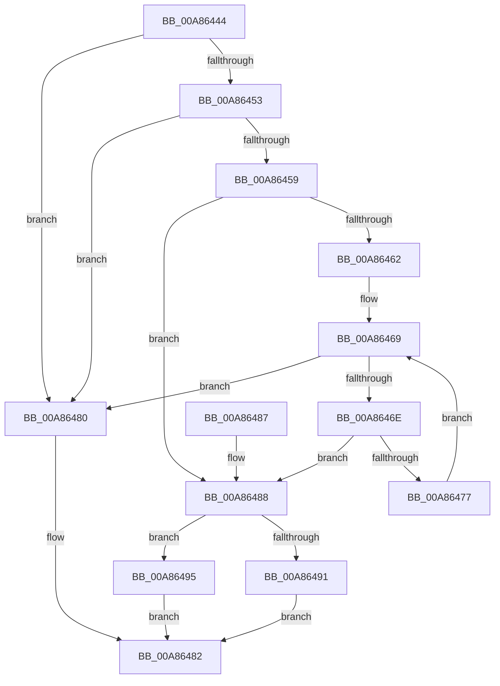

# PspValidateJobAssignmentDiskIoAttribution

- RVA: `0x00A86444`–`0x00A864A4` (길이 `96` bytes)
- VA: `0x0000000140A86444`
- 실행 섹션: `PAGE`
- PDB 이름 있음: `예`; PDB Function 태그: `아니요`
- unwind 정보 RVA: `0x0005FC2C`
- 디코드: `28`개 명령, `96/96` bytes 표시
- 미해석 바이트: `0` (있으면 어셈블리에 `.byte`로 보존)

> 이 문서는 커널 이미지의 기계어와 PDB 기호를 분석해 생성했습니다. 4번과 5번은 함수 원형과 자료형을 바이너리 사용 방식에서 추정한 C 해석이며 원본 소스 복구 결과는 아닙니다.

## 1. Dependencies

- 직접 호출 지점: **1**; 고유 호출 대상: **1**
- 직접 호출자로 확인된 함수: **1**
- RIP 상대 이미지 참조: **0**

### Outgoing calls
- `0x00A86498` → [PspIsSetJobIoAttribution](../9F/PspIsSetJobIoAttribution_function_009F7F0C.md) (function, `0x009F7F0C`)

### Direct callers
- [PspAssignProcessToJob](../A2/PspAssignProcessToJob_function_00A23370.md) at `0x00A235ED`

### Static image references
- 디코드된 RIP-relative 메모리 참조가 없습니다.

## 2. Other-region calls and transfers

- 다른 실행 섹션으로 향하는 call: **0**
- 별도 외부 분기/꼬리 이동을 확인하지 못했습니다.

## 3. Assembly (complete function range)

```asm
00A86444  48 83 EC 28                     sub rsp, 0x28
00A86448  41 8D 40 FC                     lea eax, [r8 - 4]
00A8644C  A9 FC FF FF FF                  test eax, 0xfffffffc
00A86451  75 2D                           jne 0x140a86480
00A86453  41 83 F8 06                     cmp r8d, 6
00A86457  74 27                           je 0x140a86480
00A86459  83 BA 2C 06 00 00 00            cmp dword ptr [rdx + 0x62c], 0
00A86460  75 26                           jne 0x140a86488
00A86462  48 8B 82 18 05 00 00            mov rax, qword ptr [rdx + 0x518]
00A86469  48 85 C0                        test rax, rax
00A8646C  74 12                           je 0x140a86480
00A8646E  83 B8 2C 06 00 00 00            cmp dword ptr [rax + 0x62c], 0
00A86475  75 11                           jne 0x140a86488
00A86477  48 8B 80 18 05 00 00            mov rax, qword ptr [rax + 0x518]
00A8647E  EB E9                           jmp 0x140a86469
00A86480  B0 01                           mov al, 1
00A86482  48 83 C4 28                     add rsp, 0x28
00A86486  C3                              ret
00A86487  CC                              int3
00A86488  83 B9 2C 06 00 00 00            cmp dword ptr [rcx + 0x62c], 0
00A8648F  74 04                           je 0x140a86495
00A86491  32 C0                           xor al, al
00A86493  EB ED                           jmp 0x140a86482
00A86495  45 33 C0                        xor r8d, r8d
00A86498  E8 6F 1A F7 FF                  call 0x1409f7f0c
00A8649D  84 C0                           test al, al
00A8649F  0F 94 C0                        sete al
00A864A2  EB DE                           jmp 0x140a86482
```

## 4. C-style interpretation (structured pseudocode)

```c
__int64 __fastcall PspValidateJobAssignmentDiskIoAttribution(__int64 a1, __int64 a2, __int64 a3)
{
    __int64 result;
    __int64 v_rsp;

    v_rsp = (v_rsp) - (40);
    if ((((unsigned int)(a3 - 4)) & (0xFFFFFFFCULL)) != 0) goto loc_00A86480;
    if (((unsigned int)(a3)) == 6) goto loc_00A86480;
    if ((*(unsigned int *)(a2 + 1580)) != 0) goto loc_00A86488;
loc_00A86469:
    if (*(unsigned __int64 *)(a2 + 1304) == 0) goto loc_00A86480;
    if ((*(unsigned int *)(*(unsigned __int64 *)(a2 + 1304) + 1580)) != 0) goto loc_00A86488;
    goto loc_00A86469;
loc_00A86480:
loc_00A86482:
    v_rsp = (v_rsp) + (40);
    return 1;
loc_00A86488:
    if ((*(unsigned int *)(a1 + 1580)) == 0) goto loc_00A86495;
    result = 0;
    goto loc_00A86482;
loc_00A86495:
    a3 = 0;
    result = PspIsSetJobIoAttribution(a1, a2, a3, a4);
    result = ((unsigned __int8)(result) == 0) ? 1 : 0;
    goto loc_00A86482;
}
```

## 5. (Beta) C Style

```c
int64_t PspValidateJobAssignmentDiskIoAttribution(void *Arg1, void *Arg2, void *Arg3)
{
    uint8_t *arg1 = (uint8_t *)Arg1;
    uint8_t *arg2 = (uint8_t *)Arg2;
    uint8_t *arg3 = (uint8_t *)Arg3;

    int64_t result;
    int64_t local_rsp;

    local_rsp = (local_rsp) - (40);
    if ((((uint32_t)(Arg3 - 4)) & (0xFFFFFFFCULL)) != 0) goto loc_00A86480;
    if (((uint32_t)(Arg3)) == 6) goto loc_00A86480;
    if ((*(uint32_t *)(arg2 + 0x62C)) != 0) goto loc_00A86488;
loc_00A86469:
    if (*(uint64_t *)(arg2 + 0x518) == 0) goto loc_00A86480;
    if ((*(uint32_t *)(*(uint64_t *)(arg2 + 0x518) + 0x62C)) != 0) goto loc_00A86488;
    goto loc_00A86469;
loc_00A86480:
loc_00A86482:
    local_rsp = (local_rsp) + (40);
    return 1;
loc_00A86488:
    if ((*(uint32_t *)(arg1 + 0x62C)) == 0) goto loc_00A86495;
    result = 0;
    goto loc_00A86482;
loc_00A86495:
    Arg3 = 0;
    result = PspIsSetJobIoAttribution(Arg1, Arg2, Arg3, a4);
    result = ((uint8_t)(result) == 0) ? 1 : 0;
    goto loc_00A86482;
}
```

### 관측된 메모리 오프셋

구조체 형식이 확인되지 않은 접근은 인자 기준의 오프셋으로만 기록했습니다.

| 기준 인자 | 오프셋 표현 | 폭 (bit) | 접근 |
|---|---:|---:|---|
| `Arg1` | `+ 0x62C` | `32` | `R` |
| `Arg2` | `+ 0x518` | `64` | `R` |
| `Arg2` | `+ 0x62C` | `32` | `R` |
| `Arg3` | `- 0x4` | `32` | `R` |

## 6. Execution-region graph

[열기: 2D/3D 그래프와 함수 탐색 컨트롤 패널](../../../control-panel.html?section=page&rva=0x00A86444&view=graph)

- 2D 그래프는 위에서 아래로 흐르고, 3D 그래프는 빈 공간을 드래그해 회전합니다. Shift+드래그는 이동, 휠은 확대·축소, 함수 노드 선택은 대상 보고서 이동입니다.

### Static fallback


