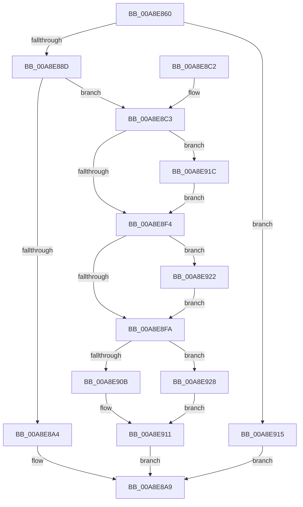

# RtlAddRange

- RVA: `0x00A8E860`–`0x00A8E932` (길이 `210` bytes)
- VA: `0x0000000140A8E860`
- 실행 섹션: `PAGE`
- PDB 이름 있음: `예`; PDB Function 태그: `아니요`
- unwind 정보 RVA: `0x000B8A74`
- 디코드: `62`개 명령, `210/210` bytes 표시
- 미해석 바이트: `0` (있으면 어셈블리에 `.byte`로 보존)

> 이 문서는 커널 이미지의 기계어와 PDB 기호를 분석해 생성했습니다. 4번과 5번은 함수 원형과 자료형을 바이너리 사용 방식에서 추정한 C 해석이며 원본 소스 복구 결과는 아닙니다.

## 1. Dependencies

- 직접 호출 지점: **3**; 고유 호출 대상: **3**
- 직접 호출자로 확인된 함수: **7**
- RIP 상대 이미지 참조: **1**

### Outgoing calls
- `0x00A8E894` → [ExAllocateFromPagedLookasideList](../../text/3F/ExAllocateFromPagedLookasideList_function_003FB730.md) (function, `0x003FB730`)
- `0x00A8E900` → [RtlpAddRange](../70/RtlpAddRange_function_00705A70.md) (function, `0x00705A70`)
- `0x00A8E92B` → [RtlpFreeRangeListEntry](../A6/RtlpFreeRangeListEntry_function_00A69918.md) (function, `0x00A69918`)

### Direct callers
- [ArbAddAllocation](../70/ArbAddAllocation_function_0070DE60.md) at `0x0070DE9F`
- [ArbAddInaccessibleAllocationRange](../70/ArbAddInaccessibleAllocationRange_function_0070DEB0.md) at `0x0070E060`
- [ArbAddMmConfigRangeAsBootReserved](../70/ArbAddMmConfigRangeAsBootReserved_function_0070E0C8.md) at `0x0070E13F`
- [ArbInitializeRangeList](../70/ArbInitializeRangeList_function_0070F070.md) at `0x0070F122`
- [IopMemInitialize](../72/IopMemInitialize_function_0072F078.md) at `0x0072F11C`
- [IopPortAddAllocation](../72/IopPortAddAllocation_function_0072F280.md) at `0x0072F2CE`
- [IopPortAddAllocation](../72/IopPortAddAllocation_function_0072F280.md) at `0x0072F320`
- [RtlInvertRangeListEx](RtlInvertRangeListEx_function_00A8E760.md) at `0x00A8E7AC`
- [RtlInvertRangeListEx](RtlInvertRangeListEx_function_00A8E760.md) at `0x00A8E809`
- [RtlInvertRangeListEx](RtlInvertRangeListEx_function_00A8E760.md) at `0x00A8E83A`

### Static image references
- `0x00A8E88D` → RVA `0x00E28200` (`.data`; read)

## 2. Other-region calls and transfers

- 다른 실행 섹션으로 향하는 call: **1**
  - `0x00A8E894` → [ExAllocateFromPagedLookasideList](../../text/3F/ExAllocateFromPagedLookasideList_function_003FB730.md) (`PAGE` → `.text`)
- 별도 외부 분기/꼬리 이동을 확인하지 못했습니다.

## 3. Assembly (complete function range)

```asm
00A8E860  48 89 5C 24 08                  mov qword ptr [rsp + 8], rbx
00A8E865  48 89 6C 24 10                  mov qword ptr [rsp + 0x10], rbp
00A8E86A  48 89 74 24 18                  mov qword ptr [rsp + 0x18], rsi
00A8E86F  57                              push rdi
00A8E870  41 56                           push r14
00A8E872  41 57                           push r15
00A8E874  48 83 EC 20                     sub rsp, 0x20
00A8E878  45 8A F1                        mov r14b, r9b
00A8E87B  49 8B F0                        mov rsi, r8
00A8E87E  48 8B EA                        mov rbp, rdx
00A8E881  48 8B F9                        mov rdi, rcx
00A8E884  4C 3B C2                        cmp r8, rdx
00A8E887  0F 82 88 00 00 00               jb 0x140a8e915
00A8E88D  48 8D 0D 6C 99 39 00            lea rcx, [rip + 0x39996c]
00A8E894  E8 97 CE 96 FF                  call 0x1403fb730
00A8E899  45 33 FF                        xor r15d, r15d
00A8E89C  48 8B D8                        mov rbx, rax
00A8E89F  48 85 C0                        test rax, rax
00A8E8A2  75 1F                           jne 0x140a8e8c3
00A8E8A4  B8 01 00 00 C0                  mov eax, 0xc0000001
00A8E8A9  48 8B 5C 24 40                  mov rbx, qword ptr [rsp + 0x40]
00A8E8AE  48 8B 6C 24 48                  mov rbp, qword ptr [rsp + 0x48]
00A8E8B3  48 8B 74 24 50                  mov rsi, qword ptr [rsp + 0x50]
00A8E8B8  48 83 C4 20                     add rsp, 0x20
00A8E8BC  41 5F                           pop r15
00A8E8BE  41 5E                           pop r14
00A8E8C0  5F                              pop rdi
00A8E8C1  C3                              ret
00A8E8C2  CC                              int3
00A8E8C3  48 8B 4C 24 70                  mov rcx, qword ptr [rsp + 0x70]
00A8E8C8  44 8B 44 24 60                  mov r8d, dword ptr [rsp + 0x60]
00A8E8CD  48 89 48 18                     mov qword ptr [rax + 0x18], rcx
00A8E8D1  48 8B 4C 24 68                  mov rcx, qword ptr [rsp + 0x68]
00A8E8D6  48 89 48 10                     mov qword ptr [rax + 0x10], rcx
00A8E8DA  44 88 78 21                     mov byte ptr [rax + 0x21], r15b
00A8E8DE  66 44 89 78 22                  mov word ptr [rax + 0x22], r15w
00A8E8E3  48 89 28                        mov qword ptr [rax], rbp
00A8E8E6  48 89 70 08                     mov qword ptr [rax + 8], rsi
00A8E8EA  44 88 70 20                     mov byte ptr [rax + 0x20], r14b
00A8E8EE  41 F6 C0 02                     test r8b, 2
00A8E8F2  75 28                           jne 0x140a8e91c
00A8E8F4  41 F6 C0 10                     test r8b, 0x10
00A8E8F8  75 28                           jne 0x140a8e922
00A8E8FA  48 8B D3                        mov rdx, rbx
00A8E8FD  48 8B CF                        mov rcx, rdi
00A8E900  E8 6B 71 C7 FF                  call 0x140705a70
00A8E905  8B F0                           mov esi, eax
00A8E907  85 C0                           test eax, eax
00A8E909  78 1D                           js 0x140a8e928
00A8E90B  FF 47 14                        inc dword ptr [rdi + 0x14]
00A8E90E  FF 47 18                        inc dword ptr [rdi + 0x18]
00A8E911  8B C6                           mov eax, esi
00A8E913  EB 94                           jmp 0x140a8e8a9
00A8E915  B8 0D 00 00 C0                  mov eax, 0xc000000d
00A8E91A  EB 8D                           jmp 0x140a8e8a9
00A8E91C  80 48 21 01                     or byte ptr [rax + 0x21], 1
00A8E920  EB D2                           jmp 0x140a8e8f4
00A8E922  80 48 21 10                     or byte ptr [rax + 0x21], 0x10
00A8E926  EB D2                           jmp 0x140a8e8fa
00A8E928  48 8B CB                        mov rcx, rbx
00A8E92B  E8 E8 AF FD FF                  call 0x140a69918
00A8E930  EB DF                           jmp 0x140a8e911
```

## 4. C-style interpretation (structured pseudocode)

```c
__int64 __fastcall RtlAddRange(__int64 a1, __int64 a2, __int64 a3, unsigned __int8 a4, unsigned int a5, __int64 a6, __int64 a7)
{
    __int64 result;
    __int64 v_r15;
    __int64 v_rsp;
    unsigned __int64 v_stack_p10;
    unsigned __int64 v_stack_p18;
    unsigned __int64 v_stack_p8;

    v_stack_p8 = v_rbx;
    v_stack_p10 = v_rbp;
    v_stack_p18 = v_rsi;
    v_rsp = (v_rsp) - (32);
    if (a3 < a2) goto loc_00A8E915;
    result = ExAllocateFromPagedLookasideList(v_rip + 3774828, a2, a3, a4);
    v_r15 = 0;
    if (result != 0) goto loc_00A8E8C3;
loc_00A8E8A9:
    v_rsp = (v_rsp) + (32);
    return (unsigned int)(0xC0000001ULL);
loc_00A8E8C3:
    *(unsigned __int64 *)((unsigned int)(0xC0000001ULL) + 24) = a7;
    *(unsigned __int64 *)((unsigned int)(0xC0000001ULL) + 16) = a6;
    *(unsigned __int8 *)((unsigned int)(0xC0000001ULL) + 33) = 0;
    *(unsigned __int16 *)((unsigned int)(0xC0000001ULL) + 34) = 0;
    *(unsigned __int64 *)((unsigned int)(0xC0000001ULL)) = v_stack_p10;
    *(unsigned __int64 *)((unsigned int)(0xC0000001ULL) + 8) = v_stack_p18;
    *(unsigned __int8 *)((unsigned int)(0xC0000001ULL) + 32) = a4;
    if ((((unsigned __int8)((unsigned int)(a5))) & (2)) != 0) goto loc_00A8E91C;
loc_00A8E8F4:
    if ((((unsigned __int8)((unsigned int)(a5))) & (16)) != 0) goto loc_00A8E922;
loc_00A8E8FA:
    result = RtlpAddRange(a1, v_stack_p8, (unsigned int)(a5), a4);
    if (sign_flag) goto loc_00A8E928;
loc_00A8E911:
    goto loc_00A8E8A9;
loc_00A8E915:
    goto loc_00A8E8A9;
loc_00A8E91C:
    goto loc_00A8E8F4;
loc_00A8E922:
    goto loc_00A8E8FA;
loc_00A8E928:
    result = RtlpFreeRangeListEntry(v_stack_p8, v_stack_p8, (unsigned int)(a5), a4);
    goto loc_00A8E911;
}
```

## 5. (Beta) C Style

```c
int64_t RtlAddRange(void *Arg1, int64_t Arg2, int64_t Arg3, uint8_t Arg4, uint32_t Arg5, int64_t Arg6, int64_t Arg7)
{
    uint8_t *arg1 = (uint8_t *)Arg1;

    int64_t result;
    int64_t local_r15;
    int64_t local_rsp;
    uint64_t v_stack_p10;
    uint64_t v_stack_p18;
    uint64_t v_stack_p8;

    v_stack_p8 = local_rbx;
    v_stack_p10 = local_rbp;
    v_stack_p18 = local_rsi;
    local_rsp = (local_rsp) - (32);
    if (Arg3 < Arg2) goto loc_00A8E915;
    result = ExAllocateFromPagedLookasideList(v_rip + 3774828, Arg2, Arg3, Arg4);
    local_r15 = 0;
    if (result != 0) goto loc_00A8E8C3;
loc_00A8E8A9:
    local_rsp = (local_rsp) + (32);
    return (uint32_t)(0xC0000001ULL);
loc_00A8E8C3:
    *(uint64_t *)((uint32_t)(0xC0000001ULL) + 0x18) = Arg7;
    *(uint64_t *)((uint32_t)(0xC0000001ULL) + 0x10) = Arg6;
    *(uint8_t *)((uint32_t)(0xC0000001ULL) + 0x21) = 0;
    *(uint16_t *)((uint32_t)(0xC0000001ULL) + 0x22) = 0;
    *(uint64_t *)((uint32_t)(0xC0000001ULL)) = v_stack_p10;
    *(uint64_t *)((uint32_t)(0xC0000001ULL) + 0x8) = v_stack_p18;
    *(uint8_t *)((uint32_t)(0xC0000001ULL) + 0x20) = Arg4;
    if ((((uint8_t)((uint32_t)(Arg5))) & (2)) != 0) goto loc_00A8E91C;
loc_00A8E8F4:
    if ((((uint8_t)((uint32_t)(Arg5))) & (16)) != 0) goto loc_00A8E922;
loc_00A8E8FA:
    result = RtlpAddRange(Arg1, v_stack_p8, (uint32_t)(Arg5), Arg4);
    if (sign_flag) goto loc_00A8E928;
loc_00A8E911:
    goto loc_00A8E8A9;
loc_00A8E915:
    goto loc_00A8E8A9;
loc_00A8E91C:
    goto loc_00A8E8F4;
loc_00A8E922:
    goto loc_00A8E8FA;
loc_00A8E928:
    result = RtlpFreeRangeListEntry(v_stack_p8, v_stack_p8, (uint32_t)(Arg5), Arg4);
    goto loc_00A8E911;
}
```

### 관측된 메모리 오프셋

구조체 형식이 확인되지 않은 접근은 인자 기준의 오프셋으로만 기록했습니다.

| 기준 인자 | 오프셋 표현 | 폭 (bit) | 접근 |
|---|---:|---:|---|
| `Arg1` | `+ 0x14` | `32` | `R/W` |
| `Arg1` | `+ 0x18` | `32` | `R/W` |

## 6. Execution-region graph

[열기: 2D/3D 그래프와 함수 탐색 컨트롤 패널](../../../control-panel.html?section=page&rva=0x00A8E860&view=graph)

- 2D 그래프는 위에서 아래로 흐르고, 3D 그래프는 빈 공간을 드래그해 회전합니다. Shift+드래그는 이동, 휠은 확대·축소, 함수 노드 선택은 대상 보고서 이동입니다.

### Static fallback


