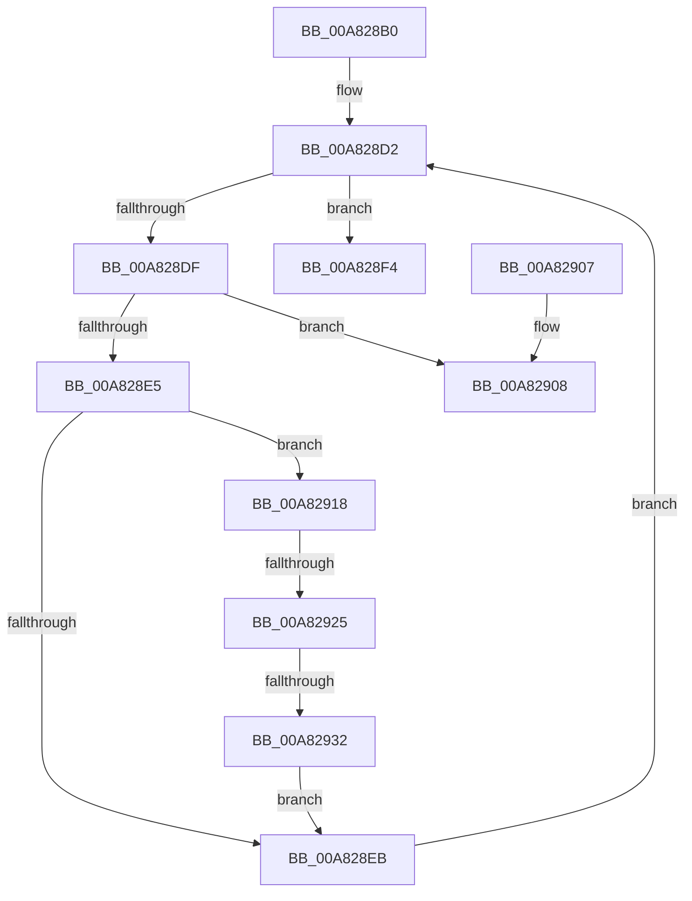

# RtlDeleteOwnersRanges

- RVA: `0x00A828B0`–`0x00A8294C` (길이 `156` bytes)
- VA: `0x0000000140A828B0`
- 실행 섹션: `PAGE`
- PDB 이름 있음: `예`; PDB Function 태그: `예`
- unwind 정보 RVA: `0x0007A7BC`
- 디코드: `46`개 명령, `156/156` bytes 표시
- 미해석 바이트: `0` (있으면 어셈블리에 `.byte`로 보존)

> 이 문서는 커널 이미지의 기계어와 PDB 기호를 분석해 생성했습니다. 4번과 5번은 함수 원형과 자료형을 바이너리 사용 방식에서 추정한 C 해석이며 원본 소스 복구 결과는 아닙니다.

## 1. Dependencies

- 직접 호출 지점: **1**; 고유 호출 대상: **1**
- 직접 호출자로 확인된 함수: **3**
- RIP 상대 이미지 참조: **0**

### Outgoing calls
- `0x00A8293C` → [RtlpFreeRangeListEntry](../A6/RtlpFreeRangeListEntry_function_00A69918.md) (function, `0x00A69918`)

### Direct callers
- [ArbDeleteOwnerRanges](../70/ArbDeleteOwnerRanges_function_0070E9B0.md) at `0x0070E9B8`
- [ArbQueryConflict](../70/ArbQueryConflict_function_0070F410.md) at `0x0070F5E1`
- [ArbQueryConflict](../70/ArbQueryConflict_function_0070F410.md) at `0x0070F6C0`
- [ArbRetestAllocation](../70/ArbRetestAllocation_function_0070F940.md) at `0x0070F9E0`

### Static image references
- 디코드된 RIP-relative 메모리 참조가 없습니다.

## 2. Other-region calls and transfers

- 다른 실행 섹션으로 향하는 call: **0**
- call이 아닌 외부 분기/꼬리 이동: **3**
  - `0x00A82913` → [sub_00B43A50](../B4/Unknown_function_00B43A50.md) (`tail-transfer`)
  - `0x00A8291F` → [sub_00B43A50 + 0x3D](../B4/Unknown_function_00B43A50.md) (`tail-transfer`)
  - `0x00A8292C` → [sub_00B43A50 + 0x3D](../B4/Unknown_function_00B43A50.md) (`tail-transfer`)

## 3. Assembly (complete function range)

```asm
00A828B0  48 89 5C 24 08                  mov qword ptr [rsp + 8], rbx
00A828B5  48 89 74 24 10                  mov qword ptr [rsp + 0x10], rsi
00A828BA  57                              push rdi
00A828BB  48 83 EC 20                     sub rsp, 0x20
00A828BF  48 8B F2                        mov rsi, rdx
00A828C2  48 8B D9                        mov rbx, rcx
00A828C5  45 33 C0                        xor r8d, r8d
00A828C8  48 8B 03                        mov rax, qword ptr [rbx]
00A828CB  48 8B 38                        mov rdi, qword ptr [rax]
00A828CE  48 8D 50 D8                     lea rdx, [rax - 0x28]
00A828D2  48 83 EF 28                     sub rdi, 0x28
00A828D6  48 8D 4A 28                     lea rcx, [rdx + 0x28]
00A828DA  48 3B D9                        cmp rbx, rcx
00A828DD  74 15                           je 0x140a828f4
00A828DF  F6 42 22 01                     test byte ptr [rdx + 0x22], 1
00A828E3  75 23                           jne 0x140a82908
00A828E5  48 39 72 18                     cmp qword ptr [rdx + 0x18], rsi
00A828E9  74 2D                           je 0x140a82918
00A828EB  48 8B D7                        mov rdx, rdi
00A828EE  48 8B 7F 28                     mov rdi, qword ptr [rdi + 0x28]
00A828F2  EB DE                           jmp 0x140a828d2
00A828F4  48 8B 5C 24 30                  mov rbx, qword ptr [rsp + 0x30]
00A828F9  41 8B C0                        mov eax, r8d
00A828FC  48 8B 74 24 38                  mov rsi, qword ptr [rsp + 0x38]
00A82901  48 83 C4 20                     add rsp, 0x20
00A82905  5F                              pop rdi
00A82906  C3                              ret
00A82907  CC                              int3
00A82908  48 8B 42 10                     mov rax, qword ptr [rdx + 0x10]
00A8290C  48 8B 08                        mov rcx, qword ptr [rax]
00A8290F  4C 8D 48 D8                     lea r9, [rax - 0x28]
00A82913  E9 38 11 0C 00                  jmp 0x140b43a50
00A82918  4C 8B 01                        mov r8, qword ptr [rcx]
00A8291B  49 39 48 08                     cmp qword ptr [r8 + 8], rcx
00A8291F  0F 85 68 11 0C 00               jne 0x140b43a8d
00A82925  48 8B 41 08                     mov rax, qword ptr [rcx + 8]
00A82929  48 39 08                        cmp qword ptr [rax], rcx
00A8292C  0F 85 5B 11 0C 00               jne 0x140b43a8d
00A82932  4C 89 00                        mov qword ptr [rax], r8
00A82935  48 8B CA                        mov rcx, rdx
00A82938  49 89 40 08                     mov qword ptr [r8 + 8], rax
00A8293C  E8 D7 6F FE FF                  call 0x140a69918
00A82941  FF 4B 14                        dec dword ptr [rbx + 0x14]
00A82944  FF 43 18                        inc dword ptr [rbx + 0x18]
00A82947  45 33 C0                        xor r8d, r8d
00A8294A  EB 9F                           jmp 0x140a828eb
```

## 4. C-style interpretation (structured pseudocode)

```c
__int64 __fastcall RtlDeleteOwnersRanges(__int64 a1, __int64 a2, int a3)
{
    __int64 result;
    __int64 v_rdi;
    __int64 v_rsp;
    unsigned __int64 v_stack_p10;
    unsigned __int64 v_stack_p8;

    v_stack_p8 = v_rbx;
    v_stack_p10 = v_rsi;
    v_rsp = (v_rsp) - (32);
    a3 = 0;
loc_00A828D2:
    v_rdi = (*(unsigned __int64 *)(*(unsigned __int64 *)(a1))) - (40);
    if (a1 == (*(unsigned __int64 *)(a1) - 40 + 40)) goto loc_00A828F4;
    if (((*(unsigned __int8 *)(*(unsigned __int64 *)(a1) - 40 + 34)) & (1)) != 0) goto loc_00A82908;
    if ((*(unsigned __int64 *)(*(unsigned __int64 *)(a1) - 40 + 24)) == a2) goto loc_00A82918;
loc_00A828EB:
    goto loc_00A828D2;
loc_00A828F4:
    v_rsp = (v_rsp) + (32);
    return 0;
loc_00A82908:
loc_00A82918:
    *(unsigned __int64 *)(*(unsigned __int64 *)(*(unsigned __int64 *)(*(unsigned __int64 *)(v_rdi + 16)) + 8)) = *(unsigned __int64 *)(*(unsigned __int64 *)(*(unsigned __int64 *)(v_rdi + 16)));
    *(unsigned __int64 *)(*(unsigned __int64 *)(*(unsigned __int64 *)(*(unsigned __int64 *)(v_rdi + 16))) + 8) = *(unsigned __int64 *)(*(unsigned __int64 *)(*(unsigned __int64 *)(v_rdi + 16)) + 8);
    result = RtlpFreeRangeListEntry(v_rdi, v_rdi, *(unsigned __int64 *)(*(unsigned __int64 *)(*(unsigned __int64 *)(v_rdi + 16))), *(unsigned __int64 *)(v_rdi + 16) - 40);
    a3 = 0;
    goto loc_00A828EB;
}
```

## 5. (Beta) C Style

```c
int64_t RtlDeleteOwnersRanges(void *Arg1, int64_t Arg2, int32_t Arg3)
{
    uint8_t *arg1 = (uint8_t *)Arg1;

    int64_t result;
    int64_t local_rdi;
    int64_t local_rsp;
    uint64_t v_stack_p10;
    uint64_t v_stack_p8;

    v_stack_p8 = local_rbx;
    v_stack_p10 = local_rsi;
    local_rsp = (local_rsp) - (32);
    Arg3 = 0;
loc_00A828D2:
    local_rdi = (*(uint64_t *)(*(uint64_t *)(arg1))) - (40);
    if (Arg1 == (*(uint64_t *)(arg1) - 40 + 40)) goto loc_00A828F4;
    if (((*(uint8_t *)(*(uint64_t *)(arg1) - 0x28 + 0x22)) & (1)) != 0) goto loc_00A82908;
    if ((*(uint64_t *)(*(uint64_t *)(arg1) - 0x28 + 0x18)) == Arg2) goto loc_00A82918;
loc_00A828EB:
    goto loc_00A828D2;
loc_00A828F4:
    local_rsp = (local_rsp) + (32);
    return 0;
loc_00A82908:
loc_00A82918:
    *(uint64_t *)(*(uint64_t *)(*(uint64_t *)(*(uint64_t *)(local_rdi + 0x10)) + 0x8)) = *(uint64_t *)(*(uint64_t *)(*(uint64_t *)(local_rdi + 0x10)));
    *(uint64_t *)(*(uint64_t *)(*(uint64_t *)(*(uint64_t *)(local_rdi + 0x10))) + 0x8) = *(uint64_t *)(*(uint64_t *)(*(uint64_t *)(local_rdi + 0x10)) + 0x8);
    result = RtlpFreeRangeListEntry(local_rdi, local_rdi, *(uint64_t *)(*(uint64_t *)(*(uint64_t *)(local_rdi + 0x10))), *(uint64_t *)(local_rdi + 0x10) - 40);
    Arg3 = 0;
    goto loc_00A828EB;
}
```

### 관측된 메모리 오프셋

구조체 형식이 확인되지 않은 접근은 인자 기준의 오프셋으로만 기록했습니다.

| 기준 인자 | 오프셋 표현 | 폭 (bit) | 접근 |
|---|---:|---:|---|
| `Arg1` | `+ 0x0` | `64` | `R` |

## 6. Execution-region graph

[열기: 2D/3D 그래프와 함수 탐색 컨트롤 패널](../../../control-panel.html?section=page&rva=0x00A828B0&view=graph)

- 2D 그래프는 위에서 아래로 흐르고, 3D 그래프는 빈 공간을 드래그해 회전합니다. Shift+드래그는 이동, 휠은 확대·축소, 함수 노드 선택은 대상 보고서 이동입니다.

### Static fallback


