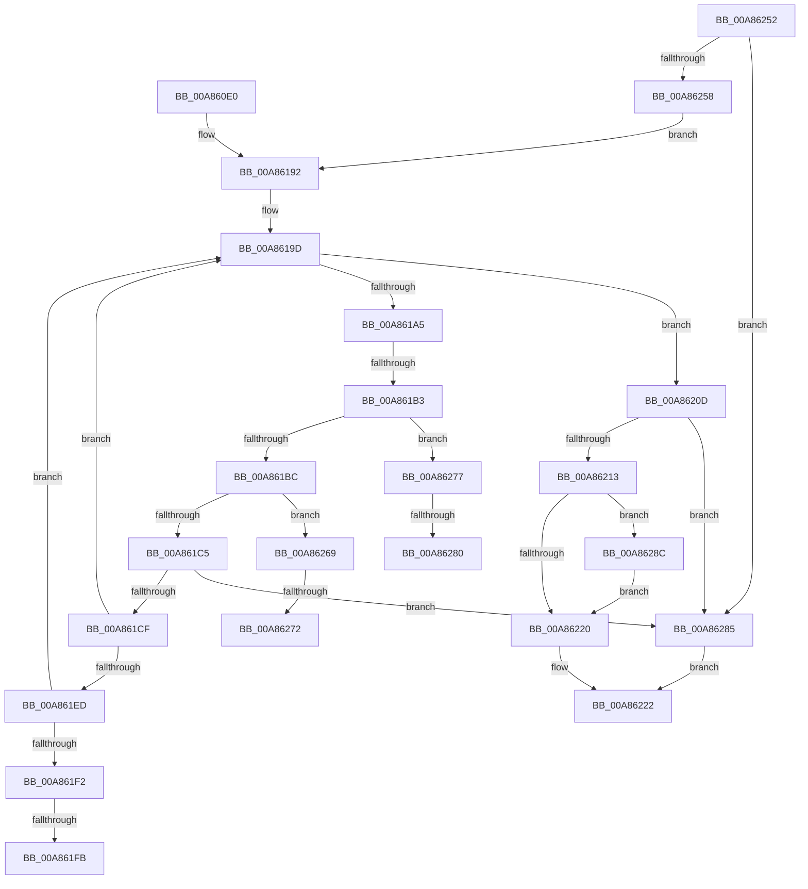

# RtlFormatMessageEx

- RVA: `0x00A860E0`–`0x00A8629B` (길이 `443` bytes)
- VA: `0x0000000140A860E0`
- 실행 섹션: `PAGE`
- PDB 이름 있음: `예`; PDB Function 태그: `예`
- unwind 정보 RVA: `0x000B7AE0`
- 디코드: `114`개 명령, `443/443` bytes 표시
- 미해석 바이트: `0` (있으면 어셈블리에 `.byte`로 보존)

> 이 문서는 커널 이미지의 기계어와 PDB 기호를 분석해 생성했습니다. 4번과 5번은 함수 원형과 자료형을 바이너리 사용 방식에서 추정한 C 해석이며 원본 소스 복구 결과는 아닙니다.

## 1. Dependencies

- 직접 호출 지점: **1**; 고유 호출 대상: **1**
- 직접 호출자로 확인된 함수: **3**
- RIP 상대 이미지 참조: **1**

### Outgoing calls
- `0x00A8622C` → [_security_check_cookie](../../text/6A/_security_check_cookie_function_006AC640.md) (function, `0x006AC640`)

### Direct callers
- [PiGetDeviceRegistryProperty](../72/PiGetDeviceRegistryProperty_function_007280A8.md) at `0x00728300`
- [RtlFormatMessage](../78/RtlFormatMessage_function_0078C510.md) at `0x0078C556`
- [sub_00B1F532](../B1/Unknown_function_00B1F532.md) at `0x00B1F5AA`

### Static image references
- `0x00A86106` → RVA `0x00E0A740` (`.data`; read)

## 2. Other-region calls and transfers

- 다른 실행 섹션으로 향하는 call: **1**
  - `0x00A8622C` → [_security_check_cookie](../../text/6A/_security_check_cookie_function_006AC640.md) (`PAGE` → `.text`)
- call이 아닌 외부 분기/꼬리 이동: **7**
  - `0x00A861AD` → [sub_00B444BA](../B4/Unknown_function_00B444BA.md) (`tail-transfer`)
  - `0x00A861F5` → [sub_00B444BA + 0x5CF](../B4/Unknown_function_00B444BA.md) (`tail-transfer`)
  - `0x00A86208` → [sub_00B444BA + 0x524](../B4/Unknown_function_00B444BA.md) (`tail-transfer`)
  - `0x00A8626C` → [sub_00B444BA + 0x50E](../B4/Unknown_function_00B444BA.md) (`tail-transfer`)
  - `0x00A86272` → [sub_00B444BA + 0x50B](../B4/Unknown_function_00B444BA.md) (`tail-transfer`)
  - `0x00A8627A` → [sub_00B444BA + 0x50B](../B4/Unknown_function_00B444BA.md) (`tail-transfer`)
  - `0x00A86280` → [sub_00B444BA + 0x50E](../B4/Unknown_function_00B444BA.md) (`tail-transfer`)

## 3. Assembly (complete function range)

```asm
00A860E0  48 8B C4                        mov rax, rsp
00A860E3  48 89 58 10                     mov qword ptr [rax + 0x10], rbx
00A860E7  48 89 70 18                     mov qword ptr [rax + 0x18], rsi
00A860EB  48 89 78 20                     mov qword ptr [rax + 0x20], rdi
00A860EF  55                              push rbp
00A860F0  41 54                           push r12
00A860F2  41 55                           push r13
00A860F4  41 56                           push r14
00A860F6  41 57                           push r15
00A860F8  48 8D A8 88 F9 FF FF            lea rbp, [rax - 0x678]
00A860FF  48 81 EC 50 07 00 00            sub rsp, 0x750
00A86106  48 8B 05 33 46 38 00            mov rax, qword ptr [rip + 0x384633]
00A8610D  48 33 C4                        xor rax, rsp
00A86110  48 89 85 40 06 00 00            mov qword ptr [rbp + 0x640], rax
00A86117  4C 8B 9D A8 06 00 00            mov r11, qword ptr [rbp + 0x6a8]
00A8611E  45 33 E4                        xor r12d, r12d
00A86121  44 8B B5 B8 06 00 00            mov r14d, dword ptr [rbp + 0x6b8]
00A86128  48 8B F9                        mov rdi, rcx
00A8612B  48 8B 8D C0 06 00 00            mov rcx, qword ptr [rbp + 0x6c0]
00A86132  45 8A D0                        mov r10b, r8b
00A86135  44 88 44 24 50                  mov byte ptr [rsp + 0x50], r8b
00A8613A  4C 8B 85 B0 06 00 00            mov r8, qword ptr [rbp + 0x6b0]
00A86141  45 8D 7C 24 02                  lea r15d, [r12 + 2]
00A86146  48 89 4D A0                     mov qword ptr [rbp - 0x60], rcx
00A8614A  49 8B D8                        mov rbx, r8
00A8614D  41 8D 4C 24 0D                  lea ecx, [r12 + 0xd]
00A86152  44 88 4C 24 51                  mov byte ptr [rsp + 0x51], r9b
00A86157  44 8B CA                        mov r9d, edx
00A8615A  89 54 24 6C                     mov dword ptr [rsp + 0x6c], edx
00A8615E  8D 51 FD                        lea edx, [rcx - 3]
00A86161  4C 89 5C 24 60                  mov qword ptr [rsp + 0x60], r11
00A86166  4C 89 45 88                     mov qword ptr [rbp - 0x78], r8
00A8616A  4C 89 64 24 70                  mov qword ptr [rsp + 0x70], r12
00A8616F  4C 89 64 24 78                  mov qword ptr [rsp + 0x78], r12
00A86174  44 89 64 24 54                  mov dword ptr [rsp + 0x54], r12d
00A86179  41 D1 EE                        shr r14d, 1
00A8617C  C7 45 80 25 00 00 00            mov dword ptr [rbp - 0x80], 0x25
00A86183  48 C7 45 90 08 00 00 00         mov qword ptr [rbp - 0x70], 8
00A8618B  C7 45 84 20 00 00 00            mov dword ptr [rbp - 0x7c], 0x20
00A86192  41 8B F4                        mov esi, r12d
00A86195  48 89 74 24 58                  mov qword ptr [rsp + 0x58], rsi
00A8619A  4D 8B EC                        mov r13, r12
00A8619D  0F B7 07                        movzx eax, word ptr [rdi]
00A861A0  66 85 C0                        test ax, ax
00A861A3  74 68                           je 0x140a8620d
00A861A5  48 83 C7 02                     add rdi, 2
00A861A9  66 3B 45 80                     cmp ax, word ptr [rbp - 0x80]
00A861AD  0F 84 07 E3 0B 00               je 0x140b444ba
00A861B3  66 3B C1                        cmp ax, cx
00A861B6  0F 84 BB 00 00 00               je 0x140a86277
00A861BC  66 3B C2                        cmp ax, dx
00A861BF  0F 84 A4 00 00 00               je 0x140a86269
00A861C5  41 83 EE 01                     sub r14d, 1
00A861C9  0F 88 B6 00 00 00               js 0x140a86285
00A861CF  66 3B 45 84                     cmp ax, word ptr [rbp - 0x7c]
00A861D3  66 89 03                        mov word ptr [rbx], ax
00A861D6  4C 0F 44 EB                     cmove r13, rbx
00A861DA  49 03 DF                        add rbx, r15
00A861DD  FF C6                           inc esi
00A861DF  41 8D 41 FF                     lea eax, [r9 - 1]
00A861E3  48 89 74 24 58                  mov qword ptr [rsp + 0x58], rsi
00A861E8  83 F8 FD                        cmp eax, -3
00A861EB  77 B0                           ja 0x140a8619d
00A861ED  41 3B F1                        cmp esi, r9d
00A861F0  72 AB                           jb 0x140a8619d
00A861F2  4D 85 ED                        test r13, r13
00A861F5  0F 84 8E E8 0B 00               je 0x140b44a89
00A861FB  41 B9 20 00 00 00               mov r9d, 0x20
00A86201  49 8B D5                        mov rdx, r13
00A86204  45 8D 61 E9                     lea r12d, [r9 - 0x17]
00A86208  E9 D1 E7 0B 00                  jmp 0x140b449de
00A8620D  41 83 FE 01                     cmp r14d, 1
00A86211  7C 72                           jl 0x140a86285
00A86213  48 8B 4D A0                     mov rcx, qword ptr [rbp - 0x60]
00A86217  66 44 89 23                     mov word ptr [rbx], r12w
00A8621B  48 85 C9                        test rcx, rcx
00A8621E  75 6C                           jne 0x140a8628c
00A86220  33 C0                           xor eax, eax
00A86222  48 8B 8D 40 06 00 00            mov rcx, qword ptr [rbp + 0x640]
00A86229  48 33 CC                        xor rcx, rsp
00A8622C  E8 0F 64 C2 FF                  call 0x1406ac640
00A86231  4C 8D 9C 24 50 07 00 00         lea r11, [rsp + 0x750]
00A86239  49 8B 5B 38                     mov rbx, qword ptr [r11 + 0x38]
00A8623D  49 8B 73 40                     mov rsi, qword ptr [r11 + 0x40]
00A86241  49 8B 7B 48                     mov rdi, qword ptr [r11 + 0x48]
00A86245  49 8B E3                        mov rsp, r11
00A86248  41 5F                           pop r15
00A8624A  41 5E                           pop r14
00A8624C  41 5D                           pop r13
00A8624E  41 5C                           pop r12
00A86250  5D                              pop rbp
00A86251  C3                              ret
00A86252  CC                              int3
00A86253  45 2B F7                        sub r14d, r15d
00A86256  78 2D                           js 0x140a86285
00A86258  66 89 0B                        mov word ptr [rbx], cx
00A8625B  49 03 DF                        add rbx, r15
00A8625E  66 89 13                        mov word ptr [rbx], dx
00A86261  49 03 DF                        add rbx, r15
00A86264  E9 29 FF FF FF                  jmp 0x140a86192
00A86269  66 39 0F                        cmp word ptr [rdi], cx
00A8626C  0F 85 56 E7 0B 00               jne 0x140b449c8
00A86272  E9 4E E7 0B 00                  jmp 0x140b449c5
00A86277  66 39 17                        cmp word ptr [rdi], dx
00A8627A  0F 84 45 E7 0B 00               je 0x140b449c5
00A86280  E9 43 E7 0B 00                  jmp 0x140b449c8
00A86285  B8 05 00 00 80                  mov eax, 0x80000005
00A8628A  EB 96                           jmp 0x140a86222
00A8628C  49 2B D8                        sub rbx, r8
00A8628F  49 03 DF                        add rbx, r15
00A86292  48 D1 FB                        sar rbx, 1
00A86295  03 DB                           add ebx, ebx
00A86297  89 19                           mov dword ptr [rcx], ebx
00A86299  EB 85                           jmp 0x140a86220
```

## 4. C-style interpretation (structured pseudocode)

```c
__int64 __fastcall RtlFormatMessageEx(__int64 a1, int a2, unsigned __int8 a3, unsigned __int8 a4)
{
    __int64 result;
    __int64 v_r12;
    __int64 v_r13;
    __int64 v_r14;
    __int64 v_rbx;
    __int64 v_rdi;
    __int64 v_rsi;
    __int64 v_rsp;
    unsigned __int64 v_stack_m28;
    unsigned __int64 v_stack_m700;
    unsigned __int64 v_stack_m708;
    unsigned int v_stack_m70C;
    unsigned __int64 v_stack_m718;
    unsigned __int64 v_stack_m720;
    unsigned int v_stack_m724;
    unsigned __int8 v_stack_m727;
    unsigned __int8 v_stack_m728;

    *(unsigned __int64 *)(v_rsp + 16) = v_rbx;
    *(unsigned __int64 *)(v_rsp + 24) = v_rsi;
    *(unsigned __int64 *)(v_rsp + 32) = v_rdi;
    v_rsp = (v_rsp) - (0x750ULL);
    result = (*(unsigned __int64 *)(v_rip + 3687987)) ^ (v_rsp);
    *(unsigned __int64 *)(v_rsp - 1656 + 1600) = result;
    v_r12 = 0;
    v_stack_m728 = a3;
    *(unsigned __int64 *)(v_rsp - 1656 - 96) = *(unsigned __int64 *)(v_rsp - 1656 + 1728);
    v_stack_m727 = a4;
    v_stack_m70C = a2;
    v_stack_m718 = *(unsigned __int64 *)(v_rsp - 1656 + 1704);
    *(unsigned __int64 *)(v_rsp - 1656 - 120) = *(unsigned __int64 *)(v_rsp - 1656 + 1712);
    v_stack_m708 = 0;
    v_stack_m700 = 0;
    v_stack_m724 = 0;
    v_r14 = (unsigned int)(((unsigned int)(*(unsigned int *)(v_rsp - 1656 + 1720))) >> (1));
    *(unsigned int *)(v_rsp - 1656 - 128) = 37;
    *(unsigned __int64 *)(v_rsp - 1656 - 112) = 8;
    *(unsigned int *)(v_rsp - 1656 - 124) = 32;
loc_00A86192:
    v_stack_m720 = 0;
loc_00A8619D:
    if ((unsigned __int16)(*(unsigned __int16 *)(a1)) == 0) goto loc_00A8620D;
    v_rdi = (a1) + (2);
    if (((unsigned __int16)(*(unsigned __int16 *)(a1))) == ((unsigned __int16)(v_r12 + 13))) goto loc_00A86277;
    if (((unsigned __int16)(*(unsigned __int16 *)(a1))) == ((unsigned __int16)(v_r12 + 13 - 3))) goto loc_00A86269;
    v_r14 = (unsigned int)((v_r14) - (1));
    if (sign_flag) goto loc_00A86285;
    *(unsigned __int16 *)(*(unsigned __int64 *)(v_rsp - 1656 + 1712)) = (unsigned __int16)(*(unsigned __int16 *)(a1));
    v_r13 = 0;
    if (((unsigned __int16)(*(unsigned __int16 *)(a1))) == (*(unsigned __int16 *)(v_rsp - 1656 - 124))) { v_r13 = *(unsigned __int64 *)(v_rsp - 1656 + 1712); }
    v_rbx = (*(unsigned __int64 *)(v_rsp - 1656 + 1712)) + (v_r12 + 2);
    v_rsi = (unsigned int)((0) + 1);
    v_stack_m720 = v_rsi;
    if (((unsigned int)((unsigned int)(a2) - 1)) > -3) goto loc_00A8619D;
    if (((unsigned int)(v_rsi)) < ((unsigned int)((unsigned int)(a2)))) goto loc_00A8619D;
loc_00A8620D:
    if (((unsigned int)(v_r14)) < 1) goto loc_00A86285;
    *(unsigned __int16 *)(v_rbx) = (unsigned __int16)(32 - 23);
    if (*(unsigned __int64 *)(v_rsp - 1656 - 96) != 0) goto loc_00A8628C;
loc_00A86220:
    result = 0;
loc_00A86222:
    a1 = (*(unsigned __int64 *)(v_rsp - 1656 + 1600)) ^ (v_rsp);
    result = _security_check_cookie(a1, v_r13, *(unsigned __int64 *)(v_rsp - 1656 + 1712), 32);
    return result;
loc_00A86269:
loc_00A86277:
loc_00A86285:
    goto loc_00A86222;
loc_00A8628C:
    v_rbx = (*(unsigned __int64 *)(v_stack_m28 + 56)) - (*(unsigned __int64 *)(v_rsp - 1656 + 1712));
    v_rbx = (v_rbx) + (v_r12 + 2);
    v_rbx = (v_rbx) >> (1);
    v_rbx = (unsigned int)((v_rbx) + ((unsigned int)(v_rbx)));
    *(unsigned int *)(a1) = (unsigned int)(v_rbx);
    goto loc_00A86220;
}
```

## 5. (Beta) C Style

```c
int64_t RtlFormatMessageEx(void *Arg1, void *Arg2, uint8_t Arg3, uint8_t Arg4)
{
    uint8_t *arg1 = (uint8_t *)Arg1;
    uint8_t *arg2 = (uint8_t *)Arg2;

    int64_t result;
    int64_t local_r12;
    int64_t local_r13;
    int64_t local_r14;
    int64_t local_rbx;
    int64_t local_rdi;
    int64_t local_rsi;
    int64_t local_rsp;
    uint64_t v_stack_m28;
    uint64_t v_stack_m700;
    uint64_t v_stack_m708;
    uint32_t v_stack_m70C;
    uint64_t v_stack_m718;
    uint64_t v_stack_m720;
    uint32_t v_stack_m724;
    uint8_t v_stack_m727;
    uint8_t v_stack_m728;

    *(uint64_t *)(local_rsp + 0x10) = local_rbx;
    *(uint64_t *)(local_rsp + 0x18) = local_rsi;
    *(uint64_t *)(local_rsp + 0x20) = local_rdi;
    local_rsp = (local_rsp) - (0x750ULL);
    result = (*(uint64_t *)(v_rip + 0x384633)) ^ (local_rsp);
    *(uint64_t *)(local_rsp - 0x678 + 0x640) = result;
    local_r12 = 0;
    v_stack_m728 = Arg3;
    *(uint64_t *)(local_rsp - 0x678 - 0x60) = *(uint64_t *)(local_rsp - 0x678 + 0x6C0);
    v_stack_m727 = Arg4;
    v_stack_m70C = Arg2;
    v_stack_m718 = *(uint64_t *)(local_rsp - 0x678 + 0x6A8);
    *(uint64_t *)(local_rsp - 0x678 - 0x78) = *(uint64_t *)(local_rsp - 0x678 + 0x6B0);
    v_stack_m708 = 0;
    v_stack_m700 = 0;
    v_stack_m724 = 0;
    local_r14 = (uint32_t)(((uint32_t)(*(uint32_t *)(local_rsp - 0x678 + 0x6B8))) >> (1));
    *(uint32_t *)(local_rsp - 0x678 - 0x80) = 37;
    *(uint64_t *)(local_rsp - 0x678 - 0x70) = 8;
    *(uint32_t *)(local_rsp - 0x678 - 0x7C) = 32;
loc_00A86192:
    v_stack_m720 = 0;
loc_00A8619D:
    if ((uint16_t)(*(uint16_t *)(arg1)) == 0) goto loc_00A8620D;
    local_rdi = (Arg1) + (2);
    if (((uint16_t)(*(uint16_t *)(arg1))) == ((uint16_t)(local_r12 + 13))) goto loc_00A86277;
    if (((uint16_t)(*(uint16_t *)(arg1))) == ((uint16_t)(local_r12 + 13 - 3))) goto loc_00A86269;
    local_r14 = (uint32_t)((local_r14) - (1));
    if (sign_flag) goto loc_00A86285;
    *(uint16_t *)(*(uint64_t *)(local_rsp - 0x678 + 0x6B0)) = (uint16_t)(*(uint16_t *)(arg1));
    local_r13 = 0;
    if (((uint16_t)(*(uint16_t *)(arg1))) == (*(uint16_t *)(local_rsp - 0x678 - 0x7C))) { local_r13 = *(uint64_t *)(local_rsp - 0x678 + 0x6B0); }
    local_rbx = (*(uint64_t *)(local_rsp - 0x678 + 0x6B0)) + (local_r12 + 2);
    local_rsi = (uint32_t)((0) + 1);
    v_stack_m720 = local_rsi;
    if (((uint32_t)((uint32_t)(Arg2) - 1)) > -3) goto loc_00A8619D;
    if (((uint32_t)(local_rsi)) < ((uint32_t)((uint32_t)(Arg2)))) goto loc_00A8619D;
loc_00A8620D:
    if (((uint32_t)(local_r14)) < 1) goto loc_00A86285;
    *(uint16_t *)(local_rbx) = (uint16_t)(32 - 23);
    if (*(uint64_t *)(local_rsp - 0x678 - 0x60) != 0) goto loc_00A8628C;
loc_00A86220:
    result = 0;
loc_00A86222:
    Arg1 = (*(uint64_t *)(local_rsp - 0x678 + 0x640)) ^ (local_rsp);
    result = _security_check_cookie(Arg1, local_r13, *(uint64_t *)(local_rsp - 0x678 + 0x6B0), 32);
    return result;
loc_00A86269:
loc_00A86277:
loc_00A86285:
    goto loc_00A86222;
loc_00A8628C:
    local_rbx = (*(uint64_t *)(v_stack_m28 + 0x38)) - (*(uint64_t *)(local_rsp - 0x678 + 0x6B0));
    local_rbx = (local_rbx) + (local_r12 + 2);
    local_rbx = (local_rbx) >> (1);
    local_rbx = (uint32_t)((local_rbx) + ((uint32_t)(local_rbx)));
    *(uint32_t *)(arg1) = (uint32_t)(local_rbx);
    goto loc_00A86220;
}
```

### 관측된 메모리 오프셋

구조체 형식이 확인되지 않은 접근은 인자 기준의 오프셋으로만 기록했습니다.

| 기준 인자 | 오프셋 표현 | 폭 (bit) | 접근 |
|---|---:|---:|---|
| `Arg1` | `+ 0x0` | `16` | `R` |
| `Arg2` | `- 0x1` | `32` | `R` |

## 6. Execution-region graph

[열기: 2D/3D 그래프와 함수 탐색 컨트롤 패널](../../../control-panel.html?section=page&rva=0x00A860E0&view=graph)

- 2D 그래프는 위에서 아래로 흐르고, 3D 그래프는 빈 공간을 드래그해 회전합니다. Shift+드래그는 이동, 휠은 확대·축소, 함수 노드 선택은 대상 보고서 이동입니다.

### Static fallback


