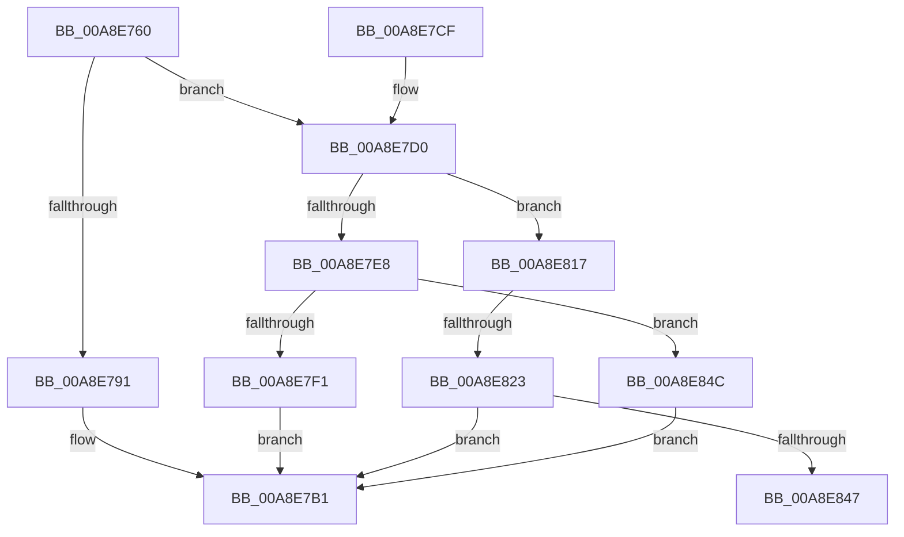

# RtlInvertRangeListEx

- RVA: `0x00A8E760`–`0x00A8E853` (길이 `243` bytes)
- VA: `0x0000000140A8E760`
- 실행 섹션: `PAGE`
- PDB 이름 있음: `예`; PDB Function 태그: `예`
- unwind 정보 RVA: `0x000B8A44`
- 디코드: `72`개 명령, `243/243` bytes 표시
- 미해석 바이트: `0` (있으면 어셈블리에 `.byte`로 보존)

> 이 문서는 커널 이미지의 기계어와 PDB 기호를 분석해 생성했습니다. 4번과 5번은 함수 원형과 자료형을 바이너리 사용 방식에서 추정한 C 해석이며 원본 소스 복구 결과는 아닙니다.

## 1. Dependencies

- 직접 호출 지점: **3**; 고유 호출 대상: **1**
- 직접 호출자로 확인된 함수: **2**
- RIP 상대 이미지 참조: **0**

### Outgoing calls
- `0x00A8E7AC` → [RtlAddRange](RtlAddRange_function_00A8E860.md) (function, `0x00A8E860`)
- `0x00A8E809` → [RtlAddRange](RtlAddRange_function_00A8E860.md) (function, `0x00A8E860`)
- `0x00A8E83A` → [RtlAddRange](RtlAddRange_function_00A8E860.md) (function, `0x00A8E860`)

### Direct callers
- [ArbInitializeRangeList](../70/ArbInitializeRangeList_function_0070F070.md) at `0x0070F145`
- [RtlInvertRangeList](RtlInvertRangeList_function_00A8E730.md) at `0x00A8E740`

### Static image references
- 디코드된 RIP-relative 메모리 참조가 없습니다.

## 2. Other-region calls and transfers

- 다른 실행 섹션으로 향하는 call: **0**
- call이 아닌 외부 분기/꼬리 이동: **2**
  - `0x00A8E81D` → [sub_00B465E2](../B4/Unknown_function_00B465E2.md) (`tail-transfer`)
  - `0x00A8E847` → [sub_00B465E2](../B4/Unknown_function_00B465E2.md) (`tail-transfer`)

## 3. Assembly (complete function range)

```asm
00A8E760  4C 8B DC                        mov r11, rsp
00A8E763  49 89 5B 08                     mov qword ptr [r11 + 8], rbx
00A8E767  49 89 6B 10                     mov qword ptr [r11 + 0x10], rbp
00A8E76B  49 89 73 18                     mov qword ptr [r11 + 0x18], rsi
00A8E76F  57                              push rdi
00A8E770  41 54                           push r12
00A8E772  41 55                           push r13
00A8E774  41 56                           push r14
00A8E776  41 57                           push r15
00A8E778  48 83 EC 40                     sub rsp, 0x40
00A8E77C  48 8B F2                        mov rsi, rdx
00A8E77F  33 FF                           xor edi, edi
00A8E781  49 8B E9                        mov rbp, r9
00A8E784  45 8A F8                        mov r15b, r8b
00A8E787  4C 8B E1                        mov r12, rcx
00A8E78A  8B D7                           mov edx, edi
00A8E78C  39 7E 14                        cmp dword ptr [rsi + 0x14], edi
00A8E78F  75 3F                           jne 0x140a8e7d0
00A8E791  48 8B 84 24 90 00 00 00         mov rax, qword ptr [rsp + 0x90]
00A8E799  49 89 43 C8                     mov qword ptr [r11 - 0x38], rax
00A8E79D  4D 89 4B C0                     mov qword ptr [r11 - 0x40], r9
00A8E7A1  45 8A C8                        mov r9b, r8b
00A8E7A4  49 83 C8 FF                     or r8, 0xffffffffffffffff
00A8E7A8  89 7C 24 20                     mov dword ptr [rsp + 0x20], edi
00A8E7AC  E8 AF 00 00 00                  call 0x140a8e860
00A8E7B1  4C 8D 5C 24 40                  lea r11, [rsp + 0x40]
00A8E7B6  49 8B 5B 30                     mov rbx, qword ptr [r11 + 0x30]
00A8E7BA  49 8B 6B 38                     mov rbp, qword ptr [r11 + 0x38]
00A8E7BE  49 8B 73 40                     mov rsi, qword ptr [r11 + 0x40]
00A8E7C2  49 8B E3                        mov rsp, r11
00A8E7C5  41 5F                           pop r15
00A8E7C7  41 5E                           pop r14
00A8E7C9  41 5D                           pop r13
00A8E7CB  41 5C                           pop r12
00A8E7CD  5F                              pop rdi
00A8E7CE  C3                              ret
00A8E7CF  CC                              int3
00A8E7D0  48 8B 1E                        mov rbx, qword ptr [rsi]
00A8E7D3  4C 8B AC 24 90 00 00 00         mov r13, qword ptr [rsp + 0x90]
00A8E7DB  48 83 EB 28                     sub rbx, 0x28
00A8E7DF  4C 8D 73 28                     lea r14, [rbx + 0x28]
00A8E7E3  49 3B F6                        cmp rsi, r14
00A8E7E6  75 2F                           jne 0x140a8e817
00A8E7E8  48 8D 42 FF                     lea rax, [rdx - 1]
00A8E7EC  48 3B D0                        cmp rdx, rax
00A8E7EF  76 5B                           jbe 0x140a8e84c
00A8E7F1  4C 89 6C 24 30                  mov qword ptr [rsp + 0x30], r13
00A8E7F6  45 8A CF                        mov r9b, r15b
00A8E7F9  48 89 6C 24 28                  mov qword ptr [rsp + 0x28], rbp
00A8E7FE  49 83 C8 FF                     or r8, 0xffffffffffffffff
00A8E802  49 8B CC                        mov rcx, r12
00A8E805  89 7C 24 20                     mov dword ptr [rsp + 0x20], edi
00A8E809  E8 52 00 00 00                  call 0x140a8e860
00A8E80E  85 C0                           test eax, eax
00A8E810  0F 48 F8                        cmovs edi, eax
00A8E813  8B C7                           mov eax, edi
00A8E815  EB 9A                           jmp 0x140a8e7b1
00A8E817  4C 8B 03                        mov r8, qword ptr [rbx]
00A8E81A  4C 3B C2                        cmp r8, rdx
00A8E81D  0F 86 BF 7D 0B 00               jbe 0x140b465e2
00A8E823  4C 89 6C 24 30                  mov qword ptr [rsp + 0x30], r13
00A8E828  49 FF C8                        dec r8
00A8E82B  48 89 6C 24 28                  mov qword ptr [rsp + 0x28], rbp
00A8E830  45 8A CF                        mov r9b, r15b
00A8E833  49 8B CC                        mov rcx, r12
00A8E836  89 7C 24 20                     mov dword ptr [rsp + 0x20], edi
00A8E83A  E8 21 00 00 00                  call 0x140a8e860
00A8E83F  85 C0                           test eax, eax
00A8E841  0F 88 6A FF FF FF               js 0x140a8e7b1
00A8E847  E9 96 7D 0B 00                  jmp 0x140b465e2
00A8E84C  33 C0                           xor eax, eax
00A8E84E  E9 5E FF FF FF                  jmp 0x140a8e7b1
```

## 4. C-style interpretation (structured pseudocode)

```c
__int64 __fastcall RtlInvertRangeListEx(__int64 a1, __int64 a2, __int64 a3, __int64 a4, __int64 a5)
{
    __int64 result;
    __int64 v_rbx;
    __int64 v_rdi;
    __int64 v_rsp;
    unsigned __int64 v_stack_m10;
    unsigned __int64 v_stack_m18;
    unsigned int v_stack_m20;
    unsigned __int64 v_stack_m28;
    unsigned int v_stack_m48;

    *(unsigned __int64 *)(v_rsp + 8) = v_rbx;
    *(unsigned __int64 *)(v_rsp + 16) = v_rbp;
    *(unsigned __int64 *)(v_rsp + 24) = v_rsi;
    v_rsp = (v_rsp) - (64);
    v_rdi = 0;
    if ((*(unsigned int *)(a2 + 20)) != 0) goto loc_00A8E7D0;
    *(unsigned __int64 *)(v_rsp - 56) = a5;
    *(unsigned __int64 *)(v_rsp - 64) = a4;
    a3 = (a3) | (-1);
    v_stack_m48 = 0;
    result = RtlAddRange(a1, 0, a3, (unsigned __int8)(a3));
loc_00A8E7B1:
    return result;
loc_00A8E7D0:
    v_rbx = (*(unsigned __int64 *)(*(unsigned __int64 *)(v_stack_m28 + 64))) - (40);
    if ((*(unsigned __int64 *)(v_stack_m28 + 64)) != (v_rbx + 40)) goto loc_00A8E817;
    if (0 <= (0 - 1)) goto loc_00A8E84C;
    v_stack_m10 = a5;
    v_stack_m18 = *(unsigned __int64 *)(v_stack_m28 + 56);
    a3 = (a3) | (-1);
    v_stack_m20 = 0;
    result = RtlAddRange(a1, 0, a3, (unsigned __int8)((unsigned __int8)(a3)));
    if (sign_flag) { v_rdi = (unsigned int)(result); }
    goto loc_00A8E7B1;
loc_00A8E817:
    v_stack_m10 = a5;
    a3 = (*(unsigned __int64 *)(v_rbx)) - 1;
    v_stack_m18 = *(unsigned __int64 *)(v_stack_m28 + 56);
    v_stack_m20 = (unsigned int)(v_rdi);
    result = RtlAddRange(a1, 0, a3, (unsigned __int8)((unsigned __int8)(a3)));
    if (sign_flag) goto loc_00A8E7B1;
loc_00A8E84C:
    result = 0;
    goto loc_00A8E7B1;
}
```

## 5. (Beta) C Style

```c
int64_t RtlInvertRangeListEx(int64_t Arg1, void *Arg2, int64_t Arg3, int64_t Arg4, int64_t Arg5)
{
    uint8_t *arg2 = (uint8_t *)Arg2;

    int64_t result;
    int64_t local_rbx;
    int64_t local_rdi;
    int64_t local_rsp;
    uint64_t v_stack_m10;
    uint64_t v_stack_m18;
    uint32_t v_stack_m20;
    uint64_t v_stack_m28;
    uint32_t v_stack_m48;

    *(uint64_t *)(local_rsp + 0x8) = local_rbx;
    *(uint64_t *)(local_rsp + 0x10) = local_rbp;
    *(uint64_t *)(local_rsp + 0x18) = local_rsi;
    local_rsp = (local_rsp) - (64);
    local_rdi = 0;
    if ((*(uint32_t *)(arg2 + 0x14)) != 0) goto loc_00A8E7D0;
    *(uint64_t *)(local_rsp - 0x38) = Arg5;
    *(uint64_t *)(local_rsp - 0x40) = Arg4;
    Arg3 = (Arg3) | (-1);
    v_stack_m48 = 0;
    result = RtlAddRange(Arg1, 0, Arg3, (uint8_t)(Arg3));
loc_00A8E7B1:
    return result;
loc_00A8E7D0:
    local_rbx = (*(uint64_t *)(*(uint64_t *)(v_stack_m28 + 0x40))) - (40);
    if ((*(uint64_t *)(v_stack_m28 + 0x40)) != (local_rbx + 40)) goto loc_00A8E817;
    if (0 <= (0 - 1)) goto loc_00A8E84C;
    v_stack_m10 = Arg5;
    v_stack_m18 = *(uint64_t *)(v_stack_m28 + 0x38);
    Arg3 = (Arg3) | (-1);
    v_stack_m20 = 0;
    result = RtlAddRange(Arg1, 0, Arg3, (uint8_t)((uint8_t)(Arg3)));
    if (sign_flag) { local_rdi = (uint32_t)(result); }
    goto loc_00A8E7B1;
loc_00A8E817:
    v_stack_m10 = Arg5;
    Arg3 = (*(uint64_t *)(local_rbx)) - 1;
    v_stack_m18 = *(uint64_t *)(v_stack_m28 + 0x38);
    v_stack_m20 = (uint32_t)(local_rdi);
    result = RtlAddRange(Arg1, 0, Arg3, (uint8_t)((uint8_t)(Arg3)));
    if (sign_flag) goto loc_00A8E7B1;
loc_00A8E84C:
    result = 0;
    goto loc_00A8E7B1;
}
```

### 관측된 메모리 오프셋

구조체 형식이 확인되지 않은 접근은 인자 기준의 오프셋으로만 기록했습니다.

| 기준 인자 | 오프셋 표현 | 폭 (bit) | 접근 |
|---|---:|---:|---|
| `Arg2` | `+ 0x0` | `64` | `R` |
| `Arg2` | `+ 0x14` | `32` | `R` |

## 6. Execution-region graph

[열기: 2D/3D 그래프와 함수 탐색 컨트롤 패널](../../../control-panel.html?section=page&rva=0x00A8E760&view=graph)

- 2D 그래프는 위에서 아래로 흐르고, 3D 그래프는 빈 공간을 드래그해 회전합니다. Shift+드래그는 이동, 휠은 확대·축소, 함수 노드 선택은 대상 보고서 이동입니다.

### Static fallback


