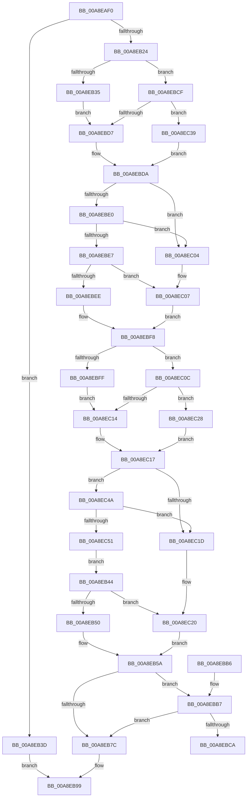

# RtlSelfRelativeToAbsoluteSD

- RVA: `0x00A8EAF0`–`0x00A8EC56` (길이 `358` bytes)
- VA: `0x0000000140A8EAF0`
- 실행 섹션: `PAGE`
- PDB 이름 있음: `예`; PDB Function 태그: `예`
- unwind 정보 RVA: `0x000B8ABC`
- 디코드: `104`개 명령, `358/358` bytes 표시
- 미해석 바이트: `0` (있으면 어셈블리에 `.byte`로 보존)

> 이 문서는 커널 이미지의 기계어와 PDB 기호를 분석해 생성했습니다. 4번과 5번은 함수 원형과 자료형을 바이너리 사용 방식에서 추정한 C 해석이며 원본 소스 복구 결과는 아닙니다.

## 1. Dependencies

- 직접 호출 지점: **0**; 고유 호출 대상: **0**
- 직접 호출자로 확인된 함수: **0**
- RIP 상대 이미지 참조: **0**

### Outgoing calls
- 직접 디코드된 call 명령이 없습니다.

### Direct callers
- 이 함수 시작 RVA로 연결되는 직접 call은 확인되지 않았습니다. 간접 호출은 완전히 역산할 수 없습니다.

### Static image references
- 디코드된 RIP-relative 메모리 참조가 없습니다.

## 2. Other-region calls and transfers

- 다른 실행 섹션으로 향하는 call: **0**
- call이 아닌 외부 분기/꼬리 이동: **1**
  - `0x00A8EBCA` → [sub_00B46642](../B4/Unknown_function_00B46642.md) (`tail-transfer`)

## 3. Assembly (complete function range)

```asm
00A8EAF0  48 8B C4                        mov rax, rsp
00A8EAF3  48 89 58 08                     mov qword ptr [rax + 8], rbx
00A8EAF7  48 89 68 10                     mov qword ptr [rax + 0x10], rbp
00A8EAFB  48 89 70 20                     mov qword ptr [rax + 0x20], rsi
00A8EAFF  4C 89 40 18                     mov qword ptr [rax + 0x18], r8
00A8EB03  57                              push rdi
00A8EB04  41 54                           push r12
00A8EB06  41 55                           push r13
00A8EB08  41 56                           push r14
00A8EB0A  41 57                           push r15
00A8EB0C  48 83 EC 20                     sub rsp, 0x20
00A8EB10  44 0F B7 51 02                  movzx r10d, word ptr [rcx + 2]
00A8EB15  45 33 DB                        xor r11d, r11d
00A8EB18  4D 8B E9                        mov r13, r9
00A8EB1B  4C 8B F2                        mov r14, rdx
00A8EB1E  66 45 85 D2                     test r10w, r10w
00A8EB22  79 19                           jns 0x140a8eb3d
00A8EB24  8B 41 04                        mov eax, dword ptr [rcx + 4]
00A8EB27  41 BF FC FF FF FF               mov r15d, 0xfffffffc
00A8EB2D  85 C0                           test eax, eax
00A8EB2F  0F 85 9A 00 00 00               jne 0x140a8ebcf
00A8EB35  41 8B DB                        mov ebx, r11d
00A8EB38  E9 9A 00 00 00                  jmp 0x140a8ebd7
00A8EB3D  B8 E7 00 00 C0                  mov eax, 0xc00000e7
00A8EB42  EB 55                           jmp 0x140a8eb99
00A8EB44  48 8B F0                        mov rsi, rax
00A8EB47  48 03 F1                        add rsi, rcx
00A8EB4A  0F 84 D0 00 00 00               je 0x140a8ec20
00A8EB50  0F B7 46 02                     movzx eax, word ptr [rsi + 2]
00A8EB54  83 C0 03                        add eax, 3
00A8EB57  41 23 C7                        and eax, r15d
00A8EB5A  4C 8B 94 24 A0 00 00 00         mov r10, qword ptr [rsp + 0xa0]
00A8EB62  4C 8B 9C 24 90 00 00 00         mov r11, qword ptr [rsp + 0x90]
00A8EB6A  4C 8B BC 24 80 00 00 00         mov r15, qword ptr [rsp + 0x80]
00A8EB72  4C 8B 64 24 70                  mov r12, qword ptr [rsp + 0x70]
00A8EB77  4D 85 F6                        test r14, r14
00A8EB7A  75 3B                           jne 0x140a8ebb7
00A8EB7C  48 8B 4C 24 60                  mov rcx, qword ptr [rsp + 0x60]
00A8EB81  C7 01 28 00 00 00               mov dword ptr [rcx], 0x28
00A8EB87  45 89 0A                        mov dword ptr [r10], r9d
00A8EB8A  45 89 03                        mov dword ptr [r11], r8d
00A8EB8D  41 89 07                        mov dword ptr [r15], eax
00A8EB90  B8 23 00 00 C0                  mov eax, 0xc0000023
00A8EB95  41 89 14 24                     mov dword ptr [r12], edx
00A8EB99  48 8B 5C 24 50                  mov rbx, qword ptr [rsp + 0x50]
00A8EB9E  48 8B 6C 24 58                  mov rbp, qword ptr [rsp + 0x58]
00A8EBA3  48 8B 74 24 68                  mov rsi, qword ptr [rsp + 0x68]
00A8EBA8  48 83 C4 20                     add rsp, 0x20
00A8EBAC  41 5F                           pop r15
00A8EBAE  41 5E                           pop r14
00A8EBB0  41 5D                           pop r13
00A8EBB2  41 5C                           pop r12
00A8EBB4  5F                              pop rdi
00A8EBB5  C3                              ret
00A8EBB6  CC                              int3
00A8EBB7  4C 8B 54 24 60                  mov r10, qword ptr [rsp + 0x60]
00A8EBBC  41 83 3A 28                     cmp dword ptr [r10], 0x28
00A8EBC0  4C 8B 94 24 A0 00 00 00         mov r10, qword ptr [rsp + 0xa0]
00A8EBC8  72 B2                           jb 0x140a8eb7c
00A8EBCA  E9 73 7A 0B 00                  jmp 0x140b46642
00A8EBCF  48 8B D8                        mov rbx, rax
00A8EBD2  48 03 D9                        add rbx, rcx
00A8EBD5  75 62                           jne 0x140a8ec39
00A8EBD7  45 8B C3                        mov r8d, r11d
00A8EBDA  41 F6 C2 04                     test r10b, 4
00A8EBDE  74 24                           je 0x140a8ec04
00A8EBE0  8B 41 10                        mov eax, dword ptr [rcx + 0x10]
00A8EBE3  85 C0                           test eax, eax
00A8EBE5  74 1D                           je 0x140a8ec04
00A8EBE7  8B F8                           mov edi, eax
00A8EBE9  48 03 F9                        add rdi, rcx
00A8EBEC  74 19                           je 0x140a8ec07
00A8EBEE  0F B7 57 02                     movzx edx, word ptr [rdi + 2]
00A8EBF2  83 C2 03                        add edx, 3
00A8EBF5  41 23 D7                        and edx, r15d
00A8EBF8  8B 41 08                        mov eax, dword ptr [rcx + 8]
00A8EBFB  85 C0                           test eax, eax
00A8EBFD  75 0D                           jne 0x140a8ec0c
00A8EBFF  49 8B EB                        mov rbp, r11
00A8EC02  EB 10                           jmp 0x140a8ec14
00A8EC04  49 8B FB                        mov rdi, r11
00A8EC07  41 8B D3                        mov edx, r11d
00A8EC0A  EB EC                           jmp 0x140a8ebf8
00A8EC0C  48 8B E8                        mov rbp, rax
00A8EC0F  48 03 E9                        add rbp, rcx
00A8EC12  75 14                           jne 0x140a8ec28
00A8EC14  45 8B CB                        mov r9d, r11d
00A8EC17  41 F6 C2 10                     test r10b, 0x10
00A8EC1B  75 2D                           jne 0x140a8ec4a
00A8EC1D  49 8B F3                        mov rsi, r11
00A8EC20  41 8B C3                        mov eax, r11d
00A8EC23  E9 32 FF FF FF                  jmp 0x140a8eb5a
00A8EC28  0F B6 45 01                     movzx eax, byte ptr [rbp + 1]
00A8EC2C  44 8D 0C 85 0B 00 00 00         lea r9d, [rax*4 + 0xb]
00A8EC34  45 23 CF                        and r9d, r15d
00A8EC37  EB DE                           jmp 0x140a8ec17
00A8EC39  0F B6 43 01                     movzx eax, byte ptr [rbx + 1]
00A8EC3D  44 8D 04 85 0B 00 00 00         lea r8d, [rax*4 + 0xb]
00A8EC45  45 23 C7                        and r8d, r15d
00A8EC48  EB 90                           jmp 0x140a8ebda
00A8EC4A  8B 41 0C                        mov eax, dword ptr [rcx + 0xc]
00A8EC4D  85 C0                           test eax, eax
00A8EC4F  74 CC                           je 0x140a8ec1d
00A8EC51  E9 EE FE FF FF                  jmp 0x140a8eb44
```

## 4. C-style interpretation (structured pseudocode)

```c
__int64 __fastcall RtlSelfRelativeToAbsoluteSD(__int64 a1, __int64 a2, __int64 a3, __int64 a4, __int64 a5, __int64 a6, __int64 a7, __int64 a8, __int64 a9, __int64 a10, __int64 a11)
{
    __int64 result;
    __int64 v_r11;
    __int64 v_rbp;
    __int64 v_rbx;
    __int64 v_rdi;
    __int64 v_rsi;
    __int64 v_rsp;
    unsigned __int64 v_stack_p10;
    unsigned __int64 v_stack_p18;
    unsigned __int64 v_stack_p20;
    unsigned __int64 v_stack_p60;
    unsigned __int64 v_stack_p8;

    *(unsigned __int64 *)(v_rsp + 8) = v_rbx;
    *(unsigned __int64 *)(v_rsp + 16) = v_rbp;
    *(unsigned __int64 *)(v_rsp + 32) = v_rsi;
    *(unsigned __int64 *)(v_rsp + 24) = a3;
    v_rsp = (v_rsp) - (32);
    v_r11 = 0;
    if (!sign_flag) goto loc_00A8EB3D;
    if ((unsigned int)((unsigned int)(*(unsigned int *)(a1 + 4))) != 0) goto loc_00A8EBCF;
    goto loc_00A8EBD7;
loc_00A8EB3D:
    goto loc_00A8EB99;
loc_00A8EB44:
    v_rsi = ((unsigned int)(0xC00000E7ULL)) + (a1);
    if (condition_is_equal) goto loc_00A8EC20;
    result = (unsigned int)((*(unsigned __int16 *)(v_rsi + 2)) + (3));
    result = (unsigned int)((result) & ((unsigned int)((unsigned int)(0xFFFFFFFCULL))));
loc_00A8EB5A:
    if (a2 != 0) goto loc_00A8EBB7;
loc_00A8EB7C:
    *(unsigned int *)(v_stack_p18) = 40;
    *(unsigned int *)(a11) = (unsigned int)(a4);
    *(unsigned int *)(a9) = (unsigned int)(a3);
    *(unsigned int *)(a7) = (unsigned int)(result);
    *(unsigned int *)(a5) = (unsigned int)(a2);
loc_00A8EB99:
    v_rsp = (v_rsp) + (32);
    return (unsigned int)(0xC0000023ULL);
loc_00A8EBB7:
    if ((*(unsigned int *)(v_stack_p60)) < 40) goto loc_00A8EB7C;
loc_00A8EBCF:
    v_rbx = ((unsigned int)(0xC0000023ULL)) + (v_stack_p18);
    if (condition_is_not_equal) goto loc_00A8EC39;
loc_00A8EBD7:
loc_00A8EBDA:
    if ((((unsigned __int8)(a11)) & (4)) == 0) goto loc_00A8EC04;
    if ((unsigned int)((unsigned int)(*(unsigned int *)(v_stack_p18 + 16))) == 0) goto loc_00A8EC04;
    v_rdi = ((unsigned int)((unsigned int)((unsigned int)(*(unsigned int *)(v_stack_p18 + 16))))) + (v_stack_p18);
    if (condition_is_equal) goto loc_00A8EC07;
    a2 = (unsigned int)((*(unsigned __int16 *)(v_rdi + 2)) + (3));
    a2 = (unsigned int)((a2) & ((unsigned int)(a7)));
loc_00A8EBF8:
    if ((unsigned int)((unsigned int)(*(unsigned int *)(v_stack_p18 + 8))) != 0) goto loc_00A8EC0C;
    goto loc_00A8EC14;
loc_00A8EC04:
loc_00A8EC07:
    goto loc_00A8EBF8;
loc_00A8EC0C:
    v_rbp = ((unsigned int)(*(unsigned int *)(v_stack_p18 + 8))) + (v_stack_p18);
    if (condition_is_not_equal) goto loc_00A8EC28;
loc_00A8EC14:
loc_00A8EC17:
    if ((((unsigned __int8)(a11)) & (16)) != 0) goto loc_00A8EC4A;
loc_00A8EC1D:
loc_00A8EC20:
    goto loc_00A8EB5A;
loc_00A8EC28:
    a4 = (unsigned int)((*(unsigned __int8 *)(v_rbp + 1) * 4 + 11) & ((unsigned int)(a7)));
    goto loc_00A8EC17;
loc_00A8EC39:
    a3 = (unsigned int)((*(unsigned __int8 *)(v_rbx + 1) * 4 + 11) & ((unsigned int)(a7)));
    goto loc_00A8EBDA;
loc_00A8EC4A:
    if ((unsigned int)((unsigned int)(*(unsigned int *)(v_stack_p18 + 12))) == 0) goto loc_00A8EC1D;
    goto loc_00A8EB44;
}
```

## 5. (Beta) C Style

```c
int64_t RtlSelfRelativeToAbsoluteSD(void *Arg1, int64_t Arg2, int64_t Arg3, int64_t Arg4, void *Arg5, uint64_t Arg6, void *Arg7, uint64_t Arg8, void *Arg9, uint64_t Arg10, void *Arg11)
{
    uint8_t *arg1 = (uint8_t *)Arg1;
    uint8_t *arg5 = (uint8_t *)Arg5;
    uint8_t *arg7 = (uint8_t *)Arg7;
    uint8_t *arg9 = (uint8_t *)Arg9;
    uint8_t *arg11 = (uint8_t *)Arg11;

    int64_t result;
    int64_t local_r11;
    int64_t local_rbp;
    int64_t local_rbx;
    int64_t local_rdi;
    int64_t local_rsi;
    int64_t local_rsp;
    uint64_t v_stack_p10;
    uint64_t v_stack_p18;
    uint64_t v_stack_p20;
    uint64_t v_stack_p60;
    uint64_t v_stack_p8;

    *(uint64_t *)(local_rsp + 0x8) = local_rbx;
    *(uint64_t *)(local_rsp + 0x10) = local_rbp;
    *(uint64_t *)(local_rsp + 0x20) = local_rsi;
    *(uint64_t *)(local_rsp + 0x18) = Arg3;
    local_rsp = (local_rsp) - (32);
    local_r11 = 0;
    if (!sign_flag) goto loc_00A8EB3D;
    if ((uint32_t)((uint32_t)(*(uint32_t *)(arg1 + 0x4))) != 0) goto loc_00A8EBCF;
    goto loc_00A8EBD7;
loc_00A8EB3D:
    goto loc_00A8EB99;
loc_00A8EB44:
    local_rsi = ((uint32_t)(0xC00000E7ULL)) + (Arg1);
    if (condition_is_equal) goto loc_00A8EC20;
    result = (uint32_t)((*(uint16_t *)(local_rsi + 0x2)) + (3));
    result = (uint32_t)((result) & ((uint32_t)((uint32_t)(0xFFFFFFFCULL))));
loc_00A8EB5A:
    if (Arg2 != 0) goto loc_00A8EBB7;
loc_00A8EB7C:
    *(uint32_t *)(v_stack_p18) = 40;
    *(uint32_t *)(arg11) = (uint32_t)(Arg4);
    *(uint32_t *)(arg9) = (uint32_t)(Arg3);
    *(uint32_t *)(arg7) = (uint32_t)(result);
    *(uint32_t *)(arg5) = (uint32_t)(Arg2);
loc_00A8EB99:
    local_rsp = (local_rsp) + (32);
    return (uint32_t)(0xC0000023ULL);
loc_00A8EBB7:
    if ((*(uint32_t *)(v_stack_p60)) < 40) goto loc_00A8EB7C;
loc_00A8EBCF:
    local_rbx = ((uint32_t)(0xC0000023ULL)) + (v_stack_p18);
    if (condition_is_not_equal) goto loc_00A8EC39;
loc_00A8EBD7:
loc_00A8EBDA:
    if ((((uint8_t)(Arg11)) & (4)) == 0) goto loc_00A8EC04;
    if ((uint32_t)((uint32_t)(*(uint32_t *)(v_stack_p18 + 0x10))) == 0) goto loc_00A8EC04;
    local_rdi = ((uint32_t)((uint32_t)((uint32_t)(*(uint32_t *)(v_stack_p18 + 0x10))))) + (v_stack_p18);
    if (condition_is_equal) goto loc_00A8EC07;
    Arg2 = (uint32_t)((*(uint16_t *)(local_rdi + 0x2)) + (3));
    Arg2 = (uint32_t)((Arg2) & ((uint32_t)(Arg7)));
loc_00A8EBF8:
    if ((uint32_t)((uint32_t)(*(uint32_t *)(v_stack_p18 + 0x8))) != 0) goto loc_00A8EC0C;
    goto loc_00A8EC14;
loc_00A8EC04:
loc_00A8EC07:
    goto loc_00A8EBF8;
loc_00A8EC0C:
    local_rbp = ((uint32_t)(*(uint32_t *)(v_stack_p18 + 0x8))) + (v_stack_p18);
    if (condition_is_not_equal) goto loc_00A8EC28;
loc_00A8EC14:
loc_00A8EC17:
    if ((((uint8_t)(Arg11)) & (16)) != 0) goto loc_00A8EC4A;
loc_00A8EC1D:
loc_00A8EC20:
    goto loc_00A8EB5A;
loc_00A8EC28:
    Arg4 = (uint32_t)((*(uint8_t *)(local_rbp + 0x1) * 4 + 11) & ((uint32_t)(Arg7)));
    goto loc_00A8EC17;
loc_00A8EC39:
    Arg3 = (uint32_t)((*(uint8_t *)(local_rbx + 0x1) * 4 + 11) & ((uint32_t)(Arg7)));
    goto loc_00A8EBDA;
loc_00A8EC4A:
    if ((uint32_t)((uint32_t)(*(uint32_t *)(v_stack_p18 + 0xC))) == 0) goto loc_00A8EC1D;
    goto loc_00A8EB44;
}
```

### 관측된 메모리 오프셋

구조체 형식이 확인되지 않은 접근은 인자 기준의 오프셋으로만 기록했습니다.

| 기준 인자 | 오프셋 표현 | 폭 (bit) | 접근 |
|---|---:|---:|---|
| `Arg1` | `+ 0x2` | `16` | `R` |
| `Arg1` | `+ 0x4` | `32` | `R` |
| `Arg1` | `+ 0x8` | `32` | `R` |
| `Arg1` | `+ 0xC` | `32` | `R` |
| `Arg1` | `+ 0x10` | `32` | `R` |
| `Arg5` | `+ 0x0` | `32` | `W` |
| `Arg7` | `+ 0x0` | `32` | `W` |
| `Arg9` | `+ 0x0` | `32` | `W` |
| `Arg11` | `+ 0x0` | `32` | `W` |

## 6. Execution-region graph

[열기: 2D/3D 그래프와 함수 탐색 컨트롤 패널](../../../control-panel.html?section=page&rva=0x00A8EAF0&view=graph)

- 2D 그래프는 위에서 아래로 흐르고, 3D 그래프는 빈 공간을 드래그해 회전합니다. Shift+드래그는 이동, 휠은 확대·축소, 함수 노드 선택은 대상 보고서 이동입니다.

### Static fallback


