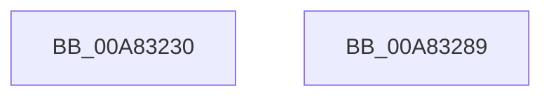

# RtlSetSystemBootStatus

- RVA: `0x00A83230`–`0x00A8328A` (길이 `90` bytes)
- VA: `0x0000000140A83230`
- 실행 섹션: `PAGE`
- PDB 이름 있음: `예`; PDB Function 태그: `아니요`
- unwind 정보 RVA: `0x0008A308`
- 디코드: `25`개 명령, `90/90` bytes 표시
- 미해석 바이트: `0` (있으면 어셈블리에 `.byte`로 보존)

> 이 문서는 커널 이미지의 기계어와 PDB 기호를 분석해 생성했습니다. 4번과 5번은 함수 원형과 자료형을 바이너리 사용 방식에서 추정한 C 해석이며 원본 소스 복구 결과는 아닙니다.

## 1. Dependencies

- 직접 호출 지점: **1**; 고유 호출 대상: **1**
- 직접 호출자로 확인된 함수: **3**
- RIP 상대 이미지 참조: **0**

### Outgoing calls
- `0x00A8327E` → [ZwPowerInformation](../../text/6A/ZwPowerInformation_function_006ADCB0.md) (function, `0x006ADCB0`)

### Direct callers
- [PopWriteBsdPoInfo](../../text/43/PopWriteBsdPoInfo_function_00430768.md) at `0x00430817`
- [PopRecordLongPowerButtonPressDetected](../75/PopRecordLongPowerButtonPressDetected_function_007543BC.md) at `0x0075442C`
- [PopRecordLongPowerButtonPressDetected](../75/PopRecordLongPowerButtonPressDetected_function_007543BC.md) at `0x00754443`
- [PopCheckAndClearBootError](../../init/C3/PopCheckAndClearBootError_function_00C3DA4C.md) at `0x00C3DAB3`

### Static image references
- 디코드된 RIP-relative 메모리 참조가 없습니다.

## 2. Other-region calls and transfers

- 다른 실행 섹션으로 향하는 call: **1**
  - `0x00A8327E` → [ZwPowerInformation](../../text/6A/ZwPowerInformation_function_006ADCB0.md) (`PAGE` → `.text`)
- 별도 외부 분기/꼬리 이동을 확인하지 못했습니다.

## 3. Assembly (complete function range)

```asm
00A83230  40 55                           push rbp
00A83232  48 8B EC                        mov rbp, rsp
00A83235  48 83 EC 60                     sub rsp, 0x60
00A83239  45 33 D2                        xor r10d, r10d
00A8323C  89 4D D0                        mov dword ptr [rbp - 0x30], ecx
00A8323F  49 8B C1                        mov rax, r9
00A83242  48 89 55 D8                     mov qword ptr [rbp - 0x28], rdx
00A83246  48 F7 D8                        neg rax
00A83249  44 89 45 E0                     mov dword ptr [rbp - 0x20], r8d
00A8324D  48 8D 45 D0                     lea rax, [rbp - 0x30]
00A83251  44 89 55 D4                     mov dword ptr [rbp - 0x2c], r10d
00A83255  1B C9                           sbb ecx, ecx
00A83257  48 C7 45 E8 20 00 00 00         mov qword ptr [rbp - 0x18], 0x20
00A8325F  83 E1 04                        and ecx, 4
00A83262  48 C7 45 F0 01 00 00 00         mov qword ptr [rbp - 0x10], 1
00A8326A  89 4C 24 20                     mov dword ptr [rsp + 0x20], ecx
00A8326E  45 8D 42 18                     lea r8d, [r10 + 0x18]
00A83272  41 8D 4A 57                     lea ecx, [r10 + 0x57]
00A83276  48 89 45 F8                     mov qword ptr [rbp - 8], rax
00A8327A  48 8D 55 E8                     lea rdx, [rbp - 0x18]
00A8327E  E8 2D AA C2 FF                  call 0x1406adcb0
00A83283  48 83 C4 60                     add rsp, 0x60
00A83287  5D                              pop rbp
00A83288  C3                              ret
00A83289  CC                              int3
```

## 4. C-style interpretation (structured pseudocode)

```c
__int64 __fastcall RtlSetSystemBootStatus(int a1, __int64 a2, int a3, __int64 a4)
{
    __int64 result;
    __int64 v_r10;
    __int64 v_rsp;
    unsigned __int64 v_stack_m10;
    unsigned __int64 v_stack_m18;
    unsigned __int64 v_stack_m20;
    unsigned int v_stack_m28;
    unsigned __int64 v_stack_m30;
    unsigned int v_stack_m34;
    unsigned int v_stack_m38;
    unsigned int v_stack_m48;

    v_rsp = (v_rsp) - (96);
    v_r10 = 0;
    v_stack_m38 = a1;
    v_stack_m30 = a2;
    result = -(a4);
    v_stack_m28 = a3;
    v_stack_m34 = 0;
    v_stack_m20 = 32;
    a1 = (unsigned int)((a1) & (4));
    v_stack_m18 = 1;
    v_stack_m48 = a1;
    v_stack_m10 = v_stack_m38;
    result = ZwPowerInformation(v_r10 + 87, v_stack_m20, v_r10 + 24, a4);
    v_rsp = (v_rsp) + (96);
    return result;
}
```

## 5. (Beta) C Style

```c
int64_t RtlSetSystemBootStatus(int32_t Arg1, int64_t Arg2, int32_t Arg3, int64_t Arg4)
{
    int64_t result;
    int64_t local_r10;
    int64_t local_rsp;
    uint64_t v_stack_m10;
    uint64_t v_stack_m18;
    uint64_t v_stack_m20;
    uint32_t v_stack_m28;
    uint64_t v_stack_m30;
    uint32_t v_stack_m34;
    uint32_t v_stack_m38;
    uint32_t v_stack_m48;

    local_rsp = (local_rsp) - (96);
    local_r10 = 0;
    v_stack_m38 = Arg1;
    v_stack_m30 = Arg2;
    result = -(Arg4);
    v_stack_m28 = Arg3;
    v_stack_m34 = 0;
    v_stack_m20 = 32;
    Arg1 = (uint32_t)((Arg1) & (4));
    v_stack_m18 = 1;
    v_stack_m48 = Arg1;
    v_stack_m10 = v_stack_m38;
    result = ZwPowerInformation(local_r10 + 87, v_stack_m20, local_r10 + 24, Arg4);
    local_rsp = (local_rsp) + (96);
    return result;
}
```

## 6. Execution-region graph

[열기: 2D/3D 그래프와 함수 탐색 컨트롤 패널](../../../control-panel.html?section=page&rva=0x00A83230&view=graph)

- 2D 그래프는 위에서 아래로 흐르고, 3D 그래프는 빈 공간을 드래그해 회전합니다. Shift+드래그는 이동, 휠은 확대·축소, 함수 노드 선택은 대상 보고서 이동입니다.

### Static fallback


