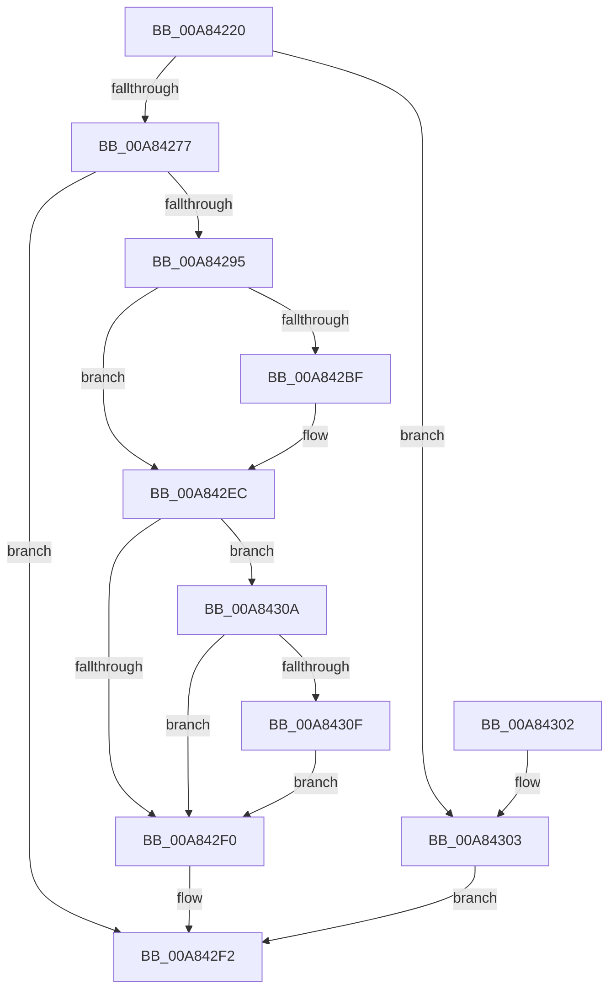

# RtlUpcaseUnicodeStringToOemString

- RVA: `0x00A84220`–`0x00A84321` (길이 `257` bytes)
- VA: `0x0000000140A84220`
- 실행 섹션: `PAGE`
- PDB 이름 있음: `예`; PDB Function 태그: `아니요`
- unwind 정보 RVA: `0x000B75E0`
- 디코드: `79`개 명령, `257/257` bytes 표시
- 미해석 바이트: `0` (있으면 어셈블리에 `.byte`로 보존)

> 이 문서는 커널 이미지의 기계어와 PDB 기호를 분석해 생성했습니다. 4번과 5번은 함수 원형과 자료형을 바이너리 사용 방식에서 추정한 C 해석이며 원본 소스 복구 결과는 아닙니다.

## 1. Dependencies

- 직접 호출 지점: **5**; 고유 호출 대상: **5**
- 직접 호출자로 확인된 함수: **1**
- RIP 상대 이미지 참조: **0**

### Outgoing calls
- `0x00A84256` → [RtlUnicodeToMultiByteSize](../90/RtlUnicodeToMultiByteSize_function_0090D110.md) (function, `0x0090D110`)
- `0x00A84288` → [AllocateOrValidateCharStringBuffer](../../text/44/AllocateOrValidateCharStringBuffer_function_00447F60.md) (function, `0x00447F60`)
- `0x00A842B0` → [RtlUpcaseUnicodeToOemN](../90/RtlUpcaseUnicodeToOemN_function_0090CC70.md) (function, `0x0090CC70`)
- `0x00A842D9` → [RtlpDidUnicodeToOemWork](../90/RtlpDidUnicodeToOemWork_function_0090CD30.md) (function, `0x0090CD30`)
- `0x00A84312` → [ExFreePool](../../poolcode/B8/ExFreePool_function_00B82850.md) (function, `0x00B82850`)

### Direct callers
- [DifRtlUpcaseUnicodeStringToOemStringWrapper](../../text/63/DifRtlUpcaseUnicodeStringToOemStringWrapper_function_0063CD50.md) at `0x0063CE35`

### Static image references
- 디코드된 RIP-relative 메모리 참조가 없습니다.

## 2. Other-region calls and transfers

- 다른 실행 섹션으로 향하는 call: **2**
  - `0x00A84288` → [AllocateOrValidateCharStringBuffer](../../text/44/AllocateOrValidateCharStringBuffer_function_00447F60.md) (`PAGE` → `.text`)
  - `0x00A84312` → [ExFreePool](../../poolcode/B8/ExFreePool_function_00B82850.md) (`PAGE` → `POOLCODE`)
- 별도 외부 분기/꼬리 이동을 확인하지 못했습니다.

## 3. Assembly (complete function range)

```asm
00A84220  48 8B C4                        mov rax, rsp
00A84223  44 88 40 18                     mov byte ptr [rax + 0x18], r8b
00A84227  48 89 48 08                     mov qword ptr [rax + 8], rcx
00A8422B  53                              push rbx
00A8422C  56                              push rsi
00A8422D  57                              push rdi
00A8422E  41 54                           push r12
00A84230  41 55                           push r13
00A84232  41 56                           push r14
00A84234  41 57                           push r15
00A84236  48 83 EC 40                     sub rsp, 0x40
00A8423A  45 8A F8                        mov r15b, r8b
00A8423D  48 8B F2                        mov rsi, rdx
00A84240  4C 8B F1                        mov r14, rcx
00A84243  45 33 ED                        xor r13d, r13d
00A84246  44 89 68 10                     mov dword ptr [rax + 0x10], r13d
00A8424A  44 0F B7 02                     movzx r8d, word ptr [rdx]
00A8424E  48 8B 52 08                     mov rdx, qword ptr [rdx + 8]
00A84252  48 8D 48 10                     lea rcx, [rax + 0x10]
00A84256  E8 B5 8E E8 FF                  call 0x14090d110
00A8425B  8B 94 24 88 00 00 00            mov edx, dword ptr [rsp + 0x88]
00A84262  FF C2                           inc edx
00A84264  89 94 24 88 00 00 00            mov dword ptr [rsp + 0x88], edx
00A8426B  81 FA FF FF 00 00               cmp edx, 0xffff
00A84271  0F 87 8C 00 00 00               ja 0x140a84303
00A84277  4D 8D 66 02                     lea r12, [r14 + 2]
00A8427B  49 8D 7E 08                     lea rdi, [r14 + 8]
00A8427F  4D 8B CC                        mov r9, r12
00A84282  4C 8B C7                        mov r8, rdi
00A84285  41 8A CF                        mov cl, r15b
00A84288  E8 D3 3C 9C FF                  call 0x140447f60
00A8428D  89 44 24 30                     mov dword ptr [rsp + 0x30], eax
00A84291  85 C0                           test eax, eax
00A84293  78 5D                           js 0x140a842f2
00A84295  0F B7 06                        movzx eax, word ptr [rsi]
00A84298  41 0F B7 14 24                  movzx edx, word ptr [r12]
00A8429D  89 44 24 20                     mov dword ptr [rsp + 0x20], eax
00A842A1  4C 8B 4E 08                     mov r9, qword ptr [rsi + 8]
00A842A5  4C 8D 84 24 88 00 00 00         lea r8, [rsp + 0x88]
00A842AD  48 8B 0F                        mov rcx, qword ptr [rdi]
00A842B0  E8 BB 89 E8 FF                  call 0x14090cc70
00A842B5  8B D8                           mov ebx, eax
00A842B7  89 44 24 30                     mov dword ptr [rsp + 0x30], eax
00A842BB  85 C0                           test eax, eax
00A842BD  78 2D                           js 0x140a842ec
00A842BF  8B 8C 24 88 00 00 00            mov ecx, dword ptr [rsp + 0x88]
00A842C6  66 41 89 0E                     mov word ptr [r14], cx
00A842CA  8B D1                           mov edx, ecx
00A842CC  48 8B 0F                        mov rcx, qword ptr [rdi]
00A842CF  44 88 2C 0A                     mov byte ptr [rdx + rcx], r13b
00A842D3  48 8B D6                        mov rdx, rsi
00A842D6  49 8B CE                        mov rcx, r14
00A842D9  E8 52 8A E8 FF                  call 0x14090cd30
00A842DE  B9 62 01 00 C0                  mov ecx, 0xc0000162
00A842E3  84 C0                           test al, al
00A842E5  0F 44 D9                        cmove ebx, ecx
00A842E8  89 5C 24 30                     mov dword ptr [rsp + 0x30], ebx
00A842EC  85 DB                           test ebx, ebx
00A842EE  78 1A                           js 0x140a8430a
00A842F0  8B C3                           mov eax, ebx
00A842F2  48 83 C4 40                     add rsp, 0x40
00A842F6  41 5F                           pop r15
00A842F8  41 5E                           pop r14
00A842FA  41 5D                           pop r13
00A842FC  41 5C                           pop r12
00A842FE  5F                              pop rdi
00A842FF  5E                              pop rsi
00A84300  5B                              pop rbx
00A84301  C3                              ret
00A84302  CC                              int3
00A84303  B8 F0 00 00 C0                  mov eax, 0xc00000f0
00A84308  EB E8                           jmp 0x140a842f2
00A8430A  45 84 FF                        test r15b, r15b
00A8430D  74 E1                           je 0x140a842f0
00A8430F  48 8B 0F                        mov rcx, qword ptr [rdi]
00A84312  E8 39 E5 0F 00                  call 0x140b82850
00A84317  4C 89 2F                        mov qword ptr [rdi], r13
00A8431A  66 45 89 2C 24                  mov word ptr [r12], r13w
00A8431F  EB CF                           jmp 0x140a842f0
```

## 4. C-style interpretation (structured pseudocode)

```c
__int64 __fastcall RtlUpcaseUnicodeStringToOemString(__int64 a1, __int64 a2, unsigned __int8 a3)
{
    __int64 result;
    __int64 v_r13;
    __int64 v_rbx;
    __int64 v_rsp;
    unsigned int v_stack_m48;
    unsigned int v_stack_m58;
    unsigned int v_stack_p10;

    *(unsigned __int8 *)(v_rsp + 24) = a3;
    *(unsigned __int64 *)(v_rsp + 8) = a1;
    v_rsp = (v_rsp) - (64);
    v_r13 = 0;
    *(unsigned int *)(v_rsp + 16) = 0;
    result = RtlUnicodeToMultiByteSize(v_rsp + 16, *(unsigned __int64 *)(a2 + 8), *(unsigned __int16 *)(a2), a4);
    a2 = (unsigned int)(((unsigned int)(v_stack_p10)) + 1);
    v_stack_p10 = (unsigned int)(a2);
    if (((unsigned int)(a2)) > 0xFFFFULL) goto loc_00A84303;
    result = AllocateOrValidateCharStringBuffer(a3, a2, a1 + 8, a1 + 2);
    v_stack_m48 = (unsigned int)(result);
    if (sign_flag) goto loc_00A842F2;
    v_stack_m58 = (unsigned int)(*(unsigned __int16 *)(a2));
    result = RtlUpcaseUnicodeToOemN(*(unsigned __int64 *)(a1 + 8), *(unsigned __int16 *)(a1 + 2), v_stack_p10, *(unsigned __int64 *)(a2 + 8));
    v_stack_m48 = (unsigned int)(result);
    v_rbx = (unsigned int)((unsigned int)(result));
    if (!(sign_flag)) {
        a1 = v_stack_p10;
        *(unsigned __int16 *)(a1) = (unsigned __int16)(a1);
        a2 = (unsigned int)(a1);
        a1 = *(unsigned __int64 *)(a1 + 8);
        *(unsigned __int8 *)(a2 + a1 * 1) = 0;
        a2 = a2;
        a1 = a1;
        result = RtlpDidUnicodeToOemWork(a1, a2, v_stack_p10, *(unsigned __int64 *)(a2 + 8));
        a1 = 0xC0000162ULL;
        v_rbx = (unsigned int)((unsigned int)(result));
        if ((unsigned __int8)(result) == 0) { v_rbx = (unsigned int)(a1); }
        v_stack_m48 = (unsigned int)(v_rbx);
    }
    if (sign_flag) goto loc_00A8430A;
loc_00A842F0:
loc_00A842F2:
    v_rsp = (v_rsp) + (64);
    return (unsigned int)((unsigned int)(v_rbx));
loc_00A84303:
    goto loc_00A842F2;
loc_00A8430A:
    if (a3 == 0) goto loc_00A842F0;
    result = ExFreePool(*(unsigned __int64 *)(a1 + 8), a2, v_stack_p10, *(unsigned __int64 *)(a2 + 8));
    *(unsigned __int64 *)(a1 + 8) = 0;
    *(unsigned __int16 *)(a1 + 2) = 0;
    goto loc_00A842F0;
}
```

## 5. (Beta) C Style

```c
int64_t RtlUpcaseUnicodeStringToOemString(void *Arg1, void *Arg2, uint8_t Arg3)
{
    uint8_t *arg1 = (uint8_t *)Arg1;
    uint8_t *arg2 = (uint8_t *)Arg2;

    int64_t result;
    int64_t local_r13;
    int64_t local_rbx;
    int64_t local_rsp;
    uint32_t v_stack_m48;
    uint32_t v_stack_m58;
    uint32_t v_stack_p10;

    *(uint8_t *)(local_rsp + 0x18) = Arg3;
    *(void **)(local_rsp + 0x8) = Arg1;
    local_rsp = (local_rsp) - (64);
    local_r13 = 0;
    *(uint32_t *)(local_rsp + 0x10) = 0;
    result = RtlUnicodeToMultiByteSize(local_rsp + 16, *(uint64_t *)(arg2 + 0x8), *(uint16_t *)(arg2), a4);
    Arg2 = (uint32_t)(((uint32_t)(v_stack_p10)) + 1);
    v_stack_p10 = (uint32_t)(Arg2);
    if (((uint32_t)(Arg2)) > 0xFFFFULL) goto loc_00A84303;
    result = AllocateOrValidateCharStringBuffer(Arg3, Arg2, Arg1 + 8, Arg1 + 2);
    v_stack_m48 = (uint32_t)(result);
    if (sign_flag) goto loc_00A842F2;
    v_stack_m58 = (uint32_t)(*(uint16_t *)(arg2));
    result = RtlUpcaseUnicodeToOemN(*(uint64_t *)(arg1 + 0x8), *(uint16_t *)(arg1 + 0x2), v_stack_p10, *(uint64_t *)(arg2 + 0x8));
    v_stack_m48 = (uint32_t)(result);
    local_rbx = (uint32_t)((uint32_t)(result));
    if (!(sign_flag)) {
        Arg1 = v_stack_p10;
        *(uint16_t *)(arg1) = (uint16_t)(Arg1);
        Arg2 = (uint32_t)(Arg1);
        Arg1 = *(uint64_t *)(arg1 + 0x8);
        *(uint8_t *)(arg2 + arg1 * 1) = 0;
        Arg2 = Arg2;
        Arg1 = Arg1;
        result = RtlpDidUnicodeToOemWork(Arg1, Arg2, v_stack_p10, *(uint64_t *)(arg2 + 0x8));
        Arg1 = 0xC0000162ULL;
        local_rbx = (uint32_t)((uint32_t)(result));
        if ((uint8_t)(result) == 0) { local_rbx = (uint32_t)(Arg1); }
        v_stack_m48 = (uint32_t)(local_rbx);
    }
    if (sign_flag) goto loc_00A8430A;
loc_00A842F0:
loc_00A842F2:
    local_rsp = (local_rsp) + (64);
    return (uint32_t)((uint32_t)(local_rbx));
loc_00A84303:
    goto loc_00A842F2;
loc_00A8430A:
    if (Arg3 == 0) goto loc_00A842F0;
    result = ExFreePool(*(uint64_t *)(arg1 + 0x8), Arg2, v_stack_p10, *(uint64_t *)(arg2 + 0x8));
    *(uint64_t *)(arg1 + 0x8) = 0;
    *(uint16_t *)(arg1 + 0x2) = 0;
    goto loc_00A842F0;
}
```

### 관측된 메모리 오프셋

구조체 형식이 확인되지 않은 접근은 인자 기준의 오프셋으로만 기록했습니다.

| 기준 인자 | 오프셋 표현 | 폭 (bit) | 접근 |
|---|---:|---:|---|
| `Arg1` | `+ 0x0` | `16` | `R` |
| `Arg1` | `+ 0x0` | `16` | `W` |
| `Arg1` | `+ 0x0` | `64` | `R` |
| `Arg1` | `+ 0x0` | `64` | `W` |
| `Arg1` | `+ 0x2` | `64` | `R` |
| `Arg1` | `+ 0x8` | `64` | `R` |
| `Arg2` | `+ 0x0` | `16` | `R` |
| `Arg2` | `+ 0x8` | `64` | `R` |

## 6. Execution-region graph

[열기: 2D/3D 그래프와 함수 탐색 컨트롤 패널](../../../control-panel.html?section=page&rva=0x00A84220&view=graph)

- 2D 그래프는 위에서 아래로 흐르고, 3D 그래프는 빈 공간을 드래그해 회전합니다. Shift+드래그는 이동, 휠은 확대·축소, 함수 노드 선택은 대상 보고서 이동입니다.

### Static fallback


