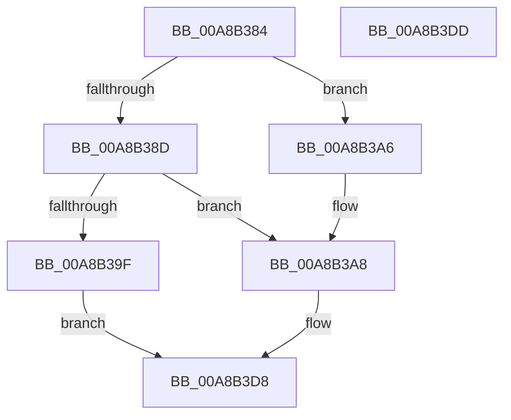

# RtlpSystemBootStatusRequest

- RVA: `0x00A8B384`–`0x00A8B3DE` (길이 `90` bytes)
- VA: `0x0000000140A8B384`
- 실행 섹션: `PAGE`
- PDB 이름 있음: `예`; PDB Function 태그: `아니요`
- unwind 정보 RVA: `0x0006C2A4`
- 디코드: `24`개 명령, `90/90` bytes 표시
- 미해석 바이트: `0` (있으면 어셈블리에 `.byte`로 보존)

> 이 문서는 커널 이미지의 기계어와 PDB 기호를 분석해 생성했습니다. 4번과 5번은 함수 원형과 자료형을 바이너리 사용 방식에서 추정한 C 해석이며 원본 소스 복구 결과는 아닙니다.

## 1. Dependencies

- 직접 호출 지점: **1**; 고유 호출 대상: **1**
- 직접 호출자로 확인된 함수: **4**
- RIP 상대 이미지 참조: **0**

### Outgoing calls
- `0x00A8B3D3` → [ZwPowerInformation](../../text/6A/ZwPowerInformation_function_006ADCB0.md) (function, `0x006ADCB0`)

### Direct callers
- [PoClearTransitionMarker](../75/PoClearTransitionMarker_function_00753C88.md) at `0x00753DEB`
- [RtlGetSystemBootStatus](../79/RtlGetSystemBootStatus_function_00790630.md) at `0x00790658`
- [RtlGetSystemBootStatusEx](../79/RtlGetSystemBootStatusEx_function_00790670.md) at `0x00790682`
- [RtlSetSystemBootStatusEx](RtlSetSystemBootStatusEx_function_00A8B360.md) at `0x00A8B372`

### Static image references
- 디코드된 RIP-relative 메모리 참조가 없습니다.

## 2. Other-region calls and transfers

- 다른 실행 섹션으로 향하는 call: **1**
  - `0x00A8B3D3` → [ZwPowerInformation](../../text/6A/ZwPowerInformation_function_006ADCB0.md) (`PAGE` → `.text`)
- 별도 외부 분기/꼬리 이동을 확인하지 못했습니다.

## 3. Assembly (complete function range)

```asm
00A8B384  48 83 EC 58                     sub rsp, 0x58
00A8B388  4D 85 C9                        test r9, r9
00A8B38B  74 19                           je 0x140a8b3a6
00A8B38D  41 8B C0                        mov eax, r8d
00A8B390  41 BA FF FF FF FF               mov r10d, 0xffffffff
00A8B396  48 C1 E0 02                     shl rax, 2
00A8B39A  49 3B C2                        cmp rax, r10
00A8B39D  76 09                           jbe 0x140a8b3a8
00A8B39F  B8 95 00 00 C0                  mov eax, 0xc0000095
00A8B3A4  EB 32                           jmp 0x140a8b3d8
00A8B3A6  33 C0                           xor eax, eax
00A8B3A8  83 64 24 34 00                  and dword ptr [rsp + 0x34], 0
00A8B3AD  83 64 24 3C 00                  and dword ptr [rsp + 0x3c], 0
00A8B3B2  44 89 44 24 38                  mov dword ptr [rsp + 0x38], r8d
00A8B3B7  41 B8 18 00 00 00               mov r8d, 0x18
00A8B3BD  89 4C 24 30                     mov dword ptr [rsp + 0x30], ecx
00A8B3C1  48 89 54 24 40                  mov qword ptr [rsp + 0x40], rdx
00A8B3C6  48 8D 54 24 30                  lea rdx, [rsp + 0x30]
00A8B3CB  89 44 24 20                     mov dword ptr [rsp + 0x20], eax
00A8B3CF  41 8D 48 3F                     lea ecx, [r8 + 0x3f]
00A8B3D3  E8 D8 28 C2 FF                  call 0x1406adcb0
00A8B3D8  48 83 C4 58                     add rsp, 0x58
00A8B3DC  C3                              ret
00A8B3DD  CC                              int3
```

## 4. C-style interpretation (structured pseudocode)

```c
__int64 __fastcall RtlpSystemBootStatusRequest(int a1, __int64 a2, int a3, __int64 a4)
{
    __int64 result;
    __int64 v_rsp;
    unsigned __int64 v_stack_m18;
    unsigned int v_stack_m1C;
    unsigned int v_stack_m20;
    unsigned int v_stack_m24;
    unsigned int v_stack_m28;
    unsigned int v_stack_m38;

    v_rsp = (v_rsp) - (88);
    if (a4 == 0) goto loc_00A8B3A6;
    result = ((unsigned int)(a3)) << (2);
    if (result <= ((unsigned int)(0xFFFFFFFFULL))) goto loc_00A8B3A8;
    goto loc_00A8B3D8;
loc_00A8B3A6:
    result = 0;
loc_00A8B3A8:
    v_stack_m20 = a3;
    v_stack_m28 = a1;
    v_stack_m18 = a2;
    v_stack_m38 = 0;
    result = ZwPowerInformation(24 + 63, v_stack_m28, 24, a4);
loc_00A8B3D8:
    v_rsp = (v_rsp) + (88);
    return result;
}
```

## 5. (Beta) C Style

```c
int64_t RtlpSystemBootStatusRequest(int32_t Arg1, int64_t Arg2, int32_t Arg3, int64_t Arg4)
{
    int64_t result;
    int64_t local_rsp;
    uint64_t v_stack_m18;
    uint32_t v_stack_m1C;
    uint32_t v_stack_m20;
    uint32_t v_stack_m24;
    uint32_t v_stack_m28;
    uint32_t v_stack_m38;

    local_rsp = (local_rsp) - (88);
    if (Arg4 == 0) goto loc_00A8B3A6;
    result = ((uint32_t)(Arg3)) << (2);
    if (result <= ((uint32_t)(0xFFFFFFFFULL))) goto loc_00A8B3A8;
    goto loc_00A8B3D8;
loc_00A8B3A6:
    result = 0;
loc_00A8B3A8:
    v_stack_m20 = Arg3;
    v_stack_m28 = Arg1;
    v_stack_m18 = Arg2;
    v_stack_m38 = 0;
    result = ZwPowerInformation(24 + 63, v_stack_m28, 24, Arg4);
loc_00A8B3D8:
    local_rsp = (local_rsp) + (88);
    return result;
}
```

## 6. Execution-region graph

[열기: 2D/3D 그래프와 함수 탐색 컨트롤 패널](../../../control-panel.html?section=page&rva=0x00A8B384&view=graph)

- 2D 그래프는 위에서 아래로 흐르고, 3D 그래프는 빈 공간을 드래그해 회전합니다. Shift+드래그는 이동, 휠은 확대·축소, 함수 노드 선택은 대상 보고서 이동입니다.

### Static fallback


