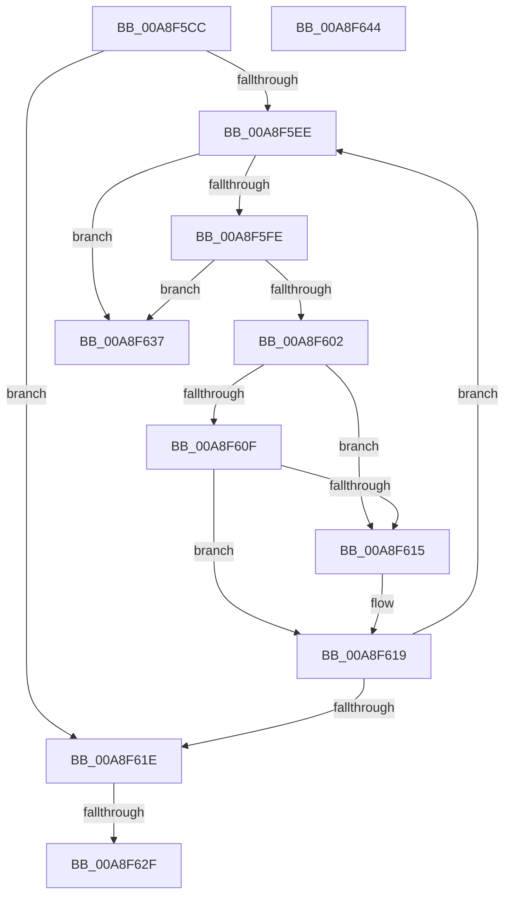

# SdbpBinarySearchUnique

- RVA: `0x00A8F5CC`–`0x00A8F645` (길이 `121` bytes)
- VA: `0x0000000140A8F5CC`
- 실행 섹션: `PAGE`
- PDB 이름 있음: `예`; PDB Function 태그: `예`
- unwind 정보 RVA: `0x000950EC`
- 디코드: `38`개 명령, `121/121` bytes 표시
- 미해석 바이트: `0` (있으면 어셈블리에 `.byte`로 보존)

> 이 문서는 커널 이미지의 기계어와 PDB 기호를 분석해 생성했습니다. 4번과 5번은 함수 원형과 자료형을 바이너리 사용 방식에서 추정한 C 해석이며 원본 소스 복구 결과는 아닙니다.

## 1. Dependencies

- 직접 호출 지점: **0**; 고유 호출 대상: **0**
- 직접 호출자로 확인된 함수: **1**
- RIP 상대 이미지 참조: **0**

### Outgoing calls
- 직접 디코드된 call 명령이 없습니다.

### Direct callers
- [SdbpGetFirstIndexedRecord](../95/SdbpGetFirstIndexedRecord_function_0095C0C4.md) at `0x0095C1A5`

### Static image references
- 디코드된 RIP-relative 메모리 참조가 없습니다.

## 2. Other-region calls and transfers

- 다른 실행 섹션으로 향하는 call: **0**
- call이 아닌 외부 분기/꼬리 이동: **2**
  - `0x00A8F629` → [sub_00B46726](../B4/Unknown_function_00B46726.md) (`tail-transfer`)
  - `0x00A8F632` → [sub_00B46726 + 0x2](../B4/Unknown_function_00B46726.md) (`tail-transfer`)

## 3. Assembly (complete function range)

```asm
00A8F5CC  48 89 5C 24 08                  mov qword ptr [rsp + 8], rbx
00A8F5D1  48 89 7C 24 10                  mov qword ptr [rsp + 0x10], rdi
00A8F5D6  41 83 09 FF                     or dword ptr [r9], 0xffffffff
00A8F5DA  44 8D 5A FF                     lea r11d, [rdx - 1]
00A8F5DE  45 33 D2                        xor r10d, r10d
00A8F5E1  83 C8 FF                        or eax, 0xffffffff
00A8F5E4  8B DA                           mov ebx, edx
00A8F5E6  48 8B F9                        mov rdi, rcx
00A8F5E9  45 85 DB                        test r11d, r11d
00A8F5EC  78 30                           js 0x140a8f61e
00A8F5EE  43 8D 04 13                     lea eax, [r11 + r10]
00A8F5F2  B9 02 00 00 00                  mov ecx, 2
00A8F5F7  99                              cdq
00A8F5F8  F7 F9                           idiv ecx
00A8F5FA  85 C0                           test eax, eax
00A8F5FC  78 39                           js 0x140a8f637
00A8F5FE  3B C3                           cmp eax, ebx
00A8F600  73 35                           jae 0x140a8f637
00A8F602  48 63 C8                        movsxd rcx, eax
00A8F605  48 8D 14 49                     lea rdx, [rcx + rcx*2]
00A8F609  4C 3B 04 97                     cmp r8, qword ptr [rdi + rdx*4]
00A8F60D  77 06                           ja 0x140a8f615
00A8F60F  44 8D 58 FF                     lea r11d, [rax - 1]
00A8F613  72 04                           jb 0x140a8f619
00A8F615  44 8D 50 01                     lea r10d, [rax + 1]
00A8F619  45 3B DA                        cmp r11d, r10d
00A8F61C  7D D0                           jge 0x140a8f5ee
00A8F61E  45 2B D3                        sub r10d, r11d
00A8F621  B9 01 00 00 00                  mov ecx, 1
00A8F626  44 3B D1                        cmp r10d, ecx
00A8F629  0F 8E F7 70 0B 00               jle 0x140b46726
00A8F62F  41 89 01                        mov dword ptr [r9], eax
00A8F632  E9 F1 70 0B 00                  jmp 0x140b46728
00A8F637  33 C0                           xor eax, eax
00A8F639  48 8B 5C 24 08                  mov rbx, qword ptr [rsp + 8]
00A8F63E  48 8B 7C 24 10                  mov rdi, qword ptr [rsp + 0x10]
00A8F643  C3                              ret
00A8F644  CC                              int3
```

## 4. C-style interpretation (structured pseudocode)

```c
__int64 __fastcall SdbpBinarySearchUnique(__int64 a1, __int64 a2, __int64 a3, __int64 a4)
{
    __int64 result;
    __int64 v_r10;
    unsigned __int64 v_stack_p10;
    unsigned __int64 v_stack_p8;

    v_stack_p8 = v_rbx;
    v_stack_p10 = v_rdi;
    v_r10 = 0;
    result = (unsigned int)((result) | (0xFFFFFFFFULL));
    if (sign_flag) goto loc_00A8F61E;
loc_00A8F5EE:
    if (sign_flag) goto loc_00A8F637;
    if (((unsigned int)(a2 - 1 + v_r10 * 1)) >= ((unsigned int)((unsigned int)((unsigned int)(a2))))) goto loc_00A8F637;
    if (a3 > (*(unsigned __int64 *)(a1 + (int)((unsigned int)(a2 - 1 + v_r10 * 1)) + (int)((unsigned int)(a2 - 1 + v_r10 * 1)) * 2 * 4))) goto loc_00A8F615;
    if (a3 >= (*(unsigned __int64 *)(a1 + (int)((unsigned int)(a2 - 1 + v_r10 * 1)) + (int)((unsigned int)(a2 - 1 + v_r10 * 1)) * 2 * 4))) {
        v_r10 = a2 - 1 + v_r10 * 1 + 1;
    }
    if (((unsigned int)(a2 - 1 + v_r10 * 1 - 1)) >= ((unsigned int)(v_r10))) goto loc_00A8F5EE;
loc_00A8F61E:
    v_r10 = (unsigned int)((v_r10) - ((unsigned int)(a2 - 1 + v_r10 * 1 - 1)));
    *(unsigned int *)(a4) = (unsigned int)(a2 - 1 + v_r10 * 1);
loc_00A8F637:
    result = 0;
    return result;
}
```

## 5. (Beta) C Style

```c
int64_t SdbpBinarySearchUnique(void *Arg1, void *Arg2, int64_t Arg3, void *Arg4)
{
    uint8_t *arg1 = (uint8_t *)Arg1;
    uint8_t *arg2 = (uint8_t *)Arg2;
    uint8_t *arg4 = (uint8_t *)Arg4;

    int64_t result;
    int64_t local_r10;
    uint64_t v_stack_p10;
    uint64_t v_stack_p8;

    v_stack_p8 = local_rbx;
    v_stack_p10 = local_rdi;
    local_r10 = 0;
    result = (uint32_t)((result) | (0xFFFFFFFFULL));
    if (sign_flag) goto loc_00A8F61E;
loc_00A8F5EE:
    if (sign_flag) goto loc_00A8F637;
    if (((uint32_t)(Arg2 - 1 + local_r10 * 1)) >= ((uint32_t)((uint32_t)((uint32_t)(Arg2))))) goto loc_00A8F637;
    if (Arg3 > (*(uint64_t *)(arg1 + (int32_t)((uint32_t)(arg2 - 0x1 + local_r10 * 1)) + (int32_t)((uint32_t)(arg2 - 0x1 + local_r10 * 1)) * 2 * 4))) goto loc_00A8F615;
    if (Arg3 >= (*(uint64_t *)(arg1 + (int32_t)((uint32_t)(arg2 - 0x1 + local_r10 * 1)) + (int32_t)((uint32_t)(arg2 - 0x1 + local_r10 * 1)) * 2 * 4))) {
        local_r10 = Arg2 - 1 + local_r10 * 1 + 1;
    }
    if (((uint32_t)(Arg2 - 1 + local_r10 * 1 - 1)) >= ((uint32_t)(local_r10))) goto loc_00A8F5EE;
loc_00A8F61E:
    local_r10 = (uint32_t)((local_r10) - ((uint32_t)(Arg2 - 1 + local_r10 * 1 - 1)));
    *(uint32_t *)(arg4) = (uint32_t)(Arg2 - 1 + local_r10 * 1);
loc_00A8F637:
    result = 0;
    return result;
}
```

### 관측된 메모리 오프셋

구조체 형식이 확인되지 않은 접근은 인자 기준의 오프셋으로만 기록했습니다.

| 기준 인자 | 오프셋 표현 | 폭 (bit) | 접근 |
|---|---:|---:|---|
| `Arg1` | `+ 0x0 + rdx*4` | `64` | `R` |
| `Arg2` | `- 0x1` | `32` | `R` |
| `Arg4` | `+ 0x0` | `32` | `R/W` |
| `Arg4` | `+ 0x0` | `32` | `W` |

## 6. Execution-region graph

[열기: 2D/3D 그래프와 함수 탐색 컨트롤 패널](../../../control-panel.html?section=page&rva=0x00A8F5CC&view=graph)

- 2D 그래프는 위에서 아래로 흐르고, 3D 그래프는 빈 공간을 드래그해 회전합니다. Shift+드래그는 이동, 휠은 확대·축소, 함수 노드 선택은 대상 보고서 이동입니다.

### Static fallback


