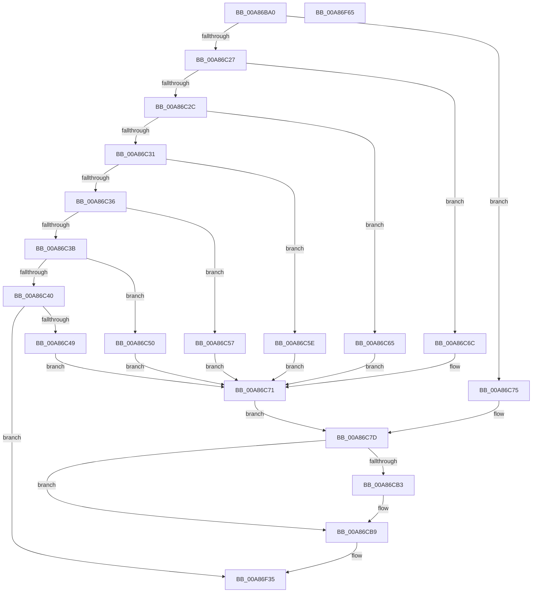

# SeAuditPlugAndPlay

- RVA: `0x00A86BA0`–`0x00A86F66` (길이 `966` bytes)
- VA: `0x0000000140A86BA0`
- 실행 섹션: `PAGE`
- PDB 이름 있음: `예`; PDB Function 태그: `아니요`
- unwind 정보 RVA: `0x000B7D5C`
- 디코드: `238`개 명령, `966/966` bytes 표시
- 미해석 바이트: `0` (있으면 어셈블리에 `.byte`로 보존)

> 이 문서는 커널 이미지의 기계어와 PDB 기호를 분석해 생성했습니다. 4번과 5번은 함수 원형과 자료형을 바이너리 사용 방식에서 추정한 C 해석이며 원본 소스 복구 결과는 아닙니다.

## 1. Dependencies

- 직접 호출 지점: **5**; 고유 호출 대상: **5**
- 직접 호출자로 확인된 함수: **1**
- RIP 상대 이미지 참조: **2**

### Outgoing calls
- `0x00A86C0D` → [memset](../../text/6C/memset_function_006C6C40.md) (function, `0x006C6C40`)
- `0x00A86CBE` → [SeCaptureSubjectContext](../86/SeCaptureSubjectContext_function_0086B820.md) (function, `0x0086B820`)
- `0x00A86F26` → [AdtpWriteToEtwEx](../../text/45/AdtpWriteToEtwEx_function_004595EC.md) (function, `0x004595EC`)
- `0x00A86F30` → [SeReleaseSubjectContext](../86/SeReleaseSubjectContext_function_0086B710.md) (function, `0x0086B710`)
- `0x00A86F3F` → [_security_check_cookie](../../text/6A/_security_check_cookie_function_006AC640.md) (function, `0x006AC640`)

### Direct callers
- [PiAuditDeviceOperation](PiAuditDeviceOperation_function_00A864DC.md) at `0x00A869CD`

### Static image references
- `0x00A86BC6` → RVA `0x00E0A740` (`.data`; read)
- `0x00A86D34` → RVA `0x000013A8` (`.rdata`; read)

## 2. Other-region calls and transfers

- 다른 실행 섹션으로 향하는 call: **3**
  - `0x00A86C0D` → [memset](../../text/6C/memset_function_006C6C40.md) (`PAGE` → `.text`)
  - `0x00A86F26` → [AdtpWriteToEtwEx](../../text/45/AdtpWriteToEtwEx_function_004595EC.md) (`PAGE` → `.text`)
  - `0x00A86F3F` → [_security_check_cookie](../../text/6A/_security_check_cookie_function_006AC640.md) (`PAGE` → `.text`)
- 별도 외부 분기/꼬리 이동을 확인하지 못했습니다.

## 3. Assembly (complete function range)

```asm
00A86BA0  48 8B C4                        mov rax, rsp
00A86BA3  48 89 58 08                     mov qword ptr [rax + 8], rbx
00A86BA7  48 89 70 10                     mov qword ptr [rax + 0x10], rsi
00A86BAB  48 89 78 18                     mov qword ptr [rax + 0x18], rdi
00A86BAF  4C 89 60 20                     mov qword ptr [rax + 0x20], r12
00A86BB3  55                              push rbp
00A86BB4  41 55                           push r13
00A86BB6  41 56                           push r14
00A86BB8  48 8D A8 68 FC FF FF            lea rbp, [rax - 0x398]
00A86BBF  48 81 EC 80 04 00 00            sub rsp, 0x480
00A86BC6  48 8B 05 73 3B 38 00            mov rax, qword ptr [rip + 0x383b73]
00A86BCD  48 33 C4                        xor rax, rsp
00A86BD0  48 89 85 70 03 00 00            mov qword ptr [rbp + 0x370], rax
00A86BD7  48 83 64 24 28 00               and qword ptr [rsp + 0x28], 0
00A86BDD  49 8B F8                        mov rdi, r8
00A86BE0  48 8B F2                        mov rsi, rdx
00A86BE3  C7 44 24 30 00 00 00 80         mov dword ptr [rsp + 0x30], 0x80000000
00A86BEB  4C 8B F1                        mov r14, rcx
00A86BEE  33 C0                           xor eax, eax
00A86BF0  0F 57 C0                        xorps xmm0, xmm0
00A86BF3  89 44 24 34                     mov dword ptr [rsp + 0x34], eax
00A86BF7  33 D2                           xor edx, edx
00A86BF9  48 8D 4C 24 50                  lea rcx, [rsp + 0x50]
00A86BFE  41 B8 20 04 00 00               mov r8d, 0x420
00A86C04  49 8B D9                        mov rbx, r9
00A86C07  F3 0F 7F 44 24 38               movdqu xmmword ptr [rsp + 0x38], xmm0
00A86C0D  E8 2E 00 C4 FF                  call 0x1406c6c40
00A86C12  8B 8D D8 03 00 00               mov ecx, dword ptr [rbp + 0x3d8]
00A86C18  41 BC 01 00 00 00               mov r12d, 1
00A86C1E  C6 44 24 20 00                  mov byte ptr [rsp + 0x20], 0
00A86C23  85 C9                           test ecx, ecx
00A86C25  74 4E                           je 0x140a86c75
00A86C27  41 2B CC                        sub ecx, r12d
00A86C2A  74 40                           je 0x140a86c6c
00A86C2C  41 2B CC                        sub ecx, r12d
00A86C2F  74 34                           je 0x140a86c65
00A86C31  41 2B CC                        sub ecx, r12d
00A86C34  74 28                           je 0x140a86c5e
00A86C36  41 2B CC                        sub ecx, r12d
00A86C39  74 1C                           je 0x140a86c57
00A86C3B  41 2B CC                        sub ecx, r12d
00A86C3E  74 10                           je 0x140a86c50
00A86C40  41 3B CC                        cmp ecx, r12d
00A86C43  0F 85 EC 02 00 00               jne 0x140a86f35
00A86C49  B8 18 19 00 00                  mov eax, 0x1918
00A86C4E  EB 21                           jmp 0x140a86c71
00A86C50  B8 17 19 00 00                  mov eax, 0x1917
00A86C55  EB 1A                           jmp 0x140a86c71
00A86C57  B8 16 19 00 00                  mov eax, 0x1916
00A86C5C  EB 13                           jmp 0x140a86c71
00A86C5E  B8 15 19 00 00                  mov eax, 0x1915
00A86C63  EB 0C                           jmp 0x140a86c71
00A86C65  B8 14 19 00 00                  mov eax, 0x1914
00A86C6A  EB 05                           jmp 0x140a86c71
00A86C6C  B8 13 19 00 00                  mov eax, 0x1913
00A86C71  33 C9                           xor ecx, ecx
00A86C73  EB 08                           jmp 0x140a86c7d
00A86C75  B8 10 19 00 00                  mov eax, 0x1910
00A86C7A  41 8B CC                        mov ecx, r12d
00A86C7D  83 64 24 5C 00                  and dword ptr [rsp + 0x5c], 0
00A86C82  BA 8A 00 00 00                  mov edx, 0x8a
00A86C87  80 BD E0 03 00 00 00            cmp byte ptr [rbp + 0x3e0], 0
00A86C8E  89 44 24 54                     mov dword ptr [rsp + 0x54], eax
00A86C92  B8 08 00 00 00                  mov eax, 8
00A86C97  C7 44 24 50 05 00 00 00         mov dword ptr [rsp + 0x50], 5
00A86C9F  44 8D 6A 86                     lea r13d, [rdx - 0x7a]
00A86CA3  66 89 54 24 64                  mov word ptr [rsp + 0x64], dx
00A86CA8  89 4C 24 58                     mov dword ptr [rsp + 0x58], ecx
00A86CAC  66 89 44 24 66                  mov word ptr [rsp + 0x66], ax
00A86CB1  75 06                           jne 0x140a86cb9
00A86CB3  66 44 89 6C 24 66               mov word ptr [rsp + 0x66], r13w
00A86CB9  48 8D 4C 24 28                  lea rcx, [rsp + 0x28]
00A86CBE  E8 5D 4B DE FF                  call 0x14086b820
00A86CC3  48 8B 4C 24 28                  mov rcx, qword ptr [rsp + 0x28]
00A86CC8  48 8B 54 24 38                  mov rdx, qword ptr [rsp + 0x38]
00A86CCD  48 85 C9                        test rcx, rcx
00A86CD0  48 8B C2                        mov rax, rdx
00A86CD3  48 0F 45 C1                     cmovne rax, rcx
00A86CD7  48 0F 45 D1                     cmovne rdx, rcx
00A86CDB  8B 4C 24 5C                     mov ecx, dword ptr [rsp + 0x5c]
00A86CDF  48 C1 E1 05                     shl rcx, 5
00A86CE3  48 8B 80 98 00 00 00            mov rax, qword ptr [rax + 0x98]
00A86CEA  4C 8B 00                        mov r8, qword ptr [rax]
00A86CED  48 8B 42 18                     mov rax, qword ptr [rdx + 0x18]
00A86CF1  C7 44 0C 70 04 00 00 00         mov dword ptr [rsp + rcx + 0x70], 4
00A86CF9  41 0F B6 48 01                  movzx ecx, byte ptr [r8 + 1]
00A86CFE  8D 14 8D 08 00 00 00            lea edx, [rcx*4 + 8]
00A86D05  8B 4C 24 5C                     mov ecx, dword ptr [rsp + 0x5c]
00A86D09  48 C1 E1 05                     shl rcx, 5
00A86D0D  89 54 0C 74                     mov dword ptr [rsp + rcx + 0x74], edx
00A86D11  8B 4C 24 5C                     mov ecx, dword ptr [rsp + 0x5c]
00A86D15  48 C1 E1 05                     shl rcx, 5
00A86D19  4C 89 44 0D 88                  mov qword ptr [rbp + rcx - 0x78], r8
00A86D1E  8B 4C 24 5C                     mov ecx, dword ptr [rsp + 0x5c]
00A86D22  41 03 CC                        add ecx, r12d
00A86D25  89 4C 24 5C                     mov dword ptr [rsp + 0x5c], ecx
00A86D29  8B D1                           mov edx, ecx
00A86D2B  48 C1 E2 05                     shl rdx, 5
00A86D2F  44 89 64 14 70                  mov dword ptr [rsp + rdx + 0x70], r12d
00A86D34  48 8D 15 6D A6 57 FF            lea rdx, [rip - 0xa85993]
00A86D3B  8B 4C 24 5C                     mov ecx, dword ptr [rsp + 0x5c]
00A86D3F  48 C1 E1 05                     shl rcx, 5
00A86D43  C7 44 0C 74 20 00 00 00         mov dword ptr [rsp + rcx + 0x74], 0x20
00A86D4B  8B 4C 24 5C                     mov ecx, dword ptr [rsp + 0x5c]
00A86D4F  48 C1 E1 05                     shl rcx, 5
00A86D53  48 89 54 0D 88                  mov qword ptr [rbp + rcx - 0x78], rdx
00A86D58  8B 4C 24 5C                     mov ecx, dword ptr [rsp + 0x5c]
00A86D5C  41 03 CC                        add ecx, r12d
00A86D5F  89 4C 24 5C                     mov dword ptr [rsp + 0x5c], ecx
00A86D63  8B D1                           mov edx, ecx
00A86D65  48 C1 E2 05                     shl rdx, 5
00A86D69  C7 44 14 70 05 00 00 00         mov dword ptr [rsp + rdx + 0x70], 5
00A86D71  8B 4C 24 5C                     mov ecx, dword ptr [rsp + 0x5c]
00A86D75  48 C1 E1 05                     shl rcx, 5
00A86D79  C7 44 0C 74 08 00 00 00         mov dword ptr [rsp + rcx + 0x74], 8
00A86D81  8B 4C 24 5C                     mov ecx, dword ptr [rsp + 0x5c]
00A86D85  48 C1 E1 05                     shl rcx, 5
00A86D89  48 89 44 0C 78                  mov qword ptr [rsp + rcx + 0x78], rax
00A86D8E  8B 44 24 5C                     mov eax, dword ptr [rsp + 0x5c]
00A86D92  41 03 C4                        add eax, r12d
00A86D95  89 44 24 5C                     mov dword ptr [rsp + 0x5c], eax
00A86D99  8B C8                           mov ecx, eax
00A86D9B  48 C1 E1 05                     shl rcx, 5
00A86D9F  44 89 64 0C 70                  mov dword ptr [rsp + rcx + 0x70], r12d
00A86DA4  8B 44 24 5C                     mov eax, dword ptr [rsp + 0x5c]
00A86DA8  41 0F B7 0E                     movzx ecx, word ptr [r14]
00A86DAC  48 C1 E0 05                     shl rax, 5
00A86DB0  41 03 CD                        add ecx, r13d
00A86DB3  89 4C 04 74                     mov dword ptr [rsp + rax + 0x74], ecx
00A86DB7  8B 44 24 5C                     mov eax, dword ptr [rsp + 0x5c]
00A86DBB  48 C1 E0 05                     shl rax, 5
00A86DBF  4C 89 74 05 88                  mov qword ptr [rbp + rax - 0x78], r14
00A86DC4  8B 44 24 5C                     mov eax, dword ptr [rsp + 0x5c]
00A86DC8  41 03 C4                        add eax, r12d
00A86DCB  89 44 24 5C                     mov dword ptr [rsp + 0x5c], eax
00A86DCF  8B C8                           mov ecx, eax
00A86DD1  48 C1 E1 05                     shl rcx, 5
00A86DD5  44 89 64 0C 70                  mov dword ptr [rsp + rcx + 0x70], r12d
00A86DDA  8B 44 24 5C                     mov eax, dword ptr [rsp + 0x5c]
00A86DDE  0F B7 0E                        movzx ecx, word ptr [rsi]
00A86DE1  48 C1 E0 05                     shl rax, 5
00A86DE5  41 03 CD                        add ecx, r13d
00A86DE8  89 4C 04 74                     mov dword ptr [rsp + rax + 0x74], ecx
00A86DEC  8B 44 24 5C                     mov eax, dword ptr [rsp + 0x5c]
00A86DF0  48 C1 E0 05                     shl rax, 5
00A86DF4  48 89 74 05 88                  mov qword ptr [rbp + rax - 0x78], rsi
00A86DF9  8B 44 24 5C                     mov eax, dword ptr [rsp + 0x5c]
00A86DFD  41 03 C4                        add eax, r12d
00A86E00  8B C8                           mov ecx, eax
00A86E02  48 C1 E1 05                     shl rcx, 5
00A86E06  89 44 24 5C                     mov dword ptr [rsp + 0x5c], eax
00A86E0A  C7 44 0C 70 0D 00 00 00         mov dword ptr [rsp + rcx + 0x70], 0xd
00A86E12  8B 44 24 5C                     mov eax, dword ptr [rsp + 0x5c]
00A86E16  48 8B 95 D0 03 00 00            mov rdx, qword ptr [rbp + 0x3d0]
00A86E1D  48 C1 E0 05                     shl rax, 5
00A86E21  44 89 6C 04 74                  mov dword ptr [rsp + rax + 0x74], r13d
00A86E26  8B 4C 24 5C                     mov ecx, dword ptr [rsp + 0x5c]
00A86E2A  48 8B 85 C8 03 00 00            mov rax, qword ptr [rbp + 0x3c8]
00A86E31  48 C1 E1 05                     shl rcx, 5
00A86E35  48 89 44 0D 88                  mov qword ptr [rbp + rcx - 0x78], rax
00A86E3A  8B 44 24 5C                     mov eax, dword ptr [rsp + 0x5c]
00A86E3E  41 03 C4                        add eax, r12d
00A86E41  89 44 24 5C                     mov dword ptr [rsp + 0x5c], eax
00A86E45  8B C8                           mov ecx, eax
00A86E47  48 C1 E1 05                     shl rcx, 5
00A86E4B  44 89 64 0C 70                  mov dword ptr [rsp + rcx + 0x70], r12d
00A86E50  8B 44 24 5C                     mov eax, dword ptr [rsp + 0x5c]
00A86E54  0F B7 0A                        movzx ecx, word ptr [rdx]
00A86E57  48 C1 E0 05                     shl rax, 5
00A86E5B  41 03 CD                        add ecx, r13d
00A86E5E  89 4C 04 74                     mov dword ptr [rsp + rax + 0x74], ecx
00A86E62  8B 44 24 5C                     mov eax, dword ptr [rsp + 0x5c]
00A86E66  48 C1 E0 05                     shl rax, 5
00A86E6A  48 89 54 05 88                  mov qword ptr [rbp + rax - 0x78], rdx
00A86E6F  BA 22 00 00 00                  mov edx, 0x22
00A86E74  8B 44 24 5C                     mov eax, dword ptr [rsp + 0x5c]
00A86E78  41 03 C4                        add eax, r12d
00A86E7B  89 44 24 5C                     mov dword ptr [rsp + 0x5c], eax
00A86E7F  8B C8                           mov ecx, eax
00A86E81  48 C1 E1 05                     shl rcx, 5
00A86E85  89 54 0C 70                     mov dword ptr [rsp + rcx + 0x70], edx
00A86E89  8B 44 24 5C                     mov eax, dword ptr [rsp + 0x5c]
00A86E8D  0F B7 0F                        movzx ecx, word ptr [rdi]
00A86E90  48 C1 E0 05                     shl rax, 5
00A86E94  41 03 CD                        add ecx, r13d
00A86E97  89 4C 04 74                     mov dword ptr [rsp + rax + 0x74], ecx
00A86E9B  8B 44 24 5C                     mov eax, dword ptr [rsp + 0x5c]
00A86E9F  48 C1 E0 05                     shl rax, 5
00A86EA3  48 89 7C 05 88                  mov qword ptr [rbp + rax - 0x78], rdi
00A86EA8  8B 44 24 5C                     mov eax, dword ptr [rsp + 0x5c]
00A86EAC  41 03 C4                        add eax, r12d
00A86EAF  89 44 24 5C                     mov dword ptr [rsp + 0x5c], eax
00A86EB3  8B C8                           mov ecx, eax
00A86EB5  48 C1 E1 05                     shl rcx, 5
00A86EB9  89 54 0C 70                     mov dword ptr [rsp + rcx + 0x70], edx
00A86EBD  8B 44 24 5C                     mov eax, dword ptr [rsp + 0x5c]
00A86EC1  0F B7 0B                        movzx ecx, word ptr [rbx]
00A86EC4  48 C1 E0 05                     shl rax, 5
00A86EC8  41 03 CD                        add ecx, r13d
00A86ECB  89 4C 04 74                     mov dword ptr [rsp + rax + 0x74], ecx
00A86ECF  8B 44 24 5C                     mov eax, dword ptr [rsp + 0x5c]
00A86ED3  48 C1 E0 05                     shl rax, 5
00A86ED7  48 89 5C 05 88                  mov qword ptr [rbp + rax - 0x78], rbx
00A86EDC  8B 44 24 5C                     mov eax, dword ptr [rsp + 0x5c]
00A86EE0  41 03 C4                        add eax, r12d
00A86EE3  89 44 24 5C                     mov dword ptr [rsp + 0x5c], eax
00A86EE7  8B C8                           mov ecx, eax
00A86EE9  48 C1 E1 05                     shl rcx, 5
00A86EED  89 54 0C 70                     mov dword ptr [rsp + rcx + 0x70], edx
00A86EF1  8B 44 24 5C                     mov eax, dword ptr [rsp + 0x5c]
00A86EF5  48 8B 95 C0 03 00 00            mov rdx, qword ptr [rbp + 0x3c0]
00A86EFC  48 C1 E0 05                     shl rax, 5
00A86F00  0F B7 0A                        movzx ecx, word ptr [rdx]
00A86F03  41 03 CD                        add ecx, r13d
00A86F06  89 4C 04 74                     mov dword ptr [rsp + rax + 0x74], ecx
00A86F0A  48 8D 4C 24 50                  lea rcx, [rsp + 0x50]
00A86F0F  8B 44 24 5C                     mov eax, dword ptr [rsp + 0x5c]
00A86F13  48 C1 E0 05                     shl rax, 5
00A86F17  48 89 54 05 88                  mov qword ptr [rbp + rax - 0x78], rdx
00A86F1C  48 8D 54 24 20                  lea rdx, [rsp + 0x20]
00A86F21  44 01 64 24 5C                  add dword ptr [rsp + 0x5c], r12d
00A86F26  E8 C1 26 9D FF                  call 0x1404595ec
00A86F2B  48 8D 4C 24 28                  lea rcx, [rsp + 0x28]
00A86F30  E8 DB 47 DE FF                  call 0x14086b710
00A86F35  48 8B 8D 70 03 00 00            mov rcx, qword ptr [rbp + 0x370]
00A86F3C  48 33 CC                        xor rcx, rsp
00A86F3F  E8 FC 56 C2 FF                  call 0x1406ac640
00A86F44  4C 8D 9C 24 80 04 00 00         lea r11, [rsp + 0x480]
00A86F4C  49 8B 5B 20                     mov rbx, qword ptr [r11 + 0x20]
00A86F50  49 8B 73 28                     mov rsi, qword ptr [r11 + 0x28]
00A86F54  49 8B 7B 30                     mov rdi, qword ptr [r11 + 0x30]
00A86F58  4D 8B 63 38                     mov r12, qword ptr [r11 + 0x38]
00A86F5C  49 8B E3                        mov rsp, r11
00A86F5F  41 5E                           pop r14
00A86F61  41 5D                           pop r13
00A86F63  5D                              pop rbp
00A86F64  C3                              ret
00A86F65  CC                              int3
```

## 4. C-style interpretation (structured pseudocode)

```c
__int64 __fastcall SeAuditPlugAndPlay(__int64 a1, __int64 a2, __int64 a3, __int64 a4)
{
    __int64 result;
    __int64 v_rsp;
    unsigned __int64 v_stack_m18;
    unsigned __int16 v_stack_m432;
    unsigned __int16 v_stack_m434;
    unsigned int v_stack_m43C;
    unsigned int v_stack_m440;
    unsigned int v_stack_m444;
    unsigned __int64 v_stack_m448;
    unsigned __int64 v_stack_m460;
    unsigned int v_stack_m464;
    unsigned int v_stack_m468;
    unsigned __int64 v_stack_m470;
    unsigned __int8 v_stack_m478;

    *(unsigned __int64 *)(v_rsp + 8) = v_rbx;
    *(unsigned __int64 *)(v_rsp + 16) = v_rsi;
    *(unsigned __int64 *)(v_rsp + 24) = v_rdi;
    *(unsigned __int64 *)(v_rsp + 32) = v_r12;
    v_rsp = (v_rsp) - (0x480ULL);
    result = (*(unsigned __int64 *)(v_rip + 3685235)) ^ (v_rsp);
    *(unsigned __int64 *)(v_rsp - 920 + 880) = result;
    v_stack_m468 = 0x80000000ULL;
    result = 0;
    v_stack_m464 = 0;
    a2 = 0;
    v_stack_m460 = v_xmm0;
    result = memset(v_stack_m448, a2, (unsigned int)(0x420ULL), a4);
    v_stack_m478 = 0;
    if ((unsigned int)((unsigned int)(*(unsigned int *)(v_rsp - 920 + 984))) == 0) goto loc_00A86C75;
    a1 = (unsigned int)(((unsigned int)(*(unsigned int *)(v_rsp - 920 + 984))) - (1));
    if (condition_is_equal) goto loc_00A86C6C;
    a1 = (unsigned int)((a1) - (1));
    if (condition_is_equal) goto loc_00A86C65;
    a1 = (unsigned int)((a1) - (1));
    if (condition_is_equal) goto loc_00A86C5E;
    a1 = (unsigned int)((a1) - (1));
    if (condition_is_equal) goto loc_00A86C57;
    a1 = (unsigned int)((a1) - (1));
    if (condition_is_equal) goto loc_00A86C50;
    if (((unsigned int)(a1)) != 1) goto loc_00A86F35;
    goto loc_00A86C71;
loc_00A86C50:
    goto loc_00A86C71;
loc_00A86C57:
    goto loc_00A86C71;
loc_00A86C5E:
    goto loc_00A86C71;
loc_00A86C65:
    goto loc_00A86C71;
loc_00A86C6C:
loc_00A86C71:
    a1 = 0;
    goto loc_00A86C7D;
loc_00A86C75:
loc_00A86C7D:
    v_stack_m444 = (unsigned int)((unsigned int)(0x1910ULL));
    v_stack_m448 = 5;
    v_stack_m434 = 138;
    v_stack_m440 = 1;
    v_stack_m432 = 8;
    if ((*(unsigned __int8 *)(v_rsp - 920 + 992)) == 0) {
        v_stack_m432 = (unsigned __int16)(138 - 122);
    }
    result = SeCaptureSubjectContext(v_stack_m470, 138, (unsigned int)(0x420ULL), a4);
    result = v_stack_m460;
    if (v_stack_m470 != 0) { result = v_stack_m470; }
    a2 = v_stack_m460;
    if (v_stack_m470 != 0) { a2 = v_stack_m470; }
    a1 = ((unsigned int)(v_stack_m43C)) << (5);
    *(unsigned int *)(v_rsp + a1 * 1 + 112) = 4;
    a1 = ((unsigned int)(v_stack_m43C)) << (5);
    *(unsigned int *)(v_rsp + a1 * 1 + 116) = (unsigned int)(*(unsigned __int8 *)(*(unsigned __int64 *)(*(unsigned __int64 *)(result + 152)) + 1) * 4 + 8);
    a1 = ((unsigned int)(v_stack_m43C)) << (5);
    *(unsigned __int64 *)(v_rsp - 920 + a1 * 1 - 120) = *(unsigned __int64 *)(*(unsigned __int64 *)(result + 152));
    a1 = (unsigned int)(((unsigned int)(v_stack_m43C)) + (1));
    v_stack_m43C = (unsigned int)(a1);
    a2 = ((unsigned int)((unsigned int)(a1))) << (5);
    *(unsigned int *)(v_rsp + a2 * 1 + 112) = 1;
    a1 = ((unsigned int)(v_stack_m43C)) << (5);
    *(unsigned int *)(v_rsp + a1 * 1 + 116) = 32;
    a1 = ((unsigned int)(v_stack_m43C)) << (5);
    *(unsigned __int64 *)(v_rsp - 920 + a1 * 1 - 120) = v_rip - 11032979;
    a1 = (unsigned int)(((unsigned int)(v_stack_m43C)) + (1));
    v_stack_m43C = (unsigned int)(a1);
    a2 = ((unsigned int)((unsigned int)(a1))) << (5);
    *(unsigned int *)(v_rsp + a2 * 1 + 112) = 5;
    a1 = ((unsigned int)(v_stack_m43C)) << (5);
    *(unsigned int *)(v_rsp + a1 * 1 + 116) = 8;
    a1 = ((unsigned int)(v_stack_m43C)) << (5);
    *(unsigned __int64 *)(v_rsp + a1 * 1 + 120) = *(unsigned __int64 *)(a2 + 24);
    result = (unsigned int)(((unsigned int)(v_stack_m43C)) + (1));
    v_stack_m43C = (unsigned int)(result);
    a1 = ((unsigned int)((unsigned int)(result))) << (5);
    *(unsigned int *)(v_rsp + a1 * 1 + 112) = 1;
    result = ((unsigned int)(v_stack_m43C)) << (5);
    a1 = (unsigned int)((*(unsigned __int16 *)(a1)) + ((unsigned int)(138 - 122)));
    *(unsigned int *)(v_rsp + result * 1 + 116) = (unsigned int)(a1);
    result = ((unsigned int)(v_stack_m43C)) << (5);
    *(unsigned __int64 *)(v_rsp - 920 + result * 1 - 120) = a1;
    result = (unsigned int)(((unsigned int)(v_stack_m43C)) + (1));
    v_stack_m43C = (unsigned int)(result);
    a1 = ((unsigned int)((unsigned int)(result))) << (5);
    *(unsigned int *)(v_rsp + a1 * 1 + 112) = 1;
    result = ((unsigned int)(v_stack_m43C)) << (5);
    a1 = (unsigned int)((*(unsigned __int16 *)(a2)) + ((unsigned int)(138 - 122)));
    *(unsigned int *)(v_rsp + result * 1 + 116) = (unsigned int)(a1);
    result = ((unsigned int)(v_stack_m43C)) << (5);
    *(unsigned __int64 *)(v_rsp - 920 + result * 1 - 120) = a2;
    result = (unsigned int)(((unsigned int)(v_stack_m43C)) + (1));
    a1 = ((unsigned int)((unsigned int)(result))) << (5);
    v_stack_m43C = (unsigned int)(result);
    *(unsigned int *)(v_rsp + a1 * 1 + 112) = 13;
    result = ((unsigned int)(v_stack_m43C)) << (5);
    *(unsigned int *)(v_rsp + result * 1 + 116) = (unsigned int)(138 - 122);
    a1 = ((unsigned int)(v_stack_m43C)) << (5);
    *(unsigned __int64 *)(v_rsp - 920 + a1 * 1 - 120) = *(unsigned __int64 *)(v_rsp - 920 + 968);
    result = (unsigned int)(((unsigned int)(v_stack_m43C)) + (1));
    v_stack_m43C = (unsigned int)(result);
    a1 = ((unsigned int)((unsigned int)(result))) << (5);
    *(unsigned int *)(v_rsp + a1 * 1 + 112) = 1;
    result = ((unsigned int)(v_stack_m43C)) << (5);
    a1 = (unsigned int)((*(unsigned __int16 *)(*(unsigned __int64 *)(v_rsp - 920 + 976))) + ((unsigned int)(138 - 122)));
    *(unsigned int *)(v_rsp + result * 1 + 116) = (unsigned int)(a1);
    result = ((unsigned int)(v_stack_m43C)) << (5);
    *(unsigned __int64 *)(v_rsp - 920 + result * 1 - 120) = *(unsigned __int64 *)(v_rsp - 920 + 976);
    result = (unsigned int)(((unsigned int)(v_stack_m43C)) + (1));
    v_stack_m43C = (unsigned int)(result);
    a1 = ((unsigned int)((unsigned int)(result))) << (5);
    *(unsigned int *)(v_rsp + a1 * 1 + 112) = 34;
    result = ((unsigned int)(v_stack_m43C)) << (5);
    a1 = (unsigned int)((*(unsigned __int16 *)(a3)) + ((unsigned int)(138 - 122)));
    *(unsigned int *)(v_rsp + result * 1 + 116) = (unsigned int)(a1);
    result = ((unsigned int)(v_stack_m43C)) << (5);
    *(unsigned __int64 *)(v_rsp - 920 + result * 1 - 120) = a3;
    result = (unsigned int)(((unsigned int)(v_stack_m43C)) + (1));
    v_stack_m43C = (unsigned int)(result);
    a1 = ((unsigned int)((unsigned int)(result))) << (5);
    *(unsigned int *)(v_rsp + a1 * 1 + 112) = 34;
    result = ((unsigned int)(v_stack_m43C)) << (5);
    a1 = (unsigned int)((*(unsigned __int16 *)(a4)) + ((unsigned int)(138 - 122)));
    *(unsigned int *)(v_rsp + result * 1 + 116) = (unsigned int)(a1);
    result = ((unsigned int)(v_stack_m43C)) << (5);
    *(unsigned __int64 *)(v_rsp - 920 + result * 1 - 120) = a4;
    result = (unsigned int)(((unsigned int)(v_stack_m43C)) + (1));
    v_stack_m43C = (unsigned int)(result);
    a1 = ((unsigned int)((unsigned int)(result))) << (5);
    *(unsigned int *)(v_rsp + a1 * 1 + 112) = 34;
    result = ((unsigned int)(v_stack_m43C)) << (5);
    a1 = (unsigned int)((*(unsigned __int16 *)(*(unsigned __int64 *)(v_rsp - 920 + 960))) + ((unsigned int)(138 - 122)));
    *(unsigned int *)(v_rsp + result * 1 + 116) = (unsigned int)(a1);
    result = ((unsigned int)(v_stack_m43C)) << (5);
    *(unsigned __int64 *)(v_rsp - 920 + result * 1 - 120) = *(unsigned __int64 *)(v_rsp - 920 + 960);
    result = AdtpWriteToEtwEx(v_stack_m448, v_stack_m478, *(unsigned __int64 *)(*(unsigned __int64 *)(result + 152)), a4);
    result = SeReleaseSubjectContext(v_stack_m470, v_stack_m478, *(unsigned __int64 *)(*(unsigned __int64 *)(result + 152)), a4);
loc_00A86F35:
    a1 = (*(unsigned __int64 *)(v_rsp - 920 + 880)) ^ (v_rsp);
    result = _security_check_cookie(a1, v_stack_m478, *(unsigned __int64 *)(*(unsigned __int64 *)(result + 152)), a4);
    return result;
}
```

## 5. (Beta) C Style

```c
int64_t SeAuditPlugAndPlay(void *Arg1, void *Arg2, void *Arg3, void *Arg4)
{
    uint8_t *arg1 = (uint8_t *)Arg1;
    uint8_t *arg2 = (uint8_t *)Arg2;
    uint8_t *arg3 = (uint8_t *)Arg3;
    uint8_t *arg4 = (uint8_t *)Arg4;

    int64_t result;
    int64_t local_rsp;
    uint64_t v_stack_m18;
    uint16_t v_stack_m432;
    uint16_t v_stack_m434;
    uint32_t v_stack_m43C;
    uint32_t v_stack_m440;
    uint32_t v_stack_m444;
    uint64_t v_stack_m448;
    uint64_t v_stack_m460;
    uint32_t v_stack_m464;
    uint32_t v_stack_m468;
    uint64_t v_stack_m470;
    uint8_t v_stack_m478;

    *(uint64_t *)(local_rsp + 0x8) = local_rbx;
    *(uint64_t *)(local_rsp + 0x10) = local_rsi;
    *(uint64_t *)(local_rsp + 0x18) = local_rdi;
    *(uint64_t *)(local_rsp + 0x20) = local_r12;
    local_rsp = (local_rsp) - (0x480ULL);
    result = (*(uint64_t *)(v_rip + 0x383B73)) ^ (local_rsp);
    *(uint64_t *)(local_rsp - 0x398 + 0x370) = result;
    v_stack_m468 = 0x80000000ULL;
    result = 0;
    v_stack_m464 = 0;
    Arg2 = 0;
    v_stack_m460 = v_xmm0;
    result = memset(v_stack_m448, Arg2, (uint32_t)(0x420ULL), Arg4);
    v_stack_m478 = 0;
    if ((uint32_t)((uint32_t)(*(uint32_t *)(local_rsp - 0x398 + 0x3D8))) == 0) goto loc_00A86C75;
    Arg1 = (uint32_t)(((uint32_t)(*(uint32_t *)(local_rsp - 0x398 + 0x3D8))) - (1));
    if (condition_is_equal) goto loc_00A86C6C;
    Arg1 = (uint32_t)((Arg1) - (1));
    if (condition_is_equal) goto loc_00A86C65;
    Arg1 = (uint32_t)((Arg1) - (1));
    if (condition_is_equal) goto loc_00A86C5E;
    Arg1 = (uint32_t)((Arg1) - (1));
    if (condition_is_equal) goto loc_00A86C57;
    Arg1 = (uint32_t)((Arg1) - (1));
    if (condition_is_equal) goto loc_00A86C50;
    if (((uint32_t)(Arg1)) != 1) goto loc_00A86F35;
    goto loc_00A86C71;
loc_00A86C50:
    goto loc_00A86C71;
loc_00A86C57:
    goto loc_00A86C71;
loc_00A86C5E:
    goto loc_00A86C71;
loc_00A86C65:
    goto loc_00A86C71;
loc_00A86C6C:
loc_00A86C71:
    Arg1 = 0;
    goto loc_00A86C7D;
loc_00A86C75:
loc_00A86C7D:
    v_stack_m444 = (uint32_t)((uint32_t)(0x1910ULL));
    v_stack_m448 = 5;
    v_stack_m434 = 138;
    v_stack_m440 = 1;
    v_stack_m432 = 8;
    if ((*(uint8_t *)(local_rsp - 0x398 + 0x3E0)) == 0) {
        v_stack_m432 = (uint16_t)(138 - 122);
    }
    result = SeCaptureSubjectContext(v_stack_m470, 138, (uint32_t)(0x420ULL), Arg4);
    result = v_stack_m460;
    if (v_stack_m470 != 0) { result = v_stack_m470; }
    Arg2 = v_stack_m460;
    if (v_stack_m470 != 0) { Arg2 = v_stack_m470; }
    Arg1 = ((uint32_t)(v_stack_m43C)) << (5);
    *(uint32_t *)(local_rsp + arg1 * 1 + 0x70) = 4;
    Arg1 = ((uint32_t)(v_stack_m43C)) << (5);
    *(uint32_t *)(local_rsp + arg1 * 1 + 0x74) = (uint32_t)(*(uint8_t *)(*(uint64_t *)(*(uint64_t *)(result + 0x98)) + 0x1) * 4 + 8);
    Arg1 = ((uint32_t)(v_stack_m43C)) << (5);
    *(uint64_t *)(local_rsp - 0x398 + arg1 * 1 - 0x78) = *(uint64_t *)(*(uint64_t *)(result + 0x98));
    Arg1 = (uint32_t)(((uint32_t)(v_stack_m43C)) + (1));
    v_stack_m43C = (uint32_t)(Arg1);
    Arg2 = ((uint32_t)((uint32_t)(Arg1))) << (5);
    *(uint32_t *)(local_rsp + arg2 * 1 + 0x70) = 1;
    Arg1 = ((uint32_t)(v_stack_m43C)) << (5);
    *(uint32_t *)(local_rsp + arg1 * 1 + 0x74) = 32;
    Arg1 = ((uint32_t)(v_stack_m43C)) << (5);
    *(uint64_t *)(local_rsp - 0x398 + arg1 * 1 - 0x78) = v_rip - 11032979;
    Arg1 = (uint32_t)(((uint32_t)(v_stack_m43C)) + (1));
    v_stack_m43C = (uint32_t)(Arg1);
    Arg2 = ((uint32_t)((uint32_t)(Arg1))) << (5);
    *(uint32_t *)(local_rsp + arg2 * 1 + 0x70) = 5;
    Arg1 = ((uint32_t)(v_stack_m43C)) << (5);
    *(uint32_t *)(local_rsp + arg1 * 1 + 0x74) = 8;
    Arg1 = ((uint32_t)(v_stack_m43C)) << (5);
    *(uint64_t *)(local_rsp + arg1 * 1 + 0x78) = *(uint64_t *)(arg2 + 0x18);
    result = (uint32_t)(((uint32_t)(v_stack_m43C)) + (1));
    v_stack_m43C = (uint32_t)(result);
    Arg1 = ((uint32_t)((uint32_t)(result))) << (5);
    *(uint32_t *)(local_rsp + arg1 * 1 + 0x70) = 1;
    result = ((uint32_t)(v_stack_m43C)) << (5);
    Arg1 = (uint32_t)((*(uint16_t *)(arg1)) + ((uint32_t)(138 - 122)));
    *(uint32_t *)(local_rsp + result * 1 + 0x74) = (uint32_t)(Arg1);
    result = ((uint32_t)(v_stack_m43C)) << (5);
    *(void **)(local_rsp - 0x398 + result * 1 - 0x78) = Arg1;
    result = (uint32_t)(((uint32_t)(v_stack_m43C)) + (1));
    v_stack_m43C = (uint32_t)(result);
    Arg1 = ((uint32_t)((uint32_t)(result))) << (5);
    *(uint32_t *)(local_rsp + arg1 * 1 + 0x70) = 1;
    result = ((uint32_t)(v_stack_m43C)) << (5);
    Arg1 = (uint32_t)((*(uint16_t *)(arg2)) + ((uint32_t)(138 - 122)));
    *(uint32_t *)(local_rsp + result * 1 + 0x74) = (uint32_t)(Arg1);
    result = ((uint32_t)(v_stack_m43C)) << (5);
    *(void **)(local_rsp - 0x398 + result * 1 - 0x78) = Arg2;
    result = (uint32_t)(((uint32_t)(v_stack_m43C)) + (1));
    Arg1 = ((uint32_t)((uint32_t)(result))) << (5);
    v_stack_m43C = (uint32_t)(result);
    *(uint32_t *)(local_rsp + arg1 * 1 + 0x70) = 13;
    result = ((uint32_t)(v_stack_m43C)) << (5);
    *(uint32_t *)(local_rsp + result * 1 + 0x74) = (uint32_t)(138 - 122);
    Arg1 = ((uint32_t)(v_stack_m43C)) << (5);
    *(uint64_t *)(local_rsp - 0x398 + arg1 * 1 - 0x78) = *(uint64_t *)(local_rsp - 0x398 + 0x3C8);
    result = (uint32_t)(((uint32_t)(v_stack_m43C)) + (1));
    v_stack_m43C = (uint32_t)(result);
    Arg1 = ((uint32_t)((uint32_t)(result))) << (5);
    *(uint32_t *)(local_rsp + arg1 * 1 + 0x70) = 1;
    result = ((uint32_t)(v_stack_m43C)) << (5);
    Arg1 = (uint32_t)((*(uint16_t *)(*(uint64_t *)(local_rsp - 0x398 + 0x3D0))) + ((uint32_t)(138 - 122)));
    *(uint32_t *)(local_rsp + result * 1 + 0x74) = (uint32_t)(Arg1);
    result = ((uint32_t)(v_stack_m43C)) << (5);
    *(uint64_t *)(local_rsp - 0x398 + result * 1 - 0x78) = *(uint64_t *)(local_rsp - 0x398 + 0x3D0);
    result = (uint32_t)(((uint32_t)(v_stack_m43C)) + (1));
    v_stack_m43C = (uint32_t)(result);
    Arg1 = ((uint32_t)((uint32_t)(result))) << (5);
    *(uint32_t *)(local_rsp + arg1 * 1 + 0x70) = 34;
    result = ((uint32_t)(v_stack_m43C)) << (5);
    Arg1 = (uint32_t)((*(uint16_t *)(arg3)) + ((uint32_t)(138 - 122)));
    *(uint32_t *)(local_rsp + result * 1 + 0x74) = (uint32_t)(Arg1);
    result = ((uint32_t)(v_stack_m43C)) << (5);
    *(void **)(local_rsp - 0x398 + result * 1 - 0x78) = Arg3;
    result = (uint32_t)(((uint32_t)(v_stack_m43C)) + (1));
    v_stack_m43C = (uint32_t)(result);
    Arg1 = ((uint32_t)((uint32_t)(result))) << (5);
    *(uint32_t *)(local_rsp + arg1 * 1 + 0x70) = 34;
    result = ((uint32_t)(v_stack_m43C)) << (5);
    Arg1 = (uint32_t)((*(uint16_t *)(arg4)) + ((uint32_t)(138 - 122)));
    *(uint32_t *)(local_rsp + result * 1 + 0x74) = (uint32_t)(Arg1);
    result = ((uint32_t)(v_stack_m43C)) << (5);
    *(void **)(local_rsp - 0x398 + result * 1 - 0x78) = Arg4;
    result = (uint32_t)(((uint32_t)(v_stack_m43C)) + (1));
    v_stack_m43C = (uint32_t)(result);
    Arg1 = ((uint32_t)((uint32_t)(result))) << (5);
    *(uint32_t *)(local_rsp + arg1 * 1 + 0x70) = 34;
    result = ((uint32_t)(v_stack_m43C)) << (5);
    Arg1 = (uint32_t)((*(uint16_t *)(*(uint64_t *)(local_rsp - 0x398 + 0x3C0))) + ((uint32_t)(138 - 122)));
    *(uint32_t *)(local_rsp + result * 1 + 0x74) = (uint32_t)(Arg1);
    result = ((uint32_t)(v_stack_m43C)) << (5);
    *(uint64_t *)(local_rsp - 0x398 + result * 1 - 0x78) = *(uint64_t *)(local_rsp - 0x398 + 0x3C0);
    result = AdtpWriteToEtwEx(v_stack_m448, v_stack_m478, *(uint64_t *)(*(uint64_t *)(result + 0x98)), Arg4);
    result = SeReleaseSubjectContext(v_stack_m470, v_stack_m478, *(uint64_t *)(*(uint64_t *)(result + 0x98)), Arg4);
loc_00A86F35:
    Arg1 = (*(uint64_t *)(local_rsp - 0x398 + 0x370)) ^ (local_rsp);
    result = _security_check_cookie(Arg1, v_stack_m478, *(uint64_t *)(*(uint64_t *)(result + 0x98)), Arg4);
    return result;
}
```

### 관측된 메모리 오프셋

구조체 형식이 확인되지 않은 접근은 인자 기준의 오프셋으로만 기록했습니다.

| 기준 인자 | 오프셋 표현 | 폭 (bit) | 접근 |
|---|---:|---:|---|
| `Arg1` | `+ 0x0` | `16` | `R` |
| `Arg2` | `+ 0x0` | `16` | `R` |
| `Arg3` | `+ 0x0` | `16` | `R` |
| `Arg4` | `+ 0x0` | `16` | `R` |

## 6. Execution-region graph

[열기: 2D/3D 그래프와 함수 탐색 컨트롤 패널](../../../control-panel.html?section=page&rva=0x00A86BA0&view=graph)

- 2D 그래프는 위에서 아래로 흐르고, 3D 그래프는 빈 공간을 드래그해 회전합니다. Shift+드래그는 이동, 휠은 확대·축소, 함수 노드 선택은 대상 보고서 이동입니다.

### Static fallback


