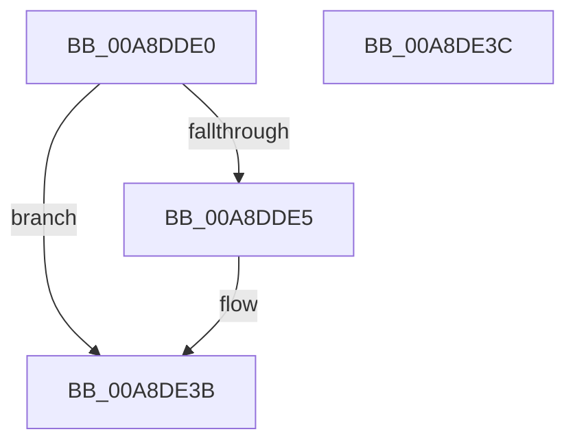

# SeCloseObjectAuditAlarm

- RVA: `0x00A8DDE0`–`0x00A8DE3D` (길이 `93` bytes)
- VA: `0x0000000140A8DDE0`
- 실행 섹션: `PAGE`
- PDB 이름 있음: `예`; PDB Function 태그: `아니요`
- unwind 정보 RVA: `0x000B8988`
- 디코드: `26`개 명령, `93/93` bytes 표시
- 미해석 바이트: `0` (있으면 어셈블리에 `.byte`로 보존)

> 이 문서는 커널 이미지의 기계어와 PDB 기호를 분석해 생성했습니다. 4번과 5번은 함수 원형과 자료형을 바이너리 사용 방식에서 추정한 C 해석이며 원본 소스 복구 결과는 아닙니다.

## 1. Dependencies

- 직접 호출 지점: **3**; 고유 호출 대상: **3**
- 직접 호출자로 확인된 함수: **0**
- RIP 상대 이미지 참조: **1**

### Outgoing calls
- `0x00A8DE06` → [SeCaptureSubjectContext](../86/SeCaptureSubjectContext_function_0086B820.md) (function, `0x0086B820`)
- `0x00A8DE22` → [SepAdtCloseObjectAuditAlarm](../86/SepAdtCloseObjectAuditAlarm_function_0086B4E8.md) (function, `0x0086B4E8`)
- `0x00A8DE2C` → [SeReleaseSubjectContext](../86/SeReleaseSubjectContext_function_0086B710.md) (function, `0x0086B710`)

### Direct callers
- 이 함수 시작 RVA로 연결되는 직접 call은 확인되지 않았습니다. 간접 호출은 완전히 역산할 수 없습니다.

### Static image references
- `0x00A8DE1B` → RVA `0x000013A8` (`.rdata`; read)

## 2. Other-region calls and transfers

- 다른 실행 섹션으로 향하는 call: **0**
- 별도 외부 분기/꼬리 이동을 확인하지 못했습니다.

## 3. Assembly (complete function range)

```asm
00A8DDE0  45 84 C0                        test r8b, r8b
00A8DDE3  74 56                           je 0x140a8de3b
00A8DDE5  48 8B C4                        mov rax, rsp
00A8DDE8  48 89 58 08                     mov qword ptr [rax + 8], rbx
00A8DDEC  57                              push rdi
00A8DDED  48 83 EC 50                     sub rsp, 0x50
00A8DDF1  0F 57 C0                        xorps xmm0, xmm0
00A8DDF4  48 8B F9                        mov rdi, rcx
00A8DDF7  48 8D 48 D8                     lea rcx, [rax - 0x28]
00A8DDFB  48 8B DA                        mov rbx, rdx
00A8DDFE  0F 11 40 D8                     movups xmmword ptr [rax - 0x28], xmm0
00A8DE02  0F 11 40 E8                     movups xmmword ptr [rax - 0x18], xmm0
00A8DE06  E8 15 DA DD FF                  call 0x14086b820
00A8DE0B  4C 8B CF                        mov r9, rdi
00A8DE0E  C6 44 24 20 01                  mov byte ptr [rsp + 0x20], 1
00A8DE13  4C 8D 44 24 30                  lea r8, [rsp + 0x30]
00A8DE18  48 8B D3                        mov rdx, rbx
00A8DE1B  48 8D 0D 86 35 57 FF            lea rcx, [rip - 0xa8ca7a]
00A8DE22  E8 C1 D6 DD FF                  call 0x14086b4e8
00A8DE27  48 8D 4C 24 30                  lea rcx, [rsp + 0x30]
00A8DE2C  E8 DF D8 DD FF                  call 0x14086b710
00A8DE31  48 8B 5C 24 60                  mov rbx, qword ptr [rsp + 0x60]
00A8DE36  48 83 C4 50                     add rsp, 0x50
00A8DE3A  5F                              pop rdi
00A8DE3B  C3                              ret
00A8DE3C  CC                              int3
```

## 4. C-style interpretation (structured pseudocode)

```c
__int64 __fastcall SeCloseObjectAuditAlarm(__int64 a1, __int64 a2, unsigned __int8 a3)
{
    __int64 result;
    __int64 v_rbx;
    __int64 v_rdi;
    __int64 v_rsp;
    unsigned __int64 v_stack_m28;
    unsigned __int8 v_stack_m38;
    unsigned __int64 v_stack_p8;

    if (a3 != 0) {
        result = v_rsp;
        *(unsigned __int64 *)(result + 8) = v_rbx;
        v_rsp = (v_rsp) - (80);
        v_rdi = a1;
        a1 = result - 40;
        v_rbx = a2;
        *(unsigned __int64 *)(result - 40) = v_xmm0;
        *(unsigned __int64 *)(result - 24) = v_xmm0;
        result = SeCaptureSubjectContext(a1, a2, a3, a4);
        a4 = v_rdi;
        v_stack_m38 = 1;
        a3 = v_stack_m28;
        a2 = v_rbx;
        a1 = v_rip - 11061882;
        result = SepAdtCloseObjectAuditAlarm(a1, a2, a3, a4);
        a1 = v_stack_m28;
        result = SeReleaseSubjectContext(a1, a2, a3, a4);
        v_rbx = v_stack_p8;
        v_rsp = (v_rsp) + (80);
    }
    return result;
}
```

## 5. (Beta) C Style

```c
int64_t SeCloseObjectAuditAlarm(int64_t Arg1, int64_t Arg2, uint8_t Arg3)
{
    int64_t result;
    int64_t local_rbx;
    int64_t local_rdi;
    int64_t local_rsp;
    uint64_t v_stack_m28;
    uint8_t v_stack_m38;
    uint64_t v_stack_p8;

    if (Arg3 != 0) {
        result = local_rsp;
        *(uint64_t *)(result + 0x8) = local_rbx;
        local_rsp = (local_rsp) - (80);
        local_rdi = Arg1;
        Arg1 = result - 40;
        local_rbx = Arg2;
        *(uint64_t *)(result - 0x28) = v_xmm0;
        *(uint64_t *)(result - 0x18) = v_xmm0;
        result = SeCaptureSubjectContext(Arg1, Arg2, Arg3, a4);
        a4 = local_rdi;
        v_stack_m38 = 1;
        Arg3 = v_stack_m28;
        Arg2 = local_rbx;
        Arg1 = v_rip - 11061882;
        result = SepAdtCloseObjectAuditAlarm(Arg1, Arg2, Arg3, a4);
        Arg1 = v_stack_m28;
        result = SeReleaseSubjectContext(Arg1, Arg2, Arg3, a4);
        local_rbx = v_stack_p8;
        local_rsp = (local_rsp) + (80);
    }
    return result;
}
```

## 6. Execution-region graph

[열기: 2D/3D 그래프와 함수 탐색 컨트롤 패널](../../../control-panel.html?section=page&rva=0x00A8DDE0&view=graph)

- 2D 그래프는 위에서 아래로 흐르고, 3D 그래프는 빈 공간을 드래그해 회전합니다. Shift+드래그는 이동, 휠은 확대·축소, 함수 노드 선택은 대상 보고서 이동입니다.

### Static fallback


