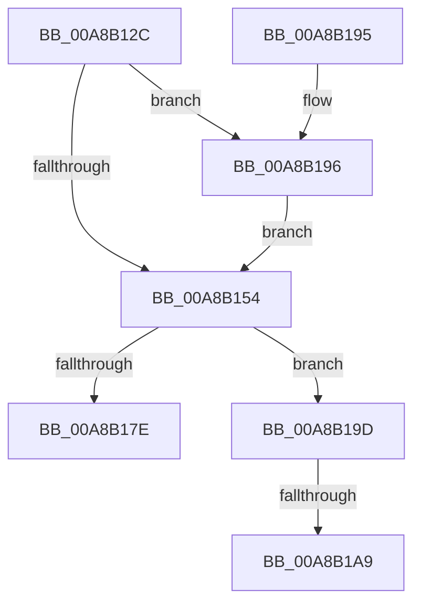

# SeCreateAccessStateFromSubjectContext

- RVA: `0x00A8B12C`–`0x00A8B1B4` (길이 `136` bytes)
- VA: `0x0000000140A8B12C`
- 실행 섹션: `PAGE`
- PDB 이름 있음: `예`; PDB Function 태그: `예`
- unwind 정보 RVA: `0x000ADAA0`
- 디코드: `40`개 명령, `136/136` bytes 표시
- 미해석 바이트: `0` (있으면 어셈블리에 `.byte`로 보존)

> 이 문서는 커널 이미지의 기계어와 PDB 기호를 분석해 생성했습니다. 4번과 5번은 함수 원형과 자료형을 바이너리 사용 방식에서 추정한 C 해석이며 원본 소스 복구 결과는 아닙니다.

## 1. Dependencies

- 직접 호출 지점: **4**; 고유 호출 대상: **3**
- 직접 호출자로 확인된 함수: **3**
- RIP 상대 이미지 참조: **0**

### Outgoing calls
- `0x00A8B158` → [ObfReferenceObject](../../text/20/ObfReferenceObject_function_0020FA20.md) (function, `0x0020FA20`)
- `0x00A8B173` → [SepCreateAccessStateFromSubjectContext](../../text/3E/SepCreateAccessStateFromSubjectContext_function_003EBF40.md) (function, `0x003EBF40`)
- `0x00A8B196` → [ObfReferenceObject](../../text/20/ObfReferenceObject_function_0020FA20.md) (function, `0x0020FA20`)
- `0x00A8B1A9` → [ObfDereferenceObject](../../text/2F/ObfDereferenceObject_function_002F9350.md) (function, `0x002F9350`)

### Direct callers
- [CmpDoBuildVirtualStack](../7E/CmpDoBuildVirtualStack_function_007EB4C4.md) at `0x007EB5C8`
- [CmKeyBodyReplicateToVirtual](../84/CmKeyBodyReplicateToVirtual_function_00843FE4.md) at `0x00844280`
- [CmKeyBodyRemapToVirtual](../AC/CmKeyBodyRemapToVirtual_function_00AC9494.md) at `0x00AC9682`

### Static image references
- 디코드된 RIP-relative 메모리 참조가 없습니다.

## 2. Other-region calls and transfers

- 다른 실행 섹션으로 향하는 call: **4**
  - `0x00A8B158` → [ObfReferenceObject](../../text/20/ObfReferenceObject_function_0020FA20.md) (`PAGE` → `.text`)
  - `0x00A8B173` → [SepCreateAccessStateFromSubjectContext](../../text/3E/SepCreateAccessStateFromSubjectContext_function_003EBF40.md) (`PAGE` → `.text`)
  - `0x00A8B196` → [ObfReferenceObject](../../text/20/ObfReferenceObject_function_0020FA20.md) (`PAGE` → `.text`)
  - `0x00A8B1A9` → [ObfDereferenceObject](../../text/2F/ObfDereferenceObject_function_002F9350.md) (`PAGE` → `.text`)
- call이 아닌 외부 분기/꼬리 이동: **2**
  - `0x00A8B1A3` → [sub_00B4607C](../B4/Unknown_function_00B4607C.md) (`tail-transfer`)
  - `0x00A8B1AF` → [sub_00B4607C](../B4/Unknown_function_00B4607C.md) (`tail-transfer`)

## 3. Assembly (complete function range)

```asm
00A8B12C  48 89 5C 24 08                  mov qword ptr [rsp + 8], rbx
00A8B131  48 89 6C 24 10                  mov qword ptr [rsp + 0x10], rbp
00A8B136  48 89 74 24 18                  mov qword ptr [rsp + 0x18], rsi
00A8B13B  57                              push rdi
00A8B13C  48 83 EC 30                     sub rsp, 0x30
00A8B140  48 8B D9                        mov rbx, rcx
00A8B143  41 8B F9                        mov edi, r9d
00A8B146  48 8B 09                        mov rcx, qword ptr [rcx]
00A8B149  49 8B F0                        mov rsi, r8
00A8B14C  48 8B EA                        mov rbp, rdx
00A8B14F  48 85 C9                        test rcx, rcx
00A8B152  75 42                           jne 0x140a8b196
00A8B154  48 8B 4B 10                     mov rcx, qword ptr [rbx + 0x10]
00A8B158  E8 C3 48 78 FF                  call 0x14020fa20
00A8B15D  48 8B 44 24 60                  mov rax, qword ptr [rsp + 0x60]
00A8B162  44 8B CF                        mov r9d, edi
00A8B165  4C 8B C6                        mov r8, rsi
00A8B168  48 89 44 24 20                  mov qword ptr [rsp + 0x20], rax
00A8B16D  48 8B D5                        mov rdx, rbp
00A8B170  48 8B CB                        mov rcx, rbx
00A8B173  E8 C8 0D 96 FF                  call 0x1403ebf40
00A8B178  8B F8                           mov edi, eax
00A8B17A  85 C0                           test eax, eax
00A8B17C  78 1F                           js 0x140a8b19d
00A8B17E  48 8B 5C 24 40                  mov rbx, qword ptr [rsp + 0x40]
00A8B183  8B C7                           mov eax, edi
00A8B185  48 8B 6C 24 48                  mov rbp, qword ptr [rsp + 0x48]
00A8B18A  48 8B 74 24 50                  mov rsi, qword ptr [rsp + 0x50]
00A8B18F  48 83 C4 30                     add rsp, 0x30
00A8B193  5F                              pop rdi
00A8B194  C3                              ret
00A8B195  CC                              int3
00A8B196  E8 85 48 78 FF                  call 0x14020fa20
00A8B19B  EB B7                           jmp 0x140a8b154
00A8B19D  48 8B 0B                        mov rcx, qword ptr [rbx]
00A8B1A0  48 85 C9                        test rcx, rcx
00A8B1A3  0F 84 D3 AE 0B 00               je 0x140b4607c
00A8B1A9  E8 A2 E1 86 FF                  call 0x1402f9350
00A8B1AE  90                              nop
00A8B1AF  E9 C8 AE 0B 00                  jmp 0x140b4607c
```

## 4. C-style interpretation (structured pseudocode)

```c
__int64 __fastcall SeCreateAccessStateFromSubjectContext(__int64 a1, __int64 a2, __int64 a3, int a4, __int64 a5)
{
    __int64 result;
    __int64 v_rsp;
    unsigned __int64 v_stack_m18;
    unsigned __int64 v_stack_p10;
    unsigned __int64 v_stack_p18;
    unsigned __int64 v_stack_p8;

    v_stack_p8 = v_rbx;
    v_stack_p10 = v_rbp;
    v_stack_p18 = v_rsi;
    v_rsp = (v_rsp) - (48);
    if (*(unsigned __int64 *)(a1) != 0) goto loc_00A8B196;
loc_00A8B154:
    result = ObfReferenceObject(*(unsigned __int64 *)(a1 + 16), a2, a3, a4);
    v_stack_m18 = a5;
    result = SepCreateAccessStateFromSubjectContext(a1, a2, a3, (unsigned int)((unsigned int)((unsigned int)(a4))));
    if (sign_flag) goto loc_00A8B19D;
    v_rsp = (v_rsp) + (48);
    return (unsigned int)((unsigned int)((unsigned int)((unsigned int)(result))));
loc_00A8B196:
    result = ObfReferenceObject(a1, a2, a3, (unsigned int)((unsigned int)((unsigned int)(a4))));
    goto loc_00A8B154;
loc_00A8B19D:
    result = ObfDereferenceObject(*(unsigned __int64 *)(v_stack_p8), a2, a3, (unsigned int)((unsigned int)((unsigned int)(a4))));
}
```

## 5. (Beta) C Style

```c
int64_t SeCreateAccessStateFromSubjectContext(void *Arg1, int64_t Arg2, int64_t Arg3, int32_t Arg4, int64_t Arg5)
{
    uint8_t *arg1 = (uint8_t *)Arg1;

    int64_t result;
    int64_t local_rsp;
    uint64_t v_stack_m18;
    uint64_t v_stack_p10;
    uint64_t v_stack_p18;
    uint64_t v_stack_p8;

    v_stack_p8 = local_rbx;
    v_stack_p10 = local_rbp;
    v_stack_p18 = local_rsi;
    local_rsp = (local_rsp) - (48);
    if (*(uint64_t *)(arg1) != 0) goto loc_00A8B196;
loc_00A8B154:
    result = ObfReferenceObject(*(uint64_t *)(arg1 + 0x10), Arg2, Arg3, Arg4);
    v_stack_m18 = Arg5;
    result = SepCreateAccessStateFromSubjectContext(Arg1, Arg2, Arg3, (uint32_t)((uint32_t)((uint32_t)(Arg4))));
    if (sign_flag) goto loc_00A8B19D;
    local_rsp = (local_rsp) + (48);
    return (uint32_t)((uint32_t)((uint32_t)((uint32_t)(result))));
loc_00A8B196:
    result = ObfReferenceObject(Arg1, Arg2, Arg3, (uint32_t)((uint32_t)((uint32_t)(Arg4))));
    goto loc_00A8B154;
loc_00A8B19D:
    result = ObfDereferenceObject(*(uint64_t *)(v_stack_p8), Arg2, Arg3, (uint32_t)((uint32_t)((uint32_t)(Arg4))));
}
```

### 관측된 메모리 오프셋

구조체 형식이 확인되지 않은 접근은 인자 기준의 오프셋으로만 기록했습니다.

| 기준 인자 | 오프셋 표현 | 폭 (bit) | 접근 |
|---|---:|---:|---|
| `Arg1` | `+ 0x0` | `64` | `R` |
| `Arg1` | `+ 0x10` | `64` | `R` |

## 6. Execution-region graph

[열기: 2D/3D 그래프와 함수 탐색 컨트롤 패널](../../../control-panel.html?section=page&rva=0x00A8B12C&view=graph)

- 2D 그래프는 위에서 아래로 흐르고, 3D 그래프는 빈 공간을 드래그해 회전합니다. Shift+드래그는 이동, 휠은 확대·축소, 함수 노드 선택은 대상 보고서 이동입니다.

### Static fallback


