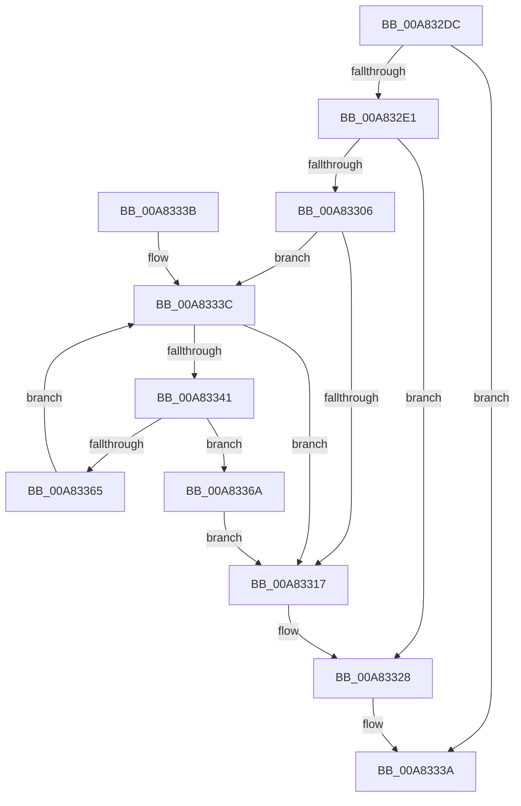

# SeMaximumAuditMaskFromGlobalSacl

- RVA: `0x00A832DC`–`0x00A8338B` (길이 `175` bytes)
- VA: `0x0000000140A832DC`
- 실행 섹션: `PAGE`
- PDB 이름 있음: `예`; PDB Function 태그: `아니요`
- unwind 정보 RVA: `0x000B741C`
- 디코드: `52`개 명령, `175/175` bytes 표시
- 미해석 바이트: `0` (있으면 어셈블리에 `.byte`로 보존)

> 이 문서는 커널 이미지의 기계어와 PDB 기호를 분석해 생성했습니다. 4번과 5번은 함수 원형과 자료형을 바이너리 사용 방식에서 추정한 C 해석이며 원본 소스 복구 결과는 아닙니다.

## 1. Dependencies

- 직접 호출 지점: **5**; 고유 호출 대상: **5**
- 직접 호출자로 확인된 함수: **2**
- RIP 상대 이미지 참조: **2**

### Outgoing calls
- `0x00A83306` → [SepRmAcquireGlobalSaclReadLock](../../text/46/SepRmAcquireGlobalSaclReadLock_function_0046B608.md) (function, `0x0046B608`)
- `0x00A8331E` → [ExReleaseResourceLite](../../text/25/ExReleaseResourceLite_function_0025FA10.md) (function, `0x0025FA10`)
- `0x00A83323` → [KeLeaveCriticalRegion](../../text/25/KeLeaveCriticalRegion_function_0025D8B0.md) (function, `0x0025D8B0`)
- `0x00A8335C` → [RtlCompareUnicodeStrings](../97/RtlCompareUnicodeStrings_function_009727E0.md) (function, `0x009727E0`)
- `0x00A8337E` → [SeMaximumAuditMask](../../text/4A/SeMaximumAuditMask_function_004A8D2C.md) (function, `0x004A8D2C`)

### Direct callers
- [sub_0086E95E](../86/Unknown_function_0086E95E.md) at `0x0086EA38`
- [sub_00B222A0](../B2/Unknown_function_00B222A0.md) at `0x00B222CB`

### Static image references
- `0x00A8330B` → RVA `0x00E680F8` (`.data`; read)
- `0x00A83317` → RVA `0x00E68100` (`.data`; read)

## 2. Other-region calls and transfers

- 다른 실행 섹션으로 향하는 call: **4**
  - `0x00A83306` → [SepRmAcquireGlobalSaclReadLock](../../text/46/SepRmAcquireGlobalSaclReadLock_function_0046B608.md) (`PAGE` → `.text`)
  - `0x00A8331E` → [ExReleaseResourceLite](../../text/25/ExReleaseResourceLite_function_0025FA10.md) (`PAGE` → `.text`)
  - `0x00A83323` → [KeLeaveCriticalRegion](../../text/25/KeLeaveCriticalRegion_function_0025D8B0.md) (`PAGE` → `.text`)
  - `0x00A8337E` → [SeMaximumAuditMask](../../text/4A/SeMaximumAuditMask_function_004A8D2C.md) (`PAGE` → `.text`)
- 별도 외부 분기/꼬리 이동을 확인하지 못했습니다.

## 3. Assembly (complete function range)

```asm
00A832DC  48 85 C9                        test rcx, rcx
00A832DF  74 59                           je 0x140a8333a
00A832E1  48 89 5C 24 10                  mov qword ptr [rsp + 0x10], rbx
00A832E6  48 89 6C 24 18                  mov qword ptr [rsp + 0x18], rbp
00A832EB  56                              push rsi
00A832EC  57                              push rdi
00A832ED  41 56                           push r14
00A832EF  48 83 EC 30                     sub rsp, 0x30
00A832F3  48 83 79 08 00                  cmp qword ptr [rcx + 8], 0
00A832F8  49 8B F1                        mov rsi, r9
00A832FB  49 8B E8                        mov rbp, r8
00A832FE  44 8B F2                        mov r14d, edx
00A83301  48 8B F9                        mov rdi, rcx
00A83304  74 22                           je 0x140a83328
00A83306  E8 FD 82 9E FF                  call 0x14046b608
00A8330B  48 8B 1D E6 4D 3E 00            mov rbx, qword ptr [rip + 0x3e4de6]
00A83312  48 85 DB                        test rbx, rbx
00A83315  75 25                           jne 0x140a8333c
00A83317  48 8D 0D E2 4D 3E 00            lea rcx, [rip + 0x3e4de2]
00A8331E  E8 ED C6 7D FF                  call 0x14025fa10
00A83323  E8 88 A5 7D FF                  call 0x14025d8b0
00A83328  48 8B 5C 24 58                  mov rbx, qword ptr [rsp + 0x58]
00A8332D  48 8B 6C 24 60                  mov rbp, qword ptr [rsp + 0x60]
00A83332  48 83 C4 30                     add rsp, 0x30
00A83336  41 5E                           pop r14
00A83338  5F                              pop rdi
00A83339  5E                              pop rsi
00A8333A  C3                              ret
00A8333B  CC                              int3
00A8333C  48 85 DB                        test rbx, rbx
00A8333F  74 D6                           je 0x140a83317
00A83341  44 0F B7 4B 08                  movzx r9d, word ptr [rbx + 8]
00A83346  0F B7 17                        movzx edx, word ptr [rdi]
00A83349  4C 8B 43 10                     mov r8, qword ptr [rbx + 0x10]
00A8334D  48 8B 4F 08                     mov rcx, qword ptr [rdi + 8]
00A83351  49 D1 E9                        shr r9, 1
00A83354  48 D1 EA                        shr rdx, 1
00A83357  C6 44 24 20 00                  mov byte ptr [rsp + 0x20], 0
00A8335C  E8 7F F4 EE FF                  call 0x1409727e0
00A83361  85 C0                           test eax, eax
00A83363  74 05                           je 0x140a8336a
00A83365  48 8B 1B                        mov rbx, qword ptr [rbx]
00A83368  EB D2                           jmp 0x140a8333c
00A8336A  48 8B 4B 18                     mov rcx, qword ptr [rbx + 0x18]
00A8336E  4C 8D 4C 24 50                  lea r9, [rsp + 0x50]
00A83373  83 64 24 50 00                  and dword ptr [rsp + 0x50], 0
00A83378  4C 8B C5                        mov r8, rbp
00A8337B  41 8B D6                        mov edx, r14d
00A8337E  E8 A9 59 A2 FF                  call 0x1404a8d2c
00A83383  8B 44 24 50                     mov eax, dword ptr [rsp + 0x50]
00A83387  09 06                           or dword ptr [rsi], eax
00A83389  EB 8C                           jmp 0x140a83317
```

## 4. C-style interpretation (structured pseudocode)

```c
__int64 __fastcall SeMaximumAuditMaskFromGlobalSacl(__int64 a1, int a2, __int64 a3, __int64 a4)
{
    __int64 result;
    __int64 v_rsp;
    unsigned __int64 v_stack_p10;
    unsigned __int64 v_stack_p18;
    unsigned __int8 v_stack_p20;
    unsigned __int64 v_stack_p50;

    if (a1 == 0) goto loc_00A8333A;
    v_stack_p10 = v_rbx;
    v_stack_p18 = v_rbp;
    v_rsp = (v_rsp) - (48);
    if ((*(unsigned __int64 *)(a1 + 8)) == 0) goto loc_00A83328;
    result = SepRmAcquireGlobalSaclReadLock(a1, a2, a3, a4);
    if (*(unsigned __int64 *)(v_rip + 4083174) != 0) goto loc_00A8333C;
loc_00A83317:
    result = ExReleaseResourceLite(v_rip + 4083170, a2, a3, a4);
    result = KeLeaveCriticalRegion(v_rip + 4083170, a2, a3, a4);
loc_00A83328:
    v_rsp = (v_rsp) + (48);
loc_00A8333A:
    return result;
loc_00A8333C:
    if (v_stack_p10 == 0) goto loc_00A83317;
    a4 = (*(unsigned __int16 *)(v_stack_p10 + 8)) >> (1);
    a2 = (*(unsigned __int16 *)(a1)) >> (1);
    v_stack_p20 = 0;
    result = RtlCompareUnicodeStrings(*(unsigned __int64 *)(a1 + 8), a2, *(unsigned __int64 *)(v_stack_p10 + 16), a4);
    if ((unsigned int)(result) == 0) goto loc_00A8336A;
    goto loc_00A8333C;
loc_00A8336A:
    result = SeMaximumAuditMask(*(unsigned __int64 *)(*(unsigned __int64 *)(v_stack_p10) + 24), (unsigned int)((unsigned int)((unsigned int)(a2))), v_stack_p18, v_stack_p50);
    goto loc_00A83317;
}
```

## 5. (Beta) C Style

```c
int64_t SeMaximumAuditMaskFromGlobalSacl(int64_t Arg1, int32_t Arg2, int64_t Arg3, void *Arg4)
{
    uint8_t *arg4 = (uint8_t *)Arg4;

    int64_t result;
    int64_t local_rsp;
    uint64_t v_stack_p10;
    uint64_t v_stack_p18;
    uint8_t v_stack_p20;
    uint64_t v_stack_p50;

    if (Arg1 == 0) goto loc_00A8333A;
    v_stack_p10 = local_rbx;
    v_stack_p18 = local_rbp;
    local_rsp = (local_rsp) - (48);
    if ((*(uint64_t *)(Arg1 + 0x8)) == 0) goto loc_00A83328;
    result = SepRmAcquireGlobalSaclReadLock(Arg1, Arg2, Arg3, Arg4);
    if (*(uint64_t *)(v_rip + 0x3E4DE6) != 0) goto loc_00A8333C;
loc_00A83317:
    result = ExReleaseResourceLite(v_rip + 4083170, Arg2, Arg3, Arg4);
    result = KeLeaveCriticalRegion(v_rip + 4083170, Arg2, Arg3, Arg4);
loc_00A83328:
    local_rsp = (local_rsp) + (48);
loc_00A8333A:
    return result;
loc_00A8333C:
    if (v_stack_p10 == 0) goto loc_00A83317;
    Arg4 = (*(uint16_t *)(v_stack_p10 + 0x8)) >> (1);
    Arg2 = (*(uint16_t *)(Arg1)) >> (1);
    v_stack_p20 = 0;
    result = RtlCompareUnicodeStrings(*(uint64_t *)(Arg1 + 0x8), Arg2, *(uint64_t *)(v_stack_p10 + 0x10), Arg4);
    if ((uint32_t)(result) == 0) goto loc_00A8336A;
    goto loc_00A8333C;
loc_00A8336A:
    result = SeMaximumAuditMask(*(uint64_t *)(*(uint64_t *)(v_stack_p10) + 0x18), (uint32_t)((uint32_t)((uint32_t)(Arg2))), v_stack_p18, v_stack_p50);
    goto loc_00A83317;
}
```

### 관측된 메모리 오프셋

구조체 형식이 확인되지 않은 접근은 인자 기준의 오프셋으로만 기록했습니다.

| 기준 인자 | 오프셋 표현 | 폭 (bit) | 접근 |
|---|---:|---:|---|
| `Arg4` | `+ 0x0` | `32` | `R/W` |

## 6. Execution-region graph

[열기: 2D/3D 그래프와 함수 탐색 컨트롤 패널](../../../control-panel.html?section=page&rva=0x00A832DC&view=graph)

- 2D 그래프는 위에서 아래로 흐르고, 3D 그래프는 빈 공간을 드래그해 회전합니다. Shift+드래그는 이동, 휠은 확대·축소, 함수 노드 선택은 대상 보고서 이동입니다.

### Static fallback


