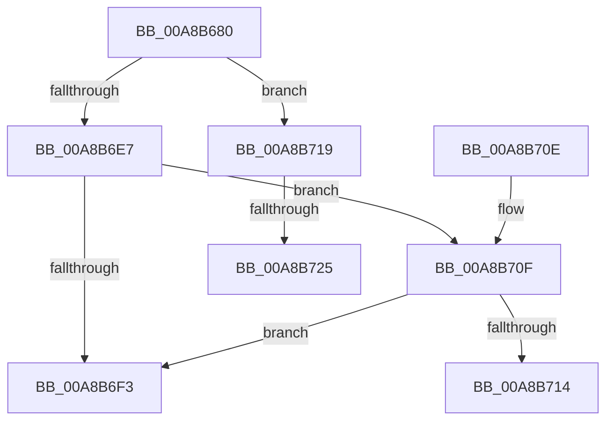

# SeOpenObjectAuditAlarmForNonObObject

- RVA: `0x00A8B680`–`0x00A8B72E` (길이 `174` bytes)
- VA: `0x0000000140A8B680`
- 실행 섹션: `PAGE`
- PDB 이름 있음: `예`; PDB Function 태그: `예`
- unwind 정보 RVA: `0x000B86F0`
- 디코드: `53`개 명령, `174/174` bytes 표시
- 미해석 바이트: `0` (있으면 어셈블리에 `.byte`로 보존)

> 이 문서는 커널 이미지의 기계어와 PDB 기호를 분석해 생성했습니다. 4번과 5번은 함수 원형과 자료형을 바이너리 사용 방식에서 추정한 C 해석이며 원본 소스 복구 결과는 아닙니다.

## 1. Dependencies

- 직접 호출 지점: **1**; 고유 호출 대상: **1**
- 직접 호출자로 확인된 함수: **0**
- RIP 상대 이미지 참조: **0**

### Outgoing calls
- `0x00A8B6CE` → [SepAdtAuditThisEventWithContext](../87/SepAdtAuditThisEventWithContext_function_00870AC0.md) (function, `0x00870AC0`)

### Direct callers
- 이 함수 시작 RVA로 연결되는 직접 call은 확인되지 않았습니다. 간접 호출은 완전히 역산할 수 없습니다.

### Static image references
- 디코드된 RIP-relative 메모리 참조가 없습니다.

## 2. Other-region calls and transfers

- 다른 실행 섹션으로 향하는 call: **0**
- call이 아닌 외부 분기/꼬리 이동: **3**
  - `0x00A8B714` → [sub_00B46176 + 0x18E](../B4/Unknown_function_00B46176.md) (`tail-transfer`)
  - `0x00A8B71F` → [sub_00B46176](../B4/Unknown_function_00B46176.md) (`tail-transfer`)
  - `0x00A8B729` → [sub_00B46176](../B4/Unknown_function_00B46176.md) (`tail-transfer`)

## 3. Assembly (complete function range)

```asm
00A8B680  48 8B C4                        mov rax, rsp
00A8B683  48 89 58 08                     mov qword ptr [rax + 8], rbx
00A8B687  4C 89 48 20                     mov qword ptr [rax + 0x20], r9
00A8B68B  4C 89 40 18                     mov qword ptr [rax + 0x18], r8
00A8B68F  48 89 50 10                     mov qword ptr [rax + 0x10], rdx
00A8B693  55                              push rbp
00A8B694  56                              push rsi
00A8B695  57                              push rdi
00A8B696  41 54                           push r12
00A8B698  41 55                           push r13
00A8B69A  41 56                           push r14
00A8B69C  41 57                           push r15
00A8B69E  48 8D 68 C1                     lea rbp, [rax - 0x3f]
00A8B6A2  48 81 EC B0 00 00 00            sub rsp, 0xb0
00A8B6A9  40 8A B5 8F 00 00 00            mov sil, byte ptr [rbp + 0x8f]
00A8B6B0  33 D2                           xor edx, edx
00A8B6B2  48 8B 7D 6F                     mov rdi, qword ptr [rbp + 0x6f]
00A8B6B6  4C 8B E9                        mov r13, rcx
00A8B6B9  88 55 F7                        mov byte ptr [rbp - 9], dl
00A8B6BC  40 84 F6                        test sil, sil
00A8B6BF  4C 8B CF                        mov r9, rdi
00A8B6C2  40 8A D6                        mov dl, sil
00A8B6C5  41 0F 94 C0                     sete r8b
00A8B6C9  B9 77 00 00 00                  mov ecx, 0x77
00A8B6CE  E8 ED 53 DE FF                  call 0x140870ac0
00A8B6D3  4C 8B A5 87 00 00 00            mov r12, qword ptr [rbp + 0x87]
00A8B6DA  45 33 C9                        xor r9d, r9d
00A8B6DD  88 85 8F 00 00 00               mov byte ptr [rbp + 0x8f], al
00A8B6E3  84 C0                           test al, al
00A8B6E5  75 32                           jne 0x140a8b719
00A8B6E7  48 8B 5D 5F                     mov rbx, qword ptr [rbp + 0x5f]
00A8B6EB  4C 8B 75 57                     mov r14, qword ptr [rbp + 0x57]
00A8B6EF  84 C0                           test al, al
00A8B6F1  74 1C                           je 0x140a8b70f
00A8B6F3  48 8B 9C 24 F0 00 00 00         mov rbx, qword ptr [rsp + 0xf0]
00A8B6FB  48 81 C4 B0 00 00 00            add rsp, 0xb0
00A8B702  41 5F                           pop r15
00A8B704  41 5E                           pop r14
00A8B706  41 5D                           pop r13
00A8B708  41 5C                           pop r12
00A8B70A  5F                              pop rdi
00A8B70B  5E                              pop rsi
00A8B70C  5D                              pop rbp
00A8B70D  C3                              ret
00A8B70E  CC                              int3
00A8B70F  4D 85 E4                        test r12, r12
00A8B712  74 DF                           je 0x140a8b6f3
00A8B714  E9 EB AB 0B 00                  jmp 0x140b46304
00A8B719  4C 8B 07                        mov r8, qword ptr [rdi]
00A8B71C  4D 85 C0                        test r8, r8
00A8B71F  0F 85 51 AA 0B 00               jne 0x140b46176
00A8B725  4C 8B 47 10                     mov r8, qword ptr [rdi + 0x10]
00A8B729  E9 48 AA 0B 00                  jmp 0x140b46176
```

## 4. C-style interpretation (structured pseudocode)

```c
__int64 __fastcall SeOpenObjectAuditAlarmForNonObObject(__int64 a1, __int64 a2, __int64 a3, __int64 a4)
{
    __int64 result;
    __int64 v_rsp;
    unsigned __int64 v_stack_p8;

    *(unsigned __int64 *)(v_rsp + 8) = v_rbx;
    *(unsigned __int64 *)(v_rsp + 32) = a4;
    *(unsigned __int64 *)(v_rsp + 24) = a3;
    *(unsigned __int64 *)(v_rsp + 16) = a2;
    v_rsp = (v_rsp) - (176);
    a2 = 0;
    *(unsigned __int8 *)(v_rsp - 63 - 9) = 0;
    a3 = ((unsigned __int8)(*(unsigned __int8 *)(v_rsp - 63 + 143)) == 0) ? 1 : 0;
    result = SepAdtAuditThisEventWithContext(119, (unsigned __int8)(*(unsigned __int8 *)(v_rsp - 63 + 143)), a3, *(unsigned __int64 *)(v_rsp - 63 + 111));
    a4 = 0;
    *(unsigned __int8 *)(v_rsp - 63 + 143) = (unsigned __int8)(result);
    if ((unsigned __int8)(result) != 0) goto loc_00A8B719;
    if ((unsigned __int8)(result) == 0) goto loc_00A8B70F;
loc_00A8B6F3:
    v_rsp = (v_rsp) + (176);
    return result;
loc_00A8B70F:
    if (*(unsigned __int64 *)(v_rsp - 63 + 135) == 0) goto loc_00A8B6F3;
loc_00A8B719:
}
```

## 5. (Beta) C Style

```c
int64_t SeOpenObjectAuditAlarmForNonObObject(int64_t Arg1, int64_t Arg2, int64_t Arg3, int64_t Arg4)
{
    int64_t result;
    int64_t local_rsp;
    uint64_t v_stack_p8;

    *(uint64_t *)(local_rsp + 0x8) = local_rbx;
    *(uint64_t *)(local_rsp + 0x20) = Arg4;
    *(uint64_t *)(local_rsp + 0x18) = Arg3;
    *(uint64_t *)(local_rsp + 0x10) = Arg2;
    local_rsp = (local_rsp) - (176);
    Arg2 = 0;
    *(uint8_t *)(local_rsp - 0x3F - 0x9) = 0;
    Arg3 = ((uint8_t)(*(uint8_t *)(local_rsp - 0x3F + 0x8F)) == 0) ? 1 : 0;
    result = SepAdtAuditThisEventWithContext(119, (uint8_t)(*(uint8_t *)(local_rsp - 0x3F + 0x8F)), Arg3, *(uint64_t *)(local_rsp - 0x3F + 0x6F));
    Arg4 = 0;
    *(uint8_t *)(local_rsp - 0x3F + 0x8F) = (uint8_t)(result);
    if ((uint8_t)(result) != 0) goto loc_00A8B719;
    if ((uint8_t)(result) == 0) goto loc_00A8B70F;
loc_00A8B6F3:
    local_rsp = (local_rsp) + (176);
    return result;
loc_00A8B70F:
    if (*(uint64_t *)(local_rsp - 0x3F + 0x87) == 0) goto loc_00A8B6F3;
loc_00A8B719:
}
```

## 6. Execution-region graph

[열기: 2D/3D 그래프와 함수 탐색 컨트롤 패널](../../../control-panel.html?section=page&rva=0x00A8B680&view=graph)

- 2D 그래프는 위에서 아래로 흐르고, 3D 그래프는 빈 공간을 드래그해 회전합니다. Shift+드래그는 이동, 휠은 확대·축소, 함수 노드 선택은 대상 보고서 이동입니다.

### Static fallback


