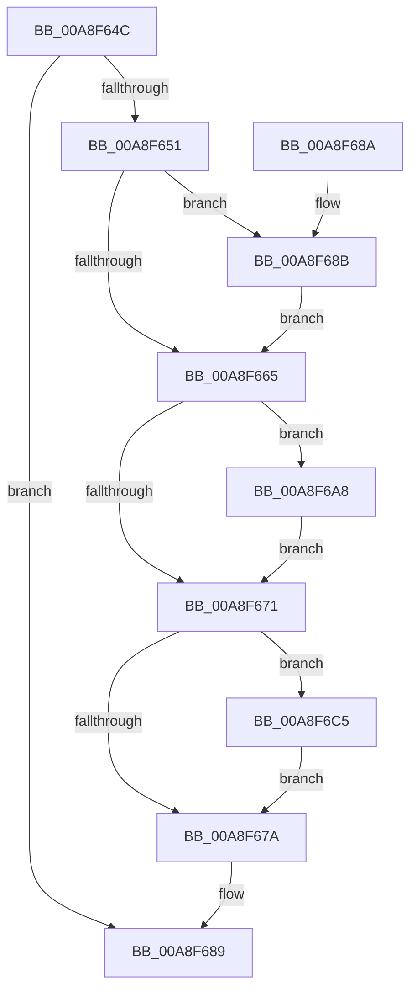

# SepDeleteClaimAttributes

- RVA: `0x00A8F64C`–`0x00A8F6D3` (길이 `135` bytes)
- VA: `0x0000000140A8F64C`
- 실행 섹션: `PAGE`
- PDB 이름 있음: `예`; PDB Function 태그: `아니요`
- unwind 정보 RVA: `0x000B8C2C`
- 디코드: `37`개 명령, `135/135` bytes 표시
- 미해석 바이트: `0` (있으면 어셈블리에 `.byte`로 보존)

> 이 문서는 커널 이미지의 기계어와 PDB 기호를 분석해 생성했습니다. 4번과 5번은 함수 원형과 자료형을 바이너리 사용 방식에서 추정한 C 해석이며 원본 소스 복구 결과는 아닙니다.

## 1. Dependencies

- 직접 호출 지점: **6**; 고유 호출 대상: **2**
- 직접 호출자로 확인된 함수: **3**
- RIP 상대 이미지 참조: **0**

### Outgoing calls
- `0x00A8F67F` → [ExFreePoolWithTag](../../poolcode/B8/ExFreePoolWithTag_function_00B82870.md) (function, `0x00B82870`)
- `0x00A8F68B` → [AuthzBasepFreeSecurityAttributesList](../../text/30/AuthzBasepFreeSecurityAttributesList_function_00301230.md) (function, `0x00301230`)
- `0x00A8F699` → [ExFreePoolWithTag](../../poolcode/B8/ExFreePoolWithTag_function_00B82870.md) (function, `0x00B82870`)
- `0x00A8F6A8` → [AuthzBasepFreeSecurityAttributesList](../../text/30/AuthzBasepFreeSecurityAttributesList_function_00301230.md) (function, `0x00301230`)
- `0x00A8F6B6` → [ExFreePoolWithTag](../../poolcode/B8/ExFreePoolWithTag_function_00B82870.md) (function, `0x00B82870`)
- `0x00A8F6C7` → [ExFreePoolWithTag](../../poolcode/B8/ExFreePoolWithTag_function_00B82870.md) (function, `0x00B82870`)

### Direct callers
- [SepDeleteLogonSessionClaims](../AA/SepDeleteLogonSessionClaims_function_00AAC8A4.md) at `0x00AAC8BD`
- [SepTokenDeleteMethod](../AF/SepTokenDeleteMethod_function_00AF23D0.md) at `0x00AF2416`
- [sub_00B3F52A](../B3/Unknown_function_00B3F52A.md) at `0x00B3F624`

### Static image references
- 디코드된 RIP-relative 메모리 참조가 없습니다.

## 2. Other-region calls and transfers

- 다른 실행 섹션으로 향하는 call: **6**
  - `0x00A8F67F` → [ExFreePoolWithTag](../../poolcode/B8/ExFreePoolWithTag_function_00B82870.md) (`PAGE` → `POOLCODE`)
  - `0x00A8F68B` → [AuthzBasepFreeSecurityAttributesList](../../text/30/AuthzBasepFreeSecurityAttributesList_function_00301230.md) (`PAGE` → `.text`)
  - `0x00A8F699` → [ExFreePoolWithTag](../../poolcode/B8/ExFreePoolWithTag_function_00B82870.md) (`PAGE` → `POOLCODE`)
  - `0x00A8F6A8` → [AuthzBasepFreeSecurityAttributesList](../../text/30/AuthzBasepFreeSecurityAttributesList_function_00301230.md) (`PAGE` → `.text`)
  - `0x00A8F6B6` → [ExFreePoolWithTag](../../poolcode/B8/ExFreePoolWithTag_function_00B82870.md) (`PAGE` → `POOLCODE`)
  - `0x00A8F6C7` → [ExFreePoolWithTag](../../poolcode/B8/ExFreePoolWithTag_function_00B82870.md) (`PAGE` → `POOLCODE`)
- 별도 외부 분기/꼬리 이동을 확인하지 못했습니다.

## 3. Assembly (complete function range)

```asm
00A8F64C  48 85 C9                        test rcx, rcx
00A8F64F  74 38                           je 0x140a8f689
00A8F651  53                              push rbx
00A8F652  48 83 EC 20                     sub rsp, 0x20
00A8F656  48 8B D9                        mov rbx, rcx
00A8F659  48 8B 89 40 02 00 00            mov rcx, qword ptr [rcx + 0x240]
00A8F660  48 85 C9                        test rcx, rcx
00A8F663  75 26                           jne 0x140a8f68b
00A8F665  48 8B 8B 48 02 00 00            mov rcx, qword ptr [rbx + 0x248]
00A8F66C  48 85 C9                        test rcx, rcx
00A8F66F  75 37                           jne 0x140a8f6a8
00A8F671  48 8B 4B 08                     mov rcx, qword ptr [rbx + 8]
00A8F675  48 85 C9                        test rcx, rcx
00A8F678  75 4B                           jne 0x140a8f6c5
00A8F67A  33 D2                           xor edx, edx
00A8F67C  48 8B CB                        mov rcx, rbx
00A8F67F  E8 EC 31 0F 00                  call 0x140b82870
00A8F684  48 83 C4 20                     add rsp, 0x20
00A8F688  5B                              pop rbx
00A8F689  C3                              ret
00A8F68A  CC                              int3
00A8F68B  E8 A0 1B 87 FF                  call 0x140301230
00A8F690  48 8B 8B 40 02 00 00            mov rcx, qword ptr [rbx + 0x240]
00A8F697  33 D2                           xor edx, edx
00A8F699  E8 D2 31 0F 00                  call 0x140b82870
00A8F69E  48 83 A3 40 02 00 00 00         and qword ptr [rbx + 0x240], 0
00A8F6A6  EB BD                           jmp 0x140a8f665
00A8F6A8  E8 83 1B 87 FF                  call 0x140301230
00A8F6AD  48 8B 8B 48 02 00 00            mov rcx, qword ptr [rbx + 0x248]
00A8F6B4  33 D2                           xor edx, edx
00A8F6B6  E8 B5 31 0F 00                  call 0x140b82870
00A8F6BB  48 83 A3 48 02 00 00 00         and qword ptr [rbx + 0x248], 0
00A8F6C3  EB AC                           jmp 0x140a8f671
00A8F6C5  33 D2                           xor edx, edx
00A8F6C7  E8 A4 31 0F 00                  call 0x140b82870
00A8F6CC  48 83 63 08 00                  and qword ptr [rbx + 8], 0
00A8F6D1  EB A7                           jmp 0x140a8f67a
```

## 4. C-style interpretation (structured pseudocode)

```c
__int64 __fastcall SepDeleteClaimAttributes(__int64 a1, int a2)
{
    __int64 result;
    __int64 v_rsp;

    if (a1 == 0) goto loc_00A8F689;
    v_rsp = (v_rsp) - (32);
    if (*(unsigned __int64 *)(a1 + 576) != 0) goto loc_00A8F68B;
loc_00A8F665:
    if (*(unsigned __int64 *)(a1 + 584) != 0) goto loc_00A8F6A8;
loc_00A8F671:
    if (*(unsigned __int64 *)(a1 + 8) != 0) goto loc_00A8F6C5;
loc_00A8F67A:
    a2 = 0;
    result = ExFreePoolWithTag(a1, a2, a3, a4);
    v_rsp = (v_rsp) + (32);
loc_00A8F689:
    return result;
loc_00A8F68B:
    result = AuthzBasepFreeSecurityAttributesList(a1, a2, a3, a4);
    a2 = 0;
    result = ExFreePoolWithTag(*(unsigned __int64 *)(a1 + 576), a2, a3, a4);
    goto loc_00A8F665;
loc_00A8F6A8:
    result = AuthzBasepFreeSecurityAttributesList(*(unsigned __int64 *)(a1 + 576), a2, a3, a4);
    a2 = 0;
    result = ExFreePoolWithTag(*(unsigned __int64 *)(a1 + 584), a2, a3, a4);
    goto loc_00A8F671;
loc_00A8F6C5:
    a2 = 0;
    result = ExFreePoolWithTag(*(unsigned __int64 *)(a1 + 584), a2, a3, a4);
    goto loc_00A8F67A;
}
```

## 5. (Beta) C Style

```c
int64_t SepDeleteClaimAttributes(int64_t Arg1, int32_t Arg2)
{
    int64_t result;
    int64_t local_rsp;

    if (Arg1 == 0) goto loc_00A8F689;
    local_rsp = (local_rsp) - (32);
    if (*(uint64_t *)(Arg1 + 0x240) != 0) goto loc_00A8F68B;
loc_00A8F665:
    if (*(uint64_t *)(Arg1 + 0x248) != 0) goto loc_00A8F6A8;
loc_00A8F671:
    if (*(uint64_t *)(Arg1 + 0x8) != 0) goto loc_00A8F6C5;
loc_00A8F67A:
    Arg2 = 0;
    result = ExFreePoolWithTag(Arg1, Arg2, a3, a4);
    local_rsp = (local_rsp) + (32);
loc_00A8F689:
    return result;
loc_00A8F68B:
    result = AuthzBasepFreeSecurityAttributesList(Arg1, Arg2, a3, a4);
    Arg2 = 0;
    result = ExFreePoolWithTag(*(uint64_t *)(Arg1 + 0x240), Arg2, a3, a4);
    goto loc_00A8F665;
loc_00A8F6A8:
    result = AuthzBasepFreeSecurityAttributesList(*(uint64_t *)(Arg1 + 0x240), Arg2, a3, a4);
    Arg2 = 0;
    result = ExFreePoolWithTag(*(uint64_t *)(Arg1 + 0x248), Arg2, a3, a4);
    goto loc_00A8F671;
loc_00A8F6C5:
    Arg2 = 0;
    result = ExFreePoolWithTag(*(uint64_t *)(Arg1 + 0x248), Arg2, a3, a4);
    goto loc_00A8F67A;
}
```

## 6. Execution-region graph

[열기: 2D/3D 그래프와 함수 탐색 컨트롤 패널](../../../control-panel.html?section=page&rva=0x00A8F64C&view=graph)

- 2D 그래프는 위에서 아래로 흐르고, 3D 그래프는 빈 공간을 드래그해 회전합니다. Shift+드래그는 이동, 휠은 확대·축소, 함수 노드 선택은 대상 보고서 이동입니다.

### Static fallback


