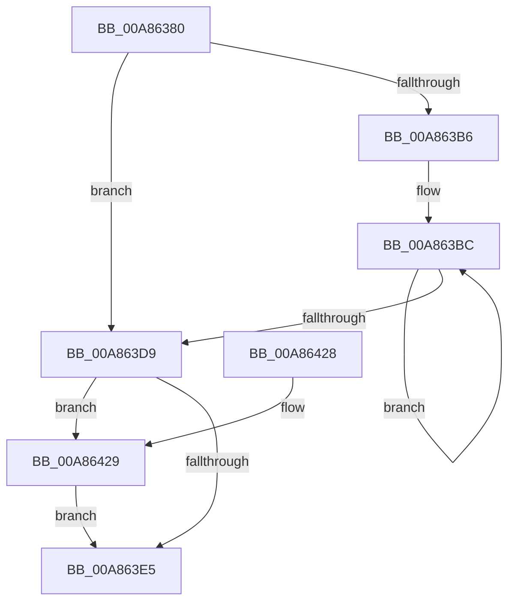

# SepGetTokenLoggingInformationBufferSize

- RVA: `0x00A86380`–`0x00A8643B` (길이 `187` bytes)
- VA: `0x0000000140A86380`
- 실행 섹션: `PAGE`
- PDB 이름 있음: `예`; PDB Function 태그: `아니요`
- unwind 정보 RVA: `0x000B7BB8`
- 디코드: `54`개 명령, `187/187` bytes 표시
- 미해석 바이트: `0` (있으면 어셈블리에 `.byte`로 보존)

> 이 문서는 커널 이미지의 기계어와 PDB 기호를 분석해 생성했습니다. 4번과 5번은 함수 원형과 자료형을 바이너리 사용 방식에서 추정한 C 해석이며 원본 소스 복구 결과는 아닙니다.

## 1. Dependencies

- 직접 호출 지점: **0**; 고유 호출 대상: **0**
- 직접 호출자로 확인된 함수: **1**
- RIP 상대 이미지 참조: **0**

### Outgoing calls
- 직접 디코드된 call 명령이 없습니다.

### Direct callers
- [SeQueryInformationToken](../8B/SeQueryInformationToken_function_008B5090.md) at `0x008B62C3`

### Static image references
- 디코드된 RIP-relative 메모리 참조가 없습니다.

## 2. Other-region calls and transfers

- 다른 실행 섹션으로 향하는 call: **0**
- 별도 외부 분기/꼬리 이동을 확인하지 못했습니다.

## 3. Assembly (complete function range)

```asm
00A86380  48 8B C4                        mov rax, rsp
00A86383  48 89 58 08                     mov qword ptr [rax + 8], rbx
00A86387  48 89 70 10                     mov qword ptr [rax + 0x10], rsi
00A8638B  48 89 78 18                     mov qword ptr [rax + 0x18], rdi
00A8638F  4C 89 70 20                     mov qword ptr [rax + 0x20], r14
00A86393  41 57                           push r15
00A86395  8B 41 7C                        mov eax, dword ptr [rcx + 0x7c]
00A86398  4C 8D 91 98 00 00 00            lea r10, [rcx + 0x98]
00A8639F  8B F0                           mov esi, eax
00A863A1  45 33 DB                        xor r11d, r11d
00A863A4  C1 E6 04                        shl esi, 4
00A863A7  4D 8B F0                        mov r14, r8
00A863AA  4C 8B FA                        mov r15, rdx
00A863AD  48 8B F9                        mov rdi, rcx
00A863B0  8B DE                           mov ebx, esi
00A863B2  85 C0                           test eax, eax
00A863B4  74 23                           je 0x140a863d9
00A863B6  49 8B 12                        mov rdx, qword ptr [r10]
00A863B9  44 8B C0                        mov r8d, eax
00A863BC  48 8B 02                        mov rax, qword ptr [rdx]
00A863BF  48 8D 52 10                     lea rdx, [rdx + 0x10]
00A863C3  0F B6 48 01                     movzx ecx, byte ptr [rax + 1]
00A863C7  8D 0C 8D 0F 00 00 00            lea ecx, [rcx*4 + 0xf]
00A863CE  83 E1 F8                        and ecx, 0xfffffff8
00A863D1  03 D9                           add ebx, ecx
00A863D3  49 83 E8 01                     sub r8, 1
00A863D7  75 E3                           jne 0x140a863bc
00A863D9  48 8B 87 50 04 00 00            mov rax, qword ptr [rdi + 0x450]
00A863E0  48 85 C0                        test rax, rax
00A863E3  75 44                           jne 0x140a86429
00A863E5  49 8B 02                        mov rax, qword ptr [r10]
00A863E8  48 8B 7C 24 20                  mov rdi, qword ptr [rsp + 0x20]
00A863ED  41 89 36                        mov dword ptr [r14], esi
00A863F0  48 8B 74 24 18                  mov rsi, qword ptr [rsp + 0x18]
00A863F5  48 8B 08                        mov rcx, qword ptr [rax]
00A863F8  4C 8B 74 24 28                  mov r14, qword ptr [rsp + 0x28]
00A863FD  41 89 1F                        mov dword ptr [r15], ebx
00A86400  45 89 19                        mov dword ptr [r9], r11d
00A86403  0F B6 41 01                     movzx eax, byte ptr [rcx + 1]
00A86407  8D 0C 85 0F 00 00 00            lea ecx, [rax*4 + 0xf]
00A8640E  48 8B 44 24 30                  mov rax, qword ptr [rsp + 0x30]
00A86413  83 E1 F8                        and ecx, 0xfffffff8
00A86416  89 08                           mov dword ptr [rax], ecx
00A86418  8D 41 50                        lea eax, [rcx + 0x50]
00A8641B  41 03 C3                        add eax, r11d
00A8641E  03 C3                           add eax, ebx
00A86420  48 8B 5C 24 10                  mov rbx, qword ptr [rsp + 0x10]
00A86425  41 5F                           pop r15
00A86427  C3                              ret
00A86428  CC                              int3
00A86429  0F B6 40 01                     movzx eax, byte ptr [rax + 1]
00A8642D  44 8D 1C 85 0F 00 00 00         lea r11d, [rax*4 + 0xf]
00A86435  41 83 E3 F8                     and r11d, 0xfffffff8
00A86439  EB AA                           jmp 0x140a863e5
```

## 4. C-style interpretation (structured pseudocode)

```c
__int64 __fastcall SepGetTokenLoggingInformationBufferSize(__int64 a1, __int64 a2, __int64 a3, __int64 a4, __int64 a5)
{
    __int64 result;
    __int64 v_r11;
    __int64 v_rbx;
    __int64 v_rsi;
    unsigned __int64 v_stack_p10;
    unsigned __int64 v_stack_p18;
    unsigned __int64 v_stack_p20;
    unsigned __int64 v_stack_p8;

    *(unsigned __int64 *)(v_rsp + 8) = v_rbx;
    *(unsigned __int64 *)(v_rsp + 16) = v_rsi;
    *(unsigned __int64 *)(v_rsp + 24) = v_rdi;
    *(unsigned __int64 *)(v_rsp + 32) = v_r14;
    v_r11 = 0;
    v_rsi = (unsigned int)(((unsigned int)((unsigned int)((unsigned int)(*(unsigned int *)(a1 + 124))))) << (4));
    if ((unsigned int)((unsigned int)(*(unsigned int *)(a1 + 124))) == 0) goto loc_00A863D9;
loc_00A863BC:
    a1 = (unsigned int)((*(unsigned __int8 *)(*(unsigned __int64 *)(*(unsigned __int64 *)(a1 + 152)) + 1) * 4 + 15) & (0xFFFFFFF8ULL));
    v_rbx = (unsigned int)(((unsigned int)((unsigned int)(v_rsi))) + ((unsigned int)(a1)));
    a3 = ((unsigned int)((unsigned int)((unsigned int)(*(unsigned int *)(a1 + 124))))) - (1);
    if (condition_is_not_equal) goto loc_00A863BC;
loc_00A863D9:
    if (*(unsigned __int64 *)(a1 + 1104) != 0) goto loc_00A86429;
loc_00A863E5:
    *(unsigned int *)(a3) = (unsigned int)(v_rsi);
    *(unsigned int *)(a2) = (unsigned int)(v_rbx);
    *(unsigned int *)(a4) = 0;
    a1 = (unsigned int)((*(unsigned __int8 *)(*(unsigned __int64 *)(*(unsigned __int64 *)(a1 + 152)) + 1) * 4 + 15) & (0xFFFFFFF8ULL));
    *(unsigned int *)(a5) = (unsigned int)(a1);
    result = (unsigned int)((a1 + 80) + (0));
    result = (unsigned int)((result) + ((unsigned int)(v_rbx)));
    return result;
loc_00A86429:
    v_r11 = (unsigned int)((*(unsigned __int8 *)(result + 1) * 4 + 15) & (0xFFFFFFF8ULL));
    goto loc_00A863E5;
}
```

## 5. (Beta) C Style

```c
int64_t SepGetTokenLoggingInformationBufferSize(void *Arg1, void *Arg2, void *Arg3, void *Arg4, void *Arg5)
{
    uint8_t *arg1 = (uint8_t *)Arg1;
    uint8_t *arg2 = (uint8_t *)Arg2;
    uint8_t *arg3 = (uint8_t *)Arg3;
    uint8_t *arg4 = (uint8_t *)Arg4;
    uint8_t *arg5 = (uint8_t *)Arg5;

    int64_t result;
    int64_t local_r11;
    int64_t local_rbx;
    int64_t local_rsi;
    uint64_t v_stack_p10;
    uint64_t v_stack_p18;
    uint64_t v_stack_p20;
    uint64_t v_stack_p8;

    *(uint64_t *)(local_rsp + 0x8) = local_rbx;
    *(uint64_t *)(local_rsp + 0x10) = local_rsi;
    *(uint64_t *)(local_rsp + 0x18) = local_rdi;
    *(uint64_t *)(local_rsp + 0x20) = local_r14;
    local_r11 = 0;
    local_rsi = (uint32_t)(((uint32_t)((uint32_t)((uint32_t)(*(uint32_t *)(arg1 + 0x7C))))) << (4));
    if ((uint32_t)((uint32_t)(*(uint32_t *)(arg1 + 0x7C))) == 0) goto loc_00A863D9;
loc_00A863BC:
    Arg1 = (uint32_t)((*(uint8_t *)(*(uint64_t *)(*(uint64_t *)(arg1 + 0x98)) + 0x1) * 4 + 15) & (0xFFFFFFF8ULL));
    local_rbx = (uint32_t)(((uint32_t)((uint32_t)(local_rsi))) + ((uint32_t)(Arg1)));
    Arg3 = ((uint32_t)((uint32_t)((uint32_t)(*(uint32_t *)(arg1 + 0x7C))))) - (1);
    if (condition_is_not_equal) goto loc_00A863BC;
loc_00A863D9:
    if (*(uint64_t *)(arg1 + 0x450) != 0) goto loc_00A86429;
loc_00A863E5:
    *(uint32_t *)(arg3) = (uint32_t)(local_rsi);
    *(uint32_t *)(arg2) = (uint32_t)(local_rbx);
    *(uint32_t *)(arg4) = 0;
    Arg1 = (uint32_t)((*(uint8_t *)(*(uint64_t *)(*(uint64_t *)(arg1 + 0x98)) + 0x1) * 4 + 15) & (0xFFFFFFF8ULL));
    *(uint32_t *)(arg5) = (uint32_t)(Arg1);
    result = (uint32_t)((Arg1 + 80) + (0));
    result = (uint32_t)((result) + ((uint32_t)(local_rbx)));
    return result;
loc_00A86429:
    local_r11 = (uint32_t)((*(uint8_t *)(result + 0x1) * 4 + 15) & (0xFFFFFFF8ULL));
    goto loc_00A863E5;
}
```

### 관측된 메모리 오프셋

구조체 형식이 확인되지 않은 접근은 인자 기준의 오프셋으로만 기록했습니다.

| 기준 인자 | 오프셋 표현 | 폭 (bit) | 접근 |
|---|---:|---:|---|
| `Arg1` | `+ 0x0` | `64` | `R` |
| `Arg1` | `+ 0x7C` | `32` | `R` |
| `Arg1` | `+ 0x98` | `64` | `R` |
| `Arg1` | `+ 0x450` | `64` | `R` |
| `Arg2` | `+ 0x0` | `32` | `W` |
| `Arg3` | `+ 0x0` | `32` | `W` |
| `Arg4` | `+ 0x0` | `32` | `W` |
| `Arg5` | `+ 0x0` | `32` | `W` |

## 6. Execution-region graph

[열기: 2D/3D 그래프와 함수 탐색 컨트롤 패널](../../../control-panel.html?section=page&rva=0x00A86380&view=graph)

- 2D 그래프는 위에서 아래로 흐르고, 3D 그래프는 빈 공간을 드래그해 회전합니다. Shift+드래그는 이동, 휠은 확대·축소, 함수 노드 선택은 대상 보고서 이동입니다.

### Static fallback


