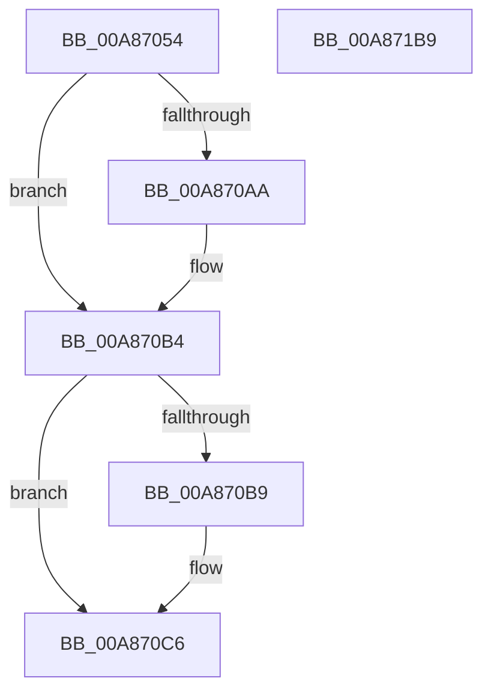

# SshSessionManagerTracePostSleepNotification

- RVA: `0x00A87054`–`0x00A871BA` (길이 `358` bytes)
- VA: `0x0000000140A87054`
- 실행 섹션: `PAGE`
- PDB 이름 있음: `예`; PDB Function 태그: `아니요`
- unwind 정보 RVA: `0x000B7D88`
- 디코드: `84`개 명령, `358/358` bytes 표시
- 미해석 바이트: `0` (있으면 어셈블리에 `.byte`로 보존)

> 이 문서는 커널 이미지의 기계어와 PDB 기호를 분석해 생성했습니다. 4번과 5번은 함수 원형과 자료형을 바이너리 사용 방식에서 추정한 C 해석이며 원본 소스 복구 결과는 아닙니다.

## 1. Dependencies

- 직접 호출 지점: **5**; 고유 호출 대상: **4**
- 직접 호출자로 확인된 함수: **1**
- RIP 상대 이미지 참조: **2**

### Outgoing calls
- `0x00A870AF` → [SshpSessionManagerInterruptTimeToSystemTime](../77/SshpSessionManagerInterruptTimeToSystemTime_function_00774478.md) (function, `0x00774478`)
- `0x00A870C1` → [SshpSessionManagerInterruptTimeToSystemTime](../77/SshpSessionManagerInterruptTimeToSystemTime_function_00774478.md) (function, `0x00774478`)
- `0x00A87187` → [Feature_SleepStudySlimControlEtl__private_ReportDeviceUsage](../../text/4F/Feature_SleepStudySlimControlEtl__private_ReportDeviceUsage_function_004FC658.md) (function, `0x004FC658`)
- `0x00A8719D` → [SshpSessionManagerSendControlEventSlimEtl](SshpSessionManagerSendControlEventSlimEtl_function_00A87200.md) (function, `0x00A87200`)
- `0x00A871A9` → [_security_check_cookie](../../text/6A/_security_check_cookie_function_006AC640.md) (function, `0x006AC640`)

### Direct callers
- [PopTransitionSystemPowerStateEx](../../pagelk/B7/PopTransitionSystemPowerStateEx_function_00B7E8C0.md) at `0x00B7F968`

### Static image references
- `0x00A8706D` → RVA `0x00E0A740` (`.data`; read)
- `0x00A87196` → RVA `0x0001BDC8` (`.rdata`; read)

## 2. Other-region calls and transfers

- 다른 실행 섹션으로 향하는 call: **2**
  - `0x00A87187` → [Feature_SleepStudySlimControlEtl__private_ReportDeviceUsage](../../text/4F/Feature_SleepStudySlimControlEtl__private_ReportDeviceUsage_function_004FC658.md) (`PAGE` → `.text`)
  - `0x00A871A9` → [_security_check_cookie](../../text/6A/_security_check_cookie_function_006AC640.md) (`PAGE` → `.text`)
- 별도 외부 분기/꼬리 이동을 확인하지 못했습니다.

## 3. Assembly (complete function range)

```asm
00A87054  44 89 4C 24 20                  mov dword ptr [rsp + 0x20], r9d
00A87059  44 89 44 24 18                  mov dword ptr [rsp + 0x18], r8d
00A8705E  55                              push rbp
00A8705F  53                              push rbx
00A87060  57                              push rdi
00A87061  48 8D 6C 24 E1                  lea rbp, [rsp - 0x1f]
00A87066  48 81 EC 00 01 00 00            sub rsp, 0x100
00A8706D  48 8B 05 CC 36 38 00            mov rax, qword ptr [rip + 0x3836cc]
00A87074  48 33 C4                        xor rax, rsp
00A87077  48 89 45 0F                     mov qword ptr [rbp + 0xf], rax
00A8707B  4C 8B 5D 77                     mov r11, qword ptr [rbp + 0x77]
00A8707F  33 FF                           xor edi, edi
00A87081  48 8B 5D 6F                     mov rbx, qword ptr [rbp + 0x6f]
00A87085  4C 8B D2                        mov r10, rdx
00A87088  48 89 7C 24 28                  mov qword ptr [rsp + 0x28], rdi
00A8708D  48 89 7C 24 30                  mov qword ptr [rsp + 0x30], rdi
00A87092  41 0F B7 03                     movzx eax, word ptr [r11]
00A87096  D1 E8                           shr eax, 1
00A87098  89 44 24 20                     mov dword ptr [rsp + 0x20], eax
00A8709C  0F B7 03                        movzx eax, word ptr [rbx]
00A8709F  D1 E8                           shr eax, 1
00A870A1  89 44 24 24                     mov dword ptr [rsp + 0x24], eax
00A870A5  48 85 C9                        test rcx, rcx
00A870A8  74 0A                           je 0x140a870b4
00A870AA  48 8D 54 24 28                  lea rdx, [rsp + 0x28]
00A870AF  E8 C4 D3 CE FF                  call 0x140774478
00A870B4  4D 85 D2                        test r10, r10
00A870B7  74 0D                           je 0x140a870c6
00A870B9  48 8D 54 24 30                  lea rdx, [rsp + 0x30]
00A870BE  49 8B CA                        mov rcx, r10
00A870C1  E8 B2 D3 CE FF                  call 0x140774478
00A870C6  48 8D 44 24 28                  lea rax, [rsp + 0x28]
00A870CB  48 C7 44 24 48 08 00 00 00      mov qword ptr [rsp + 0x48], 8
00A870D4  48 89 44 24 40                  mov qword ptr [rsp + 0x40], rax
00A870D9  48 8D 44 24 30                  lea rax, [rsp + 0x30]
00A870DE  48 89 44 24 50                  mov qword ptr [rsp + 0x50], rax
00A870E3  48 8D 45 4F                     lea rax, [rbp + 0x4f]
00A870E7  48 89 44 24 60                  mov qword ptr [rsp + 0x60], rax
00A870EC  48 8D 45 57                     lea rax, [rbp + 0x57]
00A870F0  48 89 45 8F                     mov qword ptr [rbp - 0x71], rax
00A870F4  48 8D 45 5F                     lea rax, [rbp + 0x5f]
00A870F8  48 89 45 9F                     mov qword ptr [rbp - 0x61], rax
00A870FC  48 8D 45 67                     lea rax, [rbp + 0x67]
00A87100  48 89 45 AF                     mov qword ptr [rbp - 0x51], rax
00A87104  48 8D 44 24 20                  lea rax, [rsp + 0x20]
00A87109  48 89 45 BF                     mov qword ptr [rbp - 0x41], rax
00A8710D  49 8B 43 08                     mov rax, qword ptr [r11 + 8]
00A87111  48 89 45 CF                     mov qword ptr [rbp - 0x31], rax
00A87115  8B 44 24 20                     mov eax, dword ptr [rsp + 0x20]
00A87119  03 C0                           add eax, eax
00A8711B  48 C7 44 24 58 08 00 00 00      mov qword ptr [rsp + 0x58], 8
00A87124  89 45 D7                        mov dword ptr [rbp - 0x29], eax
00A87127  48 8D 44 24 24                  lea rax, [rsp + 0x24]
00A8712C  48 89 45 DF                     mov qword ptr [rbp - 0x21], rax
00A87130  48 8B 43 08                     mov rax, qword ptr [rbx + 8]
00A87134  48 89 45 EF                     mov qword ptr [rbp - 0x11], rax
00A87138  8B 44 24 24                     mov eax, dword ptr [rsp + 0x24]
00A8713C  03 C0                           add eax, eax
00A8713E  48 C7 45 87 04 00 00 00         mov qword ptr [rbp - 0x79], 4
00A87146  89 45 F7                        mov dword ptr [rbp - 9], eax
00A87149  48 8D 45 7F                     lea rax, [rbp + 0x7f]
00A8714D  48 89 45 FF                     mov qword ptr [rbp - 1], rax
00A87151  48 C7 45 97 04 00 00 00         mov qword ptr [rbp - 0x69], 4
00A87159  48 C7 45 A7 04 00 00 00         mov qword ptr [rbp - 0x59], 4
00A87161  48 C7 45 B7 04 00 00 00         mov qword ptr [rbp - 0x49], 4
00A87169  48 C7 45 C7 04 00 00 00         mov qword ptr [rbp - 0x39], 4
00A87171  89 7D DB                        mov dword ptr [rbp - 0x25], edi
00A87174  48 C7 45 E7 04 00 00 00         mov qword ptr [rbp - 0x19], 4
00A8717C  89 7D FB                        mov dword ptr [rbp - 5], edi
00A8717F  48 C7 45 07 04 00 00 00         mov qword ptr [rbp + 7], 4
00A87187  E8 CC 54 A7 FF                  call 0x1404fc658
00A8718C  4C 8D 44 24 40                  lea r8, [rsp + 0x40]
00A87191  BA 0B 00 00 00                  mov edx, 0xb
00A87196  48 8D 0D 2B 4C 59 FF            lea rcx, [rip - 0xa6b3d5]
00A8719D  E8 5E 00 00 00                  call 0x140a87200
00A871A2  48 8B 4D 0F                     mov rcx, qword ptr [rbp + 0xf]
00A871A6  48 33 CC                        xor rcx, rsp
00A871A9  E8 92 54 C2 FF                  call 0x1406ac640
00A871AE  48 81 C4 00 01 00 00            add rsp, 0x100
00A871B5  5F                              pop rdi
00A871B6  5B                              pop rbx
00A871B7  5D                              pop rbp
00A871B8  C3                              ret
00A871B9  CC                              int3
```

## 4. C-style interpretation (structured pseudocode)

```c
__int64 __fastcall SshSessionManagerTracePostSleepNotification(__int64 a1, __int64 a2, int a3, int a4, __int64 a5, __int64 a6, __int64 a7, __int64 a8, __int64 a9)
{
    __int64 result;
    __int64 v_rdi;
    __int64 v_rsp;
    unsigned __int64 v_stack_m28;
    unsigned __int64 v_stack_m30;
    unsigned __int64 v_stack_m37;
    unsigned __int64 v_stack_m38;
    unsigned int v_stack_m3C;
    unsigned int v_stack_m40;
    unsigned __int64 v_stack_m48;
    unsigned __int64 v_stack_m50;
    unsigned __int64 v_stack_m58;
    unsigned int v_stack_m5C;
    unsigned int v_stack_m60;
    unsigned __int64 v_stack_m68;
    unsigned __int64 v_stack_m70;
    unsigned __int64 v_stack_m78;
    unsigned __int64 v_stack_m80;
    unsigned __int64 v_stack_m88;
    unsigned __int64 v_stack_m90;
    unsigned __int64 v_stack_m98;
    unsigned __int64 v_stack_mA0;
    unsigned __int64 v_stack_mA8;
    unsigned __int64 v_stack_mB0;
    unsigned __int64 v_stack_mB8;
    unsigned __int64 v_stack_mC0;
    unsigned __int64 v_stack_mC8;
    unsigned __int64 v_stack_mD0;
    unsigned __int64 v_stack_mD8;
    unsigned __int64 v_stack_mE8;
    unsigned __int64 v_stack_mF0;
    unsigned int v_stack_mF4;
    unsigned int v_stack_mF8;
    unsigned int v_stack_p18;
    unsigned int v_stack_p20;

    v_stack_p20 = a4;
    v_stack_p18 = a3;
    v_rsp = (v_rsp) - (256);
    result = (*(unsigned __int64 *)(v_rip + 3684044)) ^ (v_rsp);
    v_stack_m28 = result;
    v_rdi = 0;
    v_stack_mF0 = 0;
    v_stack_mE8 = 0;
    result = (unsigned int)((*(unsigned __int16 *)(a8)) >> (1));
    v_stack_mF8 = (unsigned int)(result);
    result = (unsigned int)((*(unsigned __int16 *)(a7)) >> (1));
    v_stack_mF4 = (unsigned int)(result);
    if (a1 != 0) {
        a2 = v_stack_mF0;
        result = SshpSessionManagerInterruptTimeToSystemTime(a1, a2, a3, a4);
    }
    if (a2 != 0) {
        a2 = v_stack_mE8;
        a1 = a2;
        result = SshpSessionManagerInterruptTimeToSystemTime(a1, a2, a3, a4);
    }
    v_stack_mD0 = 8;
    v_stack_mD8 = v_stack_mF0;
    v_stack_mC8 = v_stack_mE8;
    v_stack_mB8 = v_stack_p18;
    v_stack_mA8 = v_stack_p20;
    v_stack_m98 = a5;
    v_stack_m88 = a6;
    v_stack_m78 = v_stack_mF8;
    v_stack_m68 = *(unsigned __int64 *)(a8 + 8);
    result = (unsigned int)(((unsigned int)(v_stack_mF8)) + ((unsigned int)((unsigned int)(v_stack_mF8))));
    v_stack_mC0 = 8;
    v_stack_m60 = (unsigned int)(result);
    v_stack_m58 = v_stack_mF4;
    v_stack_m48 = *(unsigned __int64 *)(a7 + 8);
    result = (unsigned int)(((unsigned int)(v_stack_mF4)) + ((unsigned int)((unsigned int)(v_stack_mF4))));
    v_stack_mB0 = 4;
    v_stack_m40 = (unsigned int)(result);
    v_stack_m38 = a9;
    v_stack_mA0 = 4;
    v_stack_m90 = 4;
    v_stack_m80 = 4;
    v_stack_m70 = 4;
    v_stack_m5C = 0;
    v_stack_m50 = 4;
    v_stack_m3C = 0;
    v_stack_m30 = 4;
    result = Feature_SleepStudySlimControlEtl__private_ReportDeviceUsage(a1, a2, a3, a4);
    result = SshpSessionManagerSendControlEventSlimEtl(v_rip - 10925013, 11, v_stack_mD8, a4);
    a1 = (v_stack_m28) ^ (v_rsp);
    result = _security_check_cookie(a1, 11, v_stack_mD8, a4);
    v_rsp = (v_rsp) + (256);
    return result;
}
```

## 5. (Beta) C Style

```c
int64_t SshSessionManagerTracePostSleepNotification(int64_t Arg1, int64_t Arg2, int32_t Arg3, int32_t Arg4, int64_t Arg5, int64_t Arg6, void *Arg7, void *Arg8, int64_t Arg9)
{
    uint8_t *arg7 = (uint8_t *)Arg7;
    uint8_t *arg8 = (uint8_t *)Arg8;

    int64_t result;
    int64_t local_rdi;
    int64_t local_rsp;
    uint64_t v_stack_m28;
    uint64_t v_stack_m30;
    uint64_t v_stack_m37;
    uint64_t v_stack_m38;
    uint32_t v_stack_m3C;
    uint32_t v_stack_m40;
    uint64_t v_stack_m48;
    uint64_t v_stack_m50;
    uint64_t v_stack_m58;
    uint32_t v_stack_m5C;
    uint32_t v_stack_m60;
    uint64_t v_stack_m68;
    uint64_t v_stack_m70;
    uint64_t v_stack_m78;
    uint64_t v_stack_m80;
    uint64_t v_stack_m88;
    uint64_t v_stack_m90;
    uint64_t v_stack_m98;
    uint64_t v_stack_mA0;
    uint64_t v_stack_mA8;
    uint64_t v_stack_mB0;
    uint64_t v_stack_mB8;
    uint64_t v_stack_mC0;
    uint64_t v_stack_mC8;
    uint64_t v_stack_mD0;
    uint64_t v_stack_mD8;
    uint64_t v_stack_mE8;
    uint64_t v_stack_mF0;
    uint32_t v_stack_mF4;
    uint32_t v_stack_mF8;
    uint32_t v_stack_p18;
    uint32_t v_stack_p20;

    v_stack_p20 = Arg4;
    v_stack_p18 = Arg3;
    local_rsp = (local_rsp) - (256);
    result = (*(uint64_t *)(v_rip + 0x3836CC)) ^ (local_rsp);
    v_stack_m28 = result;
    local_rdi = 0;
    v_stack_mF0 = 0;
    v_stack_mE8 = 0;
    result = (uint32_t)((*(uint16_t *)(arg8)) >> (1));
    v_stack_mF8 = (uint32_t)(result);
    result = (uint32_t)((*(uint16_t *)(arg7)) >> (1));
    v_stack_mF4 = (uint32_t)(result);
    if (Arg1 != 0) {
        Arg2 = v_stack_mF0;
        result = SshpSessionManagerInterruptTimeToSystemTime(Arg1, Arg2, Arg3, Arg4);
    }
    if (Arg2 != 0) {
        Arg2 = v_stack_mE8;
        Arg1 = Arg2;
        result = SshpSessionManagerInterruptTimeToSystemTime(Arg1, Arg2, Arg3, Arg4);
    }
    v_stack_mD0 = 8;
    v_stack_mD8 = v_stack_mF0;
    v_stack_mC8 = v_stack_mE8;
    v_stack_mB8 = v_stack_p18;
    v_stack_mA8 = v_stack_p20;
    v_stack_m98 = Arg5;
    v_stack_m88 = Arg6;
    v_stack_m78 = v_stack_mF8;
    v_stack_m68 = *(uint64_t *)(arg8 + 0x8);
    result = (uint32_t)(((uint32_t)(v_stack_mF8)) + ((uint32_t)((uint32_t)(v_stack_mF8))));
    v_stack_mC0 = 8;
    v_stack_m60 = (uint32_t)(result);
    v_stack_m58 = v_stack_mF4;
    v_stack_m48 = *(uint64_t *)(arg7 + 0x8);
    result = (uint32_t)(((uint32_t)(v_stack_mF4)) + ((uint32_t)((uint32_t)(v_stack_mF4))));
    v_stack_mB0 = 4;
    v_stack_m40 = (uint32_t)(result);
    v_stack_m38 = Arg9;
    v_stack_mA0 = 4;
    v_stack_m90 = 4;
    v_stack_m80 = 4;
    v_stack_m70 = 4;
    v_stack_m5C = 0;
    v_stack_m50 = 4;
    v_stack_m3C = 0;
    v_stack_m30 = 4;
    result = Feature_SleepStudySlimControlEtl__private_ReportDeviceUsage(Arg1, Arg2, Arg3, Arg4);
    result = SshpSessionManagerSendControlEventSlimEtl(v_rip - 10925013, 11, v_stack_mD8, Arg4);
    Arg1 = (v_stack_m28) ^ (local_rsp);
    result = _security_check_cookie(Arg1, 11, v_stack_mD8, Arg4);
    local_rsp = (local_rsp) + (256);
    return result;
}
```

### 관측된 메모리 오프셋

구조체 형식이 확인되지 않은 접근은 인자 기준의 오프셋으로만 기록했습니다.

| 기준 인자 | 오프셋 표현 | 폭 (bit) | 접근 |
|---|---:|---:|---|
| `Arg7` | `+ 0x0` | `16` | `R` |
| `Arg7` | `+ 0x8` | `64` | `R` |
| `Arg8` | `+ 0x0` | `16` | `R` |

## 6. Execution-region graph

[열기: 2D/3D 그래프와 함수 탐색 컨트롤 패널](../../../control-panel.html?section=page&rva=0x00A87054&view=graph)

- 2D 그래프는 위에서 아래로 흐르고, 3D 그래프는 빈 공간을 드래그해 회전합니다. Shift+드래그는 이동, 휠은 확대·축소, 함수 노드 선택은 대상 보고서 이동입니다.

### Static fallback


