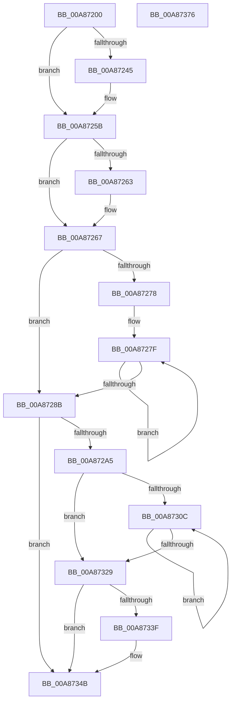

# SshpSessionManagerSendControlEventSlimEtl

- RVA: `0x00A87200`–`0x00A87377` (길이 `375` bytes)
- VA: `0x0000000140A87200`
- 실행 섹션: `PAGE`
- PDB 이름 있음: `예`; PDB Function 태그: `아니요`
- unwind 정보 RVA: `0x000886A4`
- 디코드: `93`개 명령, `375/375` bytes 표시
- 미해석 바이트: `0` (있으면 어셈블리에 `.byte`로 보존)

> 이 문서는 커널 이미지의 기계어와 PDB 기호를 분석해 생성했습니다. 4번과 5번은 함수 원형과 자료형을 바이너리 사용 방식에서 추정한 C 해석이며 원본 소스 복구 결과는 아닙니다.

## 1. Dependencies

- 직접 호출 지점: **7**; 고유 호출 대상: **7**
- 직접 호출자로 확인된 함수: **3**
- RIP 상대 이미지 참조: **9**

### Outgoing calls
- `0x00A87231` → [KeAbPreAcquire](../../text/21/KeAbPreAcquire_function_00210230.md) (function, `0x00210230`)
- `0x00A87256` → [ExfAcquirePushLockExclusiveEx](../../text/20/ExfAcquirePushLockExclusiveEx_function_0020FC90.md) (function, `0x0020FC90`)
- `0x00A87267` → [RtlGetSystemTimePrecise](../../text/37/RtlGetSystemTimePrecise_function_0037EDD0.md) (function, `0x0037EDD0`)
- `0x00A872AC` → [KeResetEvent](../../text/24/KeResetEvent_function_00248350.md) (function, `0x00248350`)
- `0x00A87318` → [memcpy](../../text/6C/memcpy_function_006C6840.md) (function, `0x006C6840`)
- `0x00A87346` → [SshpWorkItemQueue](../../text/48/SshpWorkItemQueue_function_00486B3C.md) (function, `0x00486B3C`)
- `0x00A87352` → [SSHSupportReleasePushLockExclusive](../../text/49/SSHSupportReleasePushLockExclusive_function_004954EC.md) (function, `0x004954EC`)

### Direct callers
- [PopBootBatteryStatusWorker](PopBootBatteryStatusWorker_function_00A86FA0.md) at `0x00A87031`
- [SshSessionManagerTracePostSleepNotification](SshSessionManagerTracePostSleepNotification_function_00A87054.md) at `0x00A8719D`
- [SshpSessionManagerSendControlEvent](SshpSessionManagerSendControlEvent_function_00A871C0.md) at `0x00A871E4`

### Static image references
- `0x00A8722A` → RVA `0x00F06B70` (`.data`; read)
- `0x00A87236` → RVA `0x00F06B70` (`.data`; read/write)
- `0x00A87293` → RVA `0x00F06C08` (`.data`; read)
- `0x00A872A5` → RVA `0x00F06BF0` (`.data`; read)
- `0x00A872B5` → RVA `0x0001BDD8` (`.rdata`; read)
- `0x00A872D2` → RVA `0x00F06C0C` (`.data`; read)
- `0x00A87330` → RVA `0x00F06C08` (`.data`; read/write)
- `0x00A87336` → RVA `0x00F06BA8` (`.data`; read)
- `0x00A8733F` → RVA `0x00F06BB0` (`.data`; read)

## 2. Other-region calls and transfers

- 다른 실행 섹션으로 향하는 call: **7**
  - `0x00A87231` → [KeAbPreAcquire](../../text/21/KeAbPreAcquire_function_00210230.md) (`PAGE` → `.text`)
  - `0x00A87256` → [ExfAcquirePushLockExclusiveEx](../../text/20/ExfAcquirePushLockExclusiveEx_function_0020FC90.md) (`PAGE` → `.text`)
  - `0x00A87267` → [RtlGetSystemTimePrecise](../../text/37/RtlGetSystemTimePrecise_function_0037EDD0.md) (`PAGE` → `.text`)
  - `0x00A872AC` → [KeResetEvent](../../text/24/KeResetEvent_function_00248350.md) (`PAGE` → `.text`)
  - `0x00A87318` → [memcpy](../../text/6C/memcpy_function_006C6840.md) (`PAGE` → `.text`)
  - `0x00A87346` → [SshpWorkItemQueue](../../text/48/SshpWorkItemQueue_function_00486B3C.md) (`PAGE` → `.text`)
  - `0x00A87352` → [SSHSupportReleasePushLockExclusive](../../text/49/SSHSupportReleasePushLockExclusive_function_004954EC.md) (`PAGE` → `.text`)
- 별도 외부 분기/꼬리 이동을 확인하지 못했습니다.

## 3. Assembly (complete function range)

```asm
00A87200  48 8B C4                        mov rax, rsp
00A87203  48 89 58 08                     mov qword ptr [rax + 8], rbx
00A87207  48 89 68 10                     mov qword ptr [rax + 0x10], rbp
00A8720B  48 89 70 18                     mov qword ptr [rax + 0x18], rsi
00A8720F  48 89 78 20                     mov qword ptr [rax + 0x20], rdi
00A87213  41 55                           push r13
00A87215  41 56                           push r14
00A87217  41 57                           push r15
00A87219  48 83 EC 40                     sub rsp, 0x40
00A8721D  49 8B D8                        mov rbx, r8
00A87220  8B EA                           mov ebp, edx
00A87222  4C 8B F1                        mov r14, rcx
00A87225  45 33 C0                        xor r8d, r8d
00A87228  33 D2                           xor edx, edx
00A8722A  48 8D 0D 3F F9 47 00            lea rcx, [rip + 0x47f93f]
00A87231  E8 FA 8F 78 FF                  call 0x140210230
00A87236  F0 48 0F BA 2D 30 F9 47 00 00   lock bts qword ptr [rip + 0x47f930], 0
00A87240  48 8B F8                        mov rdi, rax
00A87243  73 16                           jae 0x140a8725b
00A87245  4C 8D 05 24 F9 47 00            lea r8, [rip + 0x47f924]
00A8724C  48 8B D0                        mov rdx, rax
00A8724F  48 8D 0D 1A F9 47 00            lea rcx, [rip + 0x47f91a]
00A87256  E8 35 8A 78 FF                  call 0x14020fc90
00A8725B  45 33 ED                        xor r13d, r13d
00A8725E  48 85 FF                        test rdi, rdi
00A87261  74 04                           je 0x140a87267
00A87263  C6 47 0A 01                     mov byte ptr [rdi + 0xa], 1
00A87267  E8 64 7B 8F FF                  call 0x14037edd0
00A8726C  4C 8B F8                        mov r15, rax
00A8726F  BE 08 00 00 00                  mov esi, 8
00A87274  85 ED                           test ebp, ebp
00A87276  74 13                           je 0x140a8728b
00A87278  48 8D 4B 08                     lea rcx, [rbx + 8]
00A8727C  48 8B D5                        mov rdx, rbp
00A8727F  03 31                           add esi, dword ptr [rcx]
00A87281  48 8D 49 10                     lea rcx, [rcx + 0x10]
00A87285  48 83 EA 01                     sub rdx, 1
00A87289  75 F4                           jne 0x140a8727f
00A8728B  B8 00 04 00 00                  mov eax, 0x400
00A87290  8D 7E 1A                        lea edi, [rsi + 0x1a]
00A87293  2B 05 6F F9 47 00               sub eax, dword ptr [rip + 0x47f96f]
00A87299  48 83 C3 08                     add rbx, 8
00A8729D  3B C7                           cmp eax, edi
00A8729F  0F 82 A6 00 00 00               jb 0x140a8734b
00A872A5  48 8D 0D 44 F9 47 00            lea rcx, [rip + 0x47f944]
00A872AC  E8 9F 10 7C FF                  call 0x140248350
00A872B1  41 0F B7 06                     movzx eax, word ptr [r14]
00A872B5  0F 10 0D 1C 4B 59 FF            movups xmm1, xmmword ptr [rip - 0xa6b4e4]
00A872BC  66 89 44 24 22                  mov word ptr [rsp + 0x22], ax
00A872C1  41 0F B6 46 02                  movzx eax, byte ptr [r14 + 2]
00A872C6  44 8B 35 3B F9 47 00            mov r14d, dword ptr [rip + 0x47f93b]
00A872CD  66 89 44 24 24                  mov word ptr [rsp + 0x24], ax
00A872D2  48 8D 05 33 F9 47 00            lea rax, [rip + 0x47f933]
00A872D9  4C 03 F0                        add r14, rax
00A872DC  66 89 74 24 20                  mov word ptr [rsp + 0x20], si
00A872E1  66 44 89 6C 24 26               mov word ptr [rsp + 0x26], r13w
00A872E7  BE 20 00 00 00                  mov esi, 0x20
00A872EC  0F 11 4C 24 28                  movups xmmword ptr [rsp + 0x28], xmm1
00A872F1  66 0F 15 C9                     unpckhpd xmm1, xmm1
00A872F5  0F 10 44 24 20                  movups xmm0, xmmword ptr [rsp + 0x20]
00A872FA  41 0F 11 06                     movups xmmword ptr [r14], xmm0
00A872FE  F2 41 0F 11 4E 10               movsd qword ptr [r14 + 0x10], xmm1
00A87304  4D 89 7E 18                     mov qword ptr [r14 + 0x18], r15
00A87308  85 ED                           test ebp, ebp
00A8730A  74 1D                           je 0x140a87329
00A8730C  44 8B 03                        mov r8d, dword ptr [rbx]
00A8730F  48 8B 53 F8                     mov rdx, qword ptr [rbx - 8]
00A87313  8B CE                           mov ecx, esi
00A87315  49 03 CE                        add rcx, r14
00A87318  E8 23 F5 C3 FF                  call 0x1406c6840
00A8731D  03 33                           add esi, dword ptr [rbx]
00A8731F  48 8D 5B 10                     lea rbx, [rbx + 0x10]
00A87323  48 83 ED 01                     sub rbp, 1
00A87327  75 E3                           jne 0x140a8730c
00A87329  8B C6                           mov eax, esi
00A8732B  66 42 89 3C 30                  mov word ptr [rax + r14], di
00A87330  01 3D D2 F8 47 00               add dword ptr [rip + 0x47f8d2], edi
00A87336  4C 39 2D 6B F8 47 00            cmp qword ptr [rip + 0x47f86b], r13
00A8733D  74 0C                           je 0x140a8734b
00A8733F  48 8D 0D 6A F8 47 00            lea rcx, [rip + 0x47f86a]
00A87346  E8 F1 F7 9F FF                  call 0x140486b3c
00A8734B  48 8D 0D 1E F8 47 00            lea rcx, [rip + 0x47f81e]
00A87352  E8 95 E1 A0 FF                  call 0x1404954ec
00A87357  48 8B 5C 24 60                  mov rbx, qword ptr [rsp + 0x60]
00A8735C  48 8B 6C 24 68                  mov rbp, qword ptr [rsp + 0x68]
00A87361  48 8B 74 24 70                  mov rsi, qword ptr [rsp + 0x70]
00A87366  48 8B 7C 24 78                  mov rdi, qword ptr [rsp + 0x78]
00A8736B  48 83 C4 40                     add rsp, 0x40
00A8736F  41 5F                           pop r15
00A87371  41 5E                           pop r14
00A87373  41 5D                           pop r13
00A87375  C3                              ret
00A87376  CC                              int3
```

## 4. C-style interpretation (structured pseudocode)

```c
__int64 __fastcall SshpSessionManagerSendControlEventSlimEtl(__int64 a1, int a2, __int64 a3)
{
    __int64 result;
    __int64 v_r13;
    __int64 v_r14;
    __int64 v_rbp;
    __int64 v_rbx;
    __int64 v_rsi;
    __int64 v_rsp;
    unsigned __int64 v_stack_m30;
    unsigned __int16 v_stack_m32;
    unsigned __int16 v_stack_m34;
    unsigned __int16 v_stack_m36;
    unsigned __int16 v_stack_m38;
    unsigned __int64 v_stack_p10;
    unsigned __int64 v_stack_p18;
    unsigned __int64 v_stack_p20;
    unsigned __int64 v_stack_p8;

    *(unsigned __int64 *)(v_rsp + 8) = v_rbx;
    *(unsigned __int64 *)(v_rsp + 16) = v_rbp;
    *(unsigned __int64 *)(v_rsp + 24) = v_rsi;
    *(unsigned __int64 *)(v_rsp + 32) = v_rdi;
    v_rsp = (v_rsp) - (64);
    a3 = 0;
    a2 = 0;
    result = KeAbPreAcquire(v_rip + 4716863, a2, a3, a4);
    if (!(condition_is_above_or_equal)) {
        a3 = v_rip + 4716836;
        a2 = result;
        a1 = v_rip + 4716826;
        result = ExfAcquirePushLockExclusiveEx(a1, a2, a3, a4);
    }
    v_r13 = 0;
    if (result != 0) {
        *(unsigned __int8 *)(result + 10) = 1;
    }
    result = RtlGetSystemTimePrecise(a1, a2, a3, a4);
    if ((unsigned int)((unsigned int)(a2)) == 0) goto loc_00A8728B;
loc_00A8727F:
    v_rsi = (unsigned int)((8) + (*(unsigned int *)(a3 + 8)));
    a2 = ((unsigned int)(a2)) - (1);
    if (condition_is_not_equal) goto loc_00A8727F;
loc_00A8728B:
    result = (unsigned int)(((unsigned int)(0x400ULL)) - (*(unsigned int *)(v_rip + 4716911)));
    v_rbx = (a3) + (8);
    if (((unsigned int)(result)) < ((unsigned int)(v_rsi + 26))) goto loc_00A8734B;
    result = KeResetEvent(v_rip + 4716868, a2, a3, a4);
    v_stack_m36 = (unsigned __int16)(*(unsigned __int16 *)(a1));
    v_stack_m34 = (unsigned __int16)(*(unsigned __int8 *)(a1 + 2));
    v_r14 = ((unsigned int)(*(unsigned int *)(v_rip + 4716859))) + (v_rip + 4716851);
    v_stack_m38 = (unsigned __int16)(v_rsi);
    v_stack_m32 = 0;
    v_stack_m30 = v_xmm1;
    *(unsigned __int64 *)(v_r14) = v_xmm0;
    *(unsigned __int64 *)(v_r14 + 16) = v_xmm1;
    *(unsigned __int64 *)(v_r14 + 24) = result;
    if ((unsigned int)((unsigned int)(a2)) == 0) goto loc_00A87329;
loc_00A8730C:
    a1 = (32) + (v_r14);
    result = memcpy(a1, *(unsigned __int64 *)(v_rbx - 8), (unsigned int)(*(unsigned int *)(v_rbx)), a4);
    v_rsi = (unsigned int)((32) + (*(unsigned int *)(v_rbx)));
    v_rbp = ((unsigned int)(a2)) - (1);
    if (condition_is_not_equal) goto loc_00A8730C;
loc_00A87329:
    *(unsigned __int16 *)((unsigned int)((unsigned int)(v_rsi)) + v_r14 * 1) = (unsigned __int16)(v_rsi + 26);
    result = (unsigned int)((unsigned int)(v_rsi));
    if ((*(unsigned __int64 *)(v_rip + 4716651)) != 0) {
        a1 = v_rip + 4716650;
        result = SshpWorkItemQueue(a1, *(unsigned __int64 *)(v_rbx - 8), (unsigned int)(*(unsigned int *)(v_rbx)), a4);
    }
    result = SSHSupportReleasePushLockExclusive(v_rip + 4716574, *(unsigned __int64 *)(v_rbx - 8), (unsigned int)(*(unsigned int *)(v_rbx)), a4);
    v_rsp = (v_rsp) + (64);
    return result;
}
```

## 5. (Beta) C Style

```c
int64_t SshpSessionManagerSendControlEventSlimEtl(void *Arg1, int32_t Arg2, void *Arg3)
{
    uint8_t *arg1 = (uint8_t *)Arg1;
    uint8_t *arg3 = (uint8_t *)Arg3;

    int64_t result;
    int64_t local_r13;
    int64_t local_r14;
    int64_t local_rbp;
    int64_t local_rbx;
    int64_t local_rsi;
    int64_t local_rsp;
    uint64_t v_stack_m30;
    uint16_t v_stack_m32;
    uint16_t v_stack_m34;
    uint16_t v_stack_m36;
    uint16_t v_stack_m38;
    uint64_t v_stack_p10;
    uint64_t v_stack_p18;
    uint64_t v_stack_p20;
    uint64_t v_stack_p8;

    *(uint64_t *)(local_rsp + 0x8) = local_rbx;
    *(uint64_t *)(local_rsp + 0x10) = local_rbp;
    *(uint64_t *)(local_rsp + 0x18) = local_rsi;
    *(uint64_t *)(local_rsp + 0x20) = local_rdi;
    local_rsp = (local_rsp) - (64);
    Arg3 = 0;
    Arg2 = 0;
    result = KeAbPreAcquire(v_rip + 4716863, Arg2, Arg3, a4);
    if (!(condition_is_above_or_equal)) {
        Arg3 = v_rip + 4716836;
        Arg2 = result;
        Arg1 = v_rip + 4716826;
        result = ExfAcquirePushLockExclusiveEx(Arg1, Arg2, Arg3, a4);
    }
    local_r13 = 0;
    if (result != 0) {
        *(uint8_t *)(result + 0xA) = 1;
    }
    result = RtlGetSystemTimePrecise(Arg1, Arg2, Arg3, a4);
    if ((uint32_t)((uint32_t)(Arg2)) == 0) goto loc_00A8728B;
loc_00A8727F:
    local_rsi = (uint32_t)((8) + (*(uint32_t *)(arg3 + 0x8)));
    Arg2 = ((uint32_t)(Arg2)) - (1);
    if (condition_is_not_equal) goto loc_00A8727F;
loc_00A8728B:
    result = (uint32_t)(((uint32_t)(0x400ULL)) - (*(uint32_t *)(v_rip + 0x47F96F)));
    local_rbx = (Arg3) + (8);
    if (((uint32_t)(result)) < ((uint32_t)(local_rsi + 26))) goto loc_00A8734B;
    result = KeResetEvent(v_rip + 4716868, Arg2, Arg3, a4);
    v_stack_m36 = (uint16_t)(*(uint16_t *)(arg1));
    v_stack_m34 = (uint16_t)(*(uint8_t *)(arg1 + 0x2));
    local_r14 = ((uint32_t)(*(uint32_t *)(v_rip + 0x47F93B))) + (v_rip + 4716851);
    v_stack_m38 = (uint16_t)(local_rsi);
    v_stack_m32 = 0;
    v_stack_m30 = v_xmm1;
    *(uint64_t *)(local_r14) = v_xmm0;
    *(uint64_t *)(local_r14 + 0x10) = v_xmm1;
    *(uint64_t *)(local_r14 + 0x18) = result;
    if ((uint32_t)((uint32_t)(Arg2)) == 0) goto loc_00A87329;
loc_00A8730C:
    Arg1 = (32) + (local_r14);
    result = memcpy(Arg1, *(uint64_t *)(local_rbx - 0x8), (uint32_t)(*(uint32_t *)(local_rbx)), a4);
    local_rsi = (uint32_t)((32) + (*(uint32_t *)(local_rbx)));
    local_rbp = ((uint32_t)(Arg2)) - (1);
    if (condition_is_not_equal) goto loc_00A8730C;
loc_00A87329:
    *(uint16_t *)((uint32_t)((uint32_t)(local_rsi)) + local_r14 * 1) = (uint16_t)(local_rsi + 26);
    result = (uint32_t)((uint32_t)(local_rsi));
    if ((*(uint64_t *)(v_rip + 0x47F86B)) != 0) {
        Arg1 = v_rip + 4716650;
        result = SshpWorkItemQueue(Arg1, *(uint64_t *)(local_rbx - 0x8), (uint32_t)(*(uint32_t *)(local_rbx)), a4);
    }
    result = SSHSupportReleasePushLockExclusive(v_rip + 4716574, *(uint64_t *)(local_rbx - 0x8), (uint32_t)(*(uint32_t *)(local_rbx)), a4);
    local_rsp = (local_rsp) + (64);
    return result;
}
```

### 관측된 메모리 오프셋

구조체 형식이 확인되지 않은 접근은 인자 기준의 오프셋으로만 기록했습니다.

| 기준 인자 | 오프셋 표현 | 폭 (bit) | 접근 |
|---|---:|---:|---|
| `Arg1` | `+ 0x0` | `16` | `R` |
| `Arg1` | `+ 0x2` | `8` | `R` |
| `Arg3` | `- 0x8` | `64` | `R` |
| `Arg3` | `+ 0x0` | `32` | `R` |
| `Arg3` | `+ 0x8` | `64` | `R` |
| `Arg3` | `+ 0x10` | `64` | `R` |

## 6. Execution-region graph

[열기: 2D/3D 그래프와 함수 탐색 컨트롤 패널](../../../control-panel.html?section=page&rva=0x00A87200&view=graph)

- 2D 그래프는 위에서 아래로 흐르고, 3D 그래프는 빈 공간을 드래그해 회전합니다. Shift+드래그는 이동, 휠은 확대·축소, 함수 노드 선택은 대상 보고서 이동입니다.

### Static fallback


